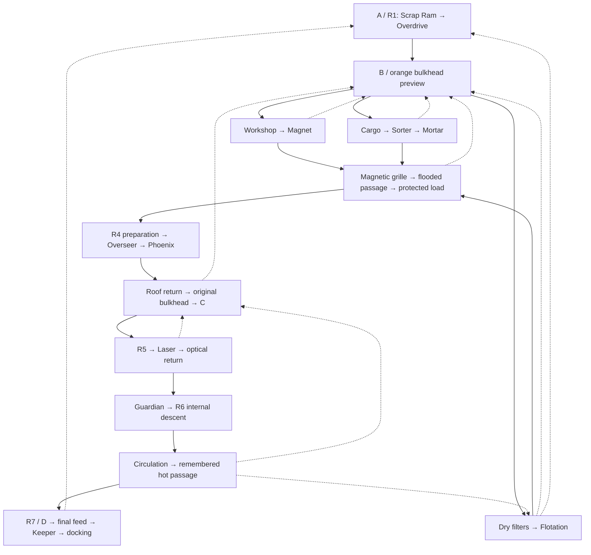

# Tankle Adventure — Astra — Game Specification

A lonely, wordless tank Metroidvania in a cooling mechanical city. This document describes the current agreed design. Region IDs name geography, not visit order. Combat values are balance rules; travel-time and architectural targets guide composition rather than impose timers or uniform room dimensions.

## Contents

1. [Identity and story](#1-identity-and-story)
2. [Controls and core systems](#2-controls-and-core-systems)
3. [Abilities](#3-abilities)
4. [World and progression](#4-world-and-progression)
5. [Machinery](#5-machinery)
6. [Combat](#6-combat)
7. [Regional journeys](#7-regional-journeys)
8. [Optional equipment](#8-optional-equipment)
9. [Ending](#9-ending)
10. [Presentation and interface](#10-presentation-and-interface)
11. [Experience criteria](#11-experience-criteria)

## 1. Identity and story

### Scope and principles

The connected journey has seven regions, exactly four Repair Hives, eight abilities including the starting Cannon, seventeen enemy types, five mandatory Bosses, ten optional equipment discoveries, optional restoration scenes and one voluntary ending. The Empty Hoist is distributed machinery, not another region. Exact campaign duration and room counts remain open.

- **Discovery:** show an obstruction before its solution; a new ability changes familiar geography. Composition guides without quests, objective arrows or forced gameplay camera moves.
- **Purposeful places:** freight, cooling, testing, cultivation and communication determine buildings and routes. Each major room offers something to notice, try and change. Machinery affects usable space, cover or sightlines.
- **Physical abilities:** every acquisition serves exploration and combat. Gates express material, force or geometry; physically valid alternative solutions remain valid.
- **Tactical combat:** readable complementary threats change movement, priorities and Heat spending. More HP, endless waves and hidden damage quotas do not substitute for decisions.
- **Useful returns:** an earned connection reveals a familiar place from another side and removes a real detour. Refuges are anchors, not compulsory stops after every reward.
- **Wordless expression:** shape, motion, sound and symbols explain the world. Machines neither speak nor lead the player. Menus, maps and equipment use concise English; acquisition information explains benefits, not route solutions. English is the only supported interface language.

The Tank drives on supported floors, ramps, moving platforms and water enabled by Flotation; it cannot jump, fly or leap gaps at speed. There is no ammunition economy, currency, experience, corpse retrieval, field-healing supply, equipment-slot restriction, mandatory restoration percentage, additional ability or alternate ending. Hazards do not teleport or bounce the Tank to safety.

### Story

Factories, transport, gardens and observatories once shared a central furnace. Heat travelled outward; coolant and reclaimed material returned. The builders are gone, and their origin and disappearance remain partly unexplained.

Surviving machines inherited two duties: sustain the furnace and repair machines that can work. Failing regulation made more scrap prolong operation without restoring efficiency. The city consumed idle equipment, peripheral facilities, then active machines. Repair Hives preserve the Tank while reclamation systems destroy it: both follow authentic duties the city can no longer fulfil together.

Earlier mobile prototypes reached the furnace as replacement drive and regulator assemblies, then wore out. Their retired hulls, cradles and sockets remain. The player is a rejected chassis able to accept incompatible prototype modules. That apparent defect permits the final drive-and-circulation combination; exploration earns it, rather than prophecy or a secret identity. Docking connects a working assembly to existing fuel and stored heat, not limitless energy. Future decline remains possible.

| Journey stage | Immediate motive | Discovery |
| --- | --- | --- |
| Foundry | Escape recycling | The factory rejects the Tank; repair preserves it |
| Middle-stage entrance | Find passage beyond the orange bulkhead | The factory belongs to a larger connected system |
| Three middle expeditions | Restore local movement in a chosen order | Freight, water and testing occupy layers of one structure |
| Phoenix, optics and circulation | Reach the deeper city | Failed vehicles share the Tank's sockets; light and coolant regulate the core seen below |
| Completed machine | Carry Heat through previously unsustainable routes | The assembled body can sustain the furnace connection |
| Final choice | Defeat Keeper, inspect the socket, decide whether to dock | A familiar repair-shaped interface needs the Tank's drive |

Recurring motifs carry this change: repair arms and sockets progress from safety to connection; inward empty carriers reveal reclamation replacing distribution; discarded hull mounts reveal predecessors; outward optical pulses continue without reply; a machine repeating a failed task offers an act of care; the red hull changes from combat risk to sustainable connection. Empty carriers, unanswered signals and patient repair arms establish loneliness, mystery and occasional tenderness. Optional scenes deepen this reading without holding essential plot information. Small acknowledgements use a light, head turn or resumed task.

## 2. Controls and core systems

### Input and cameras

| Default input | Action |
| --- | --- |
| W / A / S / D | Camera-relative direct movement; normalized diagonals |
| Mouse | Independent aim; third-person mouse look |
| Left mouse | Fire selected weapon |
| Right mouse | Magnetic Traction |
| Q | Cycle acquired Cannon, Mortar and Laser |
| Shift | Hold grounded acceleration; Phoenix upgrades this action |
| F | Toggle Flotation |
| E | Contextual use, including repair and deliberate final docking |
| Tab | Toggle map |
| Escape | Pause and settings |
| Space | Skip death; the ending also offers Skip |

Bindings are remappable. The hull turns toward travel while the turret aims independently; this is direct movement, not tank steering. Direction changes remain responsive during boost. Stationary input and pushing against walls cannot build a run-up. Weapon switching preserves Heat and recovery and does not retarget launched shells. All owned abilities remain available.

Third person follows behind and above the hull with one centred reticle. Mouse look remains independent of hull heading and works smoothly while firing or pulling, regardless of input order. Looking up cannot turn the camera into the ground or hull. Ramps and lifts preserve the movement frame. The reticle stays at the screen centre.

Settings show an unobscured paused-scene preview. The driving camera remembers pitch, follow distance, height, shoulder offset and mouse sensitivity. Driving and ending shots share a radial render distance of 230 units by default. Reset restores the camera defaults. Third-person defaults: **pitch 15.3°, distance 15, height 2.5, shoulder offset 0**. Mouse sensitivity is **1–10, default 3**, corresponding to the former 1×–10× response without a multiplier label. Presentation settings do not change gameplay values.

Clicking the playfield captures the mouse; pause and map release it. Without capture, middle-button drag turns the view alongside weapon inputs. One pause action opens settings, including while captured. The active playfield hides the native cursor. Gameplay never pulls the camera toward a solution. Wall and ceiling contact can shorten the camera arm along the requested sightline. After contact the arm holds its shortened length for 0.18 seconds of clearance before easing out. The field of view stays fixed. See [presentation](#10-presentation-and-interface).

### Aim and damage feedback

Cannon and Laser elevate/depress at most **40°** and remain level across same-height floor. At the boundary, barrel and firing direction stop while the reticle remains continuous. No angle-limit text or second ground cursor is shown. Required targets have supported firing positions within these limits. Visible surfaces agree with aim: translucent foreground cannot select an unrelated hidden floor, and transparency never removes collision. Floors, cover and roofs block real attacks.

| Hull rule | Value |
| --- | ---: |
| Starting maximum | 5 segments / 25 HP |
| Fully collected maximum | 10 segments / 50 HP |
| Post-hit recovery and protection | 0.6 s |
| Player damage radius | 0.8 units, inset from hull |
| Enemy and weak-point hit allowance | Radius 15% larger than target |

Damage volumes do not replace solid-body collision or bypass armour. A damaging hit adds an impulse away from its source: about **1.2 units in the first 0.18 s**, stopped by walls and unsupported edges. It combines with driving without resetting speed or disabling steering, boost, aim, equipment changes or interaction. During recovery the hull blinks and cannot be damaged by further attacks; Cannon, Mortar, Laser and Magnet are disabled, then held fire resumes. Repeated hits do not extend recovery. Low HP changes lights, exhaust, accents and HUD colour, not control responsiveness.

### Shared Heat

| Rule | Value |
| --- | ---: |
| Range / Overheat begins | 0–100 / 100 |
| Overheat releases | At or below 30 |
| Weapon/tool cooling delay | 0.75 s |
| Cooling after releasing Boost | Immediate |
| Cooling rate: base / filter upgrade | 50 / 62.5 Heat/s |
| Active acceleration or maintained boost | 15 Heat/s |

Weapon and boost costs add. Releasing Shift stops engine Heat and cools immediately despite coasting speed, but does not cancel the delay from a recent weapon/tool use. Four consecutive cold Cannon shots are safe; the fifth overheats.

Overheat locks weapons and Magnet. Ordinary movement and Flotation remain usable; acceleration requires Circulation. With Circulation, boost can continue or restart and maintain red heat indefinitely. Displayed Heat caps at 100 without hidden self-damage or forced stops. Release allows deceleration and cooling.

An unlabelled clockwise ring around the sole reticle changes pale yellow → orange → flashing red, remaining red throughout Overheat. Steam, engine pitch and the Circulation hull reinforce it. Blue is reserved for magnetic affordances.

### Repair, death and persistence

On death, the Tank reconstructs at the last Hive the player activated. The Old Repair Room is the starting anchor. The four refuges in [world and progression](#4-world-and-progression) offer repeatable repairs. Approaching opens the Hive; activation unfolds tools, sweeps maintenance light across the hull, restores HP and Heat, saves progress and pulses the world to communicate ordinary-enemy reset. Repeat repair may shorten animation; reconstruction uses the full cycle.

On its own floor, an active Hive reserves **18 units free of enemies, measured to body edges**. Spawns, reinforcements, patrols, pursuit, charges, pulls and drifting mines respect it. Entering the inner **5-unit** maintenance area ends pursuit; mobile enemies return home. A thin mint ring marks protection: incoming/outgoing attacks dissipate with sparks and a blocked sound; blast and contact cannot hurt the protected Tank. Magnet can operate machinery but cannot attack outside. Mortar preview shows boundary interception. Holding fire does not remove protection; leaving restores normal reach and vulnerability. Protection does not extend across floors.

At zero HP, tracks stop, turret drops, lights extinguish and smoke rises. Music immediately stops and discards the failed encounter's continuation; machinery remains audible. A brief held view precedes a Hive-shaped iris closing and reopening around the reconstructed Tank. The sequence lasts about **three seconds**, is skippable, restores HP, clears Heat and retracts Flotation. Exploration music restarts from the beginning of the track selected according to permanent acquisitions, as defined in [music](#music).

| Persists through rest, death and reload | Resets with the encounter |
| --- | --- |
| Abilities, equipment, active Hives, discovered geography | Ordinary enemies and temporary damage |
| Open routes, completed machinery and restoration | Projectiles, mines, active fuses, combat crates and pressure vessels |
| Supported magnetic-object positions | Temporary shield exposure; enemy plates return with their bearer |
| Defeated persistent Bosses, completed finite courts including reserves | Unfinished Boss seals and reserve deployment |
| Journey completion and circuit transmission progress | Other transient combat states |

Incomplete machinery must retain a supported local retry. Rest cannot reconstruct permanent barriers. Armour pickups fill only the newly added segment; repair/reconstruction fill the earned maximum.

## 3. Abilities

| Ability | Acquisition | Exploration / combat purpose |
| --- | --- | --- |
| Standard Cannon | Starting equipment | Break exposed supports, scrap and impact mechanisms / reliable direct fire |
| Overdrive | R1 Scrap Ram | Reverse conveyors, use momentum machinery / evade, reposition and ram |
| Magnetic Traction | R2 workshop | Remove blue locks and reposition selected cover / strip shields, pull light enemies, disarm mines and intercept shells |
| Flotation Chassis | R3 dry filter ferry berth | Cross the water network / change firing banks and avoid physically lower floor hazards |
| Mortar | R2 cargo installation after Sorter | Reach protected overhead targets / delayed attacks over cover |
| Phoenix Engine | R4 after Overseer | Break momentum shutters and use express routes / destroy ordinary opposition at full speed |
| Laser | R5 after Phoenix | Reach receivers through mirrors / precise sustained and reflected weak-point damage |
| Water Circulation | R6 after Laser and Guardian | Sustain hot routes and release thermal machinery / doubled red contact against all enemy categories |

Phoenix upgrades Overdrive's existing input but counts as an acquisition. Circulation is passive. Acquisition routes and first-use lessons are defined only in [regional journeys](#7-regional-journeys).

### Weapon values and behaviour

| Parameter | Cannon | Mortar | Laser |
| --- | ---: | ---: | ---: |
| Base damage | 1 per hit | 2 per blast | 3/s |
| Heat | 20 per shot | 35 per launch | 24/s |
| Minimum firing interval | 0.5 s | 1.05 s | Continuous |
| Base reach | About 24 units from hull | 24-unit landing distance | 90-unit total path |
| Additional limit | Straight flight | 1.15 s nominal flight, 10-unit rise, 3-unit blast radius | Up to 5 reflections |

**Cannon:** held fire repeats at cadence. Straight shells have no gravity, guidance, charge, reload or alternate ammunition. Ordinary cover stops them; designated scrap, supports and paddles respond physically. Recoil and scorch marks communicate impact without making ordinary walls destructible. Mobile targets and brief windows keep Cannon useful after other weapons.

**Mortar:** the launch-time aimed surface determines the arc, **actual collision determines explosion**, for player, ordinary-enemy and Boss shells alike. Contact with terrain, walls, ceilings, machinery or damage volumes detonates. A missing/moving support lets the shell continue forward under gravity; shells lost outside playable space disappear without a blast. Elevated trays are real aiming surfaces. Blasts respect solid cover. Overhead hits bypass ordinary frontal guard plates but not Boss roof armour. Survivors stagger as specified in their [enemy entries](#enemy-catalogue). Mortar does not home or pass roofs because the cursor lies beyond them.

Mortar aim uses the normal reticle plus a light curved guide and dashed landing/blast ring. Forecast the continuing arc to its first collision, including lower floors beyond the intended point. Early interception shortens the guide and makes the ring amber; no predicted collision means no ring. A small vertical impact-camera view centres its crosshair on that same first collision and shows nearby terrain. It turns amber on interception and blanks when there is no return. Preview neither locks moving enemies nor promises damage through walls.

**Laser:** holding fire sustains a beam. Opaque structure and nearer bodies stop it; reflection follows actual faces, including tilted or enemy-mounted mirrors. Reflected damage direction is the **last arriving segment**, not the player's position. Selecting Laser shows a thin dashed actual-path preview and final contact light: no Heat, damage or activation, available during Overheat, removed on switching, death or docking. The damaging beam follows it, retaining a faint guide where foreground obscures segments. The preview never moves the reticle or selects a target. Mirror puzzle rules are in [machinery](#5-machinery).

### Overdrive and Phoenix

| Engine parameter | Value |
| --- | ---: |
| Normal speed | 10 units/s |
| Overdrive maximum | 1.6× |
| Acceleration | 1.2 multipliers/s; 1.0× → 1.6× in 0.5 s |
| Release deceleration | About 1.71 multipliers/s; 1.6× → 1.0× in about 0.35 s |
| Ordinary offensive ram threshold | 1.3× |
| Phoenix maximum | 3.2× / 32 units/s |
| Phoenix run-up from normal travel | About 1.83 s / 38.5 units |
| Authored full-speed approach | At least 40 usable straight units plus safe braking |

Boost requires movement input. Re-engaging during deceleration resumes from the current multiplier. Turning remains responsive; acceleration gives no invulnerability, flight, wall passage or water support.

Ordinary ram destroys a scout and deals one Cannon-equivalent hit to a turret or unshielded guard side, losing speed against survivors. An intact guard front stops the Tank without body-contact damage. Ordinary engine contact cannot damage major Elites or Bosses.

Phoenix preserves acceleration and Heat rules. At the HUD's full-speed threshold, twin pale-yellow flames stream behind the hull and pulse gently; they disappear below threshold or on death. Full speed breaks eligible barricades and destroys ordinary enemies, including guards and mirror inspectors, preserving momentum through destroyed bodies. Major structure remains solid and stops speed. The high contact tier is **12 damage** before Circulation; armour and durability are specified in the [enemy entries](#enemy-catalogue). Cold Phoenix does not bypass Boss armour or become a mandatory Boss attack.

Express routes connect actual neighbors through player-controlled travel, with long readable approaches, broad turns, physical guide rails and braking aprons. Broken shutters and service returns stay open. Normal routes fit the pre-Circulation Heat budget without mandatory repeated cooling stops.

### Magnetic Traction

| Parameter | Value |
| --- | ---: |
| Acquire / retain dragged object | 17 / 22 units; removable enemy plates acquire at 27 |
| Empty scan / connected pull Heat | 3 / 12 per second |
| Driving during traction | Normal speed |
| Movable cover travel | 12 units/s, clearance-limited |
| Remove ordinary machinery lock / enemy shield | About 0.6 / 0.7 s |

Blue grips, removable plates, mines and interceptable shells share a material language. Held input always scans with rings and sound, even without a target. A connected tether pulses toward the Tank and visibly strains the object without attracting the reticle. Walls, intervening cargo, release, excess reach or deliberate disengagement break it. Traction occupies the weapon and stops on Overheat with a short red failure pulse.

Ordinary locks loosen, tear free and fall beside their socket; the fixed lamp turns green and release persists. Early release lets an unfinished pull settle back. Any clear reachable approach works; no hidden rail-axis/standing-position test. Heavy machinery responds through its coupling, not by flying toward the Tank.

Only repeatedly repositioned objects need rails: the cooling-passage barrier and Sorter shield, with optional mirror carriages using the same rules. Both ends have blue grips. Once acquired, moving or turning within reach does not drop the tether. Pulling moves the solid object toward the Tank, preserves partial position and pushes movable enemies along support without trapping them against walls. At obstacles, end stops or player-clearance limits, an immediate stop pulse/sound replaces pulling feedback and **Heat stops accumulating**; backing away resumes without reacquisition. Objects remain retractable and cannot cross unsupported edges. The test-bench crate is fixed cover.

A shield tears aside and briefly staggers its bearer; it stays absent until encounter reset. Pulling can interrupt a clamp charge. Mines can be pulled/disarmed or shot outside their blast; blue shells can be intercepted. Flanking and cover remain alternatives. Magnet never grapples the Tank or tows it through voids. Moving a mirror changes position; rotation requires a visibly converting mounting.

### Flotation Chassis

F mechanically deploys paired pontoons, without Heat cost and even during Overheat. Deployment cancels boost; acceleration remains unavailable while deployed, including on land. Water cruise is **1.15×** normal speed; deployed land travel is **0.75×**. Retraction requires support under the entire hull; attempts over deep water produce a short sound and warm ripple while remaining deployed, with no sinking timer, hidden damage or teleport.

Ordinary tracks cannot cross unsupported water at any speed. Floats follow connected water and real low banks/ramps, not walls, voids or unrelated heights. Currents are readable and escapable/reversible. Weapons retain normal rules; projectiles, beams, blasts and overhead shells remain dangerous. Only physically lower contact hazards can be avoided. Wheels stop on water; wakes and a softer engine distinguish travel. Eligible red contact still works afloat, but grounded engine boost does not.

### Water Circulation

A passive closed coolant loop uses jackets, moving pipes and steam; no new input, water meter or refill. It neither instantly cools the Tank nor restores ranged fire during Overheat. The engine can continue/restart while Overheated. The hull remains red until the shared recovery threshold, including during cooling; this visible state defines contact eligibility.

| Contact tier | Red damage |
| --- | ---: |
| Low speed | 2 |
| Offensive acceleration | 4 |
| Full Phoenix | 24 |
| Same-target repeat interval | 0.5 s |

The multiplier applies once to positive base contact tiers. All enemy categories qualify, including shields, Scrap Ram and Bosses; ordinary ram immunity does not cancel Circulation. Bodies remain solid and hostile damage still applies. Staying hot trades ranged fire for contact and travel; cooling restores fire. Maximum speed and acceleration do not change.

## 4. World and progression

### Site, layers and refuges

The city occupies a horseshoe industrial excavation around a furnace shaft, crossed by a broken transport bridge. The Foundry lies under the southern transit deck, Gardens in the western basin, Testworks through the rear/west cliff to the roof, and optics/circulation in one eastern structure above the central furnace. Routes follow freight, drainage and maintenance. Scenic distance suggests a larger civilization without making every platform playable.

R2's turntable is the reference height. Neighboring authoring bands begin about eight world units apart, with smaller local offsets; these are not identical storeys or player-facing floor numbers. Real walls, floors, water and landings define access, not matching height alone. R1's recycling furnace and R7's central furnace are different machines in the same material/Heat network.

| Region / map name | Height bands | Spatial relationship |
| --- | --- | --- |
| R1 — Recycling Foundry | -2 to 0 | Under R2 south; press foundation borders the garden canal; maintenance gallery faces loading works |
| R2 — Freight Exchange | -1 to +1 | Workshop, cargo decks and bridge underside overlap Gardens and Testworks approaches |
| R3 — Sunken Gardens | -3 to -1 | Western basin; connected water around -2; pump terrace meets the eastern retaining wall |
| R4 — Proving Grounds | -1 to +3 | Freight and water approach one lower installation; trial floor rises to the Phoenix roof return |
| R5 — Silent Observatory | +1 to +5 | Beyond the orange bulkhead; upper galleries overlook R6 and the core |
| R6 — Circulation Works | -5 to -1 | Below optics; internal descent, garden outlet and hot core route |
| R7 — Central Furnace | -7 to -5 | Predecessor rooms and core; old shaft rises to A below the press |

| Refuge | Identity | Expeditions |
| --- | --- | --- |
| A — Old Repair Room | Starting room facing the bent press | Foundry, Scrap Ram, later foundation returns |
| B — Central Transit | Split flywheel; orange bulkhead ahead, cage above, canal below | Three middle acquisitions and direct R4 retry |
| C — Eastern Distribution Hall | Beyond bulkhead, three coolant mains at the service junction | Optics, circulation returns and late revisits |
| D — Furnace Service Room | Deep core, empty predecessor berth | Final supply, Keeper and continued exploration |

Refuges are complete protected rooms with broken hostile sightlines. Other alcoves and visibly broken service fixtures do not offer healing or respawn cues. Shared landmarks are actual structures seen again: the press from A, beneath the garden canal and beside D–A; the flywheel from B, its bridge underside, Phoenix's roof return and B–C cage; coolant mains linking C, optics, circulation and the garden retaining wall. The furnace exhaust spine supplies broad orientation.

### Three progression scales

| Stage | Remembered boundary | Resolution |
| --- | --- | --- |
| R1 commitment loop | Entrance conveyor prevents ordinary retreat | Scrap Ram → Overdrive → short reverse lesson → reverse original entrance to A |
| R2–R4 nested stage | Orange bulkhead near B blocks visible deeper city; ordinary Boost fails | Independently acquire Magnet, Mortar and Flotation; combine them for R4; Overseer → Phoenix → roof return → break original bulkhead to C |
| R5–R7 progressive penetration | Optical descent unavailable, lower hot passage unsustainable, core visible above entry | Laser restores optics; Guardian admits R6; Circulation resolves remembered heat; existing tools restore final feed; Keeper → voluntary docking |

All seven acquired abilities and all five Bosses are required. **All six orders of Magnet, Mortar and Flotation are valid** with Cannon and Overdrive as the common incoming loadout. Magnet's garden connection is convenient, not the only Flotation entrance. Each partial expedition remains reversible without an unowned middle ability. Tools may improve another loop without gating its reward. Sorter can be postponed, but must precede Mortar.

Solid arrows describe dependencies, not mandatory hub visits; dotted arrows are earned returns. Workshop windows, the water circuit and freight outlook share actual spaces. The combined R4 approach physically requires pulling a grille, crossing water and lobbing onto a protected load to form supported ascent. Every completed step persists, and partial loadouts can retreat. No final door counts inventory. Phoenix alone resolves the original stage bulkhead; roofs, cages, tunnels, optional rewards and far-side latches cannot bypass it early.

### Returns and pacing

The permanent refuge ring is **A–B** through the original workroom ascent after Boost; **B–C** through the Phoenix breach and later cage; **C–D** through restored optical descent then thermal route; **D–A** through the shaft released from below. The garden far-bank loop links B and A. Local returns supplement this ring; exact openings are in [regional journeys](#7-regional-journeys).

Every Boss and every dense encounter, including optional fights and reinforcement waves, needs a short, safe retry. Measure from regained control at the last activated Hive to the first meaningful decision of the fight. Include travel, lifts, doors and combat on the approach. An earned return route should let the player bypass previously cleared fights and solved machinery.

Keep shortcuts sparse. Before adding one, identify the specific stretch of completed play it saves and the view or piece of machinery that makes arriving there memorable. Prefer one shared return for a workshop and its arena. Open it from the far side, frame a familiar landmark from a new angle, and make its destination recognizable before the player commits. Merge neighboring returns that save the same walk.

Inside-release doors generally become permanently bidirectional; their visible working face is accessible only from the earned side. A genuinely one-way carrier needs an independent visible return. Secondary approaches preserve the boundary they preview. Two equivalent slopes or parallel routes with the same exposure do not qualify as a shortcut.

| Composition target | Travel cost |
| --- | --- |
| D → Keeper | About 10–15 s |
| Completed first use → refuge or clear transport junction | About 15–35 s |
| Earned shortcut between the same landmarks | At least halves original cost |

Count ordinary waiting, missed departures, aiming and repeated combat. Targets never justify padding a first trip. Major fights offer an earned repair return before commitment; retries bypass completed puzzles and finite courts, using doors/ramps instead of compulsory lift waits. Returning to an area entrance is insufficient if the same long bridge still separates it from the useful destination.

### Exploration rules

A loop develops **notice → safe experiment → spatial/combat variation → acquisition/discovery → useful return**, without imposing a repeated room count. Acquisitions belong to working installations with a former user. Deep optional termini earn equipment, a lasting connection or a substantial discovery; shorten empty connections before expanding area. Place rewards in work recesses, corners or meaningful puzzle destinations, with playable separation and intervening development rather than arbitrary coordinate gaps.

Hard boundaries include unsupported water, visible momentum thresholds, protected overhead targets, optical paths and thermal contact; surrounding geometry must preserve them. Alternative approaches may change firing angle or reachable hardware without invisible immunity. Knowledge challenges ask players to recognize available actions, not hidden input recipes. Main-path openings have visible evidence. Critical objects remain recoverable; an optional enemy cannot be the only unrecoverable key. Every legal incoming loadout must be able to finish or leave a temporary commitment.

## 5. Machinery

### Interaction language and circuits

Gameplay switches respond **only to weapons**: Cannon/Mortar impacts, appropriate Laser receivers or Magnet on blue fittings. Hull contact and E do not activate switches. Repair, collection and final docking are separate. Decorations never copy usable target shapes.

| Visible form | Action / state |
| --- | --- |
| Recessed upright impact paddle, bullseye, spring or inclined door-top panel | Direct-fire activation; visible recoil, sparks and connected motion |
| Horizontal circular tray, open top and raised rim | Descending impact or exposed blast from above; sides/underside protected |
| Blue removable plate or U-shaped grip | Magnetic pull; dropped part stays blue, fixed socket lamp turns green |
| Framed mirror / circular collector | Reflection / optical reception |
| Four-mark mirror turntable | Cannon impact or unobstructed nearby Mortar blast rotates 90° in the same direction; repeatable, four turns restore orientation; Laser only reflects |
| Braced shutter, impact scars and visible approach | Momentum breakthrough |
| Heated load-bearing fasteners | Red-contact release with steam and separation |
| Mint ring | Repair safety and weapon boundary |

Shape states the action; **yellow means ready, green means operated**. A closed striped metal cover conceals an unavailable target until its prerequisite is restored. Visible recesses and backplates establish directional access; a shot reaching a working face cannot fail because of an invisible coordinate/floor test. Failed actions give material-specific resistance, impact or failure pulses. Local latches are embedded in the affected door/machine, visible from the usable approach in the driving view. Remove same-side door interactions with no traversal, discovery or tactical purpose.

Direct mechanical releases act immediately. Remote consequences have visible yellow cables/pipes ending at the actual object. The source latches immediately; green power advances along each branch, and **each destination activates when its own front arrives**, according to branch length. A nearby gate never waits for a farther branch. A local latch can open its own door immediately while its remote destination waits.

Wiring stays attached to floors, walls and frames, using simple axis-aligned north–south, east–west or vertical runs with necessary right-angle turns, not diagonal shortcuts or serpentine detours. Fixed wiring remains when doors retract or blue grips tear away. It cannot pass through closed machinery or leave disconnected floating lights. Saving/reconstruction retain incomplete transmission; completed links stay green without replay. Encountered distant links remain identifiable on the map.

Player attacks follow actual collision paths; earlier cover intercepts them. Enemy attacks do not solve progression. Major machinery changes support, access, cover or sightlines instead of merely animating beside an unrelated door. Use a few readable positions, visible stops and local recovery, not extra confirmation controls.

### Conveyors, loads and lifts

Conveyors exert a world-direction force on every body sharing support, including the Tank, enemies, movable cargo and wrecks on slopes. Ordinary opposing lanes run at **10.15 units/s**; Foundry and Keeper feed lanes at **3.2 units/s**. Walking loses ground against the former while Overdrive makes useful progress. Dark beds, side frames, end rollers, moving transverse treads and regular warm marks agree with real motion. Destroying a drive stops its belt for everyone and leaves the surface intact. Moving freight supplies changing cover; safe landings and combat/cooling bays divide long stretches.

Released lifts run automatically between stops, occupied or empty, waiting **three seconds at each endpoint and before first departure**. No E, call button, boarding trigger or destination menu. Partial boarding pauses departure; a fully supported hull near an edge rides normally. An absent platform leaves an unwalkable recessed shaft. Couplings release the whole service, which persists; local landings allow safe waiting without precision jumps. Boss retry routes obey the travel requirements above.

Loads settle onto visible supports in safe catch zones and retain local recovery. A release may start a return, complete a crossing, change cover, form ascent or expose an optical line; the visible tray action remains consistent. These uses must not strand the Tank or demand a second unrelated confirmation.

### Magnetic cover, water and optics

Only electrically linked docking machinery has a blue destination that turns green and a cable to its consequence. Pure physical slides have neither green goals nor electrical terminals. The cooling barrier reveals a doorway with jambs and floor markings visible **before** pulling. Sorter's shield interaction is defined in its [enemy entry](#sorter). Moving cover can change both player and enemy protection; stops preserve access and recovery. Pull behaviour is defined in [Magnet](#magnetic-traction).

Sluices change a real diversion plate between a few readable channel states. Water motion, debris and afloat forces agree: one channel calms while another remains fast. They never drain all Gardens or replace Flotation with a dry bypass. Currents are not a Circulation gate. Resting banks and alternative firing approaches make water a route rather than an obstacle strip.

Optical puzzles use broad visible mirror faces, receiver surfaces and openings, with stable supported shooting positions at a common useful height. Early tasks need one or two reflections. The challenge is discovering a route or changing orientation, not pixel aim, hidden standing points or simultaneous horizontal/vertical calibration. Mirrors remain visible from the driving position. A receiver's collecting face is its actual target; one hit permanently latches the result. Required mirrors are scenery, never a uniquely surviving enemy. Optional mirror carriages are positioned before firing; simultaneous traction and Laser are not required. Fixed mirrors stay fixed; indexed mirrors follow the table above.

### Thermal routes

Active hot floors use dark-red plates, pulsing orange grilles and sparse rising embers over the actual heated footprint. Heating rails add **28 Heat/s** alongside engine use, producing red contact during travel rather than idling against a shutter. Cold impacts recoil; red contact releases jammed fasteners. A restored cool bypass changes the same plates to dull green-grey and stops embers. Ordinary opposing-belt speed is retained rather than inventing a faster thermal conveyor.

The first Circulation operation establishes a supported bridge and return lift, with a far-side permanent cool bypass. Later local lanes let the player choose red contact through opposition or a sheltered cooldown for ranged fire. The final core approach is one continuous heated corridor with a full-width red barrier, no parallel cold lane or shootable bypass. Its destruction permanently enables the descent lift; D–A supplies the later ordinary return.

## 6. Combat

### Encounter rules

Combine a spatial pressure, a protected/mobile target and at least two meaningful responses. Ordinary groups usually use two or three complementary roles. Their arrivals and sightlines become readable before attacks overlap. Early heavy warnings take turns; authored late squads can overlap two **different** heavy threats, staggering starts by at least **0.5 s**. A third waits, and matching heavy weapons do not overlap warnings.

Enemies use sight, physical cover and remembered sightings, not unseen positions through walls. A visible target within 80% of weapon reach starts engagement even outside a local encounter marker; retain warning time, cover, refuge safety, arena commitment and reserve deployment rules. The four cargo emplacements acquire across their full 55-unit range, including the lower corridor. Mobile enemies pursue the last sighting for **eight seconds**, within **32 units** of home. Guards/welders advance during recovery, skirmishers strafe during bursts, ranged specialists reposition and repairers follow damaged allies; fixed guns remain fixed. Refuge entry ends pursuit. Ordinary encounters allow retreat and need not require extermination. Directional sound and edge warnings communicate relevant off-screen threats; unrelated floors remain visually subordinate.

### Shared combat rules

Movement and projectile speeds are in units/s, reach in world units and timings in seconds. Enemy HP and player weapon damage share a combat scale; incoming damage below is in hull segments, each worth 5 Tank HP. Listed HP values are absolute per placement, with no additional area multiplier. No enemy has a per-vulnerability-window damage quota.

Unless an enemy entry specifies otherwise, district initial readiness is 1.2–2 s, sight reacquisition takes 0.55 s, post-recovery pause is 0.25–0.45 s and Mortar flinch lasts 0.6 s. Readiness pauses precede, never replace, visible warnings. Blue remains removable Magnet material.

Both swimmers remain visible and damageable at the surface, follow connected water and the Tank's sluice currents, and have no submerged invulnerability phase. Their local pursuit and refuge boundaries remain in force.

All five arenas visibly seal with striped shutters and a mechanical cue only once the Tank fully enters. Dormant Bosses resist outside damage with protected-metal feedback. Seals persist through recovery and reserves; victory opens shutters and ends hazards, death/reload reset unfinished locks. Nearby refuges cannot bypass seals.

Boss projectile warnings last at least **0.85 s**, lock before release and show both firing origins when applicable. Barrage circles persist through flight. Reserve hatches warn **two seconds** before attack; reserves are finite. Main projectile Bosses offer at least **one second recovery**. The Boss HUD remains visible behind cover.

### Enemy catalogue

All enemy types and Bosses are defined here. Regional chapters specify placement and progression rather than redefining combat values.

#### Clamp Scout

HP: Foundry 1; freight and Overseer reserves 2; Testworks and Keeper reserves 3. Movement 5.6, charge speed 13, reach 11; warning 1.1 s, recovery 1.5 s. Committed charge deals 1 hull segment.

Low rust-orange jaws and a horizontal sensor identify a whole-body charge. Sidestep, bait solid cover and punish the stagger; retreating along its line remains dangerous.

#### Fixed Turret

HP: opening/workroom/bank/dispatch 2; optional workshops, condensate and spillway 3; yard and arsenal entrance 4; Testworks receiving 5; optical vestibule 6. Fixed position, reach 27; warning 1.2 s, recovery 1.5 s. Projectiles deal 1 segment.

Pale spindle/tripod with a coil hood; volleys cover a lane, followed by a cooling window. Cross between volleys, flank or counterfire.

#### Shield Guard

HP: opening/workroom/bank/benches/spillway 3; freight, reservoir and optical/coolant routes 5; Testworks service 7; cooling return 8. Movement 3.8, reach 12; warning 1.5 s, recovery 1.6 s. Projectile speed 15, damage 1 segment; frontal damage reduction 60%.

Broad refractory plate and narrow slit protect its advance. Frontal hits produce a pale flash, outward sparks and hard ricochet, distinct from orange damage feedback. Flank, lob overhead or remove a blue shield with Magnet.

#### Skirmisher

HP: workroom/freight/dock and opening dispatch 2; arsenal dispatch, reservoir, optional workshops and Overseer reserves 3; optical/coolant routes and Keeper reserves 4. Movement 6.2, reach 18; warning 0.8 s, recovery 1.4 s. Three-shot burst, projectile speed 15, damage 1 segment per hit.

Four wheels and paired guns; circles through bursts and reacquires visible movement between rounds. Evades visible airborne Mortars, never invisible aim input. Intercept its route or remove its supporting partner.

#### Rail Sniper

HP: freight/reservoir/early side rooms 3; optical/coolant routes 4; observatory north gallery 5; furnace receiving bay 6. Movement 2.8, reach 86; warning 2.2 s with final 0.8 s locked, recovery 2.2 s. Projectile speed 120, damage 2 segments.

Long raised rail and a red aiming line advertise the shot. Break sight with cover or leave the committed line before firing.

#### Artillery

HP: freight/dock 3; cargo battery, arsenal and coolant rig 5; Testworks impact court 7. Movement 2.5, reach 55; warning 1.4 s with final 0.45 s locked, recovery 2.8 s. Three staggered shells; arc height 9, flight 1.9 s, damage 2 segments per impact.

Raised mortar cup; brackets observed position and projected motion, then commits visible ground circles and arcs. Change movement after lock, rush the launcher, remove its spotter or intercept blue shells.

#### Miner

HP: Keeper reserves 3; freight and coolant routes 4; cooling west service 5. Movement 4.6, reach 13; warning 0.8 s, recovery 2.1 s. Mines deal 1 segment.

Retreats while throwing a limited field of blue discs that arm after landing. Shoot or extract mines, change approach, or advance before the field forms.

#### Welder

HP: Foundry/benches 3; condensate basin 4; coolant yard 5; cooling service/return 8. Movement 6.8, reach 18; warning 0.9 s, recovery 0.9 s. Flame damage 1 segment.

Twin bottles and a short nozzle. Tracks and advances for the first 0.55 s of warning, locks for the final 0.35 s, then sweeps for 1.8 s while advancing at 3.74 units/s without tracking. Sidestep, get behind or use solid cover; warning and flame both stop at cover.

#### Repairer

HP: mirror workshop 3; optical/coolant routes 4; western furnace feed 6. Movement 4.5, repair reach 10; warning 1 s, recovery 2 s. No damaging attack.

Tender arms and a green beam; follows and repairs living damaged allies at a finite rate with clear sight. Interrupt the beam, separate the pair or prioritize the Repairer. No resurrection.

#### Mirror Inspector

HP: mirror workshop/gallery 4; calibration route 5; optical collimator room 8. Movement 3.2, reach 16; warning 1.6 s, recovery 1.9 s. Two angled shots, projectile speed 15, damage 1 segment per hit.

Broad pale mirror reflects Laser by its real facing. Flank, lob overhead, use red contact or redirect Laser toward another target.

#### Canal Hunter

HP: first canals/reservoir 3; late condensate basin 4. Movement 6 afloat, 3.3 ashore, reach 24; warning 1.3 s, recovery 2 s. Two torpedoes 0.65 s apart at 12 units/s; torpedo and land-shot damage 1 segment.

Low amphibious hull, blue twin tubes and twin wakes. Strafes on water before committing straight non-homing torpedoes; solid cover and dry banks stop them, Cannon/Laser destroy them and Magnet intercepts. Uses low banks/ramps to move ashore, where turning slows and shots become ordinary straight projectiles. Stationary recovery rewards Mortar.

#### Dredger

HP 5. Water movement 2.4, reach 11; warning 1.2 s, recovery 2.4 s. Suction lasts 2.8 s, pulls at 2.4 units/s and causes no damage; a separate 0.8 s warning precedes one bite dealing 1 segment.

Broad pontoons, circular intake and removable blue grille. Remains afloat; suction holds a fixed forward sector without turning. Debris and floating wrecks converge visibly. Steering remains available and ordinary cruise escapes; dry land, another floor and solid cover block suction. Mortar interrupts. Magnet removes the grille until reset and causes a longer stagger, but later pump cycles resume; Magnet is optional for victory.

#### Interceptor

Hearth HP 12; movement 11.2, charge speed 26, reach 11; warning 0.75 s with final 0.35 s locked, recovery 0.75 s. Charge damage 1 segment. Initial readiness 0.4–0.7 s; sight reacquisition 0.2 s; post-recovery pause 0.12 s. Mortar deals full damage and causes 0.2 s flinch, after which the committed attack resumes without losing elapsed warning.

Red forward prongs; predicts observed movement until commitment. Brake or reverse late, bait cover, or punish recovery.

#### Bastion

HP: cooling west service 24; western furnace feed 27. Movement 7.6, reach 24; warning 0.85 s, recovery 0.75 s. Three-shot fan, projectile speed 36, damage 1 segment per hit. Frontal damage reduction 60%; blue shield absorbs 75% of cold Phoenix impact outside recovery. Initial readiness 0.4–0.7 s; sight reacquisition 0.2 s; post-recovery pause 0.12 s. Mortar deals full damage and causes 0.2 s flinch, after which the committed attack resumes without losing elapsed warning.

Thick side armour and a conspicuous blue front shield. Magnetic tension rocks the plate before tearing it off its mount and dropping it onto the floor. Magnet removal, overhead Mortar, rear shots, recovery windows and red impact counter it.

#### Siege Carrier

Cooling battery HP 20; movement 5, reach 55; warning 0.95 s, recovery 1.4 s. Six shells, arc height 9, flight 1.1 s, damage 2 segments per impact. Initial readiness 0.4–0.7 s; sight reacquisition 0.2 s; post-recovery pause 0.12 s. Mortar deals full damage and causes 0.2 s flinch, after which the committed attack resumes without losing elapsed warning.

Twin auxiliary mortar cups; current-position and projected-position markers lead to two staggered three-shell brackets. Prediction uses its own flight time. Change direction or stop after lock, rush recovery, use cover or interrupt.

#### Prism Sentinel

Observatory north gallery HP 20; movement 6.4, reach 32; warning 0.9 s, recovery 0.85 s. Four-shot fan, projectile speed 34, damage 1 segment per hit. Initial readiness 0.4–0.7 s; sight reacquisition 0.2 s; post-recovery pause 0.12 s. Mortar deals full damage and causes 0.2 s flinch, after which the committed attack resumes without losing elapsed warning.

Tall pale mirror ribs reflect frontal Laser. Reposition, lob over cover or attack its rear.

#### Flanker

HP: optical vestibule 15; furnace loading floor 18. Movement 12.4, reach 36; warning 0.55 s, recovery 0.7 s. Six shots at 0.18 s spacing, projectile speed 36, damage 1 segment per hit. Initial readiness 0.4–0.7 s; sight reacquisition 0.2 s; post-recovery pause 0.12 s. Mortar deals full damage and causes 0.2 s flinch, after which the committed attack resumes without losing elapsed warning.

Burgundy panels and twin antennae; reacquires visible movement between rounds, strafes through firing and recovery, and evades visible airborne Mortars. Direct fire, interception or Mortar where terrain restricts motion are effective.

#### Scrap Ram

**Boss; guards Overdrive.** HP 9. Spread projectiles and committed charges each deal 1 segment.

The pressing carriage uses a three-shot fan, a tracking burst, a straight ram, close-range reverse and lateral reposition. Below 55% hull it can chain two charges, each with its own warning. The rear takes full damage at all times. The front takes 40% while plated. Bait a collision to lift the radiator lids and cancel the follow-up, or attack while it reverses or travels sideways.

#### Sorter

**Boss; guards Mortar.** HP 12. Arm sweep and ground barrage each deal 2 segments; barrage arc height 10.

The freight machine winds its steel arm for a forehand, backhand or telescoping thrust. At range it lays shells across the lane, walks them along the lane or brackets both sides before striking the centre. Ground markers show the committed impacts. Flank its gearbox for full damage. Catch the actual arm on the movable rail shield to arrest it for two seconds and expose the drive from the front. Cannon and driving suffice. Magnet lets the player set the stop.

#### Overseer

**Boss; guards Phoenix.** HP 14: two side batteries at 4 each, core 6. Fans/battery shots deal 1 segment; aimed barrages deal 2, with arc height 10.

Each side battery protects its breech from the front until it fires. The recoil opens that shutter for 1.35 seconds. Its outer cylinder can also be attacked from the corresponding flank. The batteries stagger volleys, cross fire, place paired precision shots, or lay shells across, along or around a lane. Destroying one cancels its pending shots. Both destroyed permanently expose the core, which retains a fan and indirect fire. One finite light reserve pair deploys below 60% HP.

#### Optical Guardian

**Boss; guards first R6 entry.** HP 36; front, sides and roof armoured, rear vulnerable. Recovery 2.2 s. Five-lane fans deal 1 segment; paired seekers deal 2.

Tracks between attacks, then holds facing through warning, attack and recovery. It uses fans, paired precision shots, crossing bursts, seekers whose bounded turning ends before impact, and lateral repositioning when crowded or screened. Two broad flank-rear mirrors each permit a single-bounce rear shot from the approach. Dodge, then aim during stable recovery; red contact follows the universal rule.

#### Final Keeper

**Boss; victory enables voluntary ending.** HP 63: two feeds at 6.75 each, core 49.5. Fans/battery shots deal 1 segment; seekers, barrages and exposed-core sweep deal 2. Barrage arc height 10.

The port feed powers paired seekers, walking shells and bracketing salvos. The starboard feed powers battery volleys, crossfire and cross-lane barrages. Either feed takes damage continuously. Destroying one removes its attacks and interrupts its unlaunched shots. The exposed core uses precision pairs, fans, a traversing heat beam and ground attacks. Below 40%, its fan can overlap a delayed ground strike. Reserve pairs become eligible at 65% and 32%; at most two are alive/deploying. Destroy feeds to stop their belts and open flanks; once both are gone, the core remains vulnerable even during attacks.

Target duration is 20–40 seconds with ordinary or fully reinforced weapons, without a forced timer or phase damage quota. Endurance belongs mainly to the core; feeds dismantle quickly. Warned indirect fire counters permanent crate shelter using sightings or incoming fire, never unseen movement through walls. Mortar, relocation, reflection and red ramming remain useful. Full-speed red damage carries through a destroyed feed into the core; three clean impacts can win, without a component cap.

### Encounter allocation

Foundry introduces Scout, Turret, Guard, Skirmisher and Welder; freight/water add long aim, artillery and mines; optics/late industry combine reflection and repair with familiar threats. Early revisits retain ordinary defenders.

A bank-visible patrol previews water combat without blocking dry acquisition. Preserve the first Flotation crossing. Later introduce a lone Hunter with a pier, then a lone Dredger in a separate pump pocket. The optional condensate basin combines one each with cover and two banks, staggering suction before the Hunter commits. Calm canals separate encounters; required water routes are not extermination gates.

| Encounter | Roster / total HP | Spatial decision |
| --- | --- | --- |
| Optical vestibule | Flanker + ordinary Turret / 21 | Nine-unit roof favors mobile Cannon; bounded pursuit, relief before gallery |
| Observatory north gallery | Prism + Rail Sniper / 25 | Open Mortar arc, long wall breaks rail line; pair activates on own approach or provocation |
| Cooling west service | Bastion + Miner / 29 | Nine-unit roof; shield removal, flanking, direct fire and mine clearance; stays west |
| Separator battery court | Siege + Welder / 28 | Open counter-battery arc; separator and turn divide it from shield lesson; activates on approach/provocation, no kill-count screen lock |
| Furnace receiving bay | Interceptor + ordinary Rail Sniper / 18 | Broad charge introduction; both stay in bay, pause in connecting passage |
| Furnace loading floor | Flanker + Interceptor / 30 | Open east loading area supports direct fire, Mortar and red impact; combines two previously introduced enemies, no extra support |
| Western furnace feed | Bastion + Repairer / 33 | Nine-unit roof, shield/support priority; stays west of transfer partition; final optical work and quiet Boss approach follow without another wave |

Middle acquisitions assume only Cannon/Overdrive and base hull. Magnet's dispatch pair, gantry shield/sniper and open-roof assembly artillery are separate fights. Reservoir's first sniper is on a reachable bank behind short cover, with the filter-bank pair later. The cargo battery intentionally cannot be countered on first passage, but retreat stays open. Other branch abilities help without becoming hidden entry requirements.

### Damage and environment

Ordinary body contact, failed shield rams, charge anticipation/recovery and suction cause no damage. Harmless bodies still block/displace without consuming protection. Mortar direct and blast cannot charge twice for one impact; beams and continuous attacks also respect hit protection, not damage per frame. Enemy projectiles stop at the first body, dealing **one Cannon-equivalent** friendly damage before armour. Enemy Mortar blasts deal **three** to other machines, excluding their launcher; neither operates switches.

Player arcs follow [abilities](#weapon-values-and-behaviour); enemy arcs are specified in their catalogue entries. Required shots use open roof bays when clearance is insufficient, rather than flattening arcs below cover. Low protective canopies still block both sides.

Wood-braced crates have **2 HP**, breakable by fire, rams or committed charges; steel remains solid. Charge warnings show the whole swept body and path ends. Pressure vessels ignite on first hit/ram and explode after a full **0.8 s** fuse, within **5.5 units**, for **3 enemy damage / 8 Tank HP**. Extra shots do not shorten the fuse; each chained vessel warns for its own full duration. Cover intact at blast onset protects even if that blast destroys it. Combat props reset; route restoration does not.

Shallow furnace spill is traversable and deals **5 HP every 0.5 s**, independently of ordinary hit protection. Physical exit ramps remain available; acceleration shortens exposure without automatic rescue.

## 7. Regional journeys

This section owns local layouts, acquisition lessons, returns and narrative/architectural identity. Global interaction and combat rules apply without being restated. Transitions reuse actual connections: a shared structural element remains visible as material wear, enclosure and sound change. No new corridor is added solely for a transition.

### R1 — Recycling Foundry

**Building:** a bent press spans recessed production pits. Its legs define boundaries and maintenance lanes; supported conveyor frames cross pits. Thick dirty refractory courses, teal housings, soot above exhausts and cargo abrasion distinguish work from quieter service areas. Roof gaps light worn edges; furnace mouths give local warmth against cool fill. Press blows and conveyor clatter organize the line. The opening doorway at A frames the real press later recognized beneath the Gardens and beside the deep shaft.

**Route:** A faces one shared ramp with a downhill conveyor. Solid sides prevent walking around it or leaving sideways; the lower landing enters press-side bays, freight underpasses and an open machine court. A visible Scout introduces threat before attacking. Passing cargo interrupts a Turret's line, allowing following cover or moving to a firing position.

A visible shot switch powers only the first door, which opens onto a permanently level service passage. A second local switch independently powers the Boss entrance. There is no combined requirement or first-switch branch to that entrance. The separate return mouth has a one-sided door **before** its conveyor, so early visitors can turn back. Its latch is embedded only on the Boss-return face; Scrap Ram's original victory exit remains a separate automatic shutter.

**Acquisition and return:** Scrap Ram's court has solid charge obstacles, clear flanks and a visible Overdrive cradle. Victory opens its exit. Workers stay on their floor rather than pursue into the reward/lesson. The quiet cradle leads to a short, level reverse belt with safe run-up and a start apron that catches failure. Its service passage passes below the upper entrance corridor and reconnects to the **foot of the original ramp**. Cool while traversing, open the embedded shortcut latch from inside, then reverse the original downhill belt to A. Both belts keep running; the circuit uses neither another ramp/lift nor an ordinary bypass.

**Onward and later return:** from A, Boost now crosses the separate northward opposing belt into the former Overseer workroom: a Turret covers open floor, a Skirmisher pressures the other flank, and a Guard protects the ascent to B. They remain in the workroom, away from the belt, ascent and Hives; the exit stays open without waves or a kill gate. Only the original workroom ascent reaches Transit; inside service releases make return ordinary. This ordinary encounter, B and the middle expeditions separate Scrap Ram from the next Boss.

An early scrap-inspection alcove off the first-door service lane overlooks water separating it from the Transit shore ramp. That water prevents an opening bypass; Flotation later makes it a bidirectional return without a door or Boss-state check. The separate garden-side east door also reconnects to A later. Preservation and reclamation remain an observed contradiction, not exposition.

### R2 — Freight Exchange

**Building:** broad roof trusses span parallel freight lanes; work lights emphasize direction. Solid rack bases stop fire, open upper frames preserve orientation, and lower side stores provide close corners, loading openings and inspection pockets. Crane bridges stay at roof edges. Worn steel, dusty pale margins, scraped loading faces and hollow carrier sound distinguish this station from Foundry pits. The split flywheel interrupts the axis and identifies B; empty inward-facing clamps suggest distribution becoming reclamation.

**Stage entrance:** after repair at B, the first exit frames the orange structural bulkhead toward a visible eastern continuation. A failed Boost impact communicates insufficient force, with a future acceleration approach intact. The roof cage is visibly held from the far side. Workshop, cargo and dry water-side routes offer independent leads, not a three-item checklist.

**Magnet expedition:** the near workshop door's blue retaining fitting is visible before the longer assembly approach. Dispatch combat, the gantry shield/sniper and a separate open-roof artillery position develop movement with the common early loadout. Suspended fittings, occupied berths and windows onto the water make this an assembly bay rather than an empty ability hall. Its cart, two track junctions, destination berth and raised reward lift are locally visible.

Shooting paddles flips track blades once; a yellow-to-green connection stops at the junction pivot, while paired metal tongues show route direction. A Cannon hit releases the parked carrier's brake; it travels **four units/s**. Correct docking operates the catch lowering the visible Magnet module with its neighboring platform. Arrival makes it reachable without another confirmation. Wrong routing returns to the start. Shooting the signal recalls a moving carrier but never launches a parked one; shooting the moving cart cannot reverse/restart it. Track settings lock in transit, and occupied track pauses travel. Unfinished delivery retries locally with recognizable settings; completed docking stays secured.

Acquiring Magnet resolves the **earlier near-door fitting**, completing the workshop return to B. The automatic assembly carrier supplies moving cover and an open side passage without another switch. The garden circuit can later release the workshop rear opening; Magnet offers a nearby garden convenience connection, not its exclusive entrance. A small maintenance arm/rail remains optional care, separate from the reward puzzle.

**Mortar expedition:** four elevated artillery positions, two per side behind high breastworks, overlook the descending cargo corridor. Visible observation heads/tubes and staggered warnings make the first passage understandable but unanswerable with Cannon. Traverse warnings rather than attempt extermination; retreat and a lower observation/turning bay remain open.

Past an opposing belt and cooling apron, cargo staging bends to an open-top loading well overlooking Sorter's arm and cover from the driving position. Before commitment, a local release opens the service lift to B, avoiding the artillery corridor on return; retries still meet the global short-route requirement. Sorter is beatable without either other middle reward. Victory leads through a quiet enclosed corridor to Mortar.

One safe lob into a horizontal tray behind a low screen retracts the local obstruction and releases **both** the return lift and familiar upper freight load through their own cables. The load settles on visible supports to complete the crossing; no second tray or confirmation is needed. Players can then revisit the corridor and lob over all four breastworks from generous positions. Clearing this finite battery stays completed and opens Cannon reinforcement stores at the upper freight spur; deferring it still permits the return near B. If Mortar is acquired last, its first use, optional artillery reversal, combined inspection route and R4 preparation still separate the two Bosses.

**Cross-connections:** freight openings preview R4's raised load and observation windows without granting a dry bypass. Workshop windows and its rear water opening link directly into the garden expedition, so each return need not visit B. After Phoenix, the roof route returns to the original bulkhead; breaking it reaches C and allows the far-side cage release. An additional B–C express latch is released from C, independently of Sorter.

The cargo-battery readout shows four miniature Mortar emblems, one for each emplacement. Destroying an emplacement removes its emblem immediately. When all four are gone, the cable turns green toward the Cannon reinforcement store; the reward unlocks only when the signal arrives. The readout itself requires no interaction.

### R3 — Sunken Gardens

**Building:** flooded former lower rooms retain lintels, submerged beds and broken wall ends beneath freight bridges. Broad banks and supported inspection walks rise above water. Thin broken greenhouse ribs contrast with the station underside; surviving glass stays at view edges. Daylight and restrained water reflections reveal stained retaining masonry. Sparse growth clusters at leaks and sheltered beds; drips, water and distant overhead freight replace station acoustics.

**Acquisition:** the dry filter approach is independently reachable with Cannon/Boost. Bank turns preview debris-carrying water, the far inspection landing and B's actual bridge. One exposed sluice latch changes a diversion plate and flow; a later lateral current provides another traversal situation, not a duplicate adjacent control. The ferry maintenance berth houses Flotation beside a calm launch basin whose first landing is already visible.

**Development and return:** after the safe crossing, a bank Turret covers the short current-assisted route. A pump-island/filter-wall detour breaks sight and gives another firing bank. Later swimmers develop movement without assuming Magnet/Mortar. Floating beneath the familiar bridge reveals B from below; the far-bank latch opens a permanent dry inspection return. The workshop rear opening permits starting Magnet's expedition directly. Another channel reaches R4's inspection grille; until the combined tools are available it remains a reversible preview, independent of the completed Flotation loop.

The canal follows the actual press foundation to R1's service passage. From the far-bank care court, a south maintenance walk turns west to A's east door. Its full-width door exposes an embedded latch only toward the Gardens, preserves the initial commitment and permanently opens both ways without requiring the plant. Later tower descent reaches the upper inspection walk; the cooling outlet meets a lower height of the same retaining wall. The region has no Boss or extra Hive.

**Optional care:** two hinged gutters and low cranks connect a leaking pipe to a planter. Cannon paddles advance gutters through detents; actual falling water shows alignment, and wrong settings spill harmlessly. One shot breaks the rust plug before or after alignment. **Two seconds** of settled full flow fills the planter, raises a metal stem, unfolds **five leaves** and lights a blossom. Interrupted flow drains an unfinished planter; completion persists. A low partition shelters the scene from far-bank fire. Blooming reveals an [armour pack](#8-optional-equipment) beside the planter; the puzzle remains optional and unlocks no route.

Flotation also reaches a stranded foundation tender and supported ramp. A shot releases its brake; it crosses a short floating lane, climbs to the inspection berth and lights the bay, waiting for occupied track. Unfinished delivery restarts at the accessible lower dock; completed delivery stays. This is restored work, not the separate opening-bay machine used in the ending.

### R4 — Proving Grounds

**Building:** pale enamel, bare impact-scarred steel, rubber buffers and scorched mounts form a controlled test facility. Compact reception/preparation bays face the proving floor sideways through thick windows and empty restraint frames. Even task lighting reveals apparatus; the roof exit opens brighter. One continuous runway with recessed side services and substantial end buffers dominates, with recovery pockets and observation galleries around it. Failed hulls occupy test berths or a deliberate breakthrough, never the braking apron.

**Combined entrance:** freight frontage overlooks the load and upper trial floor; the garden channel reaches the same foundation beneath it. Magnet tears the blue inspection grille, Flotation crosses to a dry rear landing behind the freight bulkhead, and Mortar hits the protected horizontal load surface. The load changes cover and forms supported ascent. No early direct line or shorter dry reach solves the top target. Each step permits retreat. Immediately after ascent, an inside maintenance connection opens toward B before combat.

**Preparation and climax:** observation rooms show failed hulls, buffers and the real runway. Fixed cover and firing positions develop the three tools; one short artillery-and-shield encounter around passing freight offers target choice without waves, reserves or kill-count exit. A quiet view back toward B and the near-arena direct service return separate it from Overseer. The earned route bypasses the water, machinery and preparation fight on repairs/retries; paired freight lanes support both directions.

Overseer concludes the middle stage. After victory, a quiet supported approach reaches Phoenix, with no ordinary gauntlet between Boss and reward. The cradle faces the actual test axis, weakened partition and safe braking apron. After this lesson, the roof return reveals the familiar flywheel and descends to the **starting side of the original orange bulkhead**, remaining outside C. A calm apron permits cooling before the decisive run. Breaking that barrier completes the outer loop; C's far side can then release cage/express service. The fixed return ledge passes south of the open Transit–Testworks lift shaft without waiting for its platform. A crash-recovery branch offers optional armour.

Failed chassis establish modular construction here; predecessor rooms later reveal its cost. Phoenix's role remains travel and ordinary opposition, not a compulsory Boss ram.

### R5 — Silent Observatory

**Building:** a tall empty calibration void has broad pale galleries and solid side chambers around its edges, not stacked paths across its centre. Dark recessed glazing, brass apparatus and roof-slit/task lighting distinguish usable levels. Only actual optical faces reflect. Views below reveal the garden retaining wall, coolant mains, R6 vessels and the deeper core; the Laser cradle is a calibration station with a legible emitter–mirror–receiver relationship.

**Route:** from C, the first gallery frames an unreachable maintenance receiver across the void. Side galleries go behind equipment to Laser; no alternative stair or garden outlet reaches R6 early. West-gallery frontage faces a reflector directly, while an inner passage behind a solid screen reaches a side window. Both rejoin the open north gallery with different exposure and firing angles, not an extra reward/switch.

Laser's first broad reflection restores the remembered optical machinery and the short return to C. The lower descent remains guarded by Guardian. The original approach stays open if the reflection is unresolved. Ordinary reflection combat, a side-window variation and the original indexed mirror precede the Boss; screen geometry changes firing positions without repetitive release controls. Stable supported targets keep necessary shots within aim/range limits.

**Guardian and optional loop:** its mirrors and rear aperture occupy one readable court, without unrelated upper floors across essential paths. The safe C return exists before commitment. Victory opens the east internal descent to R6 and additional old inspection/yard-lift returns. The optional tower climb reaches a weapon-operated dish control, one outward transmission, a brief wait and settled working silence without reply. Restoring it releases Laser reinforcement; adjacent descent meets the known upper garden inspection walk instead of retracing the entire climb. The optical maintenance mezzanine and rangefinding workshop provide other discoveries on separate visits.

### R6 — Circulation Works

**Building:** a few immense cylinders, curved copper jackets, ceramic insulation and mineral-stained bases form dense work lanes, valve bays, separator platforms and cool pockets. Straight pipe runs connect them without overhead tangles. Hot machinery gives local warmth, neutral/cool task lights reveal wet service surfaces. Brief peripheral steam preserves warning areas. Lane junctions leave room to turn, retreat and see an advancing enemy; a condensate recess and garden terrace provide relief.

**Route:** descend from Guardian along the same pipes seen above. Preview the unsustainable hot maintenance passage toward the core, then follow a cold service route around vessels to the cooling-jacket installation. A return landing to C releases from inside; it cannot provide an earlier Laser bypass.

The separator's outer lane exposes the Tank to the distant lobber. Its screened inner path breaks direct observation but meets a Welder's approach; already-aimed Mortars still require movement. Both lanes allow retreat and meet in an open service crossing, without a movable barrier, kill-count gate or compulsory shot switch.

**Circulation loop:** the cold installation apron leads into the first hot bridge operation defined under [thermal routes](#thermal-routes). Its bridge, lift return and permanent cool bypass establish a useful local loop. A following lane offers sustained red contact versus sheltered cooling, and a familiar overlook separates acquisition from the final descent. The industrial outlet opens from inside to the known garden retaining wall; its opposite housing prevents early access. The condensate-island revisit develops Flotation as a combat approach.

Return to the hot passage seen on arrival. Circulation now releases the deeper connection to R7, while the previously restored optical descent remains visible in the same pipe network. This is penetration of one building, not presenting two independent keys at C.

### R7 — Predecessors and Central Furnace

**Building:** massive refractory ribs converge on one deep furnace well. Charcoal surfaces, deeply worn mounts, thick door reveals and smaller predecessor rooms precede the journey's largest coherent interior. Keep dominant forms few: foundation, feed, core and service berth. Restrained task pools illuminate familiar hull sockets; reflected floor light and core illumination preserve routes, cover and warnings. Muffled activity and low pressure replace upper-city daylight.

**Arrival:** the furnace glimpsed from R5/R6 is now reachable. Short connected rooms show dismantled predecessors, a body attached to a pipe, worn cradles and an empty interface. Recognize A's actual press foundation from below, reach D and release D–A before final supply or Keeper. A nearby retired service room offers quiet armour exploration with a local return; no new ability, refuge or restoration checklist intervenes.

**Final repair and climax:** one supply room has a hanging load blocking maintenance access and hiding an optical interface. Mortar drops it onto safe supports, exposing a side passage and firing window. From that window, a fixed mirror reconnects the feed; the opened exit returns through another door of D. This connected load-and-light task persists and is omitted on the short Keeper retry. Encounters are allocated in [combat](#encounter-allocation), without another endurance court.

Keeper's destroyed feeds change the same machine's belts and useful ground. Victory quiets reclamation and exposes the familiar vehicle-shaped socket. The final scale change is immense system → intimate berth, without a throne, inscription or added spectacle explaining the ending.

## 8. Optional equipment

Ten one-time discoveries span different stages and detour types: easy local finds, visible inaccessible rewards, ability revisits and a finite combat reward. Room discovery does not reveal hidden items on the map. Warm glints, equipment silhouettes and plausible maintenance openings invite inspection without global arrows, written solutions or hiding every reward behind a prop. Deep detours reconnect locally; acquisition installations do not immediately supply several upgrades.

| Discovery | Placement / action | Effect |
| --- | --- | --- |
| Armour 1 | Beside the Gardens mechanical flower; appears only after restoring full water flow and blooming | +1 segment / 5 HP |
| Armour 2 | Rear dock corner beneath the freight station, reached by a deeper water-and-bank expedition rather than beside Flotation | +1 segment / 5 HP |
| Armour 3 | Discarded-chassis recovery pocket beside Phoenix runway, full-speed breakthrough and short return to Testworks | +1 segment / 5 HP |
| Armour 4 | Optical maintenance mezzanine recognized from another floor; remove blue retaining plate to enter workspace | +1 segment / 5 HP |
| Armour 5 | Retired predecessor service room near D, quiet inspection and nearby return | +1 segment / 5 HP |
| Cannon reinforcement | Upper freight inspection spur store released by clearing the four remembered artillery positions; retreat stays open, battery stays cleared | Damage 1 → 1.5 |
| Mortar reinforcement | Horizontal circular tray on an inspection cabinet behind low cover; lob through framed opening to open adjacent reward room | Damage 2 → 3 |
| Laser reinforcement | Signal-tower instrument recess beyond Guardian; dish restoration rewards the climb | Damage 3 → 4.5/s |
| Cooling filter | Later condensate-island revisit; Flotation bypasses defended pump-room front, nearby bank closes return | Cooling 50 → 62.5/s (+25%) |
| Weapon scope | Rangefinding workshop branch; move a maintenance screen to expose side entrance; long firing line demonstrates reach | Cannon/Mortar range 24 → 36 (+50%) |

Equipment persists through repair, death and reload without repeated collection. Reinforcement preserves rate, range and blast radius; cooling preserves delay, costs and Overheat thresholds; scope preserves damage, Cannon speed, Mortar duration and firing rate, leaves Laser range unchanged and extends Mortar preview reach. Pickup fills only an added armour segment.

Acquisition pairs a pictogram/name with the numerical benefit. Persistent HUD cards show Armor's five collection pips, Cooling +25%, each reinforced weapon +50%, and the telescopic-reticle Scope +50% range. Reinforced Cannon/Mortar rounds are brighter and larger, Mortar adds an inner blast ring and Laser a thicker core. The selected weapon occupies the turret cradle. Cannon has a long barrel and gains a copper recoil jacket, Mortar a raised cup with two brass pressure bands, and Laser a ceramic projector with a stepped focusing iris. A reinforced Cannon shot has a short white muzzle flash and a metallic return stroke.

Tankle carries the equipment it has collected. Overdrive adds a rear gearbox which Phoenix replaces with twin exhausts. The magnetic winch opens its blue pole shoes when used. The folded flotation tanks swing down alongside the tracks when deployed. The copper circulation loop shows flow during red contact. Each armour pack fits one location: Foundry nose, Reservoir left track guard, Proving right track guard, Lens turret cheeks and Hearth rear apron. The filter opens while Heat falls. The rangefinder extends for Cannon and Mortar and stows for Laser.

## 9. Ending

Keeper victory stops feeding tracks and lowers sound, leaving a short quiet approach of roughly half a minute **without enforced waiting**. Socket rails, clamps and contact wear recall Hives and predecessor berths. The player can inspect, leave or deliberately hold contextual use **two seconds** to align and couple. A circular progress signal and preparing clamps communicate commitment; releasing/moving away before coupling cancels. No written sacrifice prompt or automatic ending on Boss death.

| Time | Sequence |
| --- | --- |
| 0–9 s | Clamps couple, wheels settle, engine joins furnace rhythm; Circulation connects, red heat steadies and power travels outward. One small turret/antenna motion leaves fate ambiguous |
| 9–15 s | Transit: repaired maintenance rail continues the cargo service restored during exploration |
| 15–20 s | Gardens: pumping/water reflect the player's actual restoration |
| 20–26 s | Opening bay: the already established dormant cargo machine lights its eyes, rolls briefly and stops |

The final cargo machine is distinct from the optional foundation tender. Unrepaired facilities remain unfinished; the observatory follows its restored state. The sole ending restores operation without promising permanent salvation, explaining the builders or explicitly declaring the Tank dead/immortal.

After commitment the HUD withdraws, engine/network sound leads before the final exploration theme returns, and directed cameras are allowed. Pause remains available; focus loss pauses. Skip becomes available after the brief coupling beat and reaches the same completion state.

The completion card contains exactly **Mission Accomplished**, **Continue** and **Main menu**, without emblem, subtitle or explanatory copy. Continue returns to D with Keeper defeated, abilities and opened routes intact: a pre-docking exploration continuation, not a literal reversal of the film. Reload resumes exploration rather than replaying; returning to the socket permits viewing again.

## 10. Presentation and interface

### Architecture, lighting and horizon

Regional form comes before palette. Workshops have substantial walls, ceilings, foundations, door faces and coherent service/cargo openings. Plazas, banks, outdoor bridges, inspection walks and optical courts remain open where justified. Alternate compact interiors and framed reveals instead of continuous exposed platforms or repeated narrow corridors. Major regions have internal height change and visible relationships to neighbors; two endpoint lifts alone do not make a building.

Repeat each region’s characteristic wall finish across its main rooms, door reveals and service bays. From the driving seat, a player approaching a junction should be able to recognize the next region by its construction and materials before crossing the threshold. Keep the local finish recognizable under both daylight and work lamps.

Standard workrooms provide **16 units headroom**, enclosed Boss halls **24**. Selected direct-fire rooms use **nine-unit roofs**: dispatch hall, optical vestibule, western cooling service and western furnace feed. These visibly block high Mortars for both sides, while open galleries and the separator court restore overhead options. The east furnace loading opening protects the required tray and charge lane. Door turns fit the Tank and its driving camera; compression comes from framing, not unusable clearance.

A normal view has one dominant local room, its route and at most one competing distant landmark framed through a doorway, freight opening, roof gap or shaft. Concentrate overlaps at recognizable bridges, underpasses, ramps and returns; keep piers out of usable routes and structural detail mostly at boundaries. Lift shafts remain open through every crossed floor, with headroom at both landings. Decorative racks and abandoned slide pockets cannot narrow travel or bypass earned-side doors. The former Sorter roof approach has a small sniper/skirmisher/shield patrol, not an empty return or new Boss seal.

Architecture stays opaque while any part of the hull or turret is visible. When the Tank is completely hidden, the foreground over its silhouette becomes partially transparent. Preserve visible current support. If most of the room needs ghosting, change its composition rather than relying on transparency.

Exaggerated barrels, pistons, vents, thick wheels, soft contact shadows and restrained outlines give machines personality without military realism or toy-diorama scale. The warm Tank silhouette contrasts with regional materials. Recoil moves the whole machine; acceleration leans and strains, wheels follow travel, hull aligns to supported slopes without buried wheels or holes in ramps. Headlights/antenna supply expression. Broad shells, impact rings, smoke and debris retain substantial weight with clear origins/lifetimes, never obscuring targets/warnings or leaving floating remnants.

Large shapes read before material boundaries, then seams/wear. Concentrate wear at contact edges, leaks, exhausts and mounts; keep gameplay floors quieter. Shared fasteners connect regional construction, not a universal panel grid. Water uses broad soft ripples and restrained highlights; glass, steam, reflections and flicker cannot mimic threats. Decorative colours cannot imitate blue magnetic fittings, ready switches, hot locks or mint refuge protection.

Light has visible sources and local purpose: roof daylight, furnace apertures, station work lamps, reflected water and task lights produce different distributions. Directional shading distinguishes tops, sides and shadow without bleaching painted metal. Neutral indirect light preserves undersides, tracks, support and exits in the driving view; looking below a roof cannot blacken third person, and bright reflections cannot hide overhead warnings. Regional changes blend smoothly. Static shadows stay anchored as the player moves; camera cutaways preserve the occluding object’s physical shadow. Indoor sightlines retain local material and lighting colours at a distance. In open areas, the waterline, terrain and skyline establish depth.

The horseshoe basin lies beneath overcast layers with a narrow warm opening. Broken viaducts, crane silhouettes and furnace stacks mark distance; sediment, shallow dark water, foundations and descending pipes ground supported routes. Upper city sees cool daylight, Gardens reflected moisture, deeper works machinery/furnace light. The ending gently warms those same structures. Backgrounds suggest a larger civilization without promising accessible platforms; threats remain the strongest moving contrast.

### Sound

Movement has continuous engine/running-gear sound; boost grows louder and higher with distinct sustained Phoenix register. Stop/cool transitions settle naturally. Overheat, recovered availability and red Circulation have distinct cues. Cannon combines sharp discharge, low body and brief mechanical return; Mortar launches deeper, Laser sustains a restrained energy texture. Impacts vary timbre slightly while preserving identity.

Distinguish armour ricochet, effective damage, Tank damage, empty scan, traction, switch, travelling power, lift arrival and reconstruction. Repair resolves gently; acquisition/unlock resolves brighter. Enemy shots carry direction/distance, distant reports quieter and duller. Relevant off-screen threats, sniper locks and artillery have positional warnings audible over score and machinery.

Alerts use stable-pitched electronic tones with soft edges, not weapon-like explosive noise, sub-bass drops or metal impacts: rising recognition chirp for new threat; accelerating pulses then held tone for Boss lock; three even pulses for clamps; slower alternating pair for press; three high/low pairs for Overheat; short double buzz for rejected actions.

Regional ambience follows activity: press/conveyor clatter, hollow freight, water and distant rails, test engines, optical resonance, uneven pumps, then low furnace pressure. No vocals, spoken announcements or intelligible broadcasts. Quiet passages preserve restoration and final coupling; after Keeper the final approach is silent.

### Music

Nine recordings from the owner's RPG Maker MZ collection provide four acquisition phases and five distinct Boss cues.

| Situation | Track |
| --- | --- |
| Initial hull | Castle3 |
| Overdrive acquired | Scene5 |
| Phoenix acquired | Scene7 |
| Water Circulation acquired | Dungeon1 |
| Scrap Ram | Battle1 |
| Overseer | Battle3 |
| Sorter | Battle4 |
| Optical Guardian | Battle6 |
| Final Keeper | Battle8 |

Exploration priority is Circulation → Phoenix → Overdrive → initial hull, by permanent ownership, not input, speed, Heat or selected weapon. Geography, ordinary fights and backtracking do not restart it. Committed Boss combat overrides until victory/death; exploration then restores the latest phase, including reload. Final approach stays silent; ending reuses Dungeon1, which may continue under completion.

Keep original durations, including tracks below 90 seconds. Battle1 loops to about **2.824 s**, Battle4 to **11.368 s**; the other seven loop from the start. Do not replay introductions each loop. Crossfade transitions without volume jumps; pause retains position, death discards failed encounter continuation. Important alerts duck music. Music and effects have independent mute controls.

### Menus and HUD

**Tankle Adventure** stays on one title line, **Astra** on a smaller subtitle line. Finished-game presentation uses restrained architectural imagery, oxidized brass, deliberate motion, clear focus and consistent spacing rather than dashboard clutter. Keep only headings, setting labels and necessary controls: no promotional copy, campaign captions, instruction footnotes or player-facing archived/preview maps.

The title screen always offers **New Game**, which starts at the Old Repair Room and immediately replaces any existing save. **Continue** appears only when a resumable journey exists and resumes that journey. Pause-menu **Restart immediately clears progress and restarts, without confirmation**. Pause emphasizes Resume and coherent display, camera, audio and input groups, including persistent settings, complete remapping, keyboard focus, reduced motion and compact layouts.

| HUD element | Behaviour |
| --- | --- |
| Hull, lower left | A hull symbol and unlabelled segments without a number; acceleration gauge may sit beside it, Heat may not |
| Reticle | Sole aim cursor with the Heat ring defined in core systems |
| Equipment tray | The selected weapon and installed tools use distinct pictograms and their current bindings; acquired tools/upgrades persist visibly after notice/reload |
| State | Flotation deployed, boost active, full Phoenix and red Circulation reflected on both body and equipment |
| Boss, top centre | An unlabelled health bar during a sealed encounter, even behind cover. Moving armour, exposed parts and impact feedback communicate vulnerability. |

Use the same silhouettes on HUD/map: long Cannon barrel; raised tube/lob for Mortar; straight ray for Laser; pontoons/waves for Flotation; engine chevrons for Overdrive; stacked armour for capacity; framed fan for cooling; scope reticle for range. Phoenix upgrades the acceleration slot; weapons show cycling while tools retain their own actions. Optional improvement displays follow [equipment](#8-optional-equipment).

Contact acquires modules; deliberate nearby use can also collect. A pulse and about **eight seconds** of pictorial control feedback use actual bindings and show new weapons' cycle/fire relation. Keep player control and safe first-use space rather than forced pauses or paragraphs. Mouse bindings use a mouse silhouette with the bound button highlighted in both the equipment tray and acquisition notice. First-use glyphs disappear once learned. Uncaptured mouse look can be hinted until used. Low-priority help yields during combat.

### Map

The compact upper-right map shows discovered nearby geometry, relevant visible threats, heading and aim without a quest arrow; orientation follows camera-relative movement. Its upper-left, and the full map's upper-left, show the Tank's current **English region name** from the world table, including while inspecting another floor.

Full map pauses play. Reveal nearby exits without complete unknown routes. Floors are separate real layers; full-brightness player arrow belongs only on the actual floor, with the selector identifying that floor while another is viewed. Known lifts permit inspecting the other known landing, not unknown floors. Gates show open/closed only, never required ability. Receivers, circuits, encountered main modules and Hives use familiar pictograms with graphical legend. Keep the restrained HUD language, without prose room-name explanations or numeric floor labels compensating for unclear architecture.

## 11. Experience criteria

Evaluate ordinary play from the default driving camera, using the starting hull as well as upgrades. Traversability alone is insufficient; exits, actions and consequences must be discoverable without coordinates or instructions.

- Every legal middle acquisition order supports its first use and escape; surrounding geometry preserves each required boundary and all five Boss commitments.
- First understanding is safe; later situations change position, timing or tactics. Each ability develops before the next major reward/Boss, including Mortar-first and Mortar-last routes.
- Every major room has a purpose and readable consequence. Quiet rooms offer observation or meaning; repeated room loops, equivalent parallel routes and empty ability halls do not qualify as variety.
- Returns meet the world pacing targets with ordinary waiting included. Repair safety, completed finite challenges and permanent openings survive their specified reset conditions.
- Interrupted machinery, missed departures, release followed by death and pickup followed by reload never strand the Tank. Shortcuts preserve ability boundaries.
- Tank support, immediate threat, a usable response and essential optical paths stay readable from the driving position. Regions remain distinguishable by spatial form without name, map, music or palette.
- Rewards are dispersed by actual exploration stage, remain identifiable in the HUD and do not buy remoteness with empty return corridors.
- The last ability changes exploration before Keeper, whose voluntary aftermath and continuation preserve actual player progress.

Establish these relationships in simple playable spaces before fixing decoration and dimensions. More props, enemies or floor area cannot compensate for an unclear action. Additional abilities, currencies, mandatory optional-upgrade collection, alternate endings and new control schemes remain outside scope.
