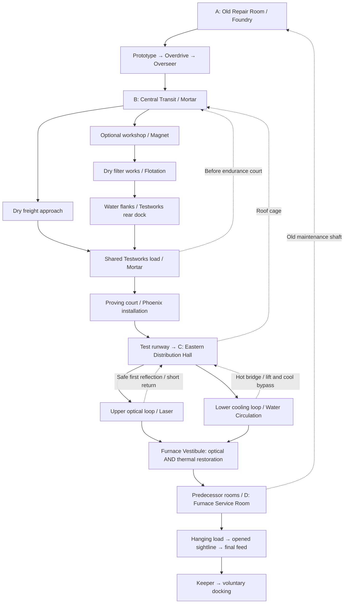
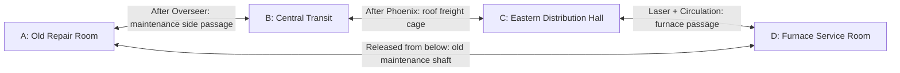

# Tankle Adventure — Astra — Game Specification

A lonely, wordless tank Metroidvania set in a cooling mechanical city. This document defines the agreed game design: its story, rules, progression, places, presentation and intended player experience. Region IDs identify geography, not a required visit order. Numerical values are the current balance baseline; travel times and spatial dimensions explicitly described as targets remain authoring guidance.

## Contents

1. [Identity and scope](#1-identity-and-scope)
2. [Story and narrative structure](#2-story-and-narrative-structure)
3. [Controls, cameras and core systems](#3-controls-cameras-and-core-systems)
4. [The eight abilities](#4-the-eight-abilities)
5. [Exploration and acquisition](#5-exploration-and-acquisition)
6. [The folded mechanical city](#6-the-folded-mechanical-city)
7. [Machinery and environmental interactions](#7-machinery-and-environmental-interactions)
8. [Combat and enemies](#8-combat-and-enemies)
9. [Regional journeys](#9-regional-journeys)
10. [Final approach and ending](#10-final-approach-and-ending)
11. [Interface and information](#11-interface-and-information)
12. [Art, sound and music](#12-art-sound-and-music)
13. [Experience requirements and open scope](#13-experience-requirements-and-open-scope)

## 1. Identity and scope

The Tank escapes a factory that has marked it for recycling, explores a lost mechanical civilization, and eventually chooses to sustain the furnace on which that civilization depends. The emotional direction is loneliness, mystery and occasional tenderness. The world moves more often than it answers: empty carriers depart, observatories transmit into silence, and repair arms attend machines that no longer wake.

The game combines direct movement and independent aim, a shared Heat budget, abilities that change both exploration and combat, and a vertically connected world. The Tank remains grounded on floors, ramps, moving platforms and supported water. There is no jumping, flight or high-speed gap-leaping ability.

### Design pillars

- **Discovery belongs to the player.** An obstruction appears before its solution. Acquiring an ability changes familiar geography and creates a reason to revisit it. Local composition suggests a likely continuation without objective arrows, written quests or forced gameplay camera moves.
- **Places have purposes.** Freight, cooling, cultivation, testing and communication determine room shapes, machinery and routes. Each major room offers a concrete situation to observe, try and change. Moving cargo, opening a firing window or establishing a crossing must affect usable space, not merely animate a machine beside an unrelated door. Ruins reveal interrupted habits and expectations, not just damage.
- **Abilities are physical actions.** Every acquisition supports exploration and combat. Gates communicate a material, force, surface or firing problem instead of an inventory check. Valid alternative solutions remain valid when the physical rules allow them.
- **Combat requires decisions.** Threat combinations change where the Tank moves, what it attacks first and when it spends Heat. Difficulty comes from readable pressure and spatial choices, not uniform HP inflation or hidden damage quotas.
- **Returns change the journey.** A nearby door, bridge, lift or express rail reveals a recognized place from another side and removes a real detour. The hub is a landmark, not a mandatory stop after each reward.
- **The world communicates without prose.** Shape, motion, sound, impact feedback, symbols and unlabelled instruments explain it. The world and its machinery do not use dialogue or written puzzle instructions. Menus, maps and the equipment HUD use concise English labels. Every acquired item remains identifiable through its icon, name and relevant count or improvement; acquisition notices explain the benefit without giving route solutions. English is the only supported interface language.
- **The Tank remains expressive.** Exaggerated industrial forms, headlights, antenna motion and mechanical timing supply personality without dialogue or realistic military styling.

### Current scope

The connected journey contains seven regions organized around exactly four Repair Hives, eight abilities including the starting Cannon, twelve ordinary enemy archetypes, the Prototype and four Boss encounters, permanent regional shortcuts, optional restoration scenes, ten dispersed equipment discoveries, and one voluntary ending. The Empty Hoist is machinery distributed through these regions, not an eighth region. The four refuges, regional loops and physical shortcuts define the city; room placement follows their relationships. Reorganizing routes and machinery does not change the agreed movement, Heat, weapon, upgrade or damage values. Main progress never depends on completing all optional repairs or collecting the optional Magnet and Flotation modules.

There is no ammunition economy, currency, experience, corpse retrieval, field healing, limited equipment loadout or mandatory restoration percentage. Acquired abilities remain available. Ordinary movement remains available during Overheat. Hazards do not bounce or teleport the Tank to safety.

## 2. Story and narrative structure

### The city before the journey

Factories, transport, gardens and observatories once shared a central furnace. Heat travelled outward through freight and service infrastructure; coolant and reclaimed material returned inward. The builders are gone. Their origin and disappearance remain partly unexplained.

The surviving machines inherited two duties: keep the furnace alive, and repair machines that can still work. As regulation and circulation failed, feeding the furnace more scrap prolonged operation without restoring efficiency. The city consumed unused equipment, then peripheral facilities, and eventually active machines. Each contraction preserved the centre while making fewer outer places habitable.

Repair Hives preserve the Tank while reclamation systems try to destroy it. Neither duty is secretly false; the failing city can no longer fulfil both together. The opening recycling attempt acquires a different meaning as the player understands the network.

Earlier mobile prototypes reached the furnace and served as replacement drive and regulator assemblies. They eventually wore out. Retired hulls, cradles and mounting sockets remain in successive chambers.

The player is a rejected experimental chassis that can accept modules from incompatible prototypes. Its apparent fault permits the combination of drive and circulation machinery needed for the final connection. This capacity is earned through exploration, not explained by prophecy or a secret identity. Docking supplies a working assembly and connection to existing fuel and stored heat; it does not create limitless energy. Future decline remains possible.

### The player's changing motivation

| Stage | Immediate purpose | What the world reveals |
| --- | --- | --- |
| Escape | Avoid reclamation and leave the Foundry | The factory rejects the Tank; Repair Hives preserve it |
| Find passage | Cross an empty transit network and its blocked approaches | The factory belonged to a much larger connected city |
| Restore local movement | Reach new banks, freight layers and service routes | Small repairs still let individual machines do useful work |
| Recognize earlier attempts | Recover the test engine and explore optical or circulation machinery | Failed vehicles share the Tank's sockets and intended destination |
| Inhabit the completed machine | Keep moving through Overheat and reopen old infrastructure | Heat can be carried, and the inner furnace approach is now possible |
| Choose | Defeat the keeper, inspect the socket and decide whether to dock | The familiar repair-shaped interface needs the Tank's drive to sustain the city |

Mandatory transit, Testworks and predecessor spaces carry the essential story. The optional Gardens and the independently ordered optical and circulation visits provide complementary evidence. No scene assumes that every optional region has already been visited.

### Recurring wordless motifs

| Motif | First reading | Later reading |
| --- | --- | --- |
| Repair arms and vehicle-shaped sockets | Safety and recovery | A machine can be connected to support something larger |
| Empty carriers and inward cargo | Abandonment | Distribution has been inverted toward reclamation |
| Detached hulls and module mounts | Scrap and useful upgrades | Previous attempts to carry the furnace's load |
| Outward optical pulses | A distant curiosity | Continued expectation without a reply |
| A maintenance machine repeating a failed task | Habit | An individual activity the player can restore |
| A red hull with a steady engine | Dangerous combat commitment | A body that can sustain the final connection |

Essential meaning must remain understandable if optional scenes are missed. Small acknowledgements use a light, head turn or resumed task; machines do not speak, lead the player, or point at objectives. The ending's detailed commitment and continuation rules are in [Final approach and ending](#10-final-approach-and-ending).

## 3. Controls, cameras and core systems

### Input and movement

| Default input | Action |
| --- | --- |
| W / A / S / D | Direct camera-relative movement; diagonal speed is normalized |
| Mouse | Independent aim; mouse look in third person |
| Left mouse button | Fire the selected weapon |
| Right mouse button | Magnetic Traction |
| Q | Cycle acquired Cannon, Mortar and Laser |
| Shift | Hold grounded acceleration; Phoenix upgrades the same action |
| F | Deploy or retract Flotation |
| E | Contextual use, including Repair Hives and deliberate final docking |
| C | Toggle third-person and overhead views |
| Tab | Open or close the map |
| Escape | Pause and system settings |
| Space | Skip the death sequence; the ending also exposes its system Skip action |

Bindings can be changed in settings. Movement is direct rather than tank steering: the hull turns to follow travel while the turret aims independently. Direction changes remain immediate during acceleration. A stationary Tank cannot build boost by holding Shift, and pushing against a wall cannot replace Phoenix's run-up. Actual wheel motion follows travel and slope support.

Weapon switching does not clear Heat, bypass firing recovery or retarget a launched Mortar. All owned capabilities remain available; there is no equipment-slot restriction that can strand the Tank.

### Two camera views

**Third person:** a perspective camera follows behind and above the Tank. Mouse look changes the view independently of hull heading; movement follows that view. One reticle stays centred on the screen. Mouse look remains smooth and available while firing or using Magnet, regardless of input order. Looking upward must not rotate the camera into the ground or hull.

**Overhead:** a fixed three-quarter view follows position and supporting height smoothly. Movement remains screen-relative, and the single reticle follows the mouse continuously. It does not snap to enemies, jump between platforms or move because an aim range is reached.

C switches immediately, preserving position, progress and equipment. Each view is a supported player choice. Ramps and lifts do not unexpectedly rotate the movement frame. Gameplay never pulls the camera toward a solution.

Settings provides a paused, unobscured scene preview. Third-person controls expose pitch, follow distance, height offset, shoulder offset and mouse sensitivity; overhead controls expose downward angle and visible area. Each view remembers its own settings and resets independently. The third-person preset is Pitch 15.3°, follow distance 15, camera height 2.5 and shoulder offset 0. Mouse sensitivity is a plain numeric setting from 1 to 10, defaulting to 3. The endpoints correspond to the previous 1× and 10× mouse response; the interface does not show a multiplier. Adjusting presentation does not alter speed, weapon limits or progress.

Clicking the playfield captures the mouse; pausing or opening the map releases it. Where capture is unavailable, middle-button dragging turns the view and works alongside weapon inputs. Opening settings must respond to one pause action, without requiring a second Escape merely because capture was active.

### Aiming and obstruction

Cannon and Laser aim independently of the hull and can elevate or depress by **40 degrees**. Across a same-height open floor they remain level. At the angular boundary, the barrel and firing direction stop; the player's reticle does not snap to a different target. There is no angle-limit text or second projected-ground marker. A different supported firing position is the solution to a genuinely unreachable angle.

Mortar uses the same reticle, with a dashed ring and a light trajectory preview. It can target a landing behind low cover, but its arc still strikes a sufficiently high wall or ceiling. Aim intent stays continuous even beyond the weapon's reach; trajectory and impact show the actual outcome.

Visible surfaces and aiming agree. A translucent foreground must not cause aim to select an unrelated hidden floor, and transparency never removes collision. Floors, cover and roofs block actual projectiles and beams. Apparent targets must have usable firing terraces within the elevation limit; the limit is not an unexplained puzzle rejection.

### HP and damage feedback

| Rule | Current value |
| --- | ---: |
| Starting hull / base maximum | 5 segments (25 HP) |
| Maximum after five optional armour packs | 10 segments (50 HP) |
| Hit recovery and protection after an attack | 0.6 s |
| Player damage radius | 0.8 world units, inset from the hull |
| Enemy body and weak-point hit allowance | 15% larger radius than the underlying target |

Damage volumes and solid-body collision serve different purposes. Forgiving edge hits do not bypass armour; a surviving enemy remains a physical obstacle. Direct and repeated contact damage respect the protection interval. Furnace channels are a separate environmental hazard, described under combat.

A damaging attack adds a velocity impulse away from its source: approximately 1.2 units of displacement over the first 0.18 seconds, stopped by walls and unsupported edges. This impulse combines with normal driving; it does not reset engine speed or disable steering, acceleration, aim, equipment changes or world interaction. During the 0.6-second recovery the hull blinks and further attacks cannot deal damage. Cannon, Mortar, Laser and magnetic firing are disabled until recovery ends; held fire resumes then. Repeated hits cannot extend the recovery window. Death transitions directly to reconstruction presentation.

HP is restored at Repair Hives or through reconstruction. An armour discovery adds and fills its new 5-HP segment once; it is not a repeatable field-healing supply. Low HP changes lights, exhaust, motion accents and HUD colour without weakening control responsiveness.

### Shared Heat

| Rule | Current value |
| --- | ---: |
| Heat range | 0–100 |
| Overheat begins | 100 |
| Overheat releases | At or below 30 |
| Cooling delay after weapon/tool Heat | 0.75 s |
| Cooling delay after releasing Boost | Immediate |
| Base cooling rate | 50 Heat/s |
| Cooling with the optional filter upgrade | 62.5 Heat/s |
| Boost Heat while the engine actively accelerates or sustains boost | 15 Heat/s |

Weapons and tools add their own costs, listed with each ability. Shooting and boost costs accumulate together. Releasing Boost stops its Heat generation and starts cooling immediately, even while the Tank coasts above normal speed. Weapon/tool Heat retains its 0.75-second delay; releasing Shift does not cancel a shot or tool use that just generated Heat. A cold Tank can fire four consecutive Cannon shots safely; the fifth reaches Overheat.

During Overheat, weapons and the magnetic tool lock. Ordinary movement and Flotation remain available. Without Water Circulation, acceleration also locks. With it, grounded boost can continue or restart, keeps producing Heat and maintains the red-hot state. Displayed Heat stays capped at 100; continuing boost does not secretly start a self-damage timer or force a stop. Releasing boost permits ordinary deceleration, cooling and recovery.

The single reticle carries an unlabelled clockwise Heat ring, progressing from pale yellow through orange to flashing red. It stays red through the Overheated state. Steam, engine pitch and the Circulation hull glow reinforce the gauge; blue is reserved for magnetic affordances.

### Repair, death and persistence

There are exactly four Repair Hives: A, the Old Repair Room; B, Central Transit; C, the Eastern Distribution Hall; and D, the Furnace Service Room. Their locations and connections are defined in [the city](#four-refuges-and-the-world-ring). Each occupies a complete safe room with entrances that interrupt hostile sightlines. Other alcoves and maintenance fixtures provide neither respawning nor repeatable healing. Long expeditions reconnect to these four refuges instead of introducing another checkpoint.

A Repair Hive opens as the Tank approaches. Activation unfolds articulated tools, sweeps a visible maintenance light across the hull, restores HP and Heat, saves progress and establishes the respawn anchor. A world pulse communicates ordinary-enemy reset. Repeated repair may shorten its animation; reconstruction receives the full cycle.

An active Hive is a **safe refuge** on its own floor:

- Its surroundings reserve an 18-unit enemy-free radius measured to the enemy body edge. Initial posts and returning reinforcements respect the same boundary as patrols, pursuit, charges, magnetic pulls and drifting mines.
- Entering the inner 5-unit maintenance area ends pursuit. Mobile attackers return toward their posts.
- A thin mint floor ring marks protection. Incoming and outgoing fire dissipate at the boundary with visible sparks and a short blocked sound; explosion and contact damage cannot reach the protected Tank.
- Holding a weapon does not remove protection. Magnet may operate machinery, but the refuge cannot be used to attack enemies outside it.
- Mortar's preview shows interception at the boundary. Leaving restores normal reach and vulnerability. Protection does not extend to a different floor.

At zero HP, tracks stop, the turret drops, headlights extinguish and smoke rises. Music stops immediately and discards the defeated encounter’s musical continuation; machinery remains audible. Reconstruction starts the exploration theme matching Phoenix ownership, rather than resuming the previous Boss cue. After a brief held view, a Hive-shaped mechanical iris closes, then opens around the reconstructed Tank. The sequence lasts about three seconds and can be skipped. Reconstruction restores HP, clears Heat and retracts Flotation.

| Persists through rest, death and reload | Resets with an encounter |
| --- | --- |
| Acquired abilities, activated Hives and discovered geography | Ordinary patrols and temporary damage states; completed finite courts are excluded |
| Opened shortcuts, gates and completed machinery | Projectiles, mines and active fuses |
| Stable magnetic-object positions and completed restoration | Combat crates and pressure vessels |
| Defeated persistent Bosses and completed finite courts | Temporary shield exposure; removed enemy plates return with their bearer |
| Journey completion | Unfinished Boss arena locks and reserve deployment |

Incomplete moving-object puzzles retain a supported local retry, never a stranded platform or impossible saved state. Permanent route openings do not reconstruct on rest. Boss seals reset on death or reload; defeated Bosses remain defeated. A completed finite court stays cleared, including its reserve waves. Long routes expose intermediate return releases, and major fights offer a return to a refuge before commitment. Reducing the number of refuges is balanced through route length, retreat and encounter placement, not extra field healing or unannounced combat-value changes.

## 4. The eight abilities

| Ability | Acquired at | Exploration role | Combat role |
| --- | --- | --- | --- |
| Standard Cannon | Starting equipment | Break exposed supports, scrap and impact mechanisms | Reliable direct fire and exposed weak-point hits |
| Overdrive | R1 Prototype | Reverse familiar conveyors and operate momentum machinery | Reposition, evade and ram suitable ordinary enemies |
| Magnetic Traction | R2 loading workshop | Tear out blue locks and plates; reposition the few movable cover carts | Strip blue shields, pull light enemies, disarm mines and intercept shells |
| Flotation Chassis | R3 ferry cradle | Traverse the connected water network and reach new banks | Change firing angle and bypass suitable floor hazards |
| Mortar | Shared R2 turntable | Reach protected targets through a clear overhead arc | Delayed attacks over low cover against clusters or committed targets |
| Phoenix Engine | R5 test building | Break momentum shutters and open express routes | Destroy ordinary enemies at full speed while preserving travel momentum |
| Laser | R4 emitter, after Phoenix | Reach distant receivers and route through mirrors | Sustained precise fire and indirect weak-point attacks |
| Water Circulation | R6 cooling rig, after Phoenix | Continue hot travel and open thermal-contact routes | Double contact damage against every enemy category during Overheat |

Phoenix upgrades Overdrive's speed ceiling and shares its input; it still counts as an acquisition. Circulation is passive. There is no ninth ability or general-purpose heat-transfer, resonance, electrical-link or player-reflection tool.

### Standard Cannon

| Parameter | Value |
| --- | ---: |
| Heat per shot | 20 |
| Minimum interval | 0.5 s |
| Useful travel from the hull | Approximately 24 units |
| Direct damage | One Cannon-hit equivalent |

Shots travel straight without guidance, lock-on, gravity or aim correction. Ordinary cover and major structure stop them; designated scrap, exposed supports and impact paddles respond physically. A held fire input repeats at the weapon's cadence. There is no ammunition count, reload, charge shot or alternate ammunition.

Cannon remains useful after later weapons: moving targets can evade a delayed Mortar, while brief firing opportunities may not support sustained Laser exposure. Enemy weak points and machinery must remain aimable without artificially narrowing the shell's visible presence. Scorch marks and recoil communicate impact without making ordinary walls destructible.

### Overdrive

| Parameter | Value |
| --- | ---: |
| Normal speed | 9.8 units/s |
| Maximum multiplier | 1.6× |
| Acceleration from 1.0× to 1.6× | 0.5 s |
| Multiplier acceleration | 1.2/s |
| Release from 1.6× to 1.0× | Approximately 0.35 s |
| Offensive ordinary-ram threshold | 1.3× |

Boost requires movement input. Re-engaging during deceleration resumes from the current multiplier. Turning and turret aim remain responsive; there is no invulnerability, flight, wall passage or water-crossing permission.

An ordinary ram destroys a scout, gives a turret or an unshielded guard side a Cannon-equivalent hit, and loses speed against a surviving solid body. An intact guard front rejects the ram and stops the Tank without ordinary body-contact damage. Ordinary engine contact does not damage major Elites or Bosses. Phoenix and Circulation modify these rules only as specified below.

The first visible gate is a conveyor that pushes normal movement backward. A short reverse conveyor directly behind the installation leads visibly toward refuge A and demonstrates the new travel direction. From its far side the player releases an ordinary maintenance bypass, then revisits the original obstruction. Other momentum mechanisms must visibly respond to an impact, not merely to a held input.

### Magnetic Traction

Blue grip fittings, removable plates, mines and interceptable artillery shells share a recognizable magnetic material and shape. Holding the input always produces a scan, rings and sound, including with no target. A connected tether pulses toward the Tank, visibly strains the target and persists until release, obstruction, excess distance or a deliberate turn away. It never attracts the reticle.

| Parameter | Value |
| --- | ---: |
| Tether reach | 13 units |
| Empty-scan Heat | 3/s |
| Connected-pull Heat | 12/s |
| Driving speed during connected traction | 55% of normal |
| Repositionable cover travel | 3 units/s |
| Time to remove a blue shield | 0.7 s |

Ordinary magnetic machinery uses removable blue locks, pins or plates. Holding traction for about 0.6 seconds visibly loosens the part, then tears it free and drops it beside its mounting. The empty socket and green fixed lamp remain; its passage or linked machinery stays released after leaving or reloading. Releasing traction early lets an unfinished pull settle back. Any clear reachable approach works, without an invisible rail-axis or standing-position condition. Heavy machinery responds through the exposed coupling rather than the whole machine flying toward the Tank.

Solid walls and intervening cargo interrupt the tether. Only objects whose position needs repeated adjustment use visible rails: the Testworks cover cart and Sorter cover. These remain solid, move toward the pulling position, stop before bodies or unsupported edges, and preserve partial travel. The player can pull them back from the other end. Optional mirror carriages can use the same rule; ordinary access locks do not require rails.

A blue shield tears free, throws aside and briefly staggers its bearer; the missing plate remains absent until that encounter resets. Movable cover may remove the enemy's screen and the player's shelter together. Mines can be pulled and disarmed or shot from outside their blast; blue shells can be intercepted. These are advantages, not prerequisites for every combat encounter: flanking, cover and leaving a warned impact area remain alternatives.

Traction occupies the weapon and stops on Overheat with a short red failure pulse. Pulling a clamp can interrupt its charge. Repositioning a mirror changes its location; rotation occurs only where the visible mounting converts the pull into rotation. The tool does not grapple the Tank upward or tow it through unsupported space.

### Flotation Chassis

Paired pontoons extend with a mechanical opening sound. F toggles them; a deployed-state glyph remains visible. Flotation consumes no Heat and remains usable during Overheat.

| Surface / rule | Value or behaviour |
| --- | --- |
| Water cruise | 1.15× normal driving speed |
| Deployed land travel | 0.75× normal driving speed |
| Boost while deployed | Unavailable, including on land |
| Deployment | Cancels the speed multiplier |
| Retraction | Requires support beneath the entire hull |

Ordinary tracks cannot cross unsupported water, even at high speed. Floats support connected water surfaces but do not cross walls, voids or unrelated height changes. Dry ramps and low shore edges identify entry and exit. Attempting to retract over deep water gives a short sound and warm ripple, leaving the pontoons deployed; no sinking timer, hidden HP cost or teleport is introduced.

The first crossing is calm, brief and ends at a visible landing. Later currents are readable in surface motion and drifting debris and remain escapable or traversable in reverse. Local sluices alter actual flow between a few readable channel states. They neither drain the Gardens nor create a dry bypass around Flotation. Resting landings, alternative banks and firing angles make water an inhabited route rather than a long obstacle strip; currents are not a Circulation gate.

Weapons retain their normal Heat rules while afloat. Projectiles, beams, blasts and overhead shells remain dangerous. Only physically lower ground-contact hazards may be avoided. Wheels stop rolling on water; wakes and a gentler engine register distinguish travel. Red-state contact remains eligible on a valid enemy contact, even while afloat, but grounded engine boosting does not.

### Mortar

| Parameter | Value |
| --- | ---: |
| Maximum landing distance | 24 units |
| Nominal flight time to the aimed surface | 1.15 s |
| Arc rise above the start/end-height path | 10 units |
| Heat per launch | 35 |
| Minimum interval | 1.05 s |
| Blast radius | 3 units against enemy damage volumes |
| Ordinary-enemy damage | 3 |

The aimed landing surface is fixed at launch and determines the ballistic arc; it is not a timed detonation trigger. Player, ordinary-enemy and Boss Mortars explode only on actual contact with terrain, walls, ceilings, machinery or a damage volume. If a supporting platform moves away or a target is in empty space, the shell continues forward and falls under gravity until contact. A shell lost outside the playable space disappears without a blast. Elevated pressure trays retain their physical contact surface as the aiming reference. A visible arc clears low cover but strikes roofs and sufficiently high walls. Blasts respect intervening solid cover. An overhead hit bypasses an ordinary guard's frontal plate; it does not become a rear hit against a Boss with an armoured roof. Surviving ordinary machines are briefly staggered, providing a follow-up opening without suppressing Boss attacks.

The common turntable cradle beside refuge B makes this first extra weapon difficult to miss. Its safe first target is a yellow load-release plate behind a low screen. A descending shot or nearby blast operates it; a level or rising shot from underneath does not. The released freight platform settles onto visible supports and completes the transport crossing. The freight battery then develops low-cover geometry in combat. Before Phoenix, a shared Testworks hanging load changes cover and opens a side passage rather than repeating an isolated tray-and-door arrangement. Optional and final uses develop an approach behind a latch and an opened optical sightline.

A ground ring marks the estimated landing and blast radius while aiming, alongside the curved flight guide. A premature collision with machinery or a ceiling shortens the guide and turns the landing ring amber. The forecast follows the same continuing arc to its first predicted collision, including a lower floor beyond the intended landing point. No landing ring is shown when no collision is predicted. It does not promise a hit beyond a wall or lock onto moving enemies.

Mortar rewards predicting a committed enemy or cluster. Its delay, range and actual overhead clearance prevent it from replacing every direct or reflected shot. It does not home or pass through a roof simply because the cursor is beyond it.

### Phoenix Engine

Phoenix raises the same grounded engine to **3.2×** speed while retaining Overdrive's **1.2 multiplier/s acceleration**. From normal moving speed, maximum takes about **1.83 seconds** and a straight run-up of about **37.73 units**. Maximum world speed is **31.36 units/s**. Release deceleration retains the existing slope, approximately **1.71 multipliers/s**. Shared engine Heat is unchanged. Short entrance shutters leave at least 40 units of usable straight approach from a normal moving start; the faster base travel must not force a precise last-moment impact.

At the same full-speed threshold that lights the Phoenix HUD indicator, twin pale-yellow flames stream backwards from the hull and pulse gently. They follow hull orientation and disappear below that threshold or on death. Hull state, speed gauge and engine register reinforce readiness. At maximum, eligible barricades break and ordinary enemies die immediately, including frontal guards and mirror inspectors. Breaking an ordinary body or obstacle preserves momentum. Intact major structures remain solid, and a blocked hull loses speed.

The finite high contact tier is 12 damage before Circulation's multiplier; ordinary full-speed destruction remains guaranteed rather than weakened by later ordinary-enemy HP. Cold Phoenix does not grant a required Boss attack or bypass special-enemy armour. Its combat purpose is overwhelming ordinary opposition during travel.

The Phoenix installation, first test runway, breakthrough, refuge C and B–C roof-cage release form one continuous exit. The player does not return to the old installation entrance to find a second demonstration track.

Express tracks have long visible run-ups, broad turns, physical guide rails and safe braking aprons. They connect actual neighboring places through player-controlled movement. Initial shutters stay broken and service returns stay open. Normal express routes fit the pre-Circulation Heat budget; they do not demand repeated mandatory cooling stops or a new jumping ability.

### Laser

| Parameter | Value |
| --- | ---: |
| Total beam path | 90 units |
| Maximum reflections | 5 |
| Heat | 24/s |
| Damage | 4.5/s |

Hold fire to sustain a beam through visible mirror faces. Opaque structure and nearer bodies stop it. Reflection follows the actual surface orientation, including tilted or enemy-mounted mirrors; framed reflective faces and outgoing segments remain readable from both sides. Authored early puzzles use one or two clear bounces rather than exhausting the maximum path.

Selecting Laser shows a thin, dashed preview of its actual reflected path and a small contact light at the final obstruction. The guide remains legible across foreground scenery, but stops wherever a physical object blocks the beam. Previewing costs no Heat, causes no damage and operates no machinery. It remains available during Overheat; firing remains locked. The guide neither moves the reticle nor chooses a target, and disappears on weapon switching, death or final docking. The solid damaging beam follows the same path when fired, with a faint guide retained for obscured segments.

Movement changes the incoming angle and therefore the useful firing line. Main-route puzzles keep the firing surface, mirrors and receivers at a common supported firing height. Broad mirror faces, receiver surfaces and openings admit a useful standing area and modest aim error. The challenge is discovering a route or changing a machine's orientation, not holding an exact pixel or finding one invisible position. Mirror faces must remain visible in both supported cameras rather than presenting an edge to the overhead view.

A receiver's visible collecting face is its actual target. One hit latches a passage permanently; the player never has to hold a beam from one position while driving through a self-closing gate elsewhere. Mandatory puzzle mirrors belong to scenery, so killing a reflective enemy cannot destroy the only solution. Magnetic mirror-carriage combinations remain optional.

For the tracking Guardian, conventional weapons can damage only the rear. Its front, sides and roof are armoured. It faces the Tank while acquiring an attack, then holds that orientation through its committed warning, attack and 2.2-second recovery. Two broad mirrors behind its flanks each support a single-bounce rear shot from the approach side. Dodging provides a stable opportunity to choose a useful mirror; the next attack reacquires the Tank. A reflected hit is judged by the **final arriving segment**, not the Tank's location. Red Circulation contact remains a close-range alternative against other surfaces. Laser is acquired before this encounter, and the Guardian does not gate the main inter-region shortcuts.

### Water Circulation

The module installs passively, adding no input, water-ammunition meter or refill chore. Coolant jackets, moving pipes and steam show the closed loop protecting the drive while heat spreads into the body. It does not instantly cool the Tank or restore ranged fire during Overheat.

The engine can continue or restart while Overheated. The hull remains red until the shared recovery threshold is reached, including during cooling. This visible state defines contact eligibility. Continued boosted movement can sustain it indefinitely under the normal Heat rules.

| Contact tier | Red-contact damage |
| --- | ---: |
| Low speed | 2 |
| At the offensive acceleration tier | 4 |
| Full Phoenix speed | 24 |
| Repeat interval against the same target | 0.5 s |

These are twice the positive base contact tiers, applied once. **Every enemy category is eligible**, including shielded enemies, the Prototype and Bosses. Ordinary ram immunity is not a zero base value that cancels the ability. The body remains solid, hostile damage still matters, and overlapping an enemy does not deal damage continuously per instant.

The first hot run starts from a cold, safe approach. Visible grilles add 28 Heat/s to engine use, bringing the Tank into Overheat before a jammed maintenance-bridge lock. Red contact releases its hot fasteners; the supported bridge settles and connects to the return lift toward refuge C. A cold impact gives solid recoil. The far side releases an ordinary permanent cool bypass, so the lesson need not be repeated on every return.

Later work lanes let the player stay red to cross ordinary opposition or cool in a side room to regain ranged fire; both choices lead to the same local exit. The inner route combines continued hot movement with a thermal release and retains the ordinary opposing-belt speed. Its optical control and hot passage are both visible from the Furnace Vestibule near C before commitment. Each completed part stays restored while the player leaves to find the other ability. Physically consistent alternate solutions to optional thermal machinery are allowed; required route boundaries must be established by observable hardware rather than an unexplained immunity.

Circulation must have an exploration interval through familiar reopened infrastructure before the final descent. Staying hot trades ranged fire for contact combat and travel; cooling restores the other choices. It changes neither engine maximum nor acceleration and adds no mandatory Phoenix Boss phase.

## 5. Exploration and acquisition

### The exploration rhythm

The Metroidvania structure follows a cycle: notice an unreachable place, follow a promising local route, learn a new physical possibility, return to recognized geography from another side, and choose which earlier obstruction to revisit. The world supports meaningful alternatives while keeping at least one comprehensible continuation. It does not maximize simultaneously open doors for their own sake.

Each major ability needs a visible acquisition, a forgiving first use, a later variation, and a lasting exploration or combat application. Acquisition rooms have a purpose and a former user for the equipment. New tools are not crowded into adjacent empty rooms.

Regions have layers: preview, initial access and deeper access. Seeing the observatory from transit does not grant access to its upper optical loop or Laser. Seeing water before Flotation establishes a remembered place and another bank, not merely an inaccessible strip.

### Required dependencies

**Cannon → Overdrive → Mortar → Phoenix → Laser and Water Circulation, in either order → inner route → final feed → Keeper → voluntary docking.**

**Magnetic Traction → Flotation** is an optional exploration branch from B. Its water approach and the dry freight approach reach the same Testworks reception hall and required Mortar-operated load before Phoenix. A player may explore the water branch before collecting Mortar, but cannot obtain Phoenix without it. Optional Sorter and Guardian victories never gate this sequence.

Solid arrows show progression; dotted arrows show earned returns. Region numbers identify places, not a fixed visit order. The two Testworks approaches are alternatives; Laser and Circulation form an AND condition at the same recognizable vestibule. A visitor with only one late ability can restore its corresponding part and leave safely.

| Acquisition or boundary | Required physical approach | First use and guaranteed return |
| --- | --- | --- |
| Overdrive | Foundry side route and Prototype, with a pre-fight return to A | Short reverse belt faces the familiar press and A; its far side releases an ordinary bypass |
| Mortar | Foundry exit and common cradle at B | Release a supported freight platform over a low screen, completing the dry crossing |
| Magnet | Optional loading workshop reached with existing abilities | Tear out a blue retaining lock to open the short return toward B; later reposition a cover cart to change a firing window |
| Flotation | Magnet opens the dry filter-work approach | Calm visible crossing, then alternative bank approaches; the bridge-underpass route opens a dry door back to B |
| Phoenix | Either Testworks entrance and the common Mortar load; a B return opens before the finite court | Installation exits directly through the runway to C and the B–C cage |
| Laser | Upper optical loop from C, after Phoenix | One broad reflection opens a short return to C; the main return and cooling connection precede Guardian |
| Water Circulation | Lower cooling loop from C, after Phoenix, independently of Laser | Red contact releases a maintenance bridge toward the C lift; a permanent cool bypass follows |
| Inner route | Optical and thermal restoration at the vestibule near C | Reach D and open the D–A shaft before final commitment; no Magnet or Flotation requirement |
| Final feed and docking | Local load-and-light restoration loop from D, Keeper victory, deliberate coupling | The loop returns to another door of D; retries do not repeat it |

Magnet and Flotation remain useful through shield removal, movable cover, water flanks, the Foundry foundation connection and later equipment revisits. The dry journey remains complete without them.

### Ability locks and alternative solutions

- **Hard physical boundaries** include unsupported water, a visible momentum threshold, a protected overhead target, an optical path and a thermal-contact release. The whole surrounding space must preserve the claimed boundary: an upper balcony or a far-side lift must not accidentally open it early.
- **Alternative-solution obstacles** offer different ways to obtain a firing line or manipulate reachable hardware. Pulling cover, reaching another bank or lobbing a shell can all be valid where geometry permits. Do not add invisible immunity to force the expected tool.
- **Knowledge obstacles** ask the player to recognize an available action: pulling from the opposite side, changing a beam angle, holding a plate with the hull or timing an impact against an exposed mechanical part. No hidden input combinations or numerical recipes are required.

Main-path openings have evidence such as a seam, exposed support, machine using the passage or view of the room beyond. Randomly shooting every wall is never necessary. Critical mirrors and movable objects remain retrievable or have a local visible recovery. An optional enemy cannot be the only unrecoverable key.

A temporary commitment must be escapable or completable with every legal incoming loadout. No route demands its own reward, a newly introduced jump, accidental falling or simultaneous operation of distant controls. Do not alter steering or momentum rules merely to manufacture a lock.

### Returns, rewards and pacing

Each major loop develops **notice → safe experiment → spatial or combat variation → acquisition or discovery → useful return**. This is an experience rhythm, not a prescribed number or order of identical rooms. First understanding happens without enemy pressure; later encounters combine familiar rules with tactical choices. Completion needs no unrelated confirmation step.

Long expeditions open intermediate connections to one of the four refuges. Before a major Boss or the proving court, the player can release a shortcut, retreat and repair instead of committing wounded. Boss retries bypass completed puzzles and full encounter gauntlets. Completed finite challenges never regenerate their waves.

| Journey | Pacing target |
| --- | --- |
| From a refuge to a discovered major Boss entrance | Approximately 10–25 seconds; no compulsory lift wait |
| From D to the Keeper entrance | Approximately 10–15 seconds; no compulsory lift |
| From completing a new ability's first use to a refuge or clear transport junction | Approximately 15–35 seconds |
| An earned shortcut between the same start and end landmarks | At least half the original traversal cost, including lift waiting and travel |

These are composition targets, not timers, minimum durations or excuses to lengthen the first trip. Count ordinary waiting, missed departures and repeated combat when judging a return. Returning to a district entrance is insufficient if a long unchanged bridge still separates it from a useful destination.

Most inside-release doors become permanently bidirectional. A genuinely one-way carrier route needs a visible, independently usable return. All returns preserve earlier ability boundaries. Direct workshop, water, optical and cooling connections supplement the four-refuge ring so visiting a refuge is a choice rather than a compulsory step after every reward.

Exploration rewards include routes, tactical positions, discoveries and clearly completed acts of restoration. Not every mechanism needs an item. Optional hull and equipment upgrades are detailed below; none is required for the ending, and Heat capacity stays fixed.

### Optional equipment discoveries

Ten one-time discoveries are separated by exploration stages, different actions and meaningful revisits. There is no minimum coordinate spacing or requirement to extend the city outward for each reward. Two nearby places can belong to different moments when their visible approaches, height and earned connections establish that relationship. An ability installation must not immediately supply its reinforcement and several armour packs on the same short run.

Hidden items do not appear on the map merely because a room is discovered. A warm glint, the equipment silhouette, a visible maintenance opening or an unusual accessible side of a machine invites inspection. There is no global collectible arrow or written ability answer. Short detours reconnect locally instead of paying for rewards with long empty return corridors.

| Reward | Location and discovery | Effect |
| --- | --- | --- |
| Armour pack 1 | A short observation branch behind the Foundry sorting machine, with a visible inspection gap; a small early discovery, not a separate puzzle chain | Add one 5-HP hull segment |
| Armour pack 2 | A dry inspection island seen from the reservoir bank before Flotation; return by water to reach it | Add one 5-HP hull segment |
| Armour pack 3 | A discarded-chassis recovery area beside the Phoenix runway, entered through a full-speed breakthrough; a short loop rejoins the Testworks | Add one 5-HP hull segment |
| Armour pack 4 | An optical maintenance mezzanine whose entrance is recognized from another floor. Magnet tears out a blue retaining plate to release the access opening; the reward is inside the workspace, not another drawer at the end of a long spur | Add one 5-HP hull segment |
| Armour pack 5 | A retired predecessor's service room near D. Quiet inspection returns nearby; there is no additional wave or long vault corridor | Add one 5-HP hull segment |
| Cannon reinforcement | An optional finite warehouse encounter: racks and moving freight interrupt a sniper line while a shield carrier or flanker closes; a finite lobber, charger and mine-layer reserve follows after four seconds. Retreat remains open, and completion permanently clears the trial and releases the stores | Cannon damage 1 → 1.5 |
| Mortar reinforcement | A horizontal circular pressure tray rests on an inspection cabinet behind a low screen. Its open top is recognizable from the approach; a lob through the framed opening lands in the tray and opens the adjacent reward room | Mortar damage 3 → 4.5 |
| Laser reinforcement | A low window, internal partition and fixed broad mirror form a short optical route to a recessed collector beside the separator. The Tank cannot enter the casing, and modest aim error remains acceptable | Laser damage 4.5 → 6.75 HP/s |
| Cooling filter | A later condensate-island revisit. Flotation bypasses the pump room's defended front and reaches the island; a nearby bank closes the return | Cooling 50 → 62.5 Heat/s |
| Weapon scope | A rangefinding workshop observation branch. Moving a maintenance screen reveals a side entrance; the workshop's long firing line lets the player immediately experience the acquired reach. No repeated magnetic drawer sequence or extended return aisle | Cannon and Mortar range 24 → 36 (+50%); damage, Cannon speed, Mortar flight duration and firing rate unchanged |

Keep a mixture of easy local finds, visible-but-unreachable rewards, ability revisits and a finite combat reward. Hidden reinforcement hardware should advertise an unusual machine or accessible side route, without a map marker revealing the item or a written ability answer. Avoid hiding every reward behind a prop.

Armour raises the maximum from five to ten segments and fills only the added segment at pickup. Repairs and reconstruction fill the earned maximum. Upgrades persist through rest, death and reload and cannot be collected repeatedly. Cooling retains the weapon/tool cooling delay, immediate Boost-release cooling, Overheat thresholds and all Heat costs. Damage reinforcement modules preserve firing rate, range and blast radius. The scope extends Cannon and Mortar range by 50%; Laser range is unchanged. Mortar landing previews use the extended reach.

Acquisition briefly pairs an armour/fan/weapon pictogram with its numerical improvement. Added hull segments and an Armor card with five collection pips retain the armour count. A Scope card with a telescopic-sight reticle permanently shows +50% range. A named Cooling card shows +25%, while each reinforced weapon card permanently shows +50%. Ability cards carry concise English names, and acquisition notices show the item name and its specific benefit. These indicators restore from the save and do not depend on the brief acquisition animation. Reinforced Cannon and Mortar rounds are brighter and larger; the reinforced Mortar adds an inner blast ring, and Laser has a thicker energy core. The ordinary weapon appearances remain unchanged.

### Rooms with a playable purpose

A major room establishes an observable situation before its decoration: what first attracts attention, what safe action can test it, what usable space changes, what choice follows, and what counts as completion. Removing an unnecessary switch is preferable to dressing the same interaction as another machine.

Cargo, filters, stators, inspection screens and service benches provide actual cover, openings, paths or observations. Their geometry follows the room's activity and leaves both camera views readable. Combat and machinery interact when moving a load changes a firing line or a route, not merely because enemies stand beside a button.

Shorten connections that offer no meaningful movement, observation, fight or story. Quiet rooms remain valuable when they contain something worth noticing. Final room count and map size follow these situations and the return network, not an area multiplier or a quota of props.

## 6. The folded mechanical city

### Site and section

The city occupies neighboring structures around a great furnace shaft in a horseshoe-shaped industrial excavation. A broken transport bridge spans its middle. The Foundry sits below the southern transit deck, a water basin occupies the west, the Testworks rises through the rear/western cliff to the roof, and optical and circulation facilities share the eastern service structure. The central furnace lies below them all.

Routes derive from freight, drainage and maintenance. Scenic distance may imply a larger city without making every distant platform a destination. Playable scale comes from authored situations, not a requirement to triple floor area or repeat the same room loop in every region.

The R2 turntable is the reference height. Neighboring authoring bands begin about eight world units apart, with smaller offsets where useful. Bands are spatial guidance, not identical storeys or numbers shown to the player.

| Region | Height envelope | Physical relationship |
| --- | --- | --- |
| R1 Recycling Foundry | -2 to 0 | Under R2's south side; press foundation borders the garden canal; maintenance gallery faces loading works |
| R2 Empty Transit Hub | -1 to +1 | Turntable at 0; bridge underside frames water travel; its roof lies below the Testworks exit |
| R3 Sunken Gardens | -3 to -1 | Western basin; connected water near -2; upper pump terrace meets the eastern retaining wall |
| R5 Prototype Testworks | -1 to +3 | Water dock and dry freight join one reception hall; the installation runway exits at C above R2 |
| R4 Silent Observatory | +1 to +5 | Upper loop from C in the eastern stack; upper apparatus defines the skyline |
| R6 Circulation Works | -5 to -1 | Inside and below that stack; dry service descent, cooling rig, garden industrial terrace and inner approach |
| R7 Predecessors / Central Furnace | -7 to -5 | Deep beneath the city; D connects upward to A beneath the familiar press foundation |

The overlaps do not imply free travel between all surfaces at the same height. Actual floors, walls, water, bridge ends and supported landings define access. R1's recycling furnace and R7's central furnace are different machines, connected by material and heat infrastructure.

### Four refuges and the world ring

| Refuge | Place and recognizable feature | Expedition coverage |
| --- | --- | --- |
| **A — Old Repair Room** | Inside the Foundry, looking onto the bent press; the Tank awakens here | Foundry exploration, Prototype and Overseer; later foundation revisits |
| **B — Central Transit** | Beside the split flywheel, with the roof cage above and canal below | Mortar, the magnetic workshop, Gardens and early Testworks |
| **C — Eastern Distribution Hall** | Upper service junction where three coolant mains meet the Testworks roof exit | Phoenix aftermath, optical and cooling loops, optional Sorter and Guardian |
| **D — Furnace Service Room** | Deep beside the central furnace, with an empty predecessor berth | Final supply restoration, Keeper preparation and post-ending exploration |

Each refuge supports multiple expeditions and recognizable returns. They are complete protected rooms, not exposed repair posts sprinkled along corridors. No other object grants a respawn or repeatable refill. A few visibly broken service fixtures may remain as scenery, without usable-Hive cues.

These are progressively earned permanent connections, not open travel at the start. Local loops and cross-region links supplement the ring; the player need not pass a refuge between every activity. The C–D route remains physical and supported, and completed optical and thermal releases persist for return travel.

### Shared landmarks and recognition

The distant furnace exhaust spine supplies broad orientation. Three structures are recognized from ordinary play:

- **Bent press:** first seen from A and the Foundry working floor, heard under the garden canal, then recognized from below before opening D–A.
- **Split flywheel:** seen beside B, from the water beneath its bridge, and from the Phoenix roof exit beside C and the B–C cage.
- **Three coolant pipes:** connect C, the optical and cooling building, and the garden retaining wall; restoration changes the flow along this same structure.

Use the actual structure across these views, not duplicate scenic substitutes. Overdrive's first return visibly faces the known press. Phoenix's first runway ends at the recognized flywheel overlook. Guardian's tower descends to a previously seen garden inspection walk. The final maintenance shaft arrives inside the city the player left at the beginning.

Major regions need an internal height change and visible relationship to another region. A lift at each end does not by itself create a connected building. No gameplay camera cut is needed to explain recognition.

### Permanent connector allocation

The table specifies destinations and opening moments; its names describe geography, not instructions displayed on gates. All earned releases survive repair, death and reload. Inside-release doors generally become bidirectional. Lift unlocks start automatic service rather than a manual call or destination menu.

| Connection | First opening | What the return accomplishes |
| --- | --- | --- |
| A ↔ Prototype approach | Release the workshop-side maintenance door before entering Prototype | Bypasses the press route and initial encounters on retries |
| Overdrive installation → A | Cross the short reverse belt with the new engine, then release its adjacent ordinary bypass | Immediate recognition and a repeatable return without replaying the belt lesson |
| A ↔ Overseer approach | Reach the original opposing belt's far side with Overdrive and release a side door before entry | Short Boss retry; the side door cannot grant early passage from A |
| A ↔ B | Overseer victory opens the Foundry exit and maintenance side passage | Joins the first two refuges without repeating the Foundry |
| Magnetic workshop ↔ B | Pull the blue lock embedded in the workshop-side maintenance door | Returns directly toward B and demonstrates magnetic release |
| Garden far shore ↔ B | Flotation crosses beneath the familiar bridge; release the dry inspection door from the far bank | Closes the water expedition locally without draining the basin or bypassing first acquisition |
| Garden ↔ Testworks rear reception; canal ↔ Foundry foundation | Water exploration reaches the rear dock and press-side maintenance latch | Alternative approach and later revisit; the dry route reaches the far bank, not the unearned Flotation installation |
| Testworks interior ↔ B | Release the inspection return before the proving court, after the shared Mortar load | Permits repair and short challenge retries without granting Phoenix early |
| B ↔ C | Phoenix's installation runway ends at C and the upper cage coupling | Immediate world shortcut; the initial lift landing at B cannot release it from below |
| Optical installation ↔ C | The safe first reflected shot opens the nearby short gallery | Return precedes Guardian and does not require traversing a long bridge |
| Optical gallery ↔ cooling works | A local optical connection, before Guardian | Direct cross-region travel; the initial cooling approach from C still works without Laser |
| Cooling installation ↔ C; industrial side route ↔ Gardens | Red contact releases the supported maintenance bridge to the C lift; release the cool bypass from its far side | Removes repeat hot runs and opens a useful industrial return without granting inner-furnace access |
| C ↔ D | Restore both parts of the Furnace Vestibule with Laser and Circulation | Opens the deep journey with a persistent return; one completed part is never lost while seeking the other |
| D ↔ A | Open the old maintenance shaft from D before the final feed and Keeper | Recognize and revisit the starting repair room; A cannot open the deep route early |
| D → final supply room → D | Dropped load exposes the side passage and optical connection; restore the feed | Returns through another nearby door, permanently bypassing the completed task on Boss retries |
| Optional Sorter fast line between B and C | Defeat Sorter to release the parallel transport track | Additional travel benefit; the ordinary B–C cage remains available without the fight |
| Guardian tower → garden upper inspection walk | Guardian victory allows tower access and release of its descent | Closes the optional exploration loop; main optical and cooling returns already exist |

Shafts, ramps and supported landings must fit their buildings. Shortcuts must not become unintended earlier entrances through long shots, movable objects or an exposed far-side control. Water access and dry return doors remain distinct. Local combat retry routes use doors or ramps, avoiding mandatory lift waits.

### Architectural composition

Most workrooms and inhabited industrial spaces have substantial walls and ceilings. They need foundations, columns, door faces, service openings and coherent cargo or coolant routes. Missing panels expose a building that already makes sense. Plazas, water banks, inspection walks, outdoor bridges and the optical court remain open where their purpose calls for it.

Enclosure and release alternate: a compact interior frames the next shaft view or familiar landmark. Avoid an uninterrupted network of exposed platforms, but also avoid replacing it with repetitive narrow corridors. Doorways and turns accommodate the Tank and both cameras. Mortar rooms retain actual overhead clearance; tall Boss halls allow their visible indirect attacks.

Unrelated upper routes must not fill the centre of an encounter's view. Concentrate overlaps at recognizable bridges, underpasses, ramps and return junctions. Supporting piers stay out of usable paths. Rails, markings, pipes and fixtures belong visibly to their supporting structure; there are no detached floating remnants.

Occluding portions of walls, ceilings, posts, floors and attached details become smoothly translucent along the view to the Tank and its nearby fighting space. The camera never shortens its configured following distance to avoid an obstruction. Whole floor tiles must not vanish, and the Tank's current support must remain legible. Transparency is a local aid, not a substitute for composing rooms that can be understood without several ghosted floors.

Both views share readable world lighting. Interior paths, undersides and machine sides retain enough indirect light; ceilings cannot turn the third-person view black. Far structures fade beyond the local room network without removing nearby junctions, readable weapon targets or important landmarks.

## 7. Machinery and environmental interactions

### A shared physical language

Door frames and the map do not display the ability required to pass a barrier. The player sees the obstruction itself: moving water, a reachable blue grip, a screened tray, a framed mirror or a braced shutter. A failed shot produces material-specific feedback, and cables show what an operated mechanism changed. Nearby safe examples establish these relationships before combat combines them. Discovered gates show only open/closed state; unknown routes do not advertise their solution.

| Affordance | Meaning and response |
| --- | --- |
| Recessed impact paddle or bullseye, spring and travel slot | Cannon-operable mechanism; recoil, sparks, sound and connected motion on impact |
| Yellow ready face / green operated lamp | Ordinary mechanism state; fixed jamb lights remain after a shutter retracts |
| Blue removable plate or U-shaped pull ring; visible rails only on repositionable carts | Magnetic traction; a torn part stays blue beside its empty socket while the fixed status lamp turns green |
| Framed mirror and circular optical collector | Optical route; contact flare and outgoing beam show the reflection |
| Mirror on a turntable with four quarter-turn marks | Each Cannon impact or Mortar blast rotates it 90 degrees; Laser only reflects |
| Horizontal circular pressure tray with an open top and raised rim | A descending impact or exposed blast from above presses it; side and underside hits strike the protective casing |
| Sprung striped pressure plate | Hull weight maintains an action; leaving releases it |
| Hinged treadle linked to track blades | One crossing changes the visible detent once; remaining on it does not toggle repeatedly |
| Reinforced braced shutter, dented wrecks and clear approach | Momentum can break the weakened structure; the supported run-up is visible |
| Heated load-bearing fasteners | Red contact releases a thermal barrier with steam and visible separation |
| Mint repair ring | Safe maintenance area and weapon boundary |

A direct-fire switch presents an upright impact face or an inclined panel inset into a door's upper edge; neither resembles an open collecting tray. Every mechanism intended for a lob uses a horizontal circular collecting tray, including the freight platform, freight crossing, Testworks load, final supply load and optional Mortar reinforcement cabinet. Their differing consequences do not change this shared shape. The opening and rim are visible from the intended approach, and a successful impact visibly depresses the tray. A high tray's Mortar landing preview refers to its collecting surface rather than the ground behind it. No standing target quietly demands a particular weapon when an ordinary shot physically reaches its working face.

Shape identifies the action; colour identifies readiness and completion. A closed striped metal cover conceals an unavailable target and opens when its prerequisite is restored. The exposed target is yellow when ready and turns green when operated; blue remains reserved for magnetic fittings. Directional access comes from visible recesses, backplates and protected upper trays. A shot that reaches an exposed working face must not be rejected merely because the Tank stands on another floor or crosses an invisible coordinate boundary.

Mechanisms answer unsuccessful attempts with the appropriate impact, resistance or failed pulse. An inactive target must not feel like a broken input. Local door latches, magnetic locks and screen releases are embedded in the actual door or machine, without a separate pedestal. They face the usable approach and remain visible in both camera views. Inside-release shortcut doors expose their working face only to the earned side and stay bidirectional after opening. A same-side door with no traversal, discovery or tactical purpose is removed; empty-space cover locks are removed with their unnecessary obstacles.

Direct mechanical releases move their attached parts immediately. A remote connection uses a visible yellow cable or pipe leading to its actual consequence. The source latches immediately while green power advances along the connection; remote machinery waits until that front reaches its endpoint, with branches arriving together. A latch that also serves a remote return opens its own door immediately while the remote gate waits for power. Fixed wiring terminates at the frame and stays behind when the door retracts or a blue grip tears free. It never passes through closed machinery or takes unsupported shortcuts between floors. Saving and reconstruction retain unfinished transmission, while completed connections stay green without replaying the delay. Power flow does not leave disconnected floating lamps. Distant encountered links remain identifiable on the discovered map.

Player shots operate machinery through their actual paths. Earlier walls and cover intercept them. Enemy attacks cannot silently solve progression mechanisms. Decorative panels do not copy usable target shapes. Difficulty comes from space, timing and pressure around simple actions, not written instructions or arbitrary input recipes.

Ordinary shortcut doors can remain one-hit releases. A major machine must do more than decorate such a release: its movement changes a usable path, sightline, cover position or support. Unnecessary controls are removed. Mechanisms use a few obvious positions, visible stops and safe recovery; no new input, free-form machinery calibration or complicated simulation is required.

### Mechanism families

| Family | Player action | Playable consequence |
| --- | --- | --- |
| Conveyors and freight | Move with or against transport, follow moving cover, release accessible brakes | Change traversal, firing exposure and return direction |
| Rail carts and hanging loads | Shoot visible track blades or brake paddles; release a supported load through a clear arc | Change docking, cover, bridge support and passage geometry |
| Magnetic locks and cover | Tear out a blue lock or plate; move the few rail-mounted carts | Permanently release an opening or repeatedly change cover and firing windows |
| Sluices and water | Shoot a visible latch to change a local diversion plate | Alter actual channel flow and safe approaches to the bank |
| Mirrors and optical paths | Shoot from another position, shoot a quarter-turn mirror or move an obstructing screen | Change light paths, machinery access and weak-point firing lines |
| Thermal maintenance | Sustain a hot run and release jammed fasteners with red contact | Establish a maintenance bridge, hot passage and permanent cool return |

The same simple action develops through different spatial situations. A first demonstration permits safe experimentation; later uses change position, timing or tactical consequences. A carriage or screen can be useful in combat without demanding that every fight be solved through machinery. Decoration reinforces these rules rather than pretending to be an additional mechanic.

### Conveyors and momentum

Conveyor motion is a physical world-direction force applied to the Tank, enemies, movable bodies and wrecks on the same support, including slopes.

| Conveyor purpose | Speed |
| --- | ---: |
| Ordinary opposing traversal | 9.95 units/s |
| Foundry and Keeper feed lanes | 3.2 units/s |

Ordinary walking loses ground against an opposing lane; Overdrive makes progress without a prolonged crawl. The first Foundry barrier is visible before the engine is acquired. Its short return belt demonstrates the new capability and leads visibly toward A. A far-side ordinary bypass makes later travel easy without disabling the original ability boundary prematurely. Cargo crossings also interrupt enemy fire: the player can follow a moving load or use its passing cover to reach a firing position. Supported cooling and combat bays separate longer stretches.

Belts have dark beds, side frames, end rollers and moving transverse treads with regular warm marks. Movement follows the real direction and slope. Destroying a drive stops its belt for every body and leaves its tread surface in place. Thermal-contact lanes use the Circulation rules rather than faster conveyor tuning to exclude the earlier engine. Visible heating rails add 28 Heat/s while occupied. Red contact arrives during useful traversal, without idling against a shutter. Completed thermal restoration leaves a persistent ordinary return or cool bypass rather than requiring repeated heating ceremonies.

### Automatic lifts and freight carriers

Once released, a lifting deck continually travels between its stops, occupied or empty, dwelling **three seconds at each endpoint**. It also waits three seconds before its first departure. There are no landing call buttons, E prompts, boarding triggers or manual destination choices. Missing a departure means waiting safely for the next cycle.

A partly boarded hull pauses departure. A fully supported hull near the edge travels normally and does not arrest the platform between floors. An absent platform leaves an unwalkable recessed shaft; boarding never requires a precision jump. Automatic travel and unlocked routes remain after death or reload.

A lift's visible far-side coupling releases the whole service. Remove redundant ballast, upper-ratchet and arrival-confirmation steps that merely open the next door. A first ride can teach boarding and support without adding a second switch at the destination. Boss retries have a door or ramp route rather than compulsory lift waiting.

Suspended loads obey visible supports and safe catch zones. B's first Mortar shot releases a freight platform onto supports to complete a crossing. The Testworks load changes cover and opens a side passage; the final supply load exposes both a passage and an optical sightline. These are different consequences of the same readable action, not separate trays connected to interchangeable doors. Players cannot be stranded by dropping a load, and a wrong or interrupted attempt retains a local recovery.

### Magnetic locks and moving cover

Most magnetic mechanisms release by tearing out a recognizable blue part. The first lock opens the maintenance return toward B; optical maintenance uses the same action to reveal its workspace. Loosening, separation, the dropped part and the exposed socket explain success without text.

Rails are reserved for repeated positioning. The Testworks cover cart remains a physical obstacle and can change a firing window in either direction. Its stops leave supported access and recovery space.

Movable combat cover changes both hostile and player lines. Sorter's rail cover remains a developed example: placement can interrupt its committed sweep and expose the drive, while its barrage discourages permanent shelter. The Tank can still win without Magnet. Any optional mirror carriage is positioned and secured before firing; no mandatory task requires simultaneous traction and Laser use.

### Optional maintenance shunting yard — R2

The two-branch rail puzzle occupies one readable workshop space within the already accessible freight layer. The start, track junctions, destination berth and neighboring inspection bridge can be inspected locally; no distant unexplained control is required. Shooting an impact paddle or crossing its hull treadle flips the visible track blades once. Remaining on the plate does not toggle repeatedly. Linkages and selected-branch lamps explain the result.

A Cannon hit releases the parked maintenance carrier's brake. It travels along the chosen track at four units/s. Correct routing secures it at the visible freight berth, operating the catch that lowers the adjacent inspection bridge. This creates a workshop cross-connection immediately, with no extra confirmation or reset action. Wrong routing returns it to its accessible start.

The signal recalls a moving carrier; nearby deliberate use remains an alternative. Recall does not launch a parked carrier, and shooting a moving carrier does not reverse or repeatedly restart it. Track changes lock during travel. The carrier pauses for a Tank or living enemy in its way.

An unfinished delivery can restart locally while track settings remain recognizable; a correctly docked carrier stays secured. This reward is a shortcut, not Magnet, a regional entrance or a main-route requirement.

### Sluices, flow and the bridge-underpass return — R3

Before Flotation, dry filter walks reveal moving water, drifting debris and a visible inspection island. Shooting an exposed sluice latch changes a diversion plate between a few clear channel states. One branch becomes calmer while another remains fast; surface motion, floating debris and the force on an afloat Tank agree. A turning pump wheel alone is not the consequence.

The dry walk reaches the Flotation installation without requiring the reward. The first crossing is short, calm and faces a clear bank. Later the direct landing is covered by a turret, while a longer route around the filter wall permits approaching a blue shield from its side or rear. Both remain understandable supported routes, with safe places to land.

Following the current beneath B's familiar bridge reaches the far-bank latch of a dry inspection door back to B. It is a simple permanent release, not another pressure-plate-and-shot procedure. The main water route continues to the Testworks rear reception. Gates never drain the entire Gardens, grant ordinary tracks unsupported-water travel or bypass the first Flotation acquisition. The restored flow is part of the same place seen during the ending.

### Optional gutter garden — R3

Two hinged gutters and low cranks lead from a leaking pipe toward an empty planter. Shooting the impact paddles or pushing the cranks with the hull advances a gutter to its next detent. A hull must withdraw before pushing again; there is no additional interaction-button step. Falling water follows the actual gutter orientation.

A rust plug restricts the pipe to a trickle. One Cannon hit breaks it, before or after alignment. A wrong alignment spills harmlessly. Two seconds of settled, connected full flow fills the planter, raises its metal stem, unfolds five leaves and lights a blossom. Interrupted flow drains an unfinished planter; completed restoration remains.

A low partition shelters the activity from the far-bank firing lane. The plant grants no collectible, HP or route key. It is a quiet act of care, separate from the maintenance delivery.

### Optional maintenance delivery — flooded foundations

Flotation reaches a stranded tender and a supported maintenance ramp. A Cannon shot releases its brake; it crosses the short floating service lane, climbs to the upper inspection berth and lights that bay. It waits for occupied track. Unfinished delivery restarts from the accessible lower dock; completion leaves the tender at its berth.

The reward is a local change in activity and a story about useful work. The ending does not move this tender elsewhere: its final awakening shot uses the different cargo machine established beside the opening bay.

### Optical machinery

The pre-acquisition route shows receivers behind equipment, framed mirrors, side windows and partitions. After Laser, one broad mirror and a forgiving receiver open the short gallery back toward C. The player can leave by the original approach if the first reflection has not yet been understood.

Later rooms develop two variations: moving a latched inspection screen to a fixed stop reveals a previously blocked light path; walking to a side window changes the incoming direction through familiar rooms. Neither requires shrinking the valid aim area. One main-route mirror sits on a turntable with four visible quarter-turn marks. Each Cannon impact or unobstructed nearby Mortar blast turns the mirror 90 degrees in the same direction, repeatedly; four hits return it to its original orientation. The mirror itself is the target, with no separate switch or remote linkage. Laser reflects without rotating it. Fixed mirrors retain their orientation. It changes which path is available rather than asking for free-angle tuning or simultaneous vertical and horizontal calibration.

Receivers sit behind real geometry, with useful mirror faces and contact points visible. Mandatory mirrors are fixed or indexed scenery, never a uniquely surviving enemy. Required routes work without Magnet; optional magnetic carriages and reflective enemies extend the established rule. A receiver latches its result, so maintaining the beam while travelling through a distant gate is unnecessary.

Guardian's arena uses two broad mirrors, recognizable firing areas and committed Boss facing. Its main approach and return exist before combat. After victory, the tower offers one legible outward transmission, a brief wait and a settled quiet working state, with no reply or explanatory text. A neighboring descent connects to the previously seen upper garden inspection walk. The tower closes an optional exploration loop rather than ending in a long retraced ramp.

### Thermal maintenance and recovery

Water Circulation's first hot run leads to a jammed maintenance-bridge lock. Red contact releases the fasteners and the bridge settles on visible supports, connecting the lift return toward C. The far side opens an ordinary cool bypass. Later routes offer a choice between continued red contact through ordinary opposition and cooling in a sheltered side room before restoring ranged fire; these local choices meet at the same exit.

Near C, the Furnace Vestibule presents the unpowered optical control and unsustainable hot passage together, before a long descent. Laser and Circulation restore distinct physical parts in either order. Each result persists while the player leaves to obtain the other. The completed route remains usable in both directions; thermal restoration is not a repeated toll on late-game travel.

## 8. Combat and enemies

### Encounter composition

An encounter combines a spatial pressure, a protected or mobile target, and at least two meaningful responses. A distant gun with a close flanker asks a different question from a shield carrier with a repairer. Cover, opposing belts, destructible machinery, water approaches and reflected fire change those decisions. More enemies or more HP alone do not create a new encounter.

Most ordinary groups use two or three complementary roles. Their arrival and sightlines must be readable before several attacks overlap. Heavy warnings within one squad take turns. Combat does not depend on whether a target happens to be on screen: directional sound and edge warnings communicate a relevant attacker beyond the camera, while unrelated floors remain visually subordinate. Enemy sight, physical cover and remembered sightings govern attacks; enemies do not know an unseen Tank's position through walls.

Mobile enemies pursue a last sighting for eight seconds and stay within 32 units of their home position. Guards and welders advance during recovery; skirmishers strafe during bursts; ranged specialists reposition between attacks; repairers follow damaged allies. Fixed turrets and heavy machinery stay fixed. Retreat to a Repair Hive ends ordinary pursuit. Ordinary encounters leave retreat available and do not all require extermination.

The Testworks proving court has one finite reserve pair, with four-second arrival spacing. It is the journey's ordinary endurance encounter, not a template repeated in the Hearth. Its return to B opens before commitment. Once cleared, its exit remains open and its initial and reserve groups remain cleared through rest, death and reload. The optional warehouse reinforcement trial follows the same completion rule. Boss reinforcements follow the separate arena rules below.

### Twelve ordinary archetypes

| Archetype | Silhouette and behaviour | Decision it creates |
| --- | --- | --- |
| Clamp Scout | Low rust-orange jaws and a horizontal sensor; closes, locks direction, then commits its whole body to a charge | Evade sideways, bait solid cover and punish the stagger; avoid retreating along its line |
| Fixed Turret | Pale spindle or tripod with a coil hood; holds a lane and exposes a cooling interval | Cross between volleys, break cover, flank or counterfire during recovery |
| Shield Guard | Broad refractory plate and narrow slit; advances while protecting its front | Flank, lob over it, or strip a blue shield with Magnet |
| Skirmisher | Four wheels and paired guns; circles while firing a three-shot burst | Intercept its route or remove the partner that makes following it dangerous |
| Rail Sniper | Long raised rail; tracks with a red aim line for a 2.2-second warning, locking the final 0.8 seconds | Reach cover or leave the committed line before a 120-units/s shot with 86-unit reach |
| Artillery | Raised mortar cup; brackets a remembered target with three staggered ground circles and visible arcs | Keep moving, reach the launcher, remove its spotter or intercept a blue shell |
| Miner | Retreats while lobbing a limited supply of blue discs that arm after landing | Shoot or extract a mine, change approach, or advance before it establishes a field |
| Welder | Paired bottles and a short nozzle; advances while preparing an 18-unit sweeping flame, then pushes forward along a committed bearing | Leave the warned sector, pass behind it or break the flame with solid cover; avoid retreating directly along its approach |
| Repairer | Tender arms and a green repair beam; restores a living ally at a finite rate and needs a clear line | Interrupt the beam, separate the pair or prioritize the repairer; it never resurrects a destroyed unit |
| Mirror Inspector | Broad pale reflecting face and paired angled shots; reflection follows its real facing | Flank, lob above it, use red contact or redirect Laser toward another target |
| Canal Hunter | Low amphibious patrol hull, paired blue torpedo tubes and twin wakes; strafes on water, locks a firing line, launches two spaced torpedoes and pauses | Move across its line, break sight with a pier, intercept its torpedoes or lob at its stationary recovery |
| Dredger | Broad pontoons, a circular intake and a removable blue grille; warns, draws water along a fixed sector, warns again and bites at the mouth | Exit sideways, keep a solid obstacle between the intake and hull, interrupt with Mortar or tear off the grille |

The opening Foundry introduces scout, turret, guard, skirmisher and welder behaviour. Freight and water routes add long-range aim, artillery and mines. Optical and late industrial routes combine mirrors and repairs with previously learned threats. Elite machinery and Bosses do not count toward the twelve archetypes.

The Guard's front reduces damage by **60%**. A pale plate flash, outward sparks and a hard ricochet distinguish armour contact from the orange response of a damaging hit. Blue shields use the same removable-material language as other magnetic objects. No enemy has a hidden maximum damage allowance per vulnerability window.

### Water encounters

Both water machines remain visible and damageable at the surface. Neither submerges into an invulnerable waiting phase. Water movement follows connected surfaces and real shores, with the same sluice currents as the Tank. The Hunter can reach land through low banks and ramps; its land travel and turning are slower, and it fires ordinary straight shots there. The Dredger stays afloat. Ordinary pursuit remains local, and all repair-refuge boundaries still apply.

The Hunter warns for 1.3 seconds, then sends two straight, non-homing torpedoes down the committed line, 0.65 seconds apart, at 12 units per second. Blue shells and pale wakes show their paths. Solid cover and dry banks stop them. Cannon or Laser can destroy a torpedo, and Magnet can intercept it. The Hunter pauses for two seconds after launching, giving Mortar a predictable target. Its first appearances have three HP; the late condensate Hunter has four.

The Dredger has five HP. A 1.2-second intake warning precedes 2.8 seconds of suction in an eleven-unit forward sector. It cannot turn during suction. Water streaks and floating fragments travel toward the mouth, and floating wrecks can be drawn in. Pull speed is 2.4 units per second, weaker than ordinary water cruise; suction does not deal damage, disable steering or require Boost to escape. Dry ground, another floor and intervening solid cover block the effect. A separate 0.8-second warning precedes one close bite, followed by a 2.4-second recovery. Mortar damage interrupts the current attack. Magnet tears off the blue grille and causes a longer stagger; the grille stays absent until the encounter resets, while subsequent pump cycles can resume. No magnetic ability is required to defeat it.

Introduce a patrol visible from the reservoir bank before Flotation without blocking its dry acquisition route. Preserve the first short crossing from the ferry bank. A later water lane introduces a lone Hunter with a pier; the reservoir pump pocket introduces a lone Dredger away from that first crossing. The optional condensate basin combines one of each around cover and two possible banks. Warnings start in sequence rather than simultaneously: suction can draw the Tank out of cover before the Hunter commits its line. Calm canals remain between encounters, and no required water passage becomes an extermination gate. Sluices change actual approach and drift for both the Tank and swimmers.

### Durability and cadence

Opening scouts have one HP, turrets two and guards three. Transit and reservoir light/heavy defenders retain their two/three-HP baseline. On the optical and coolant city routes, those light/heavy categories have four/five HP. Service-district health scales from its authored base by 1.25 in the Testworks, 1.5 in optics and coolant, and 1.75 in the deep Hearth, rounded upward. These are area-specific baselines, not a second multiplier on every route unit. Full-speed Phoenix still destroys ordinary enemies regardless of these increases.

| Ordinary enemy | Movement speed | Recovery after attack |
| --- | ---: | ---: |
| Scout | 5.6 | 1.5 s |
| Turret | Fixed | 1.5 s |
| Guard | 3.8 | 1.6 s |
| Skirmisher | 6.2 | 1.4 s |
| Sniper | 2.8 | 2.2 s |
| Artillery | 2.5 | 2.8 s |
| Miner | 4.6 | 2.1 s |
| Welder | 6.8 | 0.9 s |
| Repairer | 4.5 | 2.0 s |
| Mirror Inspector | 3.2 | 1.9 s |
| Canal Hunter | 6 in water / 3.3 on land | 2 s |
| Dredger | 2.4 in water | 2.4 s |

The Welder closes and tracks during the first 0.55 seconds of its 0.9-second warning, then stops and locks its bearing for the final 0.35 seconds. Its 1.8-second sweep advances at 55% of movement speed along that bearing without tracking the Tank. Both the warning sector and flame stop at solid cover. Flame damage remains one health segment; pressure comes from reach and movement, not increased damage.

Boss attack sequences override ordinary cadence. Readable commitment and exposed recovery remain essential even when an enemy moves aggressively.

### Damage to the Tank

Damage to the Tank is expressed in whole hull segments; one segment is five HP. Enemy health and player weapon damage use their existing combat values.

| Attack | Hull segments per accepted hit |
| --- | ---: |
| Ordinary enemy projectile, including Skirmisher | 1 |
| Sniper shot | 2 |
| Enemy Mortar direct impact or blast | 2 |
| Mine explosion | 1 |
| Welder flame contact | 1 |
| Boss fan and battery projectiles | 1 |
| Other ordinary Boss projectiles | 1 |
| Boss homing missile | 2 |
| Boss aimed barrage, direct hit or blast | 2 |
| Boss sweeping beam and Sorter sweep | 2 |
| Hunter torpedo or land shot; Dredger bite | 1 |
| Dredger suction | 0 |
| Ordinary enemy body contact, including a failed ram into a shield | 0 |
| Scout, Elite or Prototype during a committed charge | 1 |

Ordinary bodies still block and displace the Tank without damaging it or consuming its hit-protection window. A charging machine is harmful only during its actual charge; anticipation and recovery are harmless contact. Mortar direct impact and blast carry the same two-segment payload, and consecutive-hit protection prevents charging both for one impact. Continuous fire and beams also respect the protection interval; their values are not damage per frame.

Mortar arcs clear tall machinery while staying below the normal sixteen-unit workroom ceiling. Player shells rise ten units above the straight muzzle-to-target line; ordinary enemy lobs rise nine over 1.9 seconds, and Boss barrages rise ten while retaining their distinct timing. Where required firing lanes lack headroom, use an open roof bay rather than flattening the arc until it cannot cross cover. Roofed workrooms provide at least sixteen units of headroom, and the large enclosed Boss courts provide twenty-four. Low protective canopies remain physical cover. Player Mortar range, flight duration, blast radius, damage and Heat costs remain unchanged.

Enemy projectiles stop at the first physical body and can hit other enemies for one Cannon-equivalent damage before armour. Enemy Mortar blasts deal three to other machines, excluding the launcher. Friendly fire does not operate switches.

### Cover and environmental pressure

Wood-braced crates have two HP and can be broken by fire, ramming or committed enemy charges. Steel cover stays solid; blue rail-mounted cover can be repositioned. Charge warnings must describe the whole swept body, including the path ends, rather than drawing a misleading thin line.

A pressure vessel ignites on the first hit or ram and explodes after a full 0.8-second fuse, within a 5.5-unit radius, for three damage to enemies and eight to the Tank. More shots do not shorten the fuse. Each chained vessel starts its own full warning. Cover that is intact when the explosion begins protects bodies behind it, even if that blast destroys the cover. Blasts do not unlock unrelated progression mechanisms. Destructible combat props reset with ordinary combat; permanent route changes do not.

Shallow furnace spill is traversable but deals five damage every 0.5 seconds, independently of ordinary consecutive-hit protection. Physical exit ramps remain available. Acceleration can shorten exposure; the hazard does not return the Tank to a platform automatically.

### Committed Boss arenas

Prototype, Recycling Foundry, Optical Guardian, Sorter and Final Keeper each occupy a bounded arena. When the Tank has entered completely, visible striped shutters close with a mechanical cue. A dormant Boss cannot be damaged from outside; hits produce protected-metal feedback.

The seal persists through venting, exposed phases and reinforcement deployment. Victory retracts the shutters and ends active arena hazards. Death or reload resets the encounter lock. Optional fights remain optional until entry. The ordinary B–C cage and essential travel pass outside the Sorter's inner court; its victory unlocks an additional parallel fast line. Ordinary encounters do not inherit these seals, and a sealed fight cannot be escaped by reaching a nearby refuge.

Projectile warnings last at least 0.85 seconds, lock before release and show both battery origins when both will fire. Barrages retain visible landing areas throughout flight. Reinforcement hatches light for two seconds before a reserve can attack. Main projectile Bosses provide at least one second of recovery. Reserves are finite. An active Boss health bar remains visible throughout the fight, including when cover hides its body.

| Boss | Structure and pressure | Player response and reward |
| --- | --- | --- |
| Prototype | Nine HP; a pressing carriage with a broad ram, readable radiator lids and alternating Cannon volleys and committed charges. Each Cannon volley has a fixed warning followed by three spread shots and a recovery opening. Below roughly half health, the charge becomes two charges, each with a fresh warning | Bait an impact into solid cover to cancel the follow-up and expose the drive. Defeat opens the visible Overdrive cradle and return route. No damage quota limits a successful punish |
| Recycling Foundry / Overseer | Four HP per side battery and six in the core, fourteen total. Alternating batteries release staggered fans and aimed ground barrages. One finite pair of light reserves enters below 60% health | Use cover and side routes, then exploit open drive windows. Destroying a battery cancels its unreleased volley and stops its associated machinery, creating a flank. Ordinary Overdrive is not a Boss ram solution |
| Optical Guardian | Forty-eight HP; armour protects front, sides and roof. Tracks between attacks, then holds its facing through warning, attack and recovery. Five-lane fast fans alternate with paired seeking shells whose turning is limited and ends before impact | Dodge the committed attack and use the stable recovery to find a reflected rear shot through broad mirrors and a clearly exposed rear aperture. Red contact is an alternative. No per-window quota. Victory gives access to the optional outward transmission and tower descent to the upper Gardens; the main optical returns precede the fight |
| Sorter | An optional roof machine that moves rail cover and alternates a committed arm sweep with ground barrages. Hiding behind cargo invites a barrage | Read the pale-to-red-to-dark sweep warning and use its cover interaction to interrupt the arm and expose the drive. Magnet adds control of rail cover, but ordinary movement and Cannon remain viable. Victory releases a parallel B–C fast track; no ability reward or requirement for the ordinary B–C cage |
| Final Keeper | Two nine-HP feed assemblies and a sixty-six-HP core, eighty-four total. Alternates batteries, seeking pairs, barrages and an exposed-core sweep. Below 40% health, tighter fans overlap a delayed ground strike | Destroy feeds to stop their local belts and open flanks. Both destroyed feeds leave the core continuously vulnerable, including during its attacks. Reserve pairs become eligible at 65% and 32%; no more than two reserves may be alive or deploying |

A successful Keeper fight targets roughly 20–40 seconds with ordinary or fully reinforced weapons. Additional endurance belongs to the core; feed assemblies remain quick to dismantle. This is a pacing target, not a forced timer or per-phase damage quota.

The Keeper counters repeated fire from behind cover with a warned indirect attack acquired from sight or incoming fire, never from unknown movement through walls. Mortar remains useful, but staying behind one crate and holding fire must not solve the whole fight. Reflected fire, relocating under pressure and red ramming offer distinct approaches.

A full-speed red impact's damage can pass from a destroyed feed assembly into the core; it is not discarded at a component boundary. Four such clean impacts can defeat the Keeper. Cold Phoenix contact remains ineffective against Boss armour. The strength of an earned ability must not be erased by a hidden phase cap.

## 9. Regional journeys

Each region develops a distinct spatial activity around real machinery. The [four-refuge network](#four-refuges-and-the-world-ring) supplies expedition anchors; the [connector table](#permanent-connector-allocation) specifies returns. Room count, colour changes and additional switches do not establish variety. Simple actions gain depth through different positions, consequences and tactical choices.

### R1 — Recycling Foundry

**Purpose and character.** Receiving pits, sorting presses, service trenches and a local recycling furnace form a plant still reclaiming active machines. Dirty refractory blocks, worn teal machinery and warm furnace apertures contrast with readable cool fill. Heavy knocks and conveyor clatter organize the journey along the working line.

**Observe and experiment.** The Tank awakens in A beside the bent press. A visible upper exit and opposing conveyor establish the obstruction before Overdrive. The side approach reveals a scout before it attacks and leads into cargo crossings. Moving freight periodically blocks a turret's line: follow its shelter or use its passage to reach a firing position. One visible latch lowers a loading frame onto supports, opening a short path while removing cargo that screened an enemy. The machinery changes the situation in view.

**Challenge and return.** Before Prototype, open a maintenance door from the workshop side directly back to A. The arena provides solid obstacles and clear flanks for its charge, with the engine cradle visible. Acquiring Overdrive leads straight onto a short reverse belt facing the familiar press and A's light. Open the adjacent ordinary bypass from its far side; later returns need not replay the lesson. The original opposing conveyor now reaches the Overseer approach, where another inside release returns to A before the fight.

**Aftermath.** Destroying Overseer's feed assemblies stops their belts and changes useful positions. Victory opens B and the A–B maintenance passage, without adding a post-Boss Hive or an end-of-level modal. The player leaves knowing how the Foundry folds around the starting room. Preservation and reclamation remain an observed contradiction, not an explained backstory.

### R2 — Empty Transit Hub and magnetic workshop

**Purpose and character.** The split flywheel, turntable, loading galleries, warehouses and sidings form one freight system. Oxidized machinery and hollow carrier sounds contrast with B's sheltered room. Empty inward-facing cargo clamps reveal distribution turning into reclamation.

**First junction.** From B, the shared Mortar cradle and dry freight route are ahead, the inaccessible roof cage is overhead, the magnetic workshop lies to the side, and water with another bank is visible below. Mortar's safe first shot releases a freight platform behind a low screen; it settles onto supports and completes a crossing. The player sees trajectory, impact and result together. The onward freight encounter develops indirect fire around actual cover.

**Workshop expedition.** A divided assembly hall combines a sniper line interrupted by moving freight with an advancing shield carrier and a separate close route. Existing Cannon actions can release a small cart to a new berth, providing cover or an alternate approach before Magnet is owned. The installation lies deeper in the working space, without a ballast-and-ratchet checklist. After acquisition, tearing out the neighboring blue retaining lock opens the short maintenance exit toward B. Later, the Testworks cover cart develops repeated positioning and changes a firing window.

**Branches and rewards.** The optional shunting route keeps its cart, switches and destination locally visible. Securing the cart lowers the adjacent inspection bridge and makes a workshop cross-connection. A separate stores encounter combines racks, freight, distant aim and close pressure; its finite reserves permanently end when the Cannon reinforcement is earned. Restoring the small maintenance arm and rail remains a short optional act, distinct from both challenges. Water advertises the Gardens and dry freight leads to the Testworks. The later Phoenix cage reaches this same flywheel from above.

### R3 — Sunken Gardens

**Purpose and character.** Retaining walls, greenhouse ribs, filter works and mineral-stained beds sit below the freight bridges. Muted green materials, reflected light, drips and distant machinery frame views across the water. Here the important relationships are the other bank, flow, shelter and where to land.

**Before Flotation.** Magnet opens a dry filter-work approach. The player sees water carrying debris and an inspection island that cannot yet be reached. An exposed sluice latch changes a diversion plate: one channel becomes calmer while another remains fast, changing actual flow as well as its appearance. The dry route reaches the ferry installation without needing Flotation to solve its own acquisition.

**Crossing and choice.** The first crossing is brief, calm and ends at an unmistakable landing. Beyond it, a short approach is covered by a bank turret; a longer route around the filter wall reaches the side or rear of a blue-shield defender. Water supplies different firing positions rather than a long empty transit strip. The current carries a branch beneath B's recognizable bridge to a far-side dry inspection release back to B. The main water route reaches the Testworks rear entrance and joins the dry approach before the shared Mortar load.

**Revisits and quiet activity.** The canal follows the real press foundation and supports its maintenance return to the completed Foundry. The island armour rewards a visible Flotation revisit. The gutter plant and stranded foundation tender provide short, readable acts of care with no equipment or ending requirement. Later optical descent reaches an upper inspection walk, while cooling access reveals the returning pipes. Local flow changes never drain the whole region. There is no regional Boss or separate garden Repair Hive.

### R5 — Prototype Testworks

**Purpose and character.** Pale enamel, bare steel, rubber stops and scorched mounts surround test runways, buffer courts and an observation gallery. Enclosed approaches contrast with the eventual roof reveal. The player first watches how machines tested earlier hulls, then drives through the facility's full-speed test.

**Reception and pressure.** Dry freight and water dock entrances join one reception hall. Mortar releases a hanging load onto safe supports, changing cover and exposing a side passage. This develops the first load lesson rather than opening another remote door. The observation gallery shows failed hulls, buffering equipment and the actual runway before the player enters its working floor. A maintenance return to B opens before the main finite court. Artillery and moving flankers contest the floor while loading carriers create usable intervals in their sightlines; the finite reserve pair enters after its warning and breathing room. Cleared waves stay cleared.

**Acquisition and release.** The Phoenix installation, runway, breakthrough, braking apron, C and upper B–C cage coupling form one continuous exit. The player accelerates through discarded ordinary hulls and a weakened partition, stops safely at C and recognizes B's flywheel below. There is no return to the old installation entrance followed by a second distant runway. The nearby crash-recovery branch offers an optional armour loop without stretching the return.

**Optional challenge and meaning.** Sorter occupies a lateral arena. Its magnetic rail cover can interrupt a sweep; ordinary movement and Cannon also remain viable. Victory releases a parallel fast transport line between B and C, while the ordinary cage and main journey remain available without it. Failed test chassis establish modular construction and the purpose of the installations before the deep predecessor rooms reveal its cost. Phoenix is never a required Boss ramming solution.

### R4 — Silent Observatory

**Purpose and character.** Dark glass, pale cladding, brass fittings and narrow warm light surround a calibration shaft above C. Galleries show the garden retaining wall and familiar infrastructure below. Framed mirrors and collectors belong to the working equipment; unrelated floors do not cut through a puzzle or fight's central view.

**Observe before acquisition.** From C, the upper loop shows a receiver behind equipment, then leads through side galleries to the Laser installation. Windows, partitions and mirror positions establish relationships between rooms before the player can complete their light paths. Reflective inspectors and partners differ from the moving flank that contests a sniper line; combat uses the same readable architecture.

**First use and development.** One large mirror and broad receiver open a short corridor back toward C. Later rooms separately develop moving an inspection screen to a fixed stop and approaching a familiar space through another side window. One main-route turntable mirror rotates 90 degrees on every Cannon impact or Mortar blast and can be turned repeatedly, with no separate switch. No free-angle calibration, tiny valid aim point or simultaneous movement, traction and Laser hold is required. Optical service access connects the cooling building before Guardian, while the original approach remains available if a reflection has not yet been solved.

**Optional climax and exit.** Guardian's two broad mirrors, clear firing areas and committed facing make rear attacks understandable. Main returns precede its arena. After victory, the tower gives a quiet view and a legible single transmission, wait and settled working state; nobody replies. The adjacent descent joins a previously seen garden upper inspection walk. The tower supplies both a short narrative conclusion and the other end of an optional loop, rather than an isolated ramp to retrace. The maintenance mezzanine, rangefinding workshop and optical housing distribute optional discoveries across separate visits.

### R6 — Circulation Works

**Purpose and character.** Copper, dark ceramics, mineral stains and neutral task light frame boilers and the separator beneath C. Three coolant mains link the building to familiar garden infrastructure. Uneven pump rhythms become steadier as the player restores actual movement through the works.

**Spatial choice.** The dry descent from C is available after Phoenix without Laser. Two maintenance lanes face one another around machinery: distant fire covers one while a welder advances along the other. A side latch releases a rail-mounted maintenance screen to another supported stop. It blocks the distant line but opens the nearer route and lower access, making the benefit and cost visible together. Cooling jackets and dismantled assemblies lead toward the Circulation installation. Intermediate returns use C rather than another repair post.

**First hot operation.** From a safe cold approach, heating grilles bring the Tank into red contact naturally. The impact releases jammed maintenance-bridge fasteners; the bridge settles and connects the lift return toward C. A far-side release opens the ordinary cool bypass. Later work lanes offer continued hot contact through ordinary opposition or cooling in a sheltered side room to recover ranged fire. Both choices reach the same local exit. The lesson is a usable operating state, not a series of red keys.

**Exploration and convergence.** Industrial returns reach the garden side, and the condensate-island revisit uses Flotation to bypass the pump room's defended front. Near C, the Furnace Vestibule shows its unpowered optical control and unsustainable hot passage together. Restore the matching part with either acquired ability and return safely for the other; progress is retained. The last ability therefore has time to change familiar exploration before the deep descent.

### R7 — Predecessors and Central Furnace

**Purpose and character.** Refractory chambers, charcoal surfaces and weak furnace light replace the upper city's daylight. Distant activity becomes muffled. Several short connected service rooms show worn mounts, a body attached to a pipe, dismantled predecessors and an empty interface. Their relationships around the furnace well carry meaning; a long empty corridor does not.

**Recognition and preparation.** With both vestibule restorations complete, descend into the predecessor facilities and recognize A's press foundation from below. Reach D and release the D–A maintenance shaft before the final supply task or Keeper. The retired service room near D offers quiet armour exploration with a nearby return. No additional refuge or mandatory restoration checklist appears.

**Final repair.** One coherent supply room contains a hanging load blocking maintenance access and an obscured optical interface. A Mortar release settles the load on safe supports, exposing a side passage and a firing window. From that window, the Tank uses a fixed mirror to reconnect the feed. The opened maintenance exit returns through another door of D. These familiar actions create a connected physical result in one space, instead of a sequence of isolated weapon checks. Restoration stays complete, and the short Keeper retry repeats neither it nor an endurance court.

**Climax.** The Keeper is part of the feed system: destroyed assemblies stop their local belts and alter useful ground. Cover shelters temporarily, while indirect attacks demand relocation. Victory stops reclamation and leaves a quiet approach to the familiar vehicle-shaped socket. Docking remains voluntary; there is no ninth ability, forced cutscene on victory or hidden-item requirement.

## 10. Final approach and ending

### Before commitment

After the Keeper, feeding tracks stop and the sound recedes. A short, quiet approach gives the player roughly half a minute to see the damaged furnace and inspect its socket, without enforcing a wait. The docking rails, clamps and contact marks recall Repair Hives and the predecessor bays. The Tank remains controllable and can leave.

Holding contextual use for two seconds aligns the Tank with the socket. A circular progress signal and visible clamp preparation communicate the action. Releasing the control or moving away before coupling cancels it. There is no written sacrifice prompt, spoken revelation or compulsory ending trigger on Boss death.

### The 26-second ending sequence

| Time | Image and action | Meaning |
| --- | --- | --- |
| 0–9 s | Clamps couple; wheels settle; the engine joins the furnace rhythm. Circulation connects, red heat becomes a steadier light, and power travels outward. One small turret or antenna motion remains | The Tank participates in the machine; its precise consciousness or fate remains unstated |
| 9–15 s | Transit returns to view. Useful cargo movement resumes if the player repaired its rail | A previous act of repair now has a larger consequence |
| 15–20 s | The Gardens receive power. Restored pumping and water activity reflect the player's actual sluice restoration | Recovery belongs to the places the player affected |
| 20–26 s | At the opening bay, the previously dormant cargo machine's eyes light; it rolls a short distance and stops | Something else can begin |

The cargo machine in the last shot is present from the beginning and is distinct from the optional foundation tender. Unrepaired facilities remain visibly unfinished even when shared power returns. The observatory continues according to its restored state; the ending does not invent actions the player skipped.

This is the only ending. It restores operation without promising permanent salvation or explaining the absent builders. The Tank's final motion permits ambiguity rather than explicitly declaring death or immortality.

### Presentation and continuation

The HUD withdraws after commitment. The coupled engine and returning network lead the sound before the second exploration theme returns. Camera direction is permitted during this committed sequence. Pause remains available; losing focus pauses the sequence. Skip becomes available after the brief coupling beat and reaches the same completed state as watching.

The completion card reads exactly **Mission Accomplished**. Its main choices are Continue Exploration and Return to Journey Menu; the menu retains a completion mark. The second exploration theme can continue beneath this card.

Continue Exploration returns to D, the Furnace Service Room, with the Keeper defeated, acquired abilities retained and opened routes intact. This is an exploration continuation from before final docking, not a literal reversal of the cinematic's events. Reloading a completed journey resumes exploration rather than automatically replaying the film. Returning to the socket allows the ending to be viewed again.

## 11. Interface and information

The title treatment places **Tankle Adventure** on one line, with **Astra** on a separate, smaller subtitle line. HUD and map symbols share the same silhouettes: a long barrel for Cannon, an elevated tube and lob for Mortar, a straight energy ray for Laser, pontoons over waves for Flotation, and engine chevrons for Overdrive. Stacked armour plates distinguish capacity from repair; a framed fan denotes cooling, and a sight reticle denotes extended Cannon and Mortar range.

### Menus and settings

The interface should feel like part of a finished industrial adventure: a strong title composition, restrained architectural imagery, oxidized brass panels, clear focus, consistent spacing and deliberate animation. Avoid a development-dashboard appearance.

The journey menu prioritizes Continue and Start. A new journey begins at the Foundry awakening with Cannon only; replacing existing progress requires confirmation. Independent location previews are clearly separated from the main journey, show their equipment scope and keep separate progress. They must not become the normal way to find the first region or travel between regions. Any archival previews belong in a secondary, collapsed area.

Pause provides a prominent Resume action and coherent display, camera, audio and input groups. Camera distance, angle and height can be previewed against the paused scene; sensitivity and full control rebinding are accessible here. Settings persist. Keyboard focus, reduced-motion treatment and compact layouts receive the same care as mouse interaction. Escape should reach pause directly rather than requiring a confusing second press after pointer release.

### Gameplay HUD and acquisition

- **Hull:** lower-left segments show health without a number. The acceleration gauge can sit beside it; Heat cannot.
- **Heat and aim:** the single reticle carries the Heat ring and Overheat state defined in the core systems. There is no extra map-point cursor, automatic enemy snapping or written angle-limit warning.
- **Equipment:** a stable tray shows distinct pictograms and concise English names for weapons, tools, engine upgrades and optional equipment. Armor count, cooling improvement and individual weapon reinforcements remain visible after the pickup notice ends. Selection and actual bound inputs remain legible. Cannon, Mortar and Laser use the weapon-cycle relation; tools retain their own actions; Phoenix upgrades the existing acceleration slot.
- **State:** Flotation deployment, active acceleration, full Phoenix speed and red Circulation have visible equipment and body feedback. A newly acquired ability updates the tray immediately and remains represented after reload.
- **Boss:** the top-centre health display appears for the active sealed encounter and remains visible behind cover. Ordinary enemies do not fill the world with names and bars.

Module contact acquires it; deliberate nearby use may also do so. An acquisition pulse and approximately eight seconds of pictorial action feedback demonstrate the new control using the player's actual binding. A new weapon can show its cycle-and-fire relationship. Control remains with the player; no paragraph, compulsory pause or generic reward popup replaces the ability's safe first-use space.

First-use control glyphs disappear once learned. A small camera-toggle affordance remains available. The non-pointer-locked look gesture can be hinted until used. Low-priority help yields during combat. The native pointer is hidden over active aiming so only the game's reticle remains.

### Map and orientation

The compact upper-right map shows nearby discovered geometry, relevant visible threats, heading and aim, without a quest arrow. Its orientation follows the camera-relative movement frame. In overhead play it becomes visually subordinate when the aiming cursor crosses it; it must not intercept a shot intended for the world.

The full map pauses play. Nearby exits can be revealed without revealing an entire unexplored route; unknown areas remain incomplete. Floors are real separate layers. The current-position arrow is shown at full presence only on the Tank's actual floor, while the floor selector identifies where the Tank is when another layer is inspected.

Discovered lift connections allow inspecting the other known landing, without revealing unknown floors. Gates distinguish closed and opened states. Receivers, circuits, encountered main ability modules and Repair Hives use recognizable pictograms and a graphical legend. Maps share the HUD's restrained material language and do not add prose room names or numeric floor labels to explain poor world composition.

## 12. Art, sound and music

### Visual language

Oversized rounded barrels, pistons, vents, thick wheels and bold silhouettes make machines expressive. The style is an exaggerated industrial world, with substantial architecture and readable materials rather than realistic military hardware or a toy diorama. Soft contact shadows and restrained outlines support form without blackening interiors.

The warm Tank silhouette stays distinct against each region's materials. Blue denotes magnetic interaction; yellow and green distinguish available and operated mechanisms; red communicates heat and danger; the Repair Hive has its own calm mint light. Shape, motion and sound reinforce these colours. Ordinary decorative lights must not imitate a usable switch or magnetic target.

Recoil moves the whole machine. Acceleration has lean, engine strain and correct wheel rotation. The hull follows supported slopes without burying half its wheels or cutting holes in the ramp to hide contact problems. Headlights and antenna motion supply attention and personality. Critical states alter expression and sound without secretly degrading steering.

Impact rings, broad projectiles, sparks, smoke and debris give weight while preserving target silhouettes and warning areas. Effects have a clear lifetime and origin; stray suspended blocks must not masquerade as architecture. Muzzle and projectile proportions remain intentionally substantial. Enclosed rooms retain enough ambient and task light to read the Tank, floor and exits in both camera views.

Regional materials, enclosure, landmarks and machinery are specified with each [regional journey](#9-regional-journeys), rather than being colour swaps over a repeated layout.

Walls use restrained panel seams, rivets, worn paint and fine mineral grain; detail must stay subordinate to interactive colour. Water has broad, soft moving ripples and restrained highlights rather than repeated bright strokes. These surfaces retain the regional palette and remain readable under both cameras.

### Mechanical basin, sky and horizon

The city occupies a horseshoe excavation, with supported routes rising from the mechanical basin. Above it, overcast cloud layers leave a narrow warm opening. Broken viaducts, crane silhouettes and furnace stacks establish distant landmarks; below the routes, sediment, shallow dark water, foundations and descending pipes explain what holds the city up. Distant scenery suggests a larger lost civilization without promising playable destinations.

The upper city sees cool daylight and remote industrial silhouettes; the gardens add moisture and reflected light; the deeper works progressively lose sky and take their light from machinery and the furnace. The ending gently warms the same established foundations and landmarks. Foreground threats remain the strongest moving contrast. Background haze stays subdued and continuous through both camera views; structural supports must leave lower routes, sight lines and lift shafts readable.

### Mechanical sound and ambience

Movement produces a continuous engine and running-gear voice. Acceleration becomes louder and higher in pitch, with an audible distinction at sustained Phoenix speed. Stopping and cooling settle naturally. Overheat, renewed availability and red Circulation each have a clear state cue.

The Cannon combines a sharp discharge, a sustained low body and a brief mechanical return. Mortar has a deeper launch; Laser has a restrained continuous energy texture. Physical impacts have slight timbral variation without obscuring their identity.

Armour ricochets, successful damage, damage to the Tank, empty magnetic scanning, attached traction, switch operation, travelling power, lift arrival and Repair Hive reconstruction sound different. Repair settles into a short restorative phrase; acquiring or unlocking something has a brighter resolving cue. Enemy launches and impacts carry direction and distance, with distant reports quieter and duller. Sniper locks, incoming artillery and off-screen relevant threats carry positional warnings. Critical warnings remain intelligible above music and machinery. Alerts use an electronic vocabulary distinct from weapon reports: a rising recognition chirp for a new threat, accelerating pulses followed by a held tone for Boss lock, three even pulses for clamps, a slower alternating pair for the press and three high/low pairs for Overheat. Rejected actions use a brief double buzz. These signals have stable pitches and soft note edges, without explosive noise, sub-bass drops or metallic impact layers.

Ambient rhythm reflects purpose: Foundry clatter, hollow transit movement, water and distant freight, engine tests, optical resonance, uneven circulation, then the Hearth's low pressure. There are no vocals, spoken announcements or intelligible broadcasts. After the Keeper falls, the score leaves silence for the final approach. Quiet stretches make restoration and final coupling audible; constant drone and combat noise must not erase them.

### Musical direction

The soundtrack uses exactly four recordings from the owner's RPG Maker MZ collection: two exploration themes and two Boss themes. The first half is restrained and mysterious; obtaining the Phoenix Engine changes the musical identity to a more expansive, forward-moving adventure. These must feel like distinct phases of the journey, not variations of one arrangement.

| Situation | Recording | Duration |
| --- | --- | ---: |
| Before obtaining Phoenix Engine, in every region | Dungeon2 | 91.43 s |
| After obtaining Phoenix Engine, including return visits to earlier regions | Theme1 | 92.25 s |
| Prototype, Overseer, Optical Guardian and Sorter arenas | Battle4 | 107.37 s |
| Final Keeper arena | Battle8 | 107.43 s |

The Phoenix transition follows permanent acquisition, not whether the engine is currently boosting. Geography, ordinary encounters and backtracking do not change or restart the main theme. A committed Boss fight overrides exploration until victory or death. Afterwards, exploration uses the player's current Phoenix ownership. The final quiet approach remains silent; the ending reuses Theme1 rather than introducing a fifth piece.

Preserve each recording's original loop: Theme1 returns to 1.5 seconds, Battle4 returns to approximately 11.368 seconds, and Dungeon2 and Battle8 loop from their beginnings. Introductions are not replayed at every loop. Track transitions crossfade without a sudden volume jump. Pause preserves musical position; death discards the defeated encounter's continuation. Important warnings briefly lower the music. Music and effects keep independent mute controls. The former regional suite and separate ending composition are no longer used.

## 13. Experience requirements and open scope

The design succeeds when the player learns understandable physical rules, uses them in different situations and recognizes how the city reconnects. Traversability alone is insufficient: the intended exits and consequences must be discoverable without prior coordinates or instructions.

- **Four safe homes.** Exactly A, B, C and D provide repair and respawn. Long regions earn intermediate returns rather than extra Hives. Each refuge and its entrances remain safe from spawns, pursuit and incoming fire.
- **Meaningful rooms.** Each major room presents something to notice, a safe experiment, a usable change, a decision and a legible result. Unnecessary switches and empty connections are removed; quiet rooms retain worthwhile observations.
- **Abilities change familiar space.** Obstructions precede solutions. Every acquisition has a safe first use, combat value and lasting exploration effect. Overdrive and Phoenix first-use exits are naturally visible, not routes that only a knowledgeable player can locate.
- **Short, earned retries.** Discovered major Boss entrances target 10–25 seconds from their refuge; Keeper targets 10–15 seconds from D. Neither requires a lift wait or a repeated puzzle or finite court. A first-use exit targets 15–35 seconds to a refuge or clear transport junction. Shortcut savings compare the same endpoints and include normal waiting, aiming and traversal costs.
- **Physical consequences.** Cables explain causality but do not replace it. Water controls alter flow, slides change cover or openings, and loads change support or sightlines. A failed action gives local feedback. Simple shortcut doors remain simple.
- **Legal route orders.** Dry and water approaches, Laser-first and Circulation-first orders, and skipping both optional Bosses all support complete journeys. No main route requires Magnet, Flotation, a hidden upgrade, written instructions, pixel-perfect aim or an extra input.
- **Controlled pressure.** First understanding is safe; later familiar rules combine with combat. Ordinary encounters allow retreat. Bosses seal properly and retain readable responses. Finite courts stay completed through repair, death and reload; endless waves and hidden damage caps are not substitutes for design.
- **Recoverable machinery.** Movable objects have supported stops and local recovery. A missed lift, an interrupted interaction, death immediately after release and acquisition followed by reload cannot strand the Tank or reconstruct permanent barriers.
- **Readable space.** Both camera views preserve the Tank, its support, meaningful firing lines and usable exits. Architecture establishes floors and route relationships before transparency assists visibility. No unrelated floor obscures the Guardian's essential reflection paths.
- **Dispersed discoveries.** The ten optional finds occupy different stages and kinds of detour rather than prescribed coordinate gaps. No pickup requires a long empty return merely to appear remote. Acquisition benefits remain identifiable in the HUD.
- **A complete final act.** The last ability changes exploration before the Keeper; its fight targets 20–40 seconds without a forced timer. Victory leaves the voluntary connection and existing ending. Restoration and continued exploration preserve the player's actual progress.

Judge expedition and retry pacing with the starting five-segment hull as well as upgraded equipment. Spatial and mechanical relationships must prove understandable in simple playable rooms before detailed decoration and final dimensions are fixed. More props, enemies or floor area cannot compensate for an unclear or uninteresting action.

Exact campaign duration and final room counts remain open. Travel-time and spatial targets in this document guide composition rather than demanding uniform rooms or a particular amount of floor area. Additional abilities, currencies, mandatory collectibles, alternate endings and new control schemes are outside the current agreed scope.
