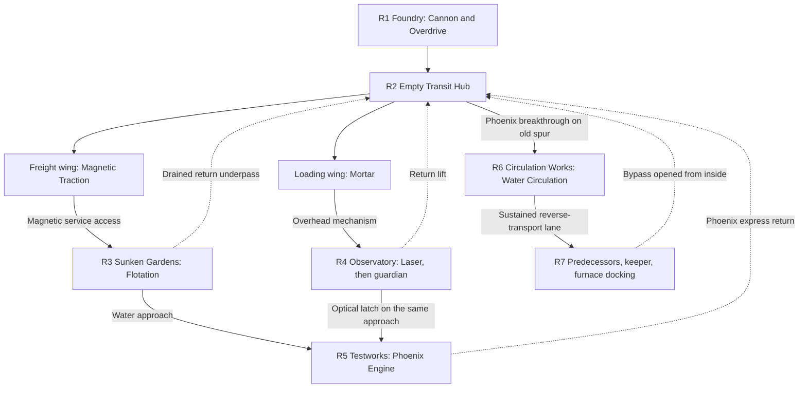

# Furnace Born — Game Specification

This is the single source of truth for game design: the existing playable level, agreed whole-game direction, and explicitly provisional concepts. New design discussions and decisions should be recorded here. Technical architecture, run instructions, and verification tooling remain in `v2/README.md`.

## Whole-Game Direction

### Decision status

The confirmed direction is a lonely, mysterious journey through a lost mechanical civilization, ending in passing on the flame (传火). The eight-ability roster and the complete story linking seven regions, ability acquisition, persistent map changes, and voluntary furnace docking are accepted design directions. Explicitly labelled proposals and unspecified room layouts, encounter values, timing, production scope, and implementation details remain open.

The existing first-level specification remains the playable baseline. Later abilities, regions, story revelations, and puzzles described here are not implemented features. All future game-design decisions belong in this document; implementation and execution instructions belong in the version README.

### Emotional identity

- Loneliness and mystery lead the experience. Occasional tenderness comes from mechanical behaviour and small responses, rather than a talkative cast or a busy social hub.
- The world sometimes moves but rarely answers. Empty trains still depart, observatories transmit into silence, and repair arms attend machines that no longer wake.
- Ruins should reveal purpose, habits, and interrupted expectations, rather than serve only as damaged scenery.
- Preserve the established exaggerated industrial forms, expressive Tank, fixed camera, and wordless storytelling. A melancholy world does not require realistic military art.
- Not every functioning machine is hostile. Some are dangerous because they continue their work; others can be helped or briefly awakened. Encounter density and any recurring characters remain open.
- The player should understand how the civilization operates and why it is failing. Its builders, origins, and ultimate disappearance may remain partly unexplained.

### Narrative premise

A small Tank rejected for melting escapes its factory, crosses a civilization that is slowly cooling, and eventually becomes the bearer of the heat that lets it continue.

The civilization did not disappear in a single disaster. Its central furnace weakened over a long period, and outlying facilities lost their supply one after another. Machines continue their last assignments even as the conditions that made those assignments useful disappear.

The recycling system sustains the remaining furnace by consuming the civilization itself: first unused equipment, then peripheral facilities, and finally machines that could still function. The first factory's attempt to recycle the Tank therefore acquires a different meaning later in the journey.

Repair Hives keep rebuilding the Tank while recycling systems try to destroy it. This contradiction is a recurring mystery: one inherited duty preserves the system, while another preserves individual machines. Both remain active, but they can no longer always be fulfilled together.

The Tank's proposed distinguishing feature is compatibility with modules from different failed prototypes. What the factory classifies as a fault becomes the means of survival and growth. Its eventual ability to carry the flame is earned through the player's journey and acquired machinery, rather than established by prophecy or a secret royal identity.

### Motivation and revelations

1. **Escape:** the Tank initially acts to avoid being recycled. The first playable level supplies this complete local motivation.
2. **Understand and find a place:** outside the factory, the Tank encounters silent facilities and occasional stranded machines. Helping, awakening, and reconnecting them reveals how the world depended on shared heat.
3. **Recognize the cost of survival:** later sites reveal that the system has repeatedly consumed itself to postpone shutdown. Earlier recycling and repair encounters become understandable in this context.
4. **Choose to continue the flame:** reaching the central furnace turns survival into a deliberate act of sustaining something beyond the Tank itself.

The accepted full-story direction below develops the ongoing reclamation cycle and reconnection of existing facilities. Routes, pumps, and energy links restored through play materially participate in the final outcome; exploration does more than fill a completion meter. A separate city-wide emergency order is not required by this treatment.

### Connected world structure

The complete-story treatment below develops seven connected regions: Recycling Foundry, Empty Transit Hub, Sunken Gardens, Silent Observatory, Prototype Testworks, Circulation Works, and the combined Predecessor Chambers / Central Furnace. This accepted seven-region structure replaces the earlier loose region list; exact room layouts remain to be designed.

Regions connect through water, cargo, optical machinery, service passages, and express tracks. Repairing infrastructure changes earlier routes. The existing eight-ability plan supplies the acquisition dependencies; the story treatment explains their physical and narrative placement. The seven-region structure is the current design baseline; room scale, total duration, and production scope still require planning and playtesting.

## Whole-Game Gameplay and Puzzle Plan

### Eight-ability scope and decision status

The roster is now **eight abilities including the starting Standard Cannon**: Standard Cannon, Overdrive, Magnetic Traction, Flotation Chassis, Mortar, Phoenix Engine, Laser, and Water Circulation. The previously proposed thermal-transfer, resonance, electrical-link, and player-mounted reflection tools are replaced, not retained as hidden prerequisites or additional abilities.

The user specified the Mortar's arcing, delayed impact; the Phoenix Engine's 3.2x maximum speed, unchanged acceleration, lethal full-speed ordinary-enemy ramming, obstacle breaking, and inter-region express routes; and the Laser's very long reach, mirror reflections, puzzle applications, and indirect weak-point attacks. Water Circulation adds the required ability to accelerate while Overheated, a red-hot hull, and double contact/ram damage against any enemy. The Water Circulation agreement also confirms passive installation without a new key or water-refill system, retained weapon lock during Overheat, stacking with Phoenix, sustained reverse-transport lanes as the primary ability gate, and a small number of thermally released impact seals that may allow physically consistent alternate solutions. Red-hot contact remains a close-range alternative against the rear-only ranged-weapon Boss. These are confirmed design decisions. Exact gate layouts, acquisition dependencies, unconfirmed controls, resource costs, and numerical balance below remain proposals for implementation planning.

Standard Cannon and Overdrive are implemented in the first playable level. This whole-game plan does not change that implementation. Phoenix Engine is a direct Overdrive upgrade using the same action, counted as one of the eight progression acquisitions while sharing the original engine controls. Water Circulation is a separate passive upgrade that changes Overheat behaviour for either engine.

Every ability needs exploration access and useful combat behaviour. Phoenix Engine's combat role is overwhelming ordinary enemies while traversing; it explicitly does not need a Boss application.

| ID | Ability | Exploration gate and puzzle role | Combat role | Main distinction |
| --- | --- | --- | --- | --- |
| 1 | Standard Cannon / 原始火炮 | Break fragile obstructions and exposed relays along a clear firing line | Reliable direct damage and aimed weak-point hits | Straight projectile, moderate reach, no targeting delay |
| 2 | Overdrive / 加速器 | Reverse conveyors and overcome suitable momentum latches | Flank, escape, and ram appropriate ordinary enemies | Grounded acceleration to 1.6x; shared Heat |
| 3 | Magnetic Traction / 磁力牵引 | Pull bridge panels, counterweights, cover, and mirror-bearing objects into position | Pull light enemies, expose movable shields, and reposition cover | Changes object position through a visible physical tether |
| 4 | Flotation Chassis / 浮航底盘 | Cross connected deep water and approach machinery from another bank | Use water flanks while firing; avoid suitable low floor hazards | Changes the usable support surface, without flight or invulnerability |
| 5 | Mortar / 迫击炮 | Lob over cover to hit a recessed mechanism, open-topped enclosure, or inaccessible support | Attack enemies at a chosen landing point after a delay; punish stationary or committed targets | Arcing attack with a fixed landing point, not homing |
| 6 | Phoenix Engine / 凤凰引擎 | Break suitable heavy obstacles at full speed; open express tracks and fast return connections | Full-speed impact immediately destroys ordinary enemies | Upgrades Overdrive to 3.2x with the same acceleration; no Boss requirement |
| 7 | Laser / 激光 | Reach distant receivers and reflect around obstacles using mirrors | Long-range precision and reflected attacks on otherwise inaccessible weak points | Visible beam path and geometric reflection, not tracking or wall penetration |
| 8 | Water Circulation / 水循环 | Maintain acceleration through Overheat on sustained transport lanes; optional red-contact seals | Red-hot contact deals double ram damage to any enemy, including Elites and Bosses | Passive engine protection; hull remains hot, and ranged fire remains locked |

### Heat and the flame

Heat remains the shared combat budget established by the first level. Cannon fire and acceleration generate it; proposed Mortar, Laser, and magnetic-tool costs must preserve choices between attack and movement. Ordinary flotation is proposed to remain usable without sustained Heat generation so traversing water does not cause unavoidable lockout. Water Circulation explicitly exempts engine acceleration from the Overheat lock and adds red-hot contact combat; it does not empty the Heat gauge or restore ranged fire.

There is no freely usable thermal-transfer tool. World cooling and furnace supply remain environmental and narrative subjects. Pumps, shutters, mirrors, and transport machinery can be manipulated through the eight abilities without requiring the Tank to absorb or donate heat as a general-purpose action.

Passing on the flame remains the ending direction. Its proposed input is a contextual docking interaction at the central furnace, developed from familiar Repair Hive interactions, not an additional combat ability. Any future local ember-carrying sequence must use this existing equipment and be designed separately; it is not a committed global timer or extra resource meter.

### Individual abilities

#### 1. Standard Cannon — direct impact

- **Exploration:** break fragile scrap or sever an exposed relay across a railing. These baseline gates establish material damage and line of sight rather than a later acquisition requirement.
- **Combat:** remain the dependable direct-damage choice after the other weapons arrive. Moving targets at ordinary combat distances should often favour the Cannon over delayed Mortar impacts or sustained Laser exposure.
- **Teaching:** a visible fragile support releases a walkway when shot. Indestructible structure responds distinctly from damageable scrap.
- **Limits and Heat:** retain the current 20 Heat per shot, cadence, and solid obstruction rules as the implemented baseline. Ordinary structural walls do not gradually become destructible through unlimited shots.

#### 2. Overdrive — momentum

- **Exploration:** reverse conveyors and push a suitable wheeled carrier past a demonstrated mechanical detent with a running impact. A momentum gate must visibly respond to force, rather than detect a key press.
- **Combat:** spend Heat on flanking, escape, or ordinary-enemy ramming. Retain immediate screen-relative directional input and independent turret aim.
- **Baseline:** maximum 1.6x speed, reached from 1.0x in 0.5 seconds; 15 Heat per second while accelerated; current release behaviour remains the first-level implementation.
- **Limits:** no invulnerability, passage through solid bodies, water traversal, or unsupported-gap crossing. The existing ordinary ram damage rules apply before the Phoenix upgrade reaches its own full-speed state, except when Water Circulation activates red-hot contact.
- **Upgrade relationship:** Phoenix Engine extends this same system rather than requiring the player to select between two accelerator items.

#### 3. Magnetic Traction — object arrangement

- **Exploration:** pull a bridge panel from behind a grille, shift a rail-mounted counterweight, or reposition a mirror-bearing object to change a Laser path. A tether requires a clear path through an opening; it cannot pass through arbitrary walls.
- **Combat:** drag a lightweight attacker out of position, pull a visibly movable shield aside, or move portable cover between the Tank and a turret. Heavy bodies resist according to readable mass and mounting.
- **Teaching:** a stopped maintenance crane leaves a suspended panel in view; the player completes the same motion from an accessible position.
- **Proposed limits:** begin with pulling rather than separate push/pull modes. Active traction occupies the tool, reduces speed, and generates Heat. Stable object positions persist after release, letting the player arrange a puzzle before firing.
- **Combination:** set a mirror's position and then use Laser; place cover before aiming a Mortar; move a counterweight to open an express-track access gate. Magnetic pulling does not itself rotate a fixed mirror unless the object is visibly mounted on a mechanism that converts the pull into rotation.

#### 4. Flotation Chassis — water routes

- **Exploration:** deploy a low flotation assembly to cross connected deep-water surfaces without a drivable floor. Ramps and shore geometry determine entry and exit, supplying a real route capability instead of a damage strip that can simply be crossed with enough HP.
- **Combat:** cross a flooded flank and fire from a new position; avoid ground-contact hazards that are physically below the chassis. Incoming projectiles, beams, hot water, and overhead attacks remain dangerous.
- **Teaching:** a derelict ferry establishes a route across water, followed by a short safe crossing before current or combat is introduced.
- **Proposed limits:** reduced travel speed with immediate directional response, no flight over walls or voids, and no grounded Overdrive/Phoenix acceleration or ramming while afloat. Firing still generates Heat; flotation itself does not continuously consume the Heat budget.
- **Recovery:** retraction requires a supporting surface. Entry without the ability, currents, sinking/failure behaviour, recoil drift, and readable shore exits need a prototype before large regions depend on them. No automatic teleport to safety.
- **Combination:** reach the far bank to pull a counterweight or establish a Mortar/Laser firing angle. Water crossing and express-track travel remain different route networks.

#### 5. Mortar — arcing fire and delayed arrival

- **Required behaviour:** launch a projectile over an obstacle toward a selected landing point. After a flight delay, it strikes enemies at that point. The target location is fixed at launch; moving enemies are not followed automatically.
- **Exploration:** hit a visible mechanism inside an open-topped enclosure, break a support behind a tall barricade, or attack the back of a lowered bridge from the available bank. Show the landing target from the isometric camera; do not make unseen arbitrary clicks the intended puzzle solution.
- **Combat:** punish a stationary turret, an enemy committed to a long attack, or a predicted cluster. The delay rewards anticipation and permits targets to move out of danger. A modest impact area is proposed; its radius, damage, and exact delay remain to be tuned.
- **Teaching:** an enemy Mortar or a visible test launcher first demonstrates a shell clearing a wall. A safe recessed relay then provides the player's first use.
- **Trajectory rules:** arcs clear obstacles below the actual flight path; roofs and sufficiently tall structure still block them. A visible shell, impact cue, and height/occlusion feedback explain failures. Range limits and overhead clearance must be readable without introducing a second persistent aim marker: any landing indicator replaces the ordinary reticle presentation for this weapon.
- **Balance proposal:** higher Heat per launch and/or slower cadence than the Cannon, with a finite range. No separate ammunition inventory is currently proposed. Do not give it enough reach, speed, or universal penetration to supersede both Cannon and Laser.
- **Armour interaction:** resolve the surface actually struck. An overhead hit does not automatically count as a rear weak-point hit. In the proposed rear-only Laser Boss, the roof and upper casing are armoured too, preventing an unexplained bypass of its physical protection rule.
- **Combination:** move cover magnetically, then bombard across it; fire from a water flank; lead a target following a known patrol or rail route.

#### 6. Phoenix Engine — full-speed breakthrough and express travel

- **Required upgrade:** extend grounded Overdrive's maximum speed from 1.6x to **3.2x**, keeping the **same acceleration**, not the same time to maximum speed. Continue to use the Overdrive action; no separate accelerator-selection button is needed.
- **Acceleration calculation:** the current multiplier acceleration is `(1.6 - 1.0) / 0.5 = 1.2` per second. From normal moving speed, reaching 3.2x therefore takes `(3.2 - 1.0) / 1.2 = 1.833...` seconds; from 1.6x it takes another `1.333...` seconds. Acceleration still requires movement input. With current BASE_SPEED = 7, maximum world speed is 22.4 units/second and an uninterrupted straight run-up from 1.0x covers about 26.95 units. These are consequences of the requested acceleration, not new balance targets.
- **Required full-speed impact:** at maximum acceleration, a collision deals overwhelming impact damage and immediately destroys ordinary enemies, including an ordinarily front-armoured Furnace Guard. It also destroys the breakable obstacles designed for this ability. Show a distinct full-speed hull/exhaust state and sound so the player can tell when breakthrough is available.
- **Before maximum:** ordinary Overdrive ram behaviour remains the proposed default until the full-speed state is reached, except for Water Circulation red-hot contact. Near-maximum tolerance for discrete simulation is an implementation detail, not a second undisclosed damage threshold.
- **Exploration gates:** heavy breakable barricades and momentum-dependent route hardware distinguish this tier from ordinary conveyors. Give the barrier enough visible run-up and a clear full-speed impact response. Not every route restriction should simply be a faster conveyor.
- **Express routes:** design dedicated tracks connecting old areas, return paths, and regional junctions. Use long readable approaches, generous turns, physical guide rails, separated entrances, and safe braking/exit areas. Keep direct movement control rather than replacing the route with a cutscene or teleport.
- **Flow proposal:** destroying an ordinary enemy or eligible obstacle at full speed should preserve momentum; otherwise the first obstacle would defeat the express-travel purpose. Major intact structures remain solid. This does not grant immunity to incoming fire, environmental hazards, or all collisions.
- **Boss scope:** do not design a mandatory Boss ram phase or require Phoenix Engine to damage Bosses. Its combat payoff is clearing ordinary opposition during travel. Without red-hot Water Circulation, Boss and major Elite collision behaviour remains separate from the ordinary-enemy kill rule and retains the existing no-ram-damage default. Red-hot contact can damage them; Phoenix alone still does not require a Boss role.
- **Heat and stopping:** retain the shared Heat system. Use the existing 15 Heat/second as a starting prototype value, not a newly fixed Phoenix balance commitment. Route length, ambient hazard exposure, release deceleration, emergency stopping distance, and cooling opportunities must be tested at 3.2x. Equal acceleration does not imply that release braking has already been specified. Before Water Circulation, avoid both endless waiting on every ordinary connector and mandatory tracks that exceed the Heat budget. Separately identified sustained lanes may require Water Circulation and continued red-hot acceleration.
- **Placement:** acquire it with enough game remaining to open several meaningful inter-region connections. Permanently broken barricades and unlocked track approaches stay open, changing later travel.

#### 7. Laser — reach and reflection

- **Required behaviour:** an extremely long-range beam reflects from mirror surfaces. Its path is geometric and visible, with no homing or arbitrary passage through opaque structure. Range remains finite for simulation but substantially exceeds ordinary Cannon engagement distances; the exact value is not yet fixed.
- **Exploration:** strike a distant receiver or weak support, reflect around a wall, or use a sequence of mirrors to reach a receiver in a recess. Mirrors may be part of scenery, movable machinery, or enemies. Magnetic Traction can reposition a mirror-bearing object when its mounting permits it.
- **Combat:** attack exposed weak points from an indirect direction. A mirror-faced enemy can redirect the player's beam toward another target; its orientation and reflective face must remain readable and obey the same rule as scenery.
- **Required Boss concept:** a Boss continually faces the player and has invulnerable front and side faces, with its rear as the only vulnerable region for conventional weapon attacks. Water Circulation red-hot contact remains an alternate close-range damage route under the all-enemies rule. Aim at a world mirror so the reflected beam reaches the rear while the Boss still faces the Tank. For example, a side firing lane leads to mirrors behind the Boss, directing the final segment forward into its back. The aim puzzle is beam routing, not trying to circle faster than an unwinnable tracking rate.
- **Weak-point validation:** use the final reflected segment and actual collision surface when determining a rear hit, not the player's position or the initial aim direction. An armoured top also blocks Mortar damage where this Boss is rear-only. Red-hot contact remains eligible on other surfaces, offering a close-range alternative to reflected ranged fire. This is a future encounter, not a redesign of the existing Furnace Overseer.
- **Teaching:** begin with one visible mirror and a stationary receiver, then introduce an offset target, a movable mirror, or a rotating mirror-bearing enemy. Mirror frames, surface sheen, contact flare, and outgoing beam make reflection understandable without written angle rules.
- **Reflection proposal:** use one consistent reflection law for scenery and enemies, including angled mirrors. Stop at opaque surfaces. Prevent pathological mirror loops with an internal path budget while keeping authored puzzles short and readable. Do not put necessary aim targets outside the player's readable view or require changing the fixed camera to find them.
- **Balance proposal:** a sustained beam that generates Heat and requires maintained aim gives a different commitment from a Cannon shot or delayed Mortar shell. Duration, damage, Heat rate, and any reflection loss need a prototype. Do not add an ammo meter or a universal armour-bypass property. Reflected routes should remain worthwhile; arbitrary per-bounce penalties must not make the intended solution ineffective.
- **No retained shield ability:** mirrors perform the reflection; the player does not separately deploy a reflective armour module.

#### 8. Water Circulation — acceleration through Overheat and red-hot contact

- **Required behaviour:** after acquiring Water Circulation, the Tank can continue accelerating and start accelerating while Overheated. Its hull becomes visibly red in that state, and contact with any enemy deals double ram damage. The ability needs an exploration application, either red-hot breakable obstacles or a puzzle that actually requires continued acceleration through Overheat.
- **Confirmed integration:** a passive installed upgrade, with no new action key, water-ammunition meter, or field-refill chore. A closed circulation loop protects the drive by spreading engine heat into the outer body; steam, moving pipes, and a glowing hull communicate why the Tank is hot but still mobile. This is not an instant cooling tool.
- **State rules:** retain the existing 100-Heat entry threshold and zero-Heat recovery threshold. With the module, reaching 100 does not force engine deceleration or prevent re-engagement. The hull remains red throughout the Overheated latch, including its cooling period, and the contact bonus lasts for that same clearly displayed state. Normal weapons and the heat-generating magnetic tool remain locked while Overheated; the exception is grounded engine acceleration. The weapon lock and passive Overheat behaviour are confirmed; the magnetic tool retains its existing proposed Heat-lock behaviour.
- **Sustaining the state:** accelerated movement continues to generate Heat and update the cooling delay, with displayed Heat capped at 100. Therefore a player can deliberately remain red and accelerate for as long as movement continues. Releasing acceleration permits the usual deceleration, cooling delay, and cooling back to zero. Do not silently impose a new duration limit, self-damage timer, or forced stop to negate sustained traversal. The cost is committing to a hot contact-combat state without ranged fire until recovery.
- **Contact damage:** every enemy category is eligible, including ordinary enemies, shielded guards, Elites, and Bosses. Red contact is not restricted to Phoenix's full-speed state or the old 1.3x offensive-ram threshold. Use a positive base contact/ram damage value for the current speed tier, then apply `red contact damage = 2 * base ram damage` once. Current zero-damage outcomes produced by ordinary ram immunity are not the base value: applying `2 * 0` would violate the all-enemies requirement. Low-speed contact baselines, speed-tier damage, and armour response amounts require explicit tuning before implementation.
- **Repeated contact:** use contact-event handling and a short per-target repeat interval to prevent frame-rate-dependent damage from overlapping bodies. Do not introduce a per-window or per-fight hit quota. Standing in continuous contact must not produce one damage application per rendered frame.
- **Phoenix combination:** Water Circulation does not change the chosen engine's maximum speed or acceleration. With ordinary Overdrive it preserves acceleration to 1.6x through Overheat; with Phoenix it preserves acceleration to 3.2x at the same existing slope. At Phoenix maximum, apply the red multiplier to the finite high base ram damage. Ordinary enemies already die at full Phoenix speed; the stacking is still meaningful for sustained travel, tougher targets, and red-contact mechanisms. Do not apply the multiplier twice or implement the ordinary kill rule as a universal Boss insta-kill flag. Eventual Boss HP and ram damage must be balanced together; no new Boss immunity cancels the user's all-enemies rule.
- **Protection:** a glowing hull does not grant invulnerability, remove physical separation, heal HP, or immunize the Tank against beams, shells, furnaces, or enemy attacks. Destroying a normal enemy in an impact can preserve Phoenix momentum as already proposed; solid major structures remain solid. Flotation still does not allow grounded Overdrive, but red-state contact damage is not silently disabled merely because a valid enemy contact occurs while afloat.
- **Feedback:** show red heat across the chassis rather than only a small icon, with steam and a distinct mechanical sound. Phoenix maximum readiness also needs a separate exhaust shape/sound so players can distinguish 'hot contact available' from 'full-speed breakthrough available.' On cooling to zero, restore the normal hull and clearly signal weapon recovery. Preserve the single warm-coloured cursor Heat gauge.
- **First use:** acquire the module at an accessible cooling installation, then provide a safe approach where normal acceleration reaches Overheat. The drive continues, the body turns red, and an ordinary obstacle/enemy or return lane demonstrates the result immediately. A cold-start approach must be possible; firing repeatedly at empty scenery is not the intended mandatory preheating step.

### Water Circulation exploration direction

**Confirmed primary gate: sustained reverse-transport lane.** A continuous opposing conveyor or pressure-driven cargo lane has no intermediate place to park. Stopping the drive moves the Tank backward; the route cannot be solved by standing still and cooling. Its uninterrupted length and opposing speed exceed what a cold Phoenix-equipped Tank without Water Circulation can traverse, including acceleration, the entire pre-Overheat travel, and the deceleration coast. With Water Circulation, the Tank crosses the threshold and keeps making progress. Side geometry must expose an understandable return path rather than hide a safe waiting pocket inside the supposedly required section. The lane itself need not deal damage, so extra HP is not an alternate resource key. Length alone is insufficient: a player must not accumulate net progress by repeating boost/cool cycles. Start prototyping with a backward belt around 2.6x normal speed, below Phoenix's 3.2x but above its sustainable pre-upgrade average including cooling, and test the chosen lane length against all release/coast cycles. This is a candidate tuning value, not a proven gate or a change to the first-level conveyor; Phoenix braking is still undecided.

This is a separate tier from ordinary Phoenix express tracks. Phoenix routes within the normal Heat budget remain useful before Water Circulation. Later sustained lanes connect distant branches and make the combination feel like a developed transport system rather than a longer repeat of every earlier conveyor.

**Confirmed secondary direction: a small number of thermally released impact seals.** A sealed gate has visibly load-bearing cold fasteners. A red-hot hull in contact releases the fasteners while the collision pushes the gate apart. A cold Phoenix hit produces a readable solid recoil; hot contact produces steam, moving fasteners, and rupture. This may be authored as a direct red-contact gate if needed, but it requires more than a red-painted wall. Define how Laser heating, Mortar impact, and sequential combinations affect it before claiming exclusivity; if those actions physically provide the same heat and force, accept the alternate solution or redesign the gate rather than invent an invisible immunity.

**Further proposal: loaded return carriage.** Drive a heavy carrier up an opposing transport lane while keeping it moving against an observable return force. The carrier makes waiting between spurts lose progress; Water Circulation sustains the drive through Overheat. Magnetic Traction can first move a counterweight or open the approach, but cannot be an untested route to holding the carrier indefinitely. This is a candidate only after validating cold-Phoenix bursts, coasting, reverse recovery, and object-wedging alternatives. A long timed door on otherwise safe ground is merely a speed check and must not be labelled a Water Circulation lock.

**Narrative use:** the module makes a small machine able to continue moving after ordinary thermal limits would stop it. A late approach to the furnace can express carrying the flame through a glowing hull and sustained movement. The final act still uses the established furnace docking interaction; no additional flame-transfer ability is introduced.

### Proposed acquisition structure

The roster now contains eight; the following map dependencies are a working proposal, not fixed region scripts:

1. Standard Cannon -> Overdrive in the existing first level.
2. Two routes out of the Empty Transit Hub provide Magnetic Traction and Mortar in either order. Neither acquisition requires the other branch's reward.
3. Magnetic Traction opens reservoir service access to Flotation Chassis. Mortar opens the observatory's enclosed service machinery route to Laser. Each of these branches is completable without the other branch's new ability.
4. Flotation Chassis plus Laser give access to a derelict high-speed test facility and Phoenix Engine. This route must be traversable at ordinary Overdrive speed before the reward; its exit demonstrates full-speed breakthrough and reconnects an old track.
5. Phoenix express routes reconnect a cooling installation where Water Circulation can be acquired without requiring red-hot acceleration to enter. Its exit demonstrates a sustained transport lane. Leave meaningful exploration and combat after acquisition.
6. The remaining exploration uses ordinary express tracks, longer Water Circulation lanes, optional branches, and the central-furnace approach. Neither late engine upgrade is reserved for the final minutes.

Dependency summary: Cannon -> Overdrive -> {Magnetic Traction, Mortar}; Magnetic Traction -> Flotation; Mortar -> Laser; {Flotation, Laser} -> Phoenix Engine -> Water Circulation. Region assignments can move if the physical gate or narrative pacing works better elsewhere.

- Show memorable blocked routes before acquisition and provide an immediate safe application after it.
- Give each new ability later exploration uses and a recurring combat application; Phoenix's combat application remains ordinary-enemy breakthrough rather than Boss damage.
- Allow costly alternate routes where the physical rules support them. Distinguish these from hard gates such as unsupported deep water, blocked straight firing lines, or a full-speed breakthrough obstacle.
- Keep large restoration changes, broken route barriers, and useful shortcuts persistent. Do not require replaying a long mirror puzzle on every return trip.
- Vary acquisition through derelict test machinery, restoration, and encounters instead of assigning every ability its own Boss.

### Controls and weapon roles

- All acquired capabilities remain available; no limited loadout can strand the player behind an ability gate. Phoenix replaces the engine's speed ceiling while retaining all ordinary Overdrive uses.
- **Proposed controls:** left click fires the selected weapon (Standard Cannon, Mortar, or Laser); right click operates Magnetic Traction; Shift operates Overdrive, upgraded to Phoenix Engine; a separate action deploys Flotation. Weapon selection uses a small icon selector, with bindings and selection method to be tested. Water Circulation activates passively during Overheat. The eight progression abilities therefore do not require eight separate action keys.
- Keep independent turret aim and screen-relative movement. Display the selected weapon through barrel configuration, one reticle, and a concise icon; preserve the warm-yellow-to-red Heat ring. Weapon-specific aiming cues must not restore the discarded duplicate ground reticle.
- Switching weapons must not erase Heat, bypass firing recovery, or retarget an already-launched Mortar. Magnetic positioning followed by firing should be deliberate rather than a simultaneous hidden tool effect.
- **Cannon:** reliable ordinary-range direct fire. **Mortar:** an arc over cover and delayed area pressure. **Laser:** very long, reflectable precision with sustained aim as the current proposal. Balance each role so selecting a new weapon does not retire the earlier two.
- Preserve normal grounded movement during Overheat. Without Water Circulation, the existing engine and weapon lock remains. With it, grounded acceleration may continue or restart and red-hot contact deals double ram damage; weapons remain locked until fully cooled; the magnetic tool keeps its proposed Heat-lock rule. Flotation remains usable. No general instant-cooling skill, separate mana system, or ammo inventory is currently planned.
- Numeric damage, ranges, launch delays, explosion radius, Laser tick rate, tool Heat costs, floating recoil, Phoenix braking, and positive ram/contact baselines for previously immune targets remain prototype decisions. The requested 3.2x maximum and unchanged acceleration are explicit exceptions already specified above.

### Combined puzzles and travel spaces

**Enclosed pump station:** the pump's exposed latch is visible inside an open-topped wall. Lob a Mortar shell onto it to release the machinery, then use Magnetic Traction to move a counterweight. Water-level changes expose an old transit route; Flotation later reaches another bank. Stationary defenders behind the same wall demonstrate the Mortar's combat use.

**Mirror observatory:** reposition a rail-mounted mirror with Magnetic Traction, then fire Laser through a visible reflected route to an offset receiver. A mirror-bearing enemy supplies a moving reflector in a later room. Use a small number of visible bounces; critical solutions must not depend on guessing off-screen geometry or an enemy that permanently dies without a retry path.

**Phoenix return rail:** encounter a heavy barricade and the long approach early. After acquisition, accelerate along the approach to the distinct full-speed state, break through the barricade and ordinary blockers, then exit onto a safe braking apron. The unlocked rail joins two previously distant regions. Design the route around actual run-up distance, speed, Heat, camera visibility, and stopping distance.

**Rear-only guardian:** the enemy keeps its armoured face toward the player. Mirrors behind and beside it create a route for Laser to reach the rear. The final segment, not the Tank's position, determines the valid hit. Let positioning and sustained aim create difficulty; do not reintroduce an arbitrary per-window damage cap. Provide enough rear exposure and mirror coverage for the authored route to remain usable while the Boss tracks the player.

**Water Circulation return:** a sustained reverse-transport lane leads out of the cooling installation toward an old junction. It has a cold-start approach, visible backward force, and safe retreat. Its geometry is validated against the maximum progress achievable without the new ability; red-hot acceleration completes the crossing.

**Central furnace:** use ordinary interactions and the eight abilities to clear access, align optical receivers, restore pumps, and reopen transport routes. The final docking passes on the flame through the furnace interface. No removed thermal-transfer, circuit-link, resonance, or shield tool is required.

### Puzzle and feedback principles

1. Demonstrate a machine or attack's visible cause and effect in a forgiving setting.
2. Let the player reproduce it with an acquired ability.
3. Change spatial arrangement, timing, or combinations without changing the physical rule.
4. Reuse that understanding in both exploration and combat.

- Make blocked Mortar arcs, armoured impacts, mirror reflections, magnetic resistance, and Phoenix readiness distinct in shape, animation, and sound. Do not require prose or colour-only matching.
- Reward successful hits during a real opportunity. The existing Elite has no per-window damage cap; the first-level Boss still retains its separately documented cap. New encounters should not add hidden hit quotas to compensate for a successful solution.
- Critical puzzle objects must remain retrievable or have a nearby visible reset. Solutions using mirror-bearing enemies need a recovery path if those enemies die or leave position.
- Avoid long forced retries, objective arrows, camera pulls, and unexplained immunity added solely to preserve a planned route.
- One-time restoration should change the world and subsequent travel. Optional shortcuts may accept more than one consistent solution.

### Design validation before implementation

- Count exactly eight progression abilities; the Phoenix upgrade shares Overdrive's controls and does not demand a separate base-engine selection.
- Verify the Phoenix acceleration slope is unchanged: about 1.83 seconds and 26.95 world units from normal moving speed to 3.2x under uninterrupted straight acceleration at the current base speed.
- At full Phoenix speed, an ordinary front-armoured guard dies on impact and an eligible barricade breaks without defeating the intended travel flow. Boss participation is not required to demonstrate the upgrade's value.
- Test ordinary express routes with the actual Heat budget, turn readability, fixed camera, and braking distance before committing regional distances. Validate Water Circulation gates against the best cold-Phoenix attempt, intermittent acceleration, coasting, safe waiting spots, and available object manipulation.
- With Water Circulation, acceleration continues through 100 Heat and can be restarted while Overheated; the hull remains red until recovery. Without the module the first-level lock behaviour remains unchanged.
- Red-hot contact damages ordinary, shielded, Elite, and Boss targets at twice a positive base value, including below Phoenix maximum speed. Ensure overlapping contacts do not apply damage every frame, the Phoenix multiplier stacks only once, and weapons remain locked during the red state under the confirmed state rules.
- A Mortar shell clears appropriate cover, stays committed to its landing point, resolves damage after flight, and is blocked by an actual roof or intercepted trajectory.
- Laser reflects consistently from scenery and enemy mirrors. A rear weak-point check follows the final segment; continuous player-facing tracking does not invalidate an otherwise correct mirror solution.
- Every signature gate is readable without a written explanation. Mortar, Cannon, and Laser retain distinct useful combat roles.
- Either permitted branch order remains completable, acquisition routes do not require their own reward, and permanent shortcuts materially reduce later travel time.

## Complete Story and Connected World — Accepted Direction

### Status and scope

This story direction was accepted on 2026-09-08. It connects escape from recycling, discovery of a city consuming itself, recovery of modules from failed prototypes, restoration of regional infrastructure, recognition of previous furnace bearers, and voluntary passing on the flame. The seven-region structure, acquisition placement, wordless recurring scenes, and map-changing return routes form the accepted narrative and progression baseline. Detailed encounter choreography, exact room geometry, optional scene variants, and final interaction/save implementation remain open wherever identified below. Design names and region identifiers are authoring vocabulary and must not appear as gameplay text.

Preserve the first level's existing local progression and mechanics. For a future full-game build, its exit continues into the transit region instead of ending the whole game; the current v2 completion sequence remains the vertical-slice implementation. Total playtime, room count, optional-content volume, and numerical encounter balance remain unspecified.

### Underlying history — what happened before play

The setting is one connected mechanical city whose factories, gardens, transport, and observatories depended on a central furnace. Its geography follows the distribution and return of heat: supply travelled outward through transport and service infrastructure, while coolant and reclaimed material returned inward.

The original builders are gone. The cause is intentionally unresolved; the critical story is what the remaining machines did afterward. The city continued for a long time under two inherited duties: keep the furnace alive, and repair machines that could still work.

The furnace's regulating and circulation machinery gradually failed. Feeding it more reclaimed material maintained a weak flame but could not restore the failing system's efficiency. The city began consuming unused equipment, then peripheral facilities, and eventually active machines. Every contraction preserved the centre a little longer and made fewer outer places habitable for mechanical life.

Earlier mobile prototypes reached the furnace and became replacement drive/regulator assemblies. They kept the system running for a time but eventually wore out. Their hulls and mounting cradles remain in successive furnace chambers. This history explains recurring vehicle-shaped interfaces without establishing a prophecy or a chosen individual.

The player Tank was a rejected experimental chassis able to accept incompatible modules. Its engine and circulating systems are initially inadequate for the central furnace. The journey builds a workable combination from abandoned attempts. The final act provides a replacement working drive, circulation path, and ignition/control connection; it does not create limitless energy from one small vehicle. Existing fuel and stored heat still matter, and future decline remains possible.

### Narrative spine — what the player wants at each stage

| Stage | Immediate player motivation | New understanding | Concrete next action |
| --- | --- | --- | --- |
| Escape | Avoid being melted | The factory rejects this Tank, while Repair Hives preserve it | Defeat the local Overseer and leave |
| Find a way onward | Explore beyond an empty transit yard toward a distant active furnace tower | This was a connected city, not an isolated weapons factory | Open the yard's two service wings and find traversable exits |
| Restore passage | Reach the far banks and upper maintenance routes | Water, cargo, and power once formed a shared circulation system; small repairs still have effects | Recover flotation and optical equipment, then restore physical connections |
| Recognize the cycle | Reach the central complex and understand its vehicle-shaped installations | The city is dismantling itself; other machines reached the furnace before | Recover the fast test engine and reach its cooling installation |
| Become capable of entering | Cross the return system that ordinary thermal limits make impassable | Remaining hot while moving is a useful state, and earlier designs failed under this load | Integrate Water Circulation and reopen the sustained return route |
| Choose to continue the flame | Reach the dying furnace after defeating its keeper | The familiar repair-shaped interface now needs a machine to sustain the system | Deliberately dock and become the next bearer |

There is no written mission list. Each local objective must be understandable from reachable space, visible obstruction, machinery behaviour, and the result of the player's previous action. The distant furnace tower is a recurring landmark, not an animated objective beacon or a camera-driven instruction.

### Seven regions and their relationship to the abilities

| Region | Former purpose and current condition | Local playable structure | Ability acquisition | Story consequence |
| --- | --- | --- | --- | --- |
| R1 — Recycling Foundry | Reclaim material and assemble prototypes; now processes almost everything as scrap | Existing A/B/C branches, Elite loop, return conveyor, Furnace Overseer | Start with Cannon; acquire Overdrive | The Tank escapes, but the repair/recycling contradiction remains |
| R2 — Empty Transit Hub | Exchange cargo and distribute heat; trains still circulate with empty carriers | Safe central turntable, magnetic freight wing, Mortar loading-bay wing, exits toward west/east regions | Magnetic Traction and Mortar, either order | Mechanical life once depended on a network; isolated useful actions still matter |
| R3 — Sunken Gardens | Coolant reservoirs and controlled growing/maintenance spaces; pumps stopped and water occupies former roads | Shore loop, pump access, ferry cradle, water route, dry return shortcut | Flotation Chassis | Shutdown was progressive; outer facilities were deliberately disconnected to preserve the centre |
| R4 — Silent Observatory | Observe the outside and align optical communications; signals continue without response | Enclosed service approach, salvaged emitter, mirror galleries, rear-vulnerable guardian, return lift | Laser before the mirror guardian | The city waited for a reply; its outward signals coexist with inward recycling traffic |
| R5 — Prototype Testworks | Test mobile replacement drives; runways end at discarded cradles and stalled rigs | Approach requiring water traversal and a separate optical latch, abandoned test loop, module recovery, breakthrough exit | Phoenix Engine | Mobile prototypes were built to carry machinery onward; familiar chassis features recur in failed candidates |
| R6 — Circulation Works | Protect drives and return coolant through the central complex; still enforces a dangerous one-way material return | Phoenix-opened service entrance, short mechanical restoration loop, circulation rig, red-hot return lane | Water Circulation | The new drive can stay mobile through Overheat, making the central return passage viable |
| R7 — Predecessor Chambers and Central Furnace | House successive regulating assemblies and maintain the remaining flame | Quiet predecessor approach, final Repair Hive, furnace keeper encounter, controllable final approach and docking | No ninth ability | The Tank understands the interface and chooses to pass on the flame |

R2 contains two substantial local wings rather than two additional standalone regions. R7 combines the earlier predecessor-chamber and central-furnace concepts. R5 and R6 are dedicated places for the two engine upgrades, not rewards crowded into the final room. Bosses are not compulsory region punctuation: R1 has its existing encounters, R4 has the mirror guardian, and R7 has the final keeper; other regions may end in a machinery sequence, an ordinary encounter, or a quiet acquisition.

### World topology and return paths



Solid arrows show progression access and dotted arrows show unlocked returns; the diagram is not a room-coordinate layout. Both incoming branches at R5 are required: the shared approach contains a water crossing and an optical latch, not two independently sufficient entrances. R3 and R4 reconnect to R2 through shortcuts. Both branches contribute practical access to R5: a flooded maintenance approach physically needs flotation, and a subsequent offset receiver needs Laser. They are separate visible obstacles in the route, not two abstract completion tokens delivered to a gate. R5's entrance and module cradle are reachable without Phoenix. Its exit reconnects an old elevated freight track to R2.

The R6 service spur is visible near the hub from the first visit, including its long approach and heavy breakthrough obstruction. Phoenix opens it. R6 itself is accessible before Water Circulation; the new module enables the sustained inner return route to R7. A maintenance bypass opened from the R7 side supplies a convenient return for optional exploration without invalidating the first crossing's ability gate.

Suggested persistent connections:

| Player action | Lasting map change | Later use and visible consequence |
| --- | --- | --- |
| Pull a cargo-wing counterweight | Lower a hub walkway and clear the reservoir service exit | The same freight carrier can finally complete its short route |
| Mortar an enclosed loading mechanism | Open observatory service access and a hub crossover | Loaded material is revealed to travel inward toward reclamation |
| Restore the garden pump mechanically | Drain a hub underpass while retaining deep-water exploration areas | A formerly submerged rest platform becomes a useful return landmark |
| Open the observatory return lift and align its optics | Reconnect an upper hub route and expose a line into the testworks approach | The outward signal visibly resumes, still without an answer |
| Break through the testworks exit with Phoenix | Connect the garden/observatory junction back to the hub via express track | Earlier long travel becomes a continuous high-speed run |
| Enter the circulation spur and acquire Water Circulation | Make the sustained inner transport lane traversable | Red-hot motion changes the previously defeating thermal limit |
| Open the inner maintenance bypass from the furnace side | Link the final rest area back to the established network | The player may finish optional restoration before docking |

Map changes result from mechanisms and traversal, not a global quest counter. Permanent shortcuts persist through rest and death; ordinary enemies may respawn without reconstructing a broken bridge or restoring a deliberately destroyed route barrier.

### R1 — escaping the machine that made you

Keep the current awakening, conveyor rejection, two relay branches, Overdrive Prototype, backtracking, and Furnace Overseer. The factory tries to reclaim the Tank; Repair Hives repeatedly rebuild it. Do not explain the contradiction yet.

The full-game continuation begins after Repair Hive 3. The Tank drives into the light and reaches an empty transit yard. The fixed camera reveals what naturally enters view: a carrier arrives without cargo, waits with its clamps open, and departs. The central tower is intermittently visible beyond the yard's structure. Do not rewrite the current standalone slice's deliberately undefined exterior until implementing that continuation.

### R2 — a network with nobody waiting

The central turntable is the first quiet orientation space outside the foundry. It connects two accessible local wings and shows several blocked routes that will become useful later. It is not a populated town or a shop hub.

A small maintenance machine is trying to repair a broken carrier rail. It performs the same unsuccessful motion each time, then pauses. It never speaks, leads the player, or points toward an objective. An optional magnetic interaction later lets the rail settle into place. The machine resumes a useful task and briefly turns its light toward the Tank. This supplies a small reason to care without making the main plot depend on reading an NPC request.

**Freight wing:** use Cannon and ordinary Overdrive to release a stopped cargo mechanism and approach a derelict magnetic loader. Recover Magnetic Traction from its accessible service mounting. The exit immediately uses pulling to lower a walkway, then returns to the central turntable. The same action reveals the reservoir route.

**Loading wing:** approach an abandoned artillery loading rig through ordinary combat and direct mechanical latches. Recover the Mortar before encountering its required overhead shot. The return route uses the new arc to hit an exposed latch inside an open-topped enclosure. This opens the observatory service passage. Do not hide the Mortar itself behind a Mortar-only gate.

The two wings can be completed in either order. The transit region's important revelation is physical: cargo tracks that appear to serve the outskirts now bring dismantled machinery back toward the furnace.

### R3 — following the missing water

Magnetic Traction opens the reservoir's service approach by moving a heavy maintenance panel or counterweight. The initial shore loop remains entirely traversable without flotation. Across the water, the player can see roads, repair cradles, and growing frames at different submerged levels; they imply successive shutdowns rather than one sudden flood.

Reach a ferry maintenance cradle and recover the Flotation Chassis from an immobilized transport shell. The first water crossing is short, calm, and leads to a visible ramp. A later flooded chamber introduces enemies and alternate firing positions. A pump restoration sequence uses movable counterweights and ordinary physical controls; it does not require any removed thermal-transfer or electrical-link ability.

Restoring the pump drains part of the transit underpass and gives an immediate dry return route. Other connected deep water remains, so acquiring flotation is not invalidated by draining the entire region. An optional side pool contains a dormant small machine with no mandatory item reward; its location can later appear in the ending.

The revealed infrastructure shows deliberate isolation: valves were shut toward the outer gardens while return pipes to the centre remained open. The player learns that the centre survived by giving up its edges.

### R4 — a signal without an answer

The Mortar opens an exposed mechanism inside an enclosed approach, giving access to the observatory service ring. The player climbs through ramps and lifts consistent with the fixed-camera ground-plane design; there is no new jumping ability.

Recover Laser from a disused calibration emitter midway through the region. A single mirror and receiver teach reflection before moving objects or enemies complicate it. A later gallery combines a pullable mirror carriage with a Laser route as an optional combination space; the mandatory route must remain completable if the player has not yet acquired Magnetic Traction.

The regional guardian tracks the Tank with its armoured face. Mirrors in the arena provide visible routes into its rear weak point. Laser is already owned; acquiring it is not the reward for a fight that requires it. Red-hot Water Circulation would remain a valid close-range alternative on a later encounter or permitted sequence break, not an immunity exception.

After the encounter, the return lift opens and the observatory's mechanical alignment can complete. The array sends a visible pulse outward. A receiver turns, waits, and resets; nothing responds. No cutscene claims the builders are dead or names an external enemy. An inward-facing maintenance aperture also becomes usable, providing the optical access needed on the testworks route.

The emotional contrast is that the city's machines still look outward while their material is steadily carried inward.

### R5 — machines that tried before you

The approach combines a real water crossing and an offset optical mechanism. The route works with Flotation and Laser in either earlier branch order. Once inside, normal Overdrive suffices to explore the accessible test loop.

Test cradles contain vehicles with different failed assemblies: an engine that tore its mounting apart, a stopped chassis below scorched coolant pipes, a narrow carrier that reached the end of its rail but could go no farther. These are visible mechanical failures, not readable logs. Their connectors resemble parts already integrated into the Tank.

Recover Phoenix Engine from a stationary accessible rig after releasing its clamps through existing tools. The acquisition need not be a Boss fight. A long exit approach makes the unchanged acceleration legible, then full speed breaks an ordinary barricade and clears a few ordinary blockers. The route rejoins an elevated hub freight line that the player saw earlier from below.

This is a major movement payoff and a period of agency after the observatory's silence. Give the player meaningful time to reopen routes and revisit earlier places before asking for the final engine upgrade. The discovery is not yet 'I must die'; it is 'these machines were attempts to go where I am going.'

### R6 — learning to remain alight

Phoenix opens the heavy service-spur obstruction near the hub. The long run-up and the route itself are familiar from earlier visits. Inside the Circulation Works, the player sees old drive bodies beside worn coolant jackets and successive connections that lead toward the furnace.

The initial restoration loop uses existing movement, ranged attacks, and physical machinery. Recover Water Circulation from a functioning service rig reached without needing continued acceleration through Overheat. Its passive integration completes the first clear connection between the player's modular body and the abandoned systems around it.

The immediate test is a sustained return lane with a cold-start approach and a safe retreat. Without the module, the machine would overheat and be pushed back. With it, the hull glows red and the drive continues. Tune it against Phoenix bursts, coasting, and cooling cycles so the gate truly requires the new property; exact transport speed and length remain prototype values.

Red-hot contact then has an ordinary-enemy application and a small thermal-release obstacle. Weapon lock makes remaining red a choice, while an adjacent safe platform allows cooling and recovery. A loaded-carriage variation can be optional after validating alternative physical solutions.

The story consequence is experiential: the Tank has become a machine that can continue moving while carrying heat its earlier body could not tolerate. It enters the inner complex with this knowledge already established through play.

### R7 — understanding the shape of the furnace

**Predecessor approach:** reduce combat density after the sustained crossing. The player passes successive drive cradles. At first they resemble structural equipment; closer chambers expose recognizable tracks, turret mountings, and the same kind of module sockets seen in the testworks. A former bearer lies connected to a return pipe, its headlight housing facing the empty corridor. The player can infer the relationship without a narrated revelation.

**Last rest and freedom to return:** place a final Repair Hive before the keeper approach. A bypass opens back toward the known network so the player can revisit optional spaces. This full-game rest point does not alter the first slice's rule that there is no Hive immediately before its local Boss.

**Furnace Keeper:** a failing maintenance/protection machine continues feeding reclaimed material into the furnace and defending the last operating assemblies. Its threat is understandable from its work: clamps seize material, moving carriers draw it toward the intake, and its weapons protect the feed path. It is not secretly the civilization's creator and gives no explanatory speech.

Build the fight from available geometry and attack decisions rather than eight sequential ability checks. Low cover gives Mortar opportunities; mirrors offer indirect Laser angles; clear exposed components reward Cannon fire; magnetic cover can alter a firing lane. Water Circulation supports close-range red-hot damage against the keeper itself. Grounded acceleration supplies positioning. Flotation may support an optional safe-temperature coolant side route if the arena needs it, but not every ability must be forced into every phase. Phoenix does not acquire a mandatory Boss-ram requirement.

A proposed two-part fight first removes the keeper's active feed/weapon machinery, then exposes its worn central drive. Distinct components change attacks and space; no arbitrary per-window hit quota extends the fight. The keeper has a meaningful positive red-contact damage path throughout damageable combat states, preserving the all-enemies rule. Exact attacks, component HP, body damage routing, and difficulty are separate encounter-design work.

When defeated, the keeper stops adding material. Its light goes out, but the remaining furnace flame does not become healthy. Victory opens access; it does not automatically finish the story or grant another ability.

**Final approach:** the player remains in control and drives past one last empty cradle into the furnace interface. Its relationship to the Repair Hives is now legible: their arms supported and repaired the Tank, while this arrangement will hold its drive in the city-wide circuit. Familiar mechanical movements reverse the direction of supply.

### Passing on the flame — accepted story outcome

Offer one authored ending for the initial complete story: the Tank chooses to dock and sustain the furnace. Optional restoration changes small visible consequences, not an undisclosed ending score or a requirement to find a 'true ending.' Additional endings remain outside this proposal until discussed.

Approaching the socket must not commit automatically. The interface opens, alignment marks and clamps become visible, and the player can still reverse away. A deliberate contextual action, using the Repair Hive interaction vocabulary, begins docking. Exact hold duration and cancellation timing require interaction testing; the player should understand the cost from predecessors and machinery rather than receive a written sacrifice menu.

In the ending, the drive couples into the shaft, the circulation pipes connect, and the red hull settles into a steady light as the furnace catches a sustained cycle. The Tank's tracks stop being locomotion and its body becomes part of the regulating assembly. The last movement of its turret or antenna is small. Whether its awareness remains is left open; the scene does not establish that it is painlessly immortal or explicitly dead.

The first outward response is a familiar sound from the network: a carrier engages, a pump turns, or a signal mechanism completes its cycle. Only after player control has been deliberately surrendered to the ending may a brief wordless closing montage revisit known locations. Gameplay camera rules remain unchanged before that commitment.

The repaired rail now carries something useful. Water reaches a dry section of the garden. The observatory continues to transmit; it still need not receive a reply. Finally, a small machine previously seen motionless in a quiet place lights up. If the player restored an optional local mechanism, that scene can show its additional effect without withholding the basic renewed-world ending.

The outcome is real renewal of operation, not proof of permanent salvation. The city has more time and functioning connections. No final text explains whether it will avoid repeating the cycle.

**Save/continuation proposal:** retain a pre-docking return state with the keeper defeated and world restoration preserved. A system-menu Continue can return there for exploration; it does not place the Tank after sacrifice or silently undo restored routes. Do not overwrite the player's only exploration state with an irreversible non-playable endpoint. The completed-ending flag and replay behaviour need implementation design later.

### Wordless storytelling vocabulary

| Recurring element | Early meaning | Later reinterpretation |
| --- | --- | --- |
| Repair arms and docking sockets | Safety and recovery | The same physical vocabulary can connect an individual machine to the whole city |
| Empty carriers | Abandonment | A network whose purpose was inverted toward reclamation |
| Detached hulls and module mounts | Scrap and upgrades | Prior attempts to bear the drive and circulation load |
| Outward optical pulses | A distant curiosity | Continuing expectation without a reply |
| A small repair machine repeating a task | Mechanical habit | An individual activity the player can actually restore |
| Red hull and steady engine motion | A dangerous combat state | A body capable of entering and sustaining the final circuit |

Use repeated shapes, spatial placement, motion, and sound together. Essential comprehension cannot depend on colour alone, reading an optional pocket, killing a uniquely useful enemy, or observing a long unskippable animation. Optional scenes deepen meaning; mandatory spaces establish what the final interface does.

### Narrative and progression checks

- The player has an immediate physical reason to enter each new route before understanding the larger history.
- The magnetic and Mortar wings work in either order; the garden and observatory rewards also work in either order. Mandatory observatory progress does not require an optional magnetic mirror arrangement.
- Every reward is reachable without itself. Laser precedes the rear-vulnerable guardian; Phoenix precedes its breakthrough exit; Water Circulation precedes its sustained lane.
- Water restoration, optical alignment, and track opening alter the connected map, rather than merely setting invisible 'region complete' flags.
- The first-level Hive, enemy, and local ending rules remain correctly scoped to the playable slice.
- Each new ability has later exploration and combat value; Phoenix's combat payoff remains ordinary-enemy breakthrough, while Water Circulation's all-enemy rule includes Bosses.
- No plot event removes acquired movement abilities, silently changes their physical rules, or reconstructs already destroyed gates to force a linear route.
- The final encounter does not require a ninth ability, all abilities in a fixed sequence, or an arbitrary damage quota.
- Main-path predecessor scenes explain the docking cost even if every optional story pocket is skipped.
- Persistent restoration has visible consequences after passing on the flame, without requiring a hidden collection percentage.
- The ending offers a deliberate commitment and a proposed pre-docking exploration continuation; exact final UX remains open.


# First Playable Level — Established Design

This section preserves the first-level specification previously recorded in `GAME_DESIGN.md`. The level is a roughly ten-minute vertical slice intended to prove the complete game loop, controls, progression, presentation, and visual identity. Balance values remain tuning targets rather than final production values. Scope exclusions and references to the Final Boss in this section apply to this slice: the Furnace Overseer is its final encounter, not the whole game's final antagonist.

## Vision

The game is a three-dimensional tank Metroidvania presented through a fixed 45-degree isometric camera and played on a two-dimensional ground plane. WASD moves directly in screen space, the hull turns to follow movement, and the turret independently aims at the mouse cursor.

The first level must prove one complete Metroidvania loop:

1. Discover a route that normal movement cannot overcome.
2. Take a visible detour.
3. Explore a compact branching area and fight enemies.
4. Defeat an Elite and acquire a traversal ability.
5. Backtrack through familiar spaces using the new ability.
6. Apply the level's learned rules in a Final Boss encounter.

The game uses an exaggerated industrial cartoon style. It is not a realistic military game, a generic low-poly game, or a toy diorama.

## Design Pillars

### Direct movement and independent aim

WASD directly controls screen-relative movement without tank-style steering. Hull Heading follows the current movement direction for animation and silhouette, while Turret Aim follows the cursor's projected ground position. The player can move and fire in different directions.

### Abilities change both traversal and combat

Overdrive opens Conveyor Gates, changes combat positioning, and enables high-speed ramming against ordinary enemies. It is not a binary key or a cooldown-based dodge.

### Pressure comes from shared Heat

The Standard Cannon and Overdrive draw from the same Heat budget. Aggressive shooting leaves less capacity for movement, while extended Overdrive leaves less capacity for attacking.

### Discovery belongs to the player

The game does not rotate or pull the camera to reveal solutions, highlight paths, show objective arrows, force pauses, or track tutorial completion. Scene composition may make options naturally readable, and brief input glyphs may identify physical controls that cannot be inferred from the world.

### The game tells its story without words

Gameplay, story, environment, maps, and HUD contain no dialogue, prose, labels, or numeric values. Action, animation, staging, icons, unlabelled bars, music, and sound communicate meaning. Text is allowed only in system settings, input configuration, and future accessibility menus.

### Hazards preserve consequences

Environmental hazards never bounce, teleport, or reset the Tank to safety. The player must physically escape or be destroyed.

## Scope

### Included

- One approximately ten-minute level.
- Locations A, B, and C plus a Final Boss room and exit.
- One player Tank with 50 HP.
- One Standard Cannon.
- One acquired ability: Overdrive.
- Three ordinary enemy types, one Elite, and one Final Boss.
- Three Repair Hives.
- A Region Map and an always-visible Minimap.
- Full keyboard remapping and essential system settings.
- A short wordless opening, ability-acquisition sequence, death sequence, and ending.

### Deliberately excluded from this version

- Field Repair or any healing between Repair Hives.
- Collectibles; only future Expansion Pockets are reserved.
- Additional weapons or abilities.
- NPCs, dialogue, logs, narration, subtitles, and environmental writing.
- Mobile controls, controller input, aim assistance, and multiplayer.
- Accessibility options other than input remapping; broader accessibility work is deferred to the second version.
- Future-level environments, creatures, or plot commitments.

## Story

The Tank is a small experimental machine rejected by the automated factory that produced it. It wakes on a maintenance platform after years of inactivity while the remaining factory systems attempt to send it back to the furnace for recycling.

The Tank has no dialogue. Twin headlights, an antenna, hull motion, turret gestures, and mechanical timing give it a silent personality. Its long-term growth comes from integrating modules taken from other failed prototypes.

The first level communicates this premise through action:

- The Tank wakes and leaves its inspection platform.
- Location A's machinery attempts to carry rejected material toward the furnace.
- Factory maintenance and defense machines oppose the Tank.
- The Overdrive Prototype demonstrates a discarded power system before the Tank claims it.
- The Furnace Overseer attempts to prevent the rejected Tank from leaving.
- Defeating the Overseer opens the factory exit.

## Visual and Audio Direction

### Exaggerated industrial style

- Oversized barrels, turrets, tracks, vents, pistons, and machinery create readable silhouettes.
- Models use rounded large forms rather than dense realistic mechanical detail.
- Saturated color blocks, stepped lighting, soft dark outlines, and expressive deformation replace photoreal materials.
- Firing produces exaggerated recoil across the entire vehicle.
- Overdrive leans and stretches the Tank's motion while making its tracks and exhaust visibly strain.
- Explosions use colorful fireballs, ring-shaped shockwaves, and clustered smoke rather than realistic simulation.
- The Tank is primarily warm yellow; facilities use teal and green; orange-red consistently communicates danger and Heat.

### Tank personality

- The Tank is compact with an oversized turret and barrel.
- Twin headlights suggest eyes without becoming a literal face.
- A short antenna reacts to discovery, danger, damage, and ability acquisition.
- Idle motion resembles breathing machinery.
- Low HP is shown through unstable track motion, intermittent exhaust, and visible damage without changing control responsiveness.
- The first level uses no written factory number or name. A formal name may be earned later.

### Mechanical score

- Music combines playful metal percussion, valves, tread rhythms, melodic synthesizers, and adaptive combat layers.
- A and B use a sparse arrangement; C adds mechanical layers; Elite and Boss encounters intensify the same musical identity.
- Acquiring Overdrive reveals the full main melody for the first time.
- There are no vocals, spoken announcements, or intelligible broadcast language.
- Driving produces a continuous engine sound; Overdrive progressively increases its volume and pitch, and stopping fades it out.
- Heat raises engine pitch and exhaust tempo so approaching Overheat is audible without looking at the HUD.
- Overheat, cannon readiness, Repair Hive activation, and heavy attack warnings each use a distinct sound shape.
- Important threats support positional audio.

## Player Control and Camera

### Input

- `W / A / S / D`: move directly up, left, down, or right relative to the screen; diagonal movement is normalized.
- Mouse: choose a ground target for Turret Aim.
- Left mouse button: fire one Standard Cannon shot toward the cursor target.
- `Shift`: hold Overdrive while moving.
- `Tab`: open the Region Map.
- `E`: activate a Repair Hive.
- `Space`: skip the death animation.

All controls may be rebound in the system settings.

### Isometric Camera

- The camera uses a fixed three-quarter orientation at approximately 45 degrees of elevation.
- It follows the Tank's ground position smoothly without rotating, zooming, or accepting mouse-look input.
- Camera orientation defines the screen-space WASD basis and remains unchanged during every encounter, including the Final Boss.
- The high angle keeps the player and nearby routes readable over low machinery.
- The first version has no free orbit, first-person view, scope, manual zoom, or shoulder switching.

## Core Status Systems

### HP

- The Tank begins with and has a maximum of 50 HP.
- There is no Field Repair in the first version.
- HP is restored only through Repair Hives and respawning.
- Direct hits grant approximately 0.6 seconds of repeated-hit protection to prevent stacked collision events from deleting HP instantly.
- Continuous Furnace Hazard damage bypasses this protection.
- Combat hurtboxes are independent of solid-body collision. The player uses an inset hurtbox (0.8 world-unit radius); enemy body hurtboxes and Boss weak points receive 15 percent additional radius for forgiving edge hits. Armour and vulnerability rules still apply. Enemy charge damage uses the player hurtbox; walls, body separation, and Furnace Hazards retain their existing physical rules.

### Heat

- Heat ranges internally from 0 to 100 but is shown only as an unlabelled circular gauge around the cursor reticle.
- Each Standard Cannon shot adds 20 Heat.
- A cold Tank may safely fire four consecutive shots; the fifth reaches the red threshold and causes Overheat.
- Overdrive adds 15 Heat per second while accelerating, at full use, and during deceleration.
- Shooting and Overdrive Heat are additive.
- After all Heat-generating activity ends, cooling begins after a 0.75-second delay.
- Cooling removes 25 Heat per second.
- At 100 Heat, the Tank becomes Overheated and cannot fire or engage Overdrive.
- Overheated ends only when Heat returns fully to zero.
- Normal direct movement remains available while Overheated.

The Heat ring fills clockwise and shifts continuously from pale yellow through orange to flashing red, remaining red throughout Overheated cooldown. Near Overheat the Tank emits increasingly intense steam. No percentage or status word is displayed.

## Standard Cannon

- The sole starting weapon is semi-automatic.
- Projectiles travel in a straight line with no gravity, guidance, lock-on, or aim correction.
- A projectile takes roughly 0.6 seconds to cross an ordinary combat room.
- A single on-screen reticle follows the mouse cursor. The projected ground target is used for aiming internally, without a separate world-space marker.
- The turret turns directly toward that target, and each click fires along the same ground-plane direction.
- Minimum shot interval is approximately 0.5 seconds.
- Direct impact deals full damage; a small splash area deals approximately 25 percent damage.
- Projectiles may destroy designated fragile scrap and Gate Relays but not ordinary walls or major machinery.
- Impacts leave brief cartoon scorch marks without permanently changing normal geometry.
- There is no ammunition count, reload cycle, alternate fire, charge shot, or ammunition selection.

## Overdrive

The Overdrive Prototype's defeated power module grants Overdrive.

- Overdrive operates only while the Tank is receiving non-zero movement input.
- Holding it accelerates from 1.0x to 1.6x speed over 0.5 seconds.
- Releasing movement or Overdrive returns speed to 1.0x over approximately 0.35 seconds.
- Heat continues to accumulate while the Tank remains above 1.0x during deceleration.
- Cooling delay begins only after speed returns fully to 1.0x and the cannon is not generating Heat.
- Re-engaging during deceleration resumes acceleration from the current multiplier.
- Direction changes remain immediate at maximum speed so WASD always preserves direct control.
- Turret Aim remains fully independent during Overdrive.
- Overdrive cannot accelerate stationary motion.

### Overdrive Ram

Ramming becomes offensive at 1.3x speed or higher.

- Scrap Scout: destroyed and thrown aside.
- Rivet Turret: takes one direct-cannon-hit equivalent and sharply reduces the Tank's speed.
- Furnace Guard front: takes no damage; the Tank loses 5 HP and slows sharply.
- Furnace Guard side or rear radiator: counts as one weak-point hit.
- Elite and Final Boss: cannot be damaged or displaced by ramming.
- Overdrive Ram never grants invulnerability, passes through a target, or replaces ordinary collision.

## Conveyor Gates

- Conveyor movement is a real world-direction velocity added continuously to the Tank.
- Normal Tank speed is defined as 1.0x; an opposing Conveyor Gate moves at approximately 1.15x.
- Normal driving therefore loses ground against the conveyor.
- During Overdrive the Tank transitions from being pushed back, through equilibrium, into slow forward progress.
- The Tank retains direct movement control and may leave laterally wherever physical walls permit.
- Location A's narrow walls make its conveyor the only forward route.
- The Location A gate allows a cold Tank to cross with roughly two seconds of sustained Overdrive, consuming about 30 percent of its Heat budget. The A and B–C gate surfaces are about 50 percent longer than the initial prototype, preserving a visible traversal while leaving Heat for subsequent actions.
- The B–C conveyor is slightly shorter and becomes the first safe practical use after ability acquisition.
- Animated surface blocks, rollers, debris, and particles show conveyor direction without written arrows.

## Rest, Death, and Respawn

### Repair Hives

The first level contains exactly three Repair Hives:

1. At the level entrance.
2. At Location C's central landmark.
3. Beyond the defeated Final Boss.

A Repair Hive unfolds as the Tank approaches. Activating it performs a rapid mechanical repair, restores HP to 50, clears Heat, saves and updates the respawn anchor, and emits a visible world pulse as ordinary enemies return. It remains lit with the same beacon symbol used on both maps. Repeated activations may skip or shorten the maintenance motion.

There is no Repair Hive immediately before the Final Boss.

### Death sequence

- At zero HP, tracks stop, the turret drops, headlights turn off, and black smoke rises.
- Music stops while the remaining machinery slows audibly.
- The fixed camera holds on the destroyed Tank for approximately one second.
- A Repair Hive-shaped mechanical iris closes the screen.
- The last activated Repair Hive rebuilds the Tank as the iris opens.
- HP returns to 50, Heat returns to zero, and ordinary enemies respawn according to the Souls-like Rest Point loop.
- Every death sequence lasts approximately three seconds.
- `Space` may skip it at any point.
- The first level has no currency, experience, death drop, or corpse-retrieval system.

## First-Level Structure

### Topology

```text
                                  Final Boss room
                                         |
                              Repair Hive 3 / exit
                                         |
                          opposing Conveyor Gate
                                         |
Level entrance / Location A ---- maintenance path ---- Location B
       Repair Hive 1                                      |
                                                  forward conveyor
                                                         |
                         branch 1 ---- Location C ---- branch 2
                                          |
                           central landmark / Repair Hive 2
                                          |
                                 Elite Barrier / Elite
```

The actual progression is:

1. The Tank wakes beside Repair Hive 1 in Location A.
2. It discovers an opposing Conveyor Gate that exceeds normal speed.
3. It takes the maintenance path to Location B.
4. A forward conveyor carries it from B into Location C.
5. It activates Repair Hive 2 at C's central landmark.
6. It explores C's two branches in either order and destroys one Gate Relay in each.
7. Both relays remove the Elite Barrier.
8. It defeats the Overdrive Prototype and acquires Overdrive.
9. It uses Overdrive to travel backward over the B–C conveyor and returns through B to A.
10. It uses Overdrive to overcome A's original Conveyor Gate.
11. It defeats the Furnace Overseer.
12. It activates Repair Hive 3 beyond the Boss and completes the level.

### Setting by area

- **Location A — cargo entrance:** awakening platform, Repair Hive 1, recycling machinery, and the initially impassable Conveyor Gate.
- **Location B — maintenance passage:** a narrow alternative route and the first ordinary enemy.
- **Location C — assembly courtyard:** a central stopped mechanical arm, Repair Hive 2, two compact looped branches, visible Elite Barrier, and Elite arena.
- **Branch 1 — scrap storage:** the combat-focused loop.
- **Branch 2 — elevated power maintenance:** ramps, overpasses, and sightline navigation without jumping.
- **Final area — foundry and assembly hall:** active furnace channels, Conveyor Gates, and the Furnace Overseer.
- **Exit:** Repair Hive 3 and a deliberately undefined exterior light beyond a partially opened gate.

### Location C

- The central landmark and Elite Barrier are visible immediately on entry.
- Two visible power connections lead from the barrier toward the branches.
- Each branch loops back to the centre rather than ending in a long forced backtrack.
- Branch 1 centres on combat.
- Branch 2 centres on ramps, elevated routes, underpasses, and firing sightlines; the Tank never jumps.
- Each branch ends at a destructible Gate Relay.
- Destroying a relay visibly removes half the Elite Barrier's power.
- Two or three short Expansion Pockets reserve space for future collectibles. They contain a view or environmental motion but no objective, progression dependency, locked-reward indicator, or suggestion that content is missing.

### Timing budget

- Opening and Locations A/B: approximately 1.5 minutes.
- Arrival at C's central Rest Point: approximately 2 minutes cumulative.
- Both C branches: approximately 3 minutes total.
- Overdrive Prototype: approximately 1 minute.
- Ability acquisition and return to A: approximately 1 minute.
- Furnace Overseer: approximately 2 minutes.
- Ending and Repair Hive 3: approximately 30 seconds.

Ten minutes is the intended clean first-play flow without deaths. Death and retry time is not part of the level-content budget.

## Encounter Plan

The level contains six ordinary enemies, one Elite, and one Final Boss.

| Area | Encounter |
| --- | --- |
| Location A | No enemies |
| Location B | 1 Scrap Scout |
| C central landmark | Safe area |
| C branch 1 | 2 Scrap Scouts + 1 Rivet Turret |
| C branch 2 | 1 Furnace Guard + 1 Rivet Turret |
| Elite arena | Overdrive Prototype only |
| Return journey | No newly spawned enemies; ordinary enemies may have respawned after resting |
| Boss room | Furnace Overseer only |

### Ordinary enemies

**Scrap Scout**

- Low reclaiming-clamp silhouette without a conventional turret.
- Rust-orange body, a horizontal sensor, and two articulated front jaws.
- Flanks and prepares a visible head-down ram with a white exhaust burst.
- One direct cannon hit destroys it.
- Ram damage to the Tank: 5 HP.

**Rivet Turret**

- A pale welding head on a tall narrow spindle, with a projecting coil barrel.
- Pale enamel contrasts with a bright sensor and a hood that lifts during charging.
- Stationary or extremely slow; applies mid-range pressure with clearly telegraphed projectiles.
- A lifting hood, barrel recoil, and thin ground shape show firing direction.
- Two direct cannon hits destroy it.
- Projectile damage to the Tank: 8 HP.

**Furnace Guard**

- Wide rectangular front, heavy tracks, and a small turret.
- A dark layered refractory shield with pale edge bands, a narrow sight slit, and a compact cannon above it.
- Slow turning makes flanking possible.
- Front armour reduces damage by 60%. A front hit briefly flashes the armour plate, throws pale sparks back toward the incoming shot, and plays a distinct metallic ricochet. Side/rear damage retains orange impact bursts and the normal damage sound.
- Three radiator hits destroy it.
- Heavy cannon damage to the Tank: 10 HP.

Ordinary enemies have no names, levels, or persistent overhead health bars. Shape, material damage, flashes, and mechanical state communicate their identity and condition. The three types remain distinguishable in silhouette alone.

## Elite Encounter — Overdrive Prototype

The Overdrive Prototype demonstrates the ability before granting it.

1. Its engine visibly and audibly charges while a forward warning shape appears.
2. It performs a straight high-speed charge.
3. The player avoids the charge using lateral movement and arena machinery.
4. The Prototype becomes Overheated and exposes its rear radiator.
5. The player attacks during this short vulnerability window while managing cannon Heat.
6. The Prototype has 9 HP. Vulnerability windows have no damage cap; the number of cycles depends on successful hits and Heat management.

The later part of the fight adds ordinary cannon shots but no summoned enemies. A Prototype cannon hit deals approximately 8 HP; its direct charge deals approximately 12 HP.

On defeat, its power module integrates into the Tank. Tracks illuminate and the Tank demonstrates a brief self-propelled acceleration. A one-time `Shift` input glyph appears. A short safe conveyor beyond the arena allows immediate experimentation without a guided camera or forced tutorial state.

## Final Boss — Furnace Overseer

The Furnace Overseer is a super-heavy mobile crucible in the foundry assembly hall, with banded armour, twin stacks, and detachable cooling assemblies. The arena contains several active conveyors and traversable Furnace Hazards while always retaining physically reachable safe ground.

### Phase 1 — cooling assemblies

- The Overseer fires slow heavy cannon shots and readable fan-shaped projectile patterns.
- It periodically activates floor conveyors that push the Tank toward furnace channels.
- Its left and right cooling assemblies open after attack sequences. In the current playable implementation, each assembly has 4 HP and remains vulnerable throughout its 3.6-second opening, with no hit quota.
- The player preserves Heat for Overdrive, crosses opposing conveyor movement, and shoots an exposed assembly.
- Destroying either assembly permanently stops the associated conveyor and expands safe ground.

### Phase 2 — central power core

- Destroying both cooling assemblies exposes the central core. In the current playable implementation, the core has 6 HP and remains vulnerable throughout its 3.2-second vent, for 14 total Boss HP across both phases. Neither phase caps damage per window; shot cadence, Heat, and positioning govern the opportunity.
- Cannon tempo increases and the Overseer slowly rotates its hull to track the Tank.
- The player chooses between spending Heat on core damage and preserving it for escape.
- The fight should last approximately two minutes and must not use excessive HP to extend duration.

Normal Boss attacks deal approximately 8–10 HP. The most strongly telegraphed heavy attacks deal 15 HP. The Overseer cannot be damaged by Overdrive Ram.

### Furnace Hazards

- Furnace channels are shallow traversable molten-waste areas, not bottomless pits.
- The Tank retains full direct movement and must drive to a physical side ramp to escape.
- Damage is 5 HP every 0.5 seconds.
- Hazard damage ignores direct-hit protection.
- Overdrive makes escape faster but is not the sole available exit method.
- There is no knockback, automatic bounce, teleport, or safe-position reset.

## Maps and HUD

### Region Map

- Opens on demand and progressively reveals visited areas.
- Shows current location, activated Repair Hives, discovered Conveyor Gates, the discovered Boss room, and explored topology.
- Unexplored spaces show only vague connected exits.
- C's branches and Expansion Pockets appear only when entered.
- Acquiring Overdrive does not mark A as an objective or provide a route.
- The map is schematic rather than a precise or rotatable three-dimensional model.

### Minimap

- Always visible in the upper-right HUD and hidden while the Region Map is open.
- Fixed north-up and centred on the player's local area.
- Shows discovered walls, paths, conveyors, Furnace Hazards, activated Repair Hives, and known Conveyor Gates.
- A broad arrow shows movement-facing Hull Heading; a thin line shows cursor-driven Turret Aim.
- Ordinary enemies appear only while currently visible and disappear immediately when sight is lost.
- Elite and Final Boss receive large icons after combat begins.
- It never shows an objective route or unexplored room.

### Combat HUD

- Lower-left: unlabelled segmented HP bar with no number.
- Cursor position: one cartoon industrial targeting reticle surrounded by an unlabelled circular Heat gauge. The native cursor is hidden over gameplay, and no projected ground marker is drawn.
- Lower-left: an unlabelled Overdrive bar beside HP. Heat is displayed only at the reticle.
- During Overdrive: a graphical acceleration gauge indicates progress from normal to maximum speed without numeric text.
- Upper-right: Minimap.
- Top-centre: unlabelled Elite or Boss health bar during those encounters only.
- Directional red edge impacts briefly indicate incoming damage without realistic blood effects.
- No ammunition, reload, weapon-slot, objective, or enemy-name display exists.

## Player-Led Onboarding

The level provides opportunities to discover mechanics without deliberate guidance:

- Brief one-time `WASD`, mouse, left-click, `E`, `Tab`, and `Shift` glyphs may reveal otherwise unknowable inputs and disappear after use.
- Location A naturally exposes the opposing Conveyor Gate and visible maintenance detour.
- No camera pull, camera rotation, light chase, route highlight, arrow, forced pause, or scripted tutorial state directs the player.
- Fragile scrap in B offers a safe opportunity to discover turret independence, projectile travel, and Heat.
- The player may discover Overheat whenever their own firing behaviour reaches the threshold; the level does not force it.
- Repair Hive animations make HP recovery, Heat clearing, activation, and enemy reset visible.
- The Overdrive Prototype demonstrates acceleration and Overheat through its combat behaviour.
- The short conveyor beyond the Elite arena provides a natural opportunity to try Overdrive.

## Ending

- The Furnace Overseer's defeat opens the rear door.
- The player remains in control and drives to Repair Hive 3.
- Activating the Hive restores and saves the Tank, then sends a light pulse toward the exit.
- The exit opens only far enough to reveal bright, undefined exterior light.
- The Tank looks toward the opening and raises its antenna.
- After approximately three seconds the image fades to a system-level completion menu.
- No future biome, creature, character, or detailed plot point is shown.

## First-Version Validation Criteria

The slice succeeds when playtesting demonstrates all of the following:

- The clean first playthrough remains close to ten minutes without making C feel like two empty corridors.
- A player understands screen-relative movement and independent cursor aim without forced guidance.
- A player discovers that the Location A conveyor cannot be crossed at normal speed.
- Both C branches are readable from the central landmark and can be completed in either order.
- The Overdrive Prototype communicates the relationship between acceleration and Overheat before the ability is acquired.
- The player can infer that Overdrive enables the return through B and the original gate at A.
- Shared Heat creates observable choices between firing, movement, and ramming.
- The Final Boss recombines Conveyor Gates, Heat, Overdrive, weak points, and Furnace Hazards without introducing an unrelated rule.
- All critical states remain understandable without gameplay text or numeric HUD values.
- Ordinary enemies remain distinguishable by silhouette, warning animation, and sound.
- The exaggerated industrial style supports oversized animation and effects without resembling realistic military art.
- Death, Repair Hive activation, and level completion are readable without words.

## Playtest Observations — 2026-09-08

Historical baseline: these findings motivated the authorized polish pass recorded below. The check used real browser keyboard movement from the start through the entrance conveyor and first enemy, screenshot inspection, source inspection, and separately configured deterministic combat scenarios. It was not a complete blind or uninterrupted human playthrough; first-time navigation and full retry pacing remain unmeasured.

1. **Confirmed: Scout charge warning understates its damage width.** The warning strip is 1.2 units wide (0.6 half-width), while charge damage sweeps the Scout's 1.5-unit radius against the player's 0.8-unit hurt radius. A targeted scenario placed the player centre 1.6 units from the charge line, putting its entire hurt radius outside the warning strip, and still reduced HP from 50 to 45. Make the warning describe the swept attacking body so visibly clearing it with the player's hurtbox actually avoids the charge. Reassess Elite charge telegraphs against the same rule.
2. **Confirmed behaviour; pacing concern: Boss windows still cap damage at two hits.** In one configured core vent window, three successive shots produced core HP 5, 4, 4 while player Heat rose to 20, 40, 60. The third shot costs Heat but cannot damage the still-venting Boss. The shields/core visuals do change after the cap, so this is not a claim of entirely missing state feedback. Consider removing the hit quota and balancing the physical opening, enemy attacks, and player positioning instead, consistent with the earlier Elite change. The subsequent polish request authorized removing this quota.
3. **Visual/narrative concern: spatial roles and recycling purpose need stronger environmental distinction.** The entrance and maintenance route share broad green slabs, railings, and similar machinery. The opening communicates awakening more directly than rejection/recycling. Candidate improvements are locally distinct machinery silhouettes, visible scrap moving toward a furnace, and clear repair-versus-recycling actions. Preserve wordless discovery and avoid objective arrows. Whether the current similarities actually make new players lose the return route needs a first-time player test.

Proposed priority: correct charge-warning fairness first, then revisit Boss attack-window pacing, then improve environmental distinctions and opening story readability. Retry-route duration and higher-gallery aiming need separate hands-on checks before being reported as established problems.

## First-Level Polish — 2026-09-09

The player approved addressing all three preceding observations and redesigning enemy presentation. This pass implements the following direction while retaining the established first-level topology, HP values, shared Heat budget, and eight-ability world plan.

### Combat Legibility and Fairness

- Scout and Elite charge warnings paint the swept attacking body as a filled capsule with a continuous pale border, including both endpoint caps. Clearing this area with the player's hurtbox avoids the charge. Scout width is 3 units over a 9.75-unit centre trajectory; Elite width is 3.8 units over a 22.8-unit centre trajectory. Cover can stop a charge earlier than the displayed maximum extent.
- The charge heading commits during anticipation. The last movement step cannot exceed the declared charge duration. The existing 1.05-second Scout and 1.7-second Elite anticipation remain.
- Boss side assemblies and core accept all valid hits throughout their timed openings. Assemblies remain 4 HP each, the core 6 HP, and the Elite 9 HP. No artificial per-window damage quota exists for either special encounter.
- The Boss core is framed by two physical door panels that slide apart during its vulnerable phase. Elite radiator covers unfold during venting; warning lights brighten and mechanical parts tense before attacks.
- Guard frontal reduction remains 60 percent, with its pale impact flash, outward sparks, and metallic sound. Combat hurtbox generosity remains unchanged.

### Enemy Art and Motion

| Enemy | Factory identity and silhouette | Visible action |
| --- | --- | --- |
| Scout | A low, rust-orange reclaiming clamp with a single horizontal sensor | Two front jaws spread before the committed rush and close during the charge. |
| Turret | A pale stationary welding head on a narrow spindle and four feet | Its hood lifts to reveal the charging coil; the welding shot has a sharp electrical tone. |
| Furnace Guard | A compact carrier behind a tall, layered refractory shield | A narrow sight slit contrasts with the broad shield; the cannon recoils above it. |
| Overdrive Prototype | A heavy pressing carriage with a broad front ram and paired radiator lids | It braces before accelerating, then opens the lids while venting its rear radiator. |
| Furnace Overseer | A mobile, banded crucible with twin stacks and detachable cooling assemblies | Its furnace door, lifting side shields, and roof vents make the attack/recovery cycle visible. |

Moving enemies roll their wheels along their actual hull-relative travel. The familiar yellow player silhouette remains visually distinct from the factory's working machines.

### Environmental Story and Composition

- The inspection cradle has a moving scan strip and an orange rejection pictogram. The frame sits behind the Tank so its silhouette stays readable. The scanner continues its machine cycle independently of player progress.
- Beyond the entrance railing, discarded tracked hulls move toward a glowing reclamation press. The press repeatedly descends, making recycling visible without a cutscene or written explanation.
- Repair Hives retain their welcoming petal motion and add paired articulated tools that reach inward and work during repair. This action contrasts with the reclamation press.
- Warm grey maintenance floors, oxidized brown sorting floors, blue-grey coolant galleries, and subdued furnace floors distinguish spatial roles. Machinery panels, pipe collars, work lamps, worn floor plates, and equipment footprints supply local detail without route arrows.
- Warm overhead light and cooler fill separate the yellow Tank from muted industrial enamel. Soft contact shadows anchor vehicles and machinery. Static environment geometry remains batched by material.
- Exploration music uses sparse, unresolved sustained notes and long gaps; combat introduces restrained mechanical pulses. Clamp, press, welding, shield-carrier, and crucible attacks have distinct synthesized sounds. The established speed-sensitive player engine remains.

These changes address the confirmed warning and quota issues and implement the proposed environmental distinction. Browser scenario checks establish mechanics and progression. Screenshot review establishes visible composition in the inspected scenes; it does not establish first-time navigation success, a ten-minute blind playthrough, or final subjective audio balance.

## Deferred Design

The following subjects are not established by the first level. Whole-game proposals above record the current direction where available, while detailed implementation and balance remain open:

- Collectible types and rewards.
- Additional weapons and their evolution paths.
- Additional traversal abilities.
- Currency, experience, equipment inventory, and corpse-retrieval rules.
- Later locations, factions, NPCs, and the Tank's eventual name.
- Controller and mobile interaction.
- Accessibility options beyond key remapping.
- Exact final balance after hands-on playtesting.
