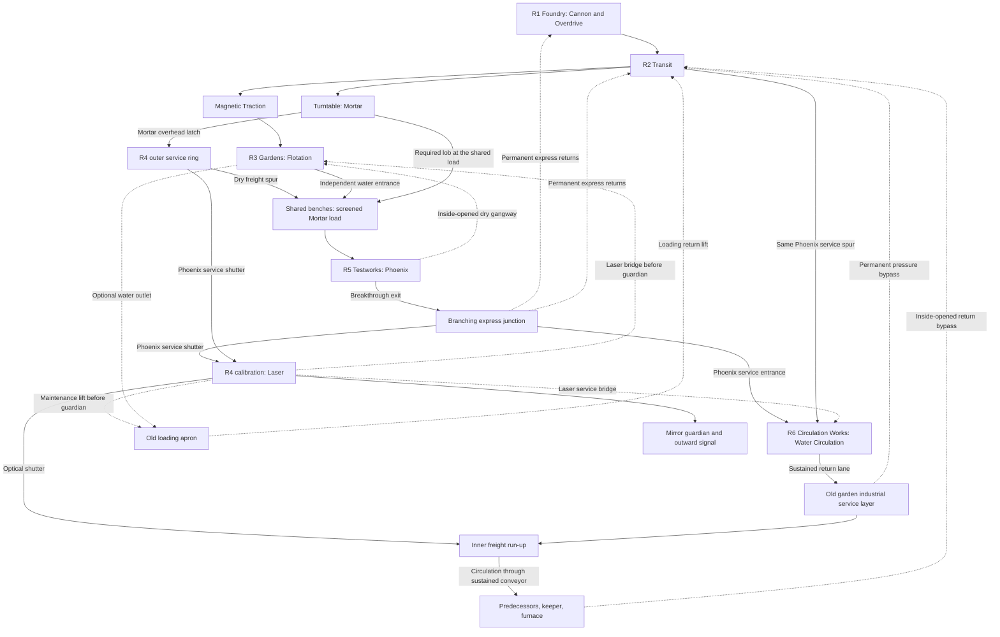
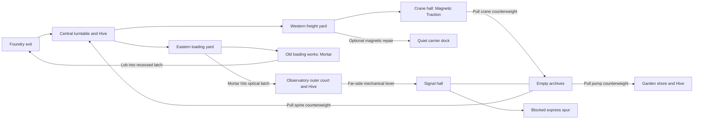
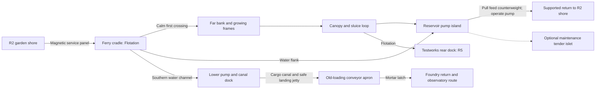

# Furnace Born — Game Specification

This is the single source of truth for game design: the existing playable level, agreed whole-game direction, and explicitly provisional concepts. New design discussions and decisions should be recorded here. Technical architecture, run instructions, and verification tooling remain in `v2/README.md`.

## Whole-Game Direction

### Decision status

The confirmed direction is a lonely, mysterious journey through a lost mechanical civilization, ending in passing on the flame (传火). The eight-ability roster and the complete story linking seven regions, ability acquisition, persistent map changes, and voluntary furnace docking are accepted design directions. On 2026-09-09 the user accepted layered regional access, direct inter-region loops, Mortar acquisition in familiar loading works, and a full exploration act after Water Circulation. The subsequent revision places Phoenix before Laser, increases middle-game branching, and prioritises permanent shortcuts over repeated approach routes. The 2026-09-16 revision places Mortar in the shared turntable hub and requires its screened-load application before Phoenix through either the freight or water approach. Laser and Water Circulation remain independently obtainable, then converge at the inner optical shutter and sustained conveyor; Magnet and Flotation are deliberately optional exploration abilities. The acquisition and story sections below incorporate this revision. On 2026-09-15 the user accepted the Folded Mechanical City direction: interwoven regions around a furnace shaft, recognizable vertical returns, and freight infrastructure integrated across regions. The Folded Mechanical City section governs spatial placement and connector landings subject to the latest Accepted acquisition structure above. Explicitly labelled proposals and unspecified room layouts, encounter values, timing, production scope, and implementation details remain open.

### Emotional identity

- Loneliness and mystery lead the experience. Occasional tenderness comes from mechanical behaviour and small responses, rather than a talkative cast or a busy social hub.
- The world sometimes moves but rarely answers. Empty trains still depart, observatories transmit into silence, and repair arms attend machines that no longer wake.
- Ruins should reveal purpose, habits, and interrupted expectations, rather than serve only as damaged scenery.
- Preserve the established exaggerated industrial forms, expressive Tank, fixed camera, and wordless storytelling. A melancholy world does not require realistic military art.
- Not every functioning machine is hostile. Some are dangerous because they continue their work; others can be helped or briefly awakened. Encounter density and any recurring characters remain open.
- The player should understand how the civilization operates and why it is failing. Its builders, origins, and ultimate disappearance may remain partly unexplained.

### Narrative premise

A small Tank rejected for melting escapes its factory, crosses a civilization that is slowly cooling, and eventually becomes the bearer of the heat that lets it continue.

The civilization did not disappear in a single disaster. Its central furnace weakened over a long period, and outlying facilities lost their supply one after another. Machines continue their last assignments even as the conditions that made those assignments useful disappear.

The recycling system sustains the remaining furnace by consuming the civilization itself: first unused equipment, then peripheral facilities, and finally machines that could still function. The first factory's attempt to recycle the Tank therefore acquires a different meaning later in the journey.

Repair Hives keep rebuilding the Tank while recycling systems try to destroy it. This contradiction is a recurring mystery: one inherited duty preserves the system, while another preserves individual machines. Both remain active, but they can no longer always be fulfilled together.

The Tank's proposed distinguishing feature is compatibility with modules from different failed prototypes. What the factory classifies as a fault becomes the means of survival and growth. Its eventual ability to carry the flame is earned through the player's journey and acquired machinery, rather than established by prophecy or a secret royal identity.

### Motivation and revelations

1. **Escape:** the Tank initially acts to avoid being recycled. The first playable level supplies this complete local motivation.
2. **Understand and find a place:** outside the factory, the Tank encounters silent facilities and occasional stranded machines. Helping, awakening, and reconnecting them reveals how the world depended on shared heat.
3. **Recognize the cost of survival:** later sites reveal that the system has repeatedly consumed itself to postpone shutdown. Earlier recycling and repair encounters become understandable in this context.
4. **Choose to continue the flame:** reaching the central furnace turns survival into a deliberate act of sustaining something beyond the Tank itself.

The accepted full-story direction below develops the ongoing reclamation cycle and reconnection of existing facilities. Routes, pumps, and energy links restored through play materially participate in the final outcome; exploration does more than fill a completion meter. A separate city-wide emergency order is not required by this treatment.

### Connected world structure

The complete-story treatment below develops seven connected regions: Recycling Foundry, Empty Transit Hub, Sunken Gardens, Silent Observatory, Prototype Testworks, Circulation Works, and the combined Predecessor Chambers / Central Furnace. This accepted seven-region structure replaces the earlier loose region list; exact room layouts remain to be designed.

Regions connect through water, cargo, optical machinery, service passages, and express tracks. Repairing infrastructure changes earlier routes. The accepted acquisition structure supplies the route dependencies; the story treatment explains their physical and narrative placement. Regions are explored at several depths across repeated visits, with direct links between them as well as connections through the transit hub. The seven-region structure is the current design baseline; room scale, total duration, and production scope still require planning and playtesting.

## Whole-Game Gameplay and Puzzle Plan

### Eight-ability scope and decision status

The roster is now **eight abilities including the starting Standard Cannon**: Standard Cannon, Overdrive, Magnetic Traction, Flotation Chassis, Mortar, Phoenix Engine, Laser, and Water Circulation. The previously proposed thermal-transfer, resonance, electrical-link, and player-mounted reflection tools are replaced, not retained as hidden prerequisites or additional abilities.

The user specified the Mortar's arcing, delayed impact; the Phoenix Engine's 3.2x maximum speed, unchanged acceleration, lethal full-speed ordinary-enemy ramming, obstacle breaking, and inter-region express routes; and the Laser's very long reach, mirror reflections, puzzle applications, and indirect weak-point attacks. Water Circulation adds the required ability to accelerate while Overheated, a red-hot hull, and double contact/ram damage against any enemy. The Water Circulation agreement also confirms passive installation without a new key or water-refill system, retained weapon lock during Overheat, stacking with Phoenix, sustained reverse-transport lanes as the primary ability gate, and a small number of thermally released impact seals that may allow physically consistent alternate solutions. Red-hot contact remains a close-range alternative against the rear-only ranged-weapon Boss. These are confirmed design decisions. The route dependencies in the accepted acquisition structure are confirmed design requirements. Exact gate geometry, unconfirmed controls, resource costs, and numerical balance below remain proposals for implementation planning.

Standard Cannon and Overdrive belong to the Foundry; Magnetic Traction and Mortar belong to the Transit Hub. Flotation belongs to the Gardens. Phoenix Engine is a direct Overdrive upgrade using the same action, counted as one of the eight progression acquisitions while sharing the original engine controls. Water Circulation is a separate passive upgrade that changes Overheat behaviour for either engine.

Every ability needs exploration access and useful combat behaviour. Phoenix Engine's combat role is overwhelming ordinary enemies while traversing; it explicitly does not need a Boss application.

| ID | Ability | Exploration gate and puzzle role | Combat role | Main distinction |
| --- | --- | --- | --- | --- |
| 1 | Standard Cannon / 原始火炮 | Break fragile obstructions and exposed relays along a clear firing line | Reliable direct damage and aimed weak-point hits | Straight projectile, moderate reach, no targeting delay |
| 2 | Overdrive / 加速器 | Reverse conveyors and overcome suitable momentum latches | Flank, escape, and ram appropriate ordinary enemies | Grounded acceleration to 1.6x; shared Heat |
| 3 | Magnetic Traction / 磁力牵引 | Pull bridge panels, counterweights, cover, and mirror-bearing objects into position | Pull light enemies, expose movable shields, and reposition cover | Changes object position through a visible physical tether |
| 4 | Flotation Chassis / 浮航底盘 | Cross connected deep water and approach machinery from another bank | Use water flanks while firing; avoid suitable low floor hazards | Changes the usable support surface, without flight or invulnerability |
| 5 | Mortar / 迫击炮 | Lob over cover to hit a recessed mechanism, open-topped enclosure, or inaccessible support | Attack enemies at a chosen landing point after a delay; punish stationary or committed targets | Arcing attack with a fixed landing point, not homing |
| 6 | Phoenix Engine / 凤凰引擎 | Break suitable heavy obstacles at full speed; open express tracks and fast return connections | Full-speed impact immediately destroys ordinary enemies | Upgrades Overdrive to 3.2x with the same acceleration; no Boss requirement |
| 7 | Laser / 激光 | Reach distant receivers and reflect around obstacles using mirrors | Long-range precision and reflected attacks on otherwise inaccessible weak points | Visible beam path and geometric reflection, not tracking or wall penetration |
| 8 | Water Circulation / 水循环 | Maintain acceleration through Overheat on sustained transport lanes; optional red-contact seals | Red-hot contact deals double ram damage to any enemy, including Elites and Bosses | Passive engine protection; hull remains hot, and ranged fire remains locked |

### Heat and the flame

Heat remains the shared combat budget established by the first level. Cannon fire and acceleration generate it; proposed Mortar, Laser, and magnetic-tool costs must preserve choices between attack and movement. Ordinary flotation is proposed to remain usable without sustained Heat generation so traversing water does not cause unavoidable lockout. Water Circulation explicitly exempts engine acceleration from the Overheat lock and adds red-hot contact combat; it does not empty the Heat gauge or restore ranged fire.

There is no freely usable thermal-transfer tool. World cooling and furnace supply remain environmental and narrative subjects. Pumps, shutters, mirrors, and transport machinery can be manipulated through the eight abilities without requiring the Tank to absorb or donate heat as a general-purpose action.

Passing on the flame remains the ending direction. Its proposed input is a contextual docking interaction at the central furnace, developed from familiar Repair Hive interactions, not an additional combat ability. Any future local ember-carrying sequence must use this existing equipment and be designed separately; it is not a committed global timer or extra resource meter.

### Playability and legibility revision

- Combat simulation is independent of the camera mode. Line of sight, distance, a squad's last sighting, and physical cover govern attacks. An indirect launcher may use a recent allied sighting; it does not acquire the Tank through an unknown wall. Committed attacks outside the view have a restrained directional warning and spatial sound. Neither changes the reticle or selects a target.
- Recovery keeps the shared Heat budget: Cannon costs 20, acceleration generates 15 per second, cooling removes 50 per second, and Overheat begins at 100. Cooling starts 0.25 seconds after heat generation stops; weapons and the ordinary engine recover at 30. Continued Water Circulation acceleration maintains the red-hot state. Ordinary movement is always available.
- Prefer broad, supported wall bays and clear openings over repeated small posts and disconnected lintels. The awakening view frames the usable service path and its first opponent. Equipment silhouettes at major branch entrances match the acquired equipment and the corresponding physical barriers. They are local architectural signs, without written instructions or a global objective arrow.
- Overhead visibility must protect the surrounding fighting space, not only the Tank's silhouette. Large foundations between the camera and a lower arena become locally translucent across that space, with continuous transitions as the Tank moves. The visible lower-floor target must also be the aiming target; transparency never removes physical collision.
- A shot mechanism communicates its consequence through its machine, a connecting power line, and the receiving gate or lift. A brief pulse travels along the connection when it operates. Distant, unresolved connections remain identifiable on the discovered map. The full map emphasizes the selected floor; remote floors do not accumulate into a dense stack. Known ability barriers retain the equipment silhouette needed to remember them later. The Tank marker shows its heading, and selecting a known lift connection switches the map to its other known landing.
- Small encounters combine a concrete pressure source and a protected threat. Shield carriers advance into the player's firing space. The freight battery puts an arcing launcher behind low cover and a mobile shooter on its flank, making the newly acquired Mortar useful in a fight as well as at a latch. Skirmishers keep moving during burst and recovery, inviting prediction instead of shots at a stationary target. Mine layers lob visible, interceptable discs toward nearby approach lanes; they arm after landing. Mortar impacts briefly stagger surviving ordinary machines, creating a follow-up opening without suppressing Boss attacks. Fragile first opponents remain brief teaching encounters. Do not increase all enemy health merely to lengthen fights.
- The two sustained thermal trials use 48-unit opposing sections, with an approximately nine-second full-speed crossing. They must still reject cold Phoenix traversal, including coast and repeated cooling attempts. The completed industrial release and the first completed inner crossing change their respective conveyors into assisted exit lanes, with permanent restoration. Repeating a mastered Heat test is not the price of revisiting the area. Lifts retain automatic travel and three-second endpoint dwell.

Mortar aiming may place a landing point behind low cover; the shell still collides with actual walls and roofs along its arc. A light trajectory preview communicates that arc without adding another reticle. The shared Testworks receiver is visible above its screen while the screen still blocks direct fire. Looking upward in third person keeps the shoulder camera above the hull instead of rotating it into the floor. Mirrors visibly expose both reflective faces, matching their two-sided reflection rule.

### Individual abilities

#### 1. Standard Cannon — direct impact

- **Exploration:** break fragile scrap or sever an exposed relay across a railing. These baseline gates establish material damage and line of sight rather than a later acquisition requirement.
- **Combat:** remain the dependable direct-damage choice after the other weapons arrive. Moving targets at ordinary combat distances should often favour the Cannon over delayed Mortar impacts or sustained Laser exposure.
- **Teaching:** a visible fragile support releases a walkway when shot. Indestructible structure responds distinctly from damageable scrap.
- **Limits and Heat:** retain 20 Heat per shot, the 0.5-second cadence, and solid obstruction rules. The density revision bounds Cannon travel to approximately 24 units from the hull. Ordinary structural walls do not gradually become destructible through unlimited shots.

#### 2. Overdrive — momentum

- **Exploration:** reverse conveyors and push a suitable wheeled carrier past a demonstrated mechanical detent with a running impact. A momentum gate must visibly respond to force, rather than detect a key press.
- **Combat:** spend Heat on flanking, escape, or ordinary-enemy ramming. Retain immediate screen-relative directional input and independent turret aim.
- **Baseline:** maximum 1.6x speed, reached from 1.0x in 0.5 seconds; 15 Heat per second while accelerated; release deceleration takes 0.35 seconds from 1.6x to normal speed.
- **Limits:** no invulnerability, passage through solid bodies, water traversal, or unsupported-gap crossing. The existing ordinary ram damage rules apply before the Phoenix upgrade reaches its own full-speed state, except when Water Circulation activates red-hot contact.
- **Upgrade relationship:** Phoenix Engine extends this same system rather than requiring the player to select between two accelerator items.

#### 3. Magnetic Traction — object arrangement

- **Exploration:** pull a bridge panel from behind a grille, shift a rail-mounted counterweight, or reposition a mirror-bearing object to change a Laser path. A tether requires a clear path through an opening; it cannot pass through arbitrary walls.
- **Combat:** drag a lightweight attacker out of position, pull a visibly movable shield aside, or move portable cover between the Tank and a turret. Heavy bodies resist according to readable mass and mounting.
- **Teaching:** a stopped maintenance crane leaves a suspended panel in view; the player completes the same motion from an accessible position.
- **Proposed limits:** begin with pulling rather than separate push/pull modes. Active traction occupies the tool, reduces speed, and generates Heat. Stable object positions persist after release, letting the player arrange a puzzle before firing.
- **Combination:** set a mirror's position and then use Laser; place cover before aiming a Mortar; move a counterweight to open an express-track access gate. Magnetic pulling does not itself rotate a fixed mirror unless the object is visibly mounted on a mechanism that converts the pull into rotation.

#### 4. Flotation Chassis — water routes

- **Exploration:** deploy a low flotation assembly to cross connected deep-water surfaces without a drivable floor. Ramps and shore geometry determine entry and exit, supplying a real route capability instead of a damage strip that can simply be crossed with enough HP.
- **Combat:** cross a flooded flank and fire from a new position; avoid ground-contact hazards that are physically below the chassis. Incoming projectiles, beams, hot water, and overhead attacks remain dangerous.
- **Teaching:** a derelict ferry establishes a route across water, followed by a short safe crossing before current or combat is introduced.
- **Proposed limits:** reduced travel speed with immediate directional response, no flight over walls or voids, and no grounded Overdrive/Phoenix acceleration or ramming while afloat. Firing still generates Heat; flotation itself does not continuously consume the Heat budget.
- **Recovery:** retraction requires a supporting surface. Entry without the ability, currents, sinking/failure behaviour, recoil drift, and readable shore exits need a prototype before large regions depend on them. No automatic teleport to safety.
- **Combination:** reach the far bank to pull a counterweight or establish a Mortar/Laser firing angle. Water crossing and express-track travel remain different route networks.

#### 5. Mortar — arcing fire and delayed arrival

- **Required behaviour:** launch a projectile over an obstacle toward a selected landing point. After a flight delay, it strikes enemies at that point. The target location is fixed at launch; moving enemies are not followed automatically.
- **Exploration:** hit a visible mechanism inside an open-topped enclosure, break a support behind a tall barricade, or attack the back of a lowered bridge from the available bank. Show the landing target from the isometric camera; do not make unseen arbitrary clicks the intended puzzle solution.
- **Combat:** punish a stationary turret, an enemy committed to a long attack, or a predicted cluster. The delay rewards anticipation and permits targets to move out of danger. A modest impact area is proposed; its radius, damage, and exact delay remain to be tuned.
- **Teaching:** an enemy Mortar or a visible test launcher first demonstrates a shell clearing a wall. A safe recessed relay then provides the player's first use.
- **Trajectory rules:** arcs clear obstacles below the actual flight path; roofs and sufficiently tall structure still block them. A visible shell, impact cue, and height/occlusion feedback explain failures. Range limits and overhead clearance must be readable without introducing a second persistent aim marker: any landing indicator replaces the ordinary reticle presentation for this weapon.
- **Balance proposal:** higher Heat per launch and/or slower cadence than the Cannon, with a finite range. No separate ammunition inventory is currently proposed. Do not give it enough reach, speed, or universal penetration to supersede both Cannon and Laser.
- **Armour interaction:** resolve the surface actually struck. An overhead hit does not automatically count as a rear weak-point hit. In the proposed rear-only Laser Boss, the roof and upper casing are armoured too, preventing an unexplained bypass of its physical protection rule.
- **Combination:** move cover magnetically, then bombard across it; fire from a water flank; lead a target following a known patrol or rail route.

#### 6. Phoenix Engine — full-speed breakthrough and express travel

- **Required upgrade:** extend grounded Overdrive's maximum speed from 1.6x to **3.2x**, keeping the **same acceleration**, not the same time to maximum speed. Continue to use the Overdrive action; no separate accelerator-selection button is needed.
- **Acceleration calculation:** the current multiplier acceleration is `(1.6 - 1.0) / 0.5 = 1.2` per second. From normal moving speed, reaching 3.2x therefore takes `(3.2 - 1.0) / 1.2 = 1.833...` seconds; from 1.6x it takes another `1.333...` seconds. Acceleration still requires movement input. With current BASE_SPEED = 7, maximum world speed is 22.4 units/second and an uninterrupted straight run-up from 1.0x covers about 26.95 units. These are consequences of the requested acceleration, not new balance targets.
- **Required full-speed impact:** at maximum acceleration, a collision deals overwhelming impact damage and immediately destroys ordinary enemies, including an ordinarily front-armoured Furnace Guard. It also destroys the breakable obstacles designed for this ability. Show a distinct full-speed hull/exhaust state and sound so the player can tell when breakthrough is available.
- **Before maximum:** ordinary Overdrive ram behaviour remains the proposed default until the full-speed state is reached, except for Water Circulation red-hot contact. The maximum-speed feedback must match the actual breakthrough threshold.
- **Exploration gates:** heavy breakable barricades and momentum-dependent route hardware distinguish this tier from ordinary conveyors. Give the barrier enough visible run-up and a clear full-speed impact response. Not every route restriction should simply be a faster conveyor.
- **Express routes:** design dedicated tracks connecting old areas, return paths, and regional junctions. Use long readable approaches, generous turns, physical guide rails, separated entrances, and safe braking/exit areas. Keep direct movement control rather than replacing the route with a cutscene or teleport.
- **Flow proposal:** destroying an ordinary enemy or eligible obstacle at full speed should preserve momentum; otherwise the first obstacle would defeat the express-travel purpose. Major intact structures remain solid. This does not grant immunity to incoming fire, environmental hazards, or all collisions.
- **Boss scope:** do not design a mandatory Boss ram phase or require Phoenix Engine to damage Bosses. Its combat payoff is clearing ordinary opposition during travel. Without red-hot Water Circulation, Boss and major Elite collision behaviour remains separate from the ordinary-enemy kill rule and retains the existing no-ram-damage default. Red-hot contact can damage them; Phoenix alone still does not require a Boss role.
- **Heat and stopping:** retain the shared Heat system. Use the existing 15 Heat/second as a starting prototype value, not a newly fixed Phoenix balance commitment. Route length, ambient hazard exposure, release deceleration, emergency stopping distance, and cooling opportunities must be tested at 3.2x. Equal acceleration does not imply that release braking has already been specified. Before Water Circulation, avoid both endless waiting on every ordinary connector and mandatory tracks that exceed the Heat budget. Separately identified sustained lanes may require Water Circulation and continued red-hot acceleration.
- **Placement:** acquire it with enough game remaining to open several meaningful inter-region connections. Permanently broken barricades and unlocked track approaches stay open, changing later travel.

#### 7. Laser — reach and reflection

- **Required behaviour:** an extremely long-range beam reflects from mirror surfaces. Its path is geometric and visible, with no homing or arbitrary passage through opaque structure. Range remains finite for simulation but substantially exceeds ordinary Cannon engagement distances; the exact value is not yet fixed.
- **Exploration:** strike a distant receiver or weak support, reflect around a wall, or use a sequence of mirrors to reach a receiver in a recess. Mirrors may be part of scenery, movable machinery, or enemies. Magnetic Traction can reposition a mirror-bearing object when its mounting permits it.
- **Combat:** attack exposed weak points from an indirect direction. A mirror-faced enemy can redirect the player's beam toward another target; its orientation and reflective face must remain readable and obey the same rule as scenery.
- **Required Boss concept:** a Boss continually faces the player and has invulnerable front and side faces, with its rear as the only vulnerable region for conventional weapon attacks. Water Circulation red-hot contact remains an alternate close-range damage route under the all-enemies rule. Aim at a world mirror so the reflected beam reaches the rear while the Boss still faces the Tank. For example, a side firing lane leads to mirrors behind the Boss, directing the final segment forward into its back. The aim puzzle is beam routing, not trying to circle faster than an unwinnable tracking rate.
- **Weak-point validation:** use the final reflected segment and actual collision surface when determining a rear hit, not the player's position or the initial aim direction. An armoured top also blocks Mortar damage where this Boss is rear-only. Red-hot contact remains eligible on other surfaces, offering a close-range alternative to reflected ranged fire. This is a future encounter, not a redesign of the existing Furnace Overseer.
- **Teaching:** begin with one visible mirror and a stationary receiver, then introduce an offset target, a movable mirror, or a rotating mirror-bearing enemy. Mirror frames, surface sheen, contact flare, and outgoing beam make reflection understandable without written angle rules.
- **Reflection proposal:** use one consistent reflection law for scenery and enemies, including angled mirrors. Stop at opaque surfaces. Prevent pathological mirror loops with an internal path budget while keeping authored puzzles short and readable. Do not put necessary aim targets outside the player's readable view or require changing the fixed camera to find them.
- **Balance proposal:** a sustained beam that generates Heat and requires maintained aim gives a different commitment from a Cannon shot or delayed Mortar shell. Duration, damage, Heat rate, and any reflection loss need a prototype. Do not add an ammo meter or a universal armour-bypass property. Reflected routes should remain worthwhile; arbitrary per-bounce penalties must not make the intended solution ineffective.
- **No retained shield ability:** mirrors perform the reflection; the player does not separately deploy a reflective armour module.

#### 8. Water Circulation — acceleration through Overheat and red-hot contact

- **Required behaviour:** after acquiring Water Circulation, the Tank can continue accelerating and start accelerating while Overheated. Its hull becomes visibly red in that state, and contact with any enemy deals double ram damage. The ability needs an exploration application, either red-hot breakable obstacles or a puzzle that actually requires continued acceleration through Overheat.
- **Confirmed integration:** a passive installed upgrade, with no new action key, water-ammunition meter, or field-refill chore. A closed circulation loop protects the drive by spreading engine heat into the outer body; steam, moving pipes, and a glowing hull communicate why the Tank is hot but still mobile. This is not an instant cooling tool.
- **State rules:** retain the existing 100-Heat entry threshold and 30-Heat recovery threshold. With the module, reaching 100 does not force engine deceleration or prevent re-engagement. The hull remains red throughout the Overheated latch, including its cooling period, and the contact bonus lasts for that same clearly displayed state. Normal weapons and the heat-generating magnetic tool remain locked while Overheated; the exception is grounded engine acceleration. The weapon lock and passive Overheat behaviour are confirmed; the magnetic tool retains its existing proposed Heat-lock behaviour.
- **Sustaining the state:** accelerated movement continues to generate Heat and update the cooling delay, with displayed Heat capped at 100. Therefore a player can deliberately remain red and accelerate for as long as movement continues. Releasing acceleration permits the usual deceleration, cooling delay, and cooling back through the recovery threshold. Do not silently impose a new duration limit, self-damage timer, or forced stop to negate sustained traversal. The cost is committing to a hot contact-combat state without ranged fire until recovery.
- **Contact damage:** every enemy category is eligible, including ordinary enemies, shielded guards, Elites, and Bosses. Red contact is not restricted to Phoenix's full-speed state or the old 1.3x offensive-ram threshold. Use a positive base contact/ram damage value for the current speed tier, then apply `red contact damage = 2 * base ram damage` once. Current zero-damage outcomes produced by ordinary ram immunity are not the base value: applying `2 * 0` would violate the all-enemies requirement. Low-speed contact baselines, speed-tier damage, and armour response amounts require explicit tuning before implementation.
- **Repeated contact:** use contact-event handling and a short per-target repeat interval to prevent frame-rate-dependent damage from overlapping bodies. Do not introduce a per-window or per-fight hit quota. Standing in continuous contact must not produce one damage application per rendered frame.
- **Phoenix combination:** Water Circulation does not change the chosen engine's maximum speed or acceleration. With ordinary Overdrive it preserves acceleration to 1.6x through Overheat; with Phoenix it preserves acceleration to 3.2x at the same existing slope. At Phoenix maximum, apply the red multiplier to the finite high base ram damage. Ordinary enemies already die at full Phoenix speed; the stacking is still meaningful for sustained travel, tougher targets, and red-contact mechanisms. Do not apply the multiplier twice or implement the ordinary kill rule as a universal Boss insta-kill flag. Eventual Boss HP and ram damage must be balanced together; no new Boss immunity cancels the user's all-enemies rule.
- **Protection:** a glowing hull does not grant invulnerability, remove physical separation, heal HP, or immunize the Tank against beams, shells, furnaces, or enemy attacks. Destroying a normal enemy in an impact can preserve Phoenix momentum as already proposed; solid major structures remain solid. Flotation still does not allow grounded Overdrive, but red-state contact damage is not silently disabled merely because a valid enemy contact occurs while afloat.
- **Feedback:** show red heat across the chassis rather than only a small icon, with steam and a distinct mechanical sound. Phoenix maximum readiness also needs a separate exhaust shape/sound so players can distinguish 'hot contact available' from 'full-speed breakthrough available.' On cooling to 30 Heat, restore the normal hull and clearly signal weapon recovery. Preserve the single warm-coloured cursor Heat gauge.
- **First use:** acquire the module at an accessible cooling installation, then provide a safe approach where normal acceleration reaches Overheat. The drive continues, the body turns red, and an ordinary obstacle/enemy or return lane demonstrates the result immediately. A cold-start approach must be possible; firing repeatedly at empty scenery is not the intended mandatory preheating step.

### Water Circulation exploration direction

**Confirmed primary gate: sustained reverse-transport lane.** A continuous opposing conveyor or pressure-driven cargo lane has no intermediate place to park. Stopping the drive moves the Tank backward; the route cannot be solved by standing still and cooling. Its uninterrupted length and opposing speed exceed what a cold Phoenix-equipped Tank without Water Circulation can traverse, including acceleration, the entire pre-Overheat travel, and the deceleration coast. With Water Circulation, the Tank crosses the threshold and keeps making progress. Side geometry must expose an understandable return path rather than hide a safe waiting pocket inside the supposedly required section. The lane itself need not deal damage, so extra HP is not an alternate resource key. Length alone is insufficient: a player must not accumulate net progress by repeating boost/cool cycles. Start prototyping with a backward belt around 2.6x normal speed, below Phoenix's 3.2x but above its sustainable pre-upgrade average including cooling, and test the chosen lane length against all release/coast cycles. This is a candidate tuning value, not a proven gate or a change to the first-level conveyor; Phoenix braking is still undecided.

This is a separate tier from ordinary Phoenix express tracks. Phoenix routes within the normal Heat budget remain useful before Water Circulation. Later sustained lanes connect distant branches and make the combination feel like a developed transport system rather than a longer repeat of every earlier conveyor.

**Confirmed secondary direction: a small number of thermally released impact seals.** A sealed gate has visibly load-bearing cold fasteners. A red-hot hull in contact releases the fasteners while the collision pushes the gate apart. A cold Phoenix hit produces a readable solid recoil; hot contact produces steam, moving fasteners, and rupture. This may be authored as a direct red-contact gate if needed, but it requires more than a red-painted wall. Define how Laser heating, Mortar impact, and sequential combinations affect it before claiming exclusivity; if those actions physically provide the same heat and force, accept the alternate solution or redesign the gate rather than invent an invisible immunity.

**Further proposal: loaded return carriage.** Drive a heavy carrier up an opposing transport lane while keeping it moving against an observable return force. The carrier makes waiting between spurts lose progress; Water Circulation sustains the drive through Overheat. Magnetic Traction can first move a counterweight or open the approach, but cannot be an untested route to holding the carrier indefinitely. This is a candidate only after validating cold-Phoenix bursts, coasting, reverse recovery, and object-wedging alternatives. A long timed door on otherwise safe ground is merely a speed check and must not be labelled a Water Circulation lock.

**Narrative use:** the module makes a small machine able to continue moving after ordinary thermal limits would stop it. A late approach to the furnace can express carrying the flame through a glowing hull and sustained movement. The final act still uses the established furnace docking interaction; no additional flame-transfer ability is introduced.

### Accepted acquisition structure

The 2026-09-16 progression revision below supersedes earlier acquisition locations and route diagrams wherever they disagree. Phoenix remains before Laser. The middle game retains two approaches and independently ordered late branches; useful shortcuts stay persistent. Regional numbering describes geography, not a required visit order.

| Acquisition | Required equipment and physical route | Immediate application and lasting value | Completion status |
| --- | --- | --- | --- |
| Standard Cannon | Starting equipment | Exposed Foundry relays, aimed combat and machinery throughout the city | Required |
| Overdrive | Cannon; Foundry Prototype encounter | Reverse the familiar conveyors, then use acceleration in combat and freight routes | Required |
| Mortar | Foundry exit; an exposed cradle at the shared turntable's transport-bridge mouth | Lob into the open-topped bridge enclosure; open the dry freight entrance; later release the screened carrier load | Required before Phoenix |
| Magnetic Traction | Cannon/Overdrive; visible training gallery beside the turntable | Open the ferry cradle; strip blue shields and cover, handle mines and incoming shells | Optional route ability with repeated combat uses |
| Flotation | Magnetic Traction; ferry cradle | Cross beneath the familiar bridge, reach water flanks, and revisit the canal and sump | Optional water-route ability |
| Phoenix | Mortar; approach the shared benches through either the dry freight ring or the Flotation route | Bombard the load behind its screen, board the carrier, then break the launch shutter and open two regional branches | Required |
| Laser | Phoenix; calibration entrance | First reflected receiver, indexed mirror return, optical shortcuts and the inner freight shutter | Required for the inner route; independent of Circulation acquisition |
| Water Circulation | Phoenix; cooling rig | Sustained industrial return, permanent bypass and red-contact combat, followed by the inner conveyor | Required for the inner route; independent of Laser acquisition |

The main dependency is Cannon → Overdrive → Mortar → Phoenix → {Laser, Water Circulation} → inner route. Magnetic Traction → Flotation forms the optional water branch. Players may explore this branch before collecting Mortar, but both approaches encounter the same screened load before Phoenix. Mortar is visible at the common hub rather than hidden in a lower branch that a water-route player may never visit.

Laser-first and Circulation-first are equally supported. The optical shutter stands on a safe run-up beside the cooling rig, before the sustained inner conveyor. A player who arrives with Circulation first sees the optical obstruction before committing to a long conveyor attempt. Laser opens the shutter through its visible receiver; Circulation sustains the actual drive. The final docking does not inspect an inventory checklist.

Magnet and Flotation may be omitted from an ordinary completed run through the dry freight route. Their value is explicit: another approach, water-side combat positions, early canal returns, submerged exploration, and persistent shortcuts. Skipping a branch must not make it silently obsolete; blue shields and cover continue to reward Magnet after the approaches converge. A full exploration journey revisits the water branch even if the dry approach was taken first.

### Room sequence, teaching and return routes

| Space | First observation and action | New understanding or reward | Return connection |
| --- | --- | --- | --- |
| Foundry | Shoot exposed relays; encounter the opposing conveyor before its engine solution | Overdrive changes which direction can be traversed | Prototype return and Foundry exit |
| Turntable | See the Mortar cradle at the bridge mouth and the receiver beyond a solid, open-topped screen | A fixed landing point can reach behind a wall; the first shot is safe to attempt | Shared hub remains reachable |
| Freight enclosure / water branch | Choose the Mortar opening or magnetic ferry and water crossing | Distinct approaches to the same machinery, with different combat positions | Inside freight release / dry gangway |
| Shared benches and carrier | Recognize the same screened target on an inclined approach; bombard it to release the load | Mortar is reused in three-dimensional space before Phoenix | Roof cage returns directly to the turntable |
| Calibration | See and fire along a reflected light path; then change the second mirror | Laser changes reachable firing lines and joins previously separate heights | Emitter cage, garden lift and yard lift |
| Cooling rig | Cross the sustained return while overheated | Circulation changes how long the engine can work; red contact remains useful | Industrial bypass reaches old transit and garden infrastructure |
| Inner freight run-up | Open the optical shutter, then traverse the opposing conveyor | The two late branches converge through physical actions | Final refuge cage returns to the city |

A new ability must have a visible acquisition, a safe first use, a later variation and a useful return or combat application. Obstructions use material, shape, movement and shot feedback rather than instructional prose. No new quest text, forced camera, objective arrow or collection counter is added. Getting a new weapon keeps its HUD acquisition demonstration and visible switch binding.

Shortcut placement must preserve the first meaningful use of its local ability. An inside release may bypass an already solved challenge on later visits; it may not grant a new player passage past an unlearned required ability. Water detours are deliberate exploration with reachable exits, not compulsory empty round trips.

Supported ordinary journeys include dry freight with Laser first, dry freight with Circulation first, and a full exploration journey through Magnet/Flotation with either late order. Acquisition and return routes must remain traversable from an actual new journey, including reloads and ordinary combat. Local mechanism success alone does not establish this experience.

### Controls and weapon roles

- All acquired capabilities remain available; no limited loadout can strand the player behind an ability gate. Phoenix replaces the engine's speed ceiling while retaining all ordinary Overdrive uses.
- **Proposed controls:** left click fires the selected weapon (Standard Cannon, Mortar, or Laser); right click operates Magnetic Traction; Shift operates Overdrive, upgraded to Phoenix Engine; a separate action deploys Flotation. Weapon selection uses a small icon selector, with bindings and selection method to be tested. Water Circulation activates passively during Overheat. The eight progression abilities therefore do not require eight separate action keys.
- Keep independent turret aim and screen-relative movement. Display the selected weapon through barrel configuration, one reticle, and a concise icon; preserve the warm-yellow-to-red Heat ring. Weapon-specific aiming cues must not restore the discarded duplicate ground reticle.
- Switching weapons must not erase Heat, bypass firing recovery, or retarget an already-launched Mortar. Magnetic positioning followed by firing should be deliberate rather than a simultaneous hidden tool effect.
- **Cannon:** reliable ordinary-range direct fire. **Mortar:** an arc over cover and delayed area pressure. **Laser:** very long, reflectable precision with sustained aim as the current proposal. Balance each role so selecting a new weapon does not retire the earlier two.
- Preserve normal grounded movement during Overheat. Without Water Circulation, the existing engine and weapon lock remains. With it, grounded acceleration may continue or restart and red-hot contact deals double ram damage; weapons remain locked until Heat falls to 30; the magnetic tool keeps its proposed Heat-lock rule. Flotation remains usable. No general instant-cooling skill, separate mana system, or ammo inventory is currently planned.
- Numeric damage, ranges, launch delays, explosion radius, Laser tick rate, tool Heat costs, floating recoil, Phoenix braking, and positive ram/contact baselines for previously immune targets remain prototype decisions. The requested 3.2x maximum and unchanged acceleration are explicit exceptions already specified above.

### Combined puzzles and travel spaces

**Enclosed pump station — optional return puzzle:** the pump's exposed latch is visible inside an open-topped wall. Lob a Mortar shell onto it to release the machinery, then use Magnetic Traction to move a counterweight. Water-level changes expose an old transit route; Flotation later reaches another bank. Stationary defenders behind the same wall demonstrate the Mortar's combat use. This combined puzzle is not on the acquisition route to Flotation or on either shared R5/R6 acquisition loop.

**Mirror observatory:** reposition a rail-mounted mirror with Magnetic Traction, then fire Laser through a visible reflected route to an offset receiver. A mirror-bearing enemy supplies a moving reflector in a later room. Use a small number of visible bounces; critical solutions must not depend on guessing off-screen geometry or an enemy that permanently dies without a retry path.

**Phoenix return rail:** encounter a heavy barricade and the long approach early. After acquisition, accelerate along the approach to the distinct full-speed state, break through the barricade and ordinary blockers, then exit onto a safe braking apron. The unlocked rail joins two previously distant regions. Design the route around actual run-up distance, speed, Heat, camera visibility, and stopping distance.

**Rear-only guardian:** the enemy keeps its armoured face toward the player. Mirrors behind and beside it create a route for Laser to reach the rear. The final segment, not the Tank's position, determines the valid hit. Let positioning and sustained aim create difficulty; do not reintroduce an arbitrary per-window damage cap. Provide enough rear exposure and mirror coverage for the authored route to remain usable while the Boss tracks the player.

**Water Circulation return:** a sustained reverse-transport lane leads out of the cooling installation toward an old junction. It has a cold-start approach, visible backward force, and safe retreat. Its geometry is validated against the maximum progress achievable without the new ability; red-hot acceleration completes the crossing.

**Central furnace:** use ordinary interactions and the eight abilities to clear access, align optical receivers, restore pumps, and reopen transport routes. The final docking passes on the flame through the furnace interface. No removed thermal-transfer, circuit-link, resonance, or shield tool is required.

### Puzzle and feedback principles

1. Demonstrate a machine or attack's visible cause and effect in a forgiving setting.
2. Let the player reproduce it with an acquired ability.
3. Change spatial arrangement, timing, or combinations without changing the physical rule.
4. Reuse that understanding in both exploration and combat.

- Make blocked Mortar arcs, armoured impacts, mirror reflections, magnetic resistance, and Phoenix readiness distinct in shape, animation, and sound. Do not require prose or colour-only matching.
- Reward successful hits during a real opportunity. The existing Elite and first-level Boss have no per-window damage cap. New encounters should not add hidden hit quotas to compensate for a successful solution.
- Critical puzzle objects must remain retrievable or have a nearby visible reset. Solutions using mirror-bearing enemies need a recovery path if those enemies die or leave position.
- Avoid long forced retries, objective arrows, camera pulls, and unexplained immunity added solely to preserve a planned route.
- One-time restoration should change the world and subsequent travel. Optional shortcuts may accept more than one consistent solution.

### Design validation before implementation

- Count exactly eight progression abilities; the Phoenix upgrade shares Overdrive's controls and does not demand a separate base-engine selection.
- Verify the Phoenix acceleration slope is unchanged: about 1.83 seconds and 26.95 world units from normal moving speed to 3.2x under uninterrupted straight acceleration at the current base speed.
- At full Phoenix speed, an ordinary front-armoured guard dies on impact and an eligible barricade breaks without defeating the intended travel flow. Boss participation is not required to demonstrate the upgrade's value.
- Test ordinary express routes with the actual Heat budget, turn readability, fixed camera, and braking distance before committing regional distances. Validate Water Circulation gates against the best cold-Phoenix attempt, intermittent acceleration, coasting, safe waiting spots, and available object manipulation.
- With Water Circulation, acceleration continues through 100 Heat and can be restarted while Overheated; the hull remains red until recovery. Without the module the first-level lock behaviour remains unchanged.
- Red-hot contact damages ordinary, shielded, Elite, and Boss targets at twice a positive base value, including below Phoenix maximum speed. Ensure overlapping contacts do not apply damage every frame, the Phoenix multiplier stacks only once, and weapons remain locked during the red state under the confirmed state rules.
- A Mortar shell clears appropriate cover, stays committed to its landing point, resolves damage after flight, and is blocked by an actual roof or intercepted trajectory.
- Laser reflects consistently from scenery and enemy mirrors. A rear weak-point check follows the final segment; continuous player-facing tracking does not invalidate an otherwise correct mirror solution.
- Every signature gate is readable without a written explanation. Mortar, Cannon, and Laser retain distinct useful combat roles.
- All three supported acquisition orders remain completable, acquisition routes do not require their own reward, and permanent shortcuts materially reduce later travel time.

## Exploration Structure — Accepted Super Metroid Direction

### Status and reference

The user accepted this exploration direction on 2026-09-09 and subsequently requested Phoenix before Laser, more middle-game branching, and more shortcuts. The revised acquisition table and topology below are the current design baseline. Two pre-Phoenix branches now use Flotation or Mortar; two post-Phoenix branches lead independently to Laser or Water Circulation. These replace the previous Laser route into R5. They are design requirements; exact rooms and balance remain subject to playtesting. The Folded Mechanical City section below specifies their spatial arrangement and replaces earlier horizontal connector placement. Preserve the eight abilities, fixed-camera grounded Tank controls, intuitive physical interactions, shared Heat, and voluntary passing-on-the-flame ending.

Nintendo's development team explicitly describes Super Metroid's flexibility of exploration and discusses obtaining equipment earlier through alternate routes in its [series retrospective](https://www.nintendo.com/en-gb/News/2021/August/Metroid-Dread-Report-Vol-4-Unravelling-a-saga-35-years-in-the-making-2018281.html). Its later [exploration guidance](https://www.nintendo.com/en-gb/News/2022/January/Metroid-Dread-Report-Vol-11-Power-through-with-these-pointers-for-exploration-and-combat-2102114.html) also describes environmental hints, mechanisms that change routes, and revisiting earlier areas with new abilities. That second source describes Metroid Dread, not a room-by-room account of Super Metroid. The design below adapts those exploration goals to Furnace Born; it does not claim that the reference uses every rule described here.

### Exploration rhythm

Use local acquisition loops, persistent shortcuts, and a readable likely route within a connected world that supports other orders. The transit hub is one memorable junction; progress does not require completing two wings and reporting back there before entering the next region.

The emotional rhythm is: notice something unreachable; follow the locally promising path; briefly lose access to the familiar route; discover a new physical possibility; emerge into a place recognized from another side; voluntarily revisit an earlier obstruction. A comprehensible likely route should exist without an objective arrow. Maximizing the number of simultaneously open branches is not the goal.

### Required world topology

1. **Regions contain several depths of access.** Reach garden shores before being able to cross water, observatory exterior machinery before controlling optics, and the testworks perimeter before entering its main rigs. Region entry does not mean region completion. The seven regions remain geographical places, not seven sequential chapters.
2. **Replace repeated hub returns with inter-region loops.** Add garden-to-old-loading-station, observatory-to-garden-upper-works, and testworks-to-foundry/transit links. R2 remains a memorable crossing but is no longer the mandatory stop after every acquisition.
3. **Branch before and after Phoenix.** Flotation opens R5 from the garden water network; Mortar opens the independent dry freight approach through R4's outer ring. Both approaches converge before the screened carrier load, where Mortar is required; Cannon and ordinary Overdrive handle the remaining shared loop. Phoenix then opens R4 calibration and R6 circulation as parallel choices; Laser is always after Phoenix, while Laser and Water Circulation can be acquired in either order. R4's earlier exterior visit does not grant access to its emitter.
4. **Make the first extra weapon visible in shared geography.** Place Mortar at the turntable bridge mouth after the Foundry. Its first open-topped enclosure is visible on the onward bridge. Keep the old loading works as an optional conveyor/combat loop linking transit, the water outlet and the later observatory lift; it no longer contains the module.
5. **Give Water Circulation a final exploration act.** Acquisition should precede a meaningful period of opening old transport infrastructure, red-hot combat, and optional restoration. The central furnace must not be its only substantial payoff. R6 reconnects through a formerly inaccessible garden service channel before the sustained inner route reaches R7. This is a supported industrial transport route; it does not secretly require Flotation after a Mortar-first approach to R5.
6. **Make shortcuts part of acquisition loops.** Each major reward should have a nearby onward exit into another known space or a new junction, avoiding reversal of its entire approach. Open principal shortcuts before regional Boss completion where possible. A lowered bridge, released service door, or restored lift remains usable after rest and death without repeating a puzzle. Phoenix connectors need safe braking areas, visible junctions, and camera-readable bends; route recognition and actual travel-time reduction matter more than shortcut count.

### Supported acquisition routes

All three orders must be supported by the room graph. Cannon is present from the start. They are examples of meaningful choices rather than a menu or three prescribed campaigns.

- **Garden / optics-first branch:** Overdrive → Magnetic Traction → Flotation → turntable Mortar → either R5 approach for Phoenix → direct express connection for Laser → R4/R6 bridge or express branch for Water Circulation → new return-network exploration → R7.
- **Freight-first branch:** Overdrive → earlier Mortar → R4 outer ring and dry R5 freight spur → Phoenix → R4 calibration for Laser → reopened loading/transit connection for Magnetic Traction and Flotation → Water Circulation → final exploration. Neither pre-Phoenix traversal nor the Laser acquisition secretly requires flotation or magnetism.
- **Circulation-first branch:** Overdrive → Magnetic Traction → Flotation → turntable Mortar → R5 rear entrance for Phoenix → direct R6 service branch for Water Circulation → supported garden/transit bypass → R4 calibration for Laser → remaining local exploration and R7. Laser is not a prerequisite for the R6 rig, and the observatory guardian must support the previously confirmed red-contact alternative in this order.

Every order puts Phoenix before Laser. Exploring the water branch before returning for Mortar or delaying Magnetic Traction/Flotation on the freight route creates actual changes in entry direction, equipment, and travel. The Laser and Water Circulation branches should each contain a useful acquisition loop; they must not merely expose two doors before forcing the same next ability. Examples retain all eight abilities without imposing a collection checklist at the finale. Only Magnetic Traction and Flotation are intentionally optional in the ordinary completion route; the required physical gates remain in both late acquisition orders.

### Permanent shortcut network

The following connectors are the revised authoring targets. They extend the loading-yard and pump returns. The Folded Mechanical City connector table below assigns their physical landings and vertical transfers; this table describes their progression roles. Opening conditions describe the first traversal. Unless a continuing hazard is explicitly identified, an opened connector is bidirectional, remains open after rest/death/reload, and needs no repeated input sequence. Its far-side release must be inaccessible from the earlier side until the relevant initial route has been earned.

| Connection | First opening and direction | Later purpose |
| --- | --- | --- |
| R5 rear dock ↔ R3 first far-bank landing | Release a dry maintenance gangway from inside R5 on the common acquisition loop | Avoid repeating the long water approach on later garden/testworks visits; leave the rest of the water network intact |
| R5 Phoenix cradle exit → R1/R2 express junction | Demonstrate full-speed breakthrough immediately after acquisition, then open the junction's ordinary service bypass from inside | Reach the loading works, transit crossings, and foundry directly; the opened route does not rebuild its barricade |
| Express junction ↔ R4 calibration approach | Phoenix opens a momentum-operated service shutter; both the early outer-ring route and this express route meet behind the same pre-Laser access boundary | Reach the emitter without retracing R4's entire outer approach; provide a supported escape to the junction before the guardian |
| Express junction ↔ R6 service yard | Phoenix releases the existing heavy service-spur obstruction from the new transport connection as well as the familiar hub approach | Make circulation a direct parallel choice after Phoenix, without requiring an intermediate hub visit |
| R4 calibration loop ↔ old loading rig's safe apron | Open an ordinary maintenance lift from its upper landing near the emitter, independently of defeating the guardian | Revisit the old loading conveyors or leave R4 quickly; land on the supported safe side of the existing conveyor |
| R4 mirror gallery ↔ R3 upper pump works | Laser reaches the visible recessed bridge receiver during the gallery loop, before the guardian | Reinterpret a familiar garden landmark from above and leave the unfinished observatory for another branch |
| R4 mirror gallery ↔ R6 upper service yard | Laser releases the long-sightline service bridge from R4; it lands on R6's ordinary pre-Water-Circulation restoration layer | Move directly between the two post-Phoenix branches; the independent Phoenix entrance keeps Laser optional for R6 acquisition |
| R6 sustained return → R3 industrial service layer ↔ R2 inner ring | Water Circulation crosses the sustained lane, then the far-side mechanism opens a short supported pressure bypass | Explore the newly accessible garden layer and return without repeating the whole high-pressure lane; the separate inner transport approach still gates R7 |

Preserve the existing planned R7-to-transit bypass before the final commitment. The express junction is a connected piece of transport infrastructure, with exits toward R4, R6, and familiar places; it must not become a new mandatory hub that all later travel repeatedly crosses. The R4/R3 and R4/R6 bridges and the R6 garden return supply alternative cycles.

Shortcuts should reconnect geographically adjacent edges separated by a wall, height difference, or dormant machine. A path that repeats the same rooms faster is not sufficient on its own. Put latches, lifts, and bridge machinery where their endpoints can be recognised from the original approach. Do not add generic teleport points, new abilities, mandatory collection rewards, or automatic cutscene travel.

For ordinary revisits, prototype a target of at most half the original approach travel time between the same two landmarks, excluding combat and menu time. This is a tuning goal, not a measured result or a reason to inflate the first trip. Repeat trips must not require another room-sized puzzle, full encounter gauntlet, or a chain of compulsory cooling stops. Benchmark with the owned equipment, actual Heat budget, fixed camera, and braking behaviour before approving connector lengths.

### Ability-to-world relationships

Each acquisition should change how several familiar spaces can be used. The following reuse targets are authoring checks, not a demand for identical numbers of locks in every region.

| Ability | Primary new access | Earlier space to reinterpret | Later reuse or mastery |
| --- | --- | --- | --- |
| Cannon | Break exposed supports and fragile scrap | A visible load-bearing part can open a route as well as take damage | Find a valid firing position instead of assuming every relay needs the newest weapon |
| Overdrive | Overcome short opposing conveyors | Cross the conveyor that first rejected the Tank; turn an old exit into an entrance | Plan short boosts around firing Heat and use ordinary-enemy rams while travelling |
| Magnetic Traction | Reposition a mounted bridge or counterweight | Pull a familiar carrier into place, revealing an alternative passage | Change which side an object is pulled from; move shields, cover, and mirror carriages |
| Flotation | Enter an interconnected water route network | The water under earlier platforms becomes traversable space connecting regions | Reach different banks and firing positions; use a rear route into the testworks |
| Mortar | Enter the R4 outer ring and independent R5 freight route through exposed overhead mechanisms | An old sealed loading yard becomes accessible through its exposed mechanism | Predict an enemy's committed movement; bypass some frontal combat or approach puzzles |
| Laser | Open mirror-gallery depths and direct R4/R3/R6 service connections after Phoenix | Old mirror surfaces, sightlines, and observation apertures acquire a new purpose | Align a reflected attack or choose a long-range angle; combine with a movable mirror |
| Phoenix | Open the express network and independent Laser / Water Circulation acquisition routes | Distant tracks seen on earlier visits become fast inter-region routes | Preserve its ordinary-enemy breakthrough payoff; it has no mandatory Boss application |
| Water Circulation | Sustain acceleration through Overheat on long opposing transport lanes | Return channels that repeatedly defeated the earlier engine become routes | Plan red-hot combat and cool-down stops across several old areas before the final commitment |

For each new acquisition, author one forgiving immediate application, one memorable earlier obstruction worth returning to, and one later use in a changed context. A lock's shape must advertise its physical problem; do not cover the map with eight families of colour-coded doors.

### Three kinds of obstruction

- **Physical hard gates:** no support beneath connected deep water; a true full-speed impact threshold; or a sustained reverse lane that cannot be crossed within the earlier engine's best Heat budget. Test the whole surrounding space for other entrances. A gate may be hard on one route while another route reaches the same destination.
- **Alternative-solution obstacles:** a shielded firing line, a blocked approach, or a service mechanism with multiple physically exposed parts. The straightforward tool may be Mortar, while pulling movable cover or reaching the other bank creates a valid Cannon angle. Accept that solution when the geometry supports it. Do not invent invisible immunity to preserve the expected equipment order.
- **Knowledge and technique obstacles:** a player already has the needed action but has not recognized its use, such as moving to the opposite side to pull a counterweight in the desired direction, using a familiar mirror from another angle, or timing an arc against a moving mechanism. Demonstrate the relationship through machinery and allow forgiving retries. No hidden button combination, unannounced heat trick, new jumping ability, or mandatory high-precision stunt is implied.

Do not silently change steering, acceleration, or momentum conservation to manufacture technique gates. Any such physics change would need a separate proposal and prototype. Water Circulation's primary hard gates must still defeat intermittent boosting, coasting, waiting, and movable-object exploits under the actual rules; optional earlier lanes can deliberately allow some of those solutions.

### Local guidance, commitment, and recovery

- Let the player encounter a small number of distinct memorable obstructions before their solutions. A flooded room, a moving conveyor, and a distant receiver are easier to remember than a wall of interchangeable locked doors.
- Build short local loops where the most promising route teaches the next interaction. Open a broader choice after the player reaches recognizable geography again.
- A one-way descent, conveyor entry, or door opened from the far side can create a temporary commitment, but the enclosed space must be completable with every permitted incoming equipment set. It needs reachable recovery and a reliable onward exit; optional enemy objects cannot be its sole unrecoverable key.
- Hide main-path openings only with visible evidence: a seam, an exposed support, a machine using the passage, or a glimpse of the room beyond. Randomly shelling every wall must never be necessary.
- Return trips should contain changed access, a new angle on a landmark, or an efficient shortcut. Do not rebuild a broken barrier to force the same fight or traversal again.
- Do not require a full-world sweep after every upgrade. At least one likely continuation should emerge from the local loop or a clearly remembered earlier place. Wider searching is an optional opportunity.

### Exploration rewards and story placement

Eight major abilities alone do not supply enough reasons to inspect a large world. Use useful shortcuts, visible restoration of stranded machinery, and optional predecessor scenes as exploration rewards. A small number of permanent survivability improvements remains a separate candidate for later balance design, not an approved numerical addition; maximum Heat increases in particular could invalidate established engine gates and should not be assumed. Avoid empty locked pockets or routine currency filler.

The main story must tolerate the supported alternate acquisition orders. Put essential knowledge about the final docking in unavoidable predecessor spaces rather than behind completion of every regional scene. Garden valves, observatory signals, and discarded prototypes should each reveal a comprehensible part of the same history in either order. The final quiet approach can then gather those observations into the voluntary choice to pass on the flame.

### Next design artifact and acceptance checks

The R4–R6 regional design below specifies this revised middle-game structure. Maintain its room-connection graph, including both depths of R4 and the permanent shortcut network. For every connection record its physical opening condition, travel direction, persistent mechanism state, required knowledge, possible alternate solution, recognizable landmark, and retry/return path.

Validate that graph against all three supported acquisition orders. Removing Phoenix from the attainable equipment set must prevent Laser acquisition; removing Laser must still leave the Phoenix and Water Circulation routes available. Every acquisition must be reachable without itself; every temporary commitment must have an exit for all legal incoming states; every persistent object puzzle must remain recoverable after death or rest. Explicitly document any allowed module omission instead of assuming either mandatory collection or universal sequence breaking.

A new player's test should establish whether they remember a relevant earlier obstacle after obtaining an ability, recognize an old room reached from a new entrance, and can find a likely continuation without an objective marker. A second playthrough should establish whether a different order creates a meaningfully different journey. These are playtest goals, not results established by the existing first-level automated checks.

## Folded Mechanical City — Whole-World Spatial Design

### Decision and scope

On 2026-09-15 the user accepted reorganizing the world as a vertically interwoven mechanical city around a great furnace shaft, and requested careful design because spatial experience is central to the game. This section is the spatial authoring baseline. It supersedes the earlier predominantly horizontal regional arrangement, the Empty Hoist's placement as a detached excursion, and its proposed standalone duration. The regional story, eight abilities, acquisition dependencies, wordless presentation, and voluntary final docking remain in force. Heights, room counts, and travel times below are staging targets subject to playable validation, not measured results.

The reference is the experience of recognizing connected places from new elevations and discovering short physical returns. Miyazaki describes the vertical, traversable spaces of Dark Souls and Bloodborne in his [Game Informer interview](https://gameinformer.com/interview/2018/08/21/hidetaka-miyazaki-on-sekiro-shadows-die-twice). The following city, mechanisms, and route constraints are Furnace Born's design, not a reconstruction of those games.

### The spatial promise

The player gradually realizes that the city occupies a small number of neighboring structures, although its first routes wind through many rooms. Returning to a known place should revise the player's understanding of where they have been. Preserve route length through encounters, changing viewpoints, and local decisions; reduce empty geographic separation between regions.

Three experiences must recur: seeing a reachable future route above or below; crossing through a familiar place at a different elevation; opening a nearby connection that removes a substantial detour. A region with only an entrance lift and an exit lift does not satisfy this promise. Each major region needs an internal height change during ordinary play and a physically recognizable relationship with another region.

The emotional arc follows the section: escape R1's local recycling machinery, climb through a cooling city in search of a way onward, and eventually choose to descend toward the central furnace beneath it. R1's recycling furnace and R7's central furnace remain different machines. Their freight and heat connections explain their relationship without pretending they are the same Boss arena.

### Site, section, and common landmarks

The city clings to the inside and rim of a horseshoe-shaped industrial excavation. Its open side faces the established camera; rear structures provide mass and silhouette. A broken transport bridge spans the middle. A western water basin lies below it, while an eastern service stack carries the observatory above and the circulation machinery below. The central void exposes part of the furnace exhaust spine, never the complete final chamber.

The basin's eastern retaining wall is also the western face of the circulation service stack. R3's upper pump terrace wraps onto this wall, directly below R4's western service balcony; C09 and C11 therefore connect neighboring pieces of architecture. R5's dry receiving bay and the R4 outer ring meet along the rear cliff at +1, separate from the later roof express track. The R1 press foundation borders the southern canal, with the old loading apron above and beside it. Reserve these shared boundaries before allocating optional rooms.

Height bands are authoring vocabulary, not literal stories with identical ceilings. Use the R2 turntable deck as band 0; begin staging with approximately 8 world units between neighboring bands. Adjacent combat terraces can use smaller offsets. The whole vertical extent must be broken into local views rather than compressed into one camera frame. Do not display height numbers or region names in play.

| Region | Section envelope | Main spatial role and recognizable overlap |
| --- | --- | --- |
| R1 Recycling Foundry | -2 to 0; initial inhabited floor near -1 | Embedded below the southern half of R2. Its press foundation borders the R3 canal; its overhead maintenance gallery faces the old loading rig. |
| R2 Empty Transit Hub | -1 to +1; turntable at 0 | The central bridge and crossroad. Its underside frames the garden crossing; its roof sits below the R5 exit. Freight machinery opens local upward and downward views. |
| R3 Sunken Gardens | -3 to -1; connected open water near -2 | A western basin under R1/R2, with banks and pump terraces at different heights. Its upper works face the observatory service connection; sealed lower machinery belongs to R6. |
| R4 Silent Observatory | +1 to +5; outer service ring at +1, calibration/emitter near +3 | On the eastern service stack. The outer ring is physically below the Phoenix shutter. The emitter's return cage descends beside the old loading rig; the signal apparatus reaches the skyline. |
| R5 Prototype Testworks | -1 to +3; common benches near +1, cradle near +2 | A rear water dock rises into the western cliff; an independent freight entrance arrives from R4 at +1. The exit crosses above R2 before joining the upper express routes. |
| R6 Circulation Works | -5 to -1; service yard near -1, rig near -3 | Inside the eastern stack and around the lower shaft. A dry descent connects its Phoenix entrance to the rig. The sustained return reaches the garden's sealed industrial terrace near -2. |
| R7 Predecessors / Central Furnace | -7 to -5 | Deep beneath the bridge, reached through a separate sustained inner approach. The final return shaft rises to R2; its lower release is reached before the keeper. |

The envelopes overlap deliberately. They do not authorize travel between every surface at the same height. Floors, walls, water, supported bridges, and actual door faces determine access.

A section sketch describes position only; the access and connector tables define travel:

~~~text
                         Observatory apparatus (+5)
      Testworks roofs (+3)        Calibration / emitter (+3)
      Phoenix cradle (+2)        Outer service ring (+1)
          Upper freight route and express junction (+1 to +3)
                 Transport bridge / turntable (0)
      Foundry (-1)                  Service yard (-1)
      Garden water (-2)             Circulation rig (-3)
      Sealed pump foundations       Sustained inner approach (-5)
                       Central furnace (-7)
~~~

Use three shared anchors rather than a forest of competing towers:

- The R2 split flywheel has a missing wedge and an off-center axle. It is seen from the arrival deck, from below across the garden water, and from the R5 roof. Its silhouette remains recognizable without color or labels.
- R1's bent press frame has one broken support and an intermittent empty stroke. Early play passes its working side; the canal later exposes its foundation through a grille. The same movement and muffled rhythm establish identity.
- Three large coolant pipes run along the eastern stack, with one visibly broken branch. They appear below R4, at the R3 pump wall, and inside R6. Water and steam move in consistent physical directions; restoring a branch changes an earlier view.

The furnace exhaust spine is the long-range orientation landmark. Other anchors become visible through authored openings and across open edges. They need not all be visible at once. A sightline ends at a real piece of the same structure, not a duplicate scenic stand-in. No camera cut, objective arrow, or compulsory map opening introduces a connection.

### Regional access layers and protected approaches

The optional old-loading loop uses two opposing conveyor stretches with a safe cooling bay between them. Overdrive crosses each stretch; the bay gives room to stop, cool and deal with the gun covering the apron. The loading return lands on the transit side of the freight latch, so opening it does not bypass the Mortar approach to the outer ring.

Every region distinguishes a preview, an initial playable layer, and deeper access. A far-side shortcut lands in a named layer below; proximity to another room does not give permission to enter it.

| First route | Physical sequence | Equipment boundary and guaranteed way onward |
| --- | --- | --- |
| R1 to R2 | Escape the foundry, reach an exterior loading terrace, then rise onto the turntable bridge. Its underside remains visible through floor openings. | Preserve the existing R1 encounter and exit sequence. Later returns open into the completed foundry, not past its first-visit locks. |
| R2 to R3 ferry cradle | Descend a freight gallery; Magnetic Traction moves the service panel; a dry ledge reaches the disabled ferry above the water. | Cannon and Overdrive reach Magnetic Traction. Magnet opens the normal Flotation approach. No water crossing is required to acquire Flotation. |
| R3 water network | Deploy at the ferry, cross beneath R2, visit the far bank, then choose the rear testworks water route or the southern cargo canal. | Flotation opens the unsupported water. Pump restoration adds a dry return without draining all ability-gated water. |
| R2 turntable to Mortar | The module sits at the common bridge mouth; the protected receiver ahead gives it an immediate purpose. | Reachable after the Foundry with no water or magnetic prerequisite. The lower loading apron is an optional loop, not another pickup. |
| Turntable Mortar to R4 outer ring | A lob releases an open-topped freight latch. A supported ascending service route reaches the outer ring below the calibration shutter. | Mortar opens the ordinary dry approach to R5. The overhead receiver has a roof/hood against shots from accessible higher terraces; inspect its firing geometry from every early route. |
| Two entries to R5 | The rear water dock rises through retaining-wall galleries; the R4 freight spur reaches a separate dry receiving bay. They join at a common test bench before the cradle. | Mortar is needed at the shared screened load. Flotation supplies the optional water entrance; the dry entrance needs no Magnet or Flotation. No Laser, Phoenix or Circulation is required before its own acquisition. |
| Phoenix exit to R4 calibration | An immediate full-speed breakthrough reaches the roof junction. Its eastern branch meets the outer-ring approach behind their shared Phoenix boundary. | Phoenix is required through both initial entrances. Laser is acquired before a laser-required gallery or guardian; a return to the junction is available beforehand. |
| Phoenix exit to R6 service yard | A separate branch descends the eastern service stack, passing the dormant old R2 spur, and breaks the service-yard barrier. | Phoenix is sufficient with Cannon and grounded movement. No Laser, Mortar, Magnet, or Flotation gate appears between the yard and Circulation rig. |
| R6 to the garden industrial terrace | After the rig, traverse a supported opposing return lane and release the pressure bypass from its far end. | Water Circulation supplies sustained travel; dry footing preserves the Mortar-first route. Failed cold attempts return to a safe starting pocket. |
| R6 to R7 | A distinct supported inner lane below the industrial return descends toward the predecessor chambers. | Laser opens the optical shutter on the safe run-up, and Water Circulation sustains travel through the following conveyor. The garden bypass does not reach the far side of either gate. No all-abilities inventory check is added. |

Phoenix remains before Laser. Laser and Water Circulation remain independently obtainable after Phoenix. Early preview access to an observatory window, pump balcony, or upper lift landing is not access to its module room.

### Persistent physical connectors

The table is the authoritative connector allocation for the folded city. Each ID names an authoring connection only. All opened mechanisms persist through repair, death, and reload. Ordinary return travel needs no repeated puzzle. A continuing water or sustained-lane requirement is stated explicitly. Initial ability routes above remain available independently of these returns.

| ID | Actual endpoints | First release and recognition | Later traversal / protected boundary |
| --- | --- | --- | --- |
| C01 | R3 cargo canal (-2) to R1 press maintenance floor (-1) | Flotation reaches the press foundation. Shoot the exposed maintenance latch from inside and unfold a short supported ramp. The familiar press is visible through the grille before opening it. | The ramp is dry; arriving via the canal still needs Flotation. It reaches completed R1 and the lower loading area, not the R4 outer ring or calibration. |
| C02 | Old loading apron (-1) to R1/R2 exit terrace (0) | Mortar drops into the existing loading enclosure and releases the return gate. | Short dry return. The ordinary R2 entry to the apron remains distinct, so this opening does not award access to an unearned region. |
| C03 | R3 pump terrace (-1) to R2 garden shore (-1) | Restore the pump from the garden side; a ballasted bridge rises beside its still-flooded neighbors. | Dry bidirectional bridge. The ferry-side cradle remains separated from the far-bank network by its original water/service boundary. |
| C04 | R5 rear dock (-1) to R3 far bank (-1) | From the shared R5 entry loop, release the folded maintenance gangway. The dock and matching hinge were visible across the inlet. | Dry return available before Phoenix. A Mortar-first player can reach this bank but cannot walk across the remaining water to the ferry cradle or back through the unearned magnetic panel. |
| C05 | R5 roof exit (+3) to R2 turntable service landing (0) | After the Phoenix demonstration, reach the upper coupling and release the roof freight cage. The split flywheel is visible directly below. | Short lift with calls at both ends; a dry connection reaches the foundry exit terrace. The early R2 training lift has no mechanical route to this upper stop before release. |
| C06 | Roof express junction (+2/+3) to R4 calibration approach (+3) | Phoenix breaks the visible service shutter from the supported run-up. | Open dry track; boosting is optional on repeat visits. It joins the post-Phoenix calibration layer without requiring Mortar or the guardian. |
| C07 | Express junction (+2) and old R2 spur (0) to R6 yard (-1) | Two approaches meet before the same Phoenix service barrier. | Dry ramps and local transport segments with braking courts. This path reaches the pre-Circulation yard, not the sustained return's far end. |
| C08 | R4 emitter-side landing (+3) to old loading apron (-1) | Shoot or operate the maintenance-cage release beside the emitter before the guardian. The cage descends past the Mortar enclosure to the familiar safe apron. | Dry lift with calls at both ends. Early shots from the apron cannot reach the release through the underside of its landing and enclosed drive casing. |
| C09 | R4 mirror service gallery (+2) to R3 upper pump works (-1) | Laser opens the recessed bridge receiver during the post-emitter loop. | A short bridge reaches a service tower; its lift supplies the height change. Dry, bidirectional, and guardian-independent. It lands on the upper pump terrace rather than the unearned ferry cradle. |
| C10 | R4 service gallery (+2) to R6 yard (-1) | Laser opens an enclosed optical release on the adjacent eastern service stack. | A short lateral passage and maintenance lift replace the long trip around the express network. No water is introduced. The independent C07 entrance keeps Laser optional for Circulation. |
| C11 | R6 sustained-return landing (-2) to rig-side maintenance passage (-3) and R3 industrial terrace (-2) | After crossing with Circulation, release the far-side pressure assembly. Its pipes lead visibly to the locked door seen at the start. | Dry bypass skips the repeated hot lane. A return rise reaches the R2 inner-service landing at 0, independently of the ferry water. None of these doors enters R7. |
| C12 | R7 last-rest antechamber (-5) to R2 inner-service landing (0) | Before the keeper, operate the lower cage coupling. The ascent reveals the underside of the split flywheel. | Callable final return before committing to docking. Its upper entrance is physically closed until the lower release; the keeper is not required to open it. |

C05, C08, and C12 use separate cages with distinct landings. They are geographically near one another but are not one elevator with every destination selectable from the start. C09/C10 share portions of the eastern maintenance stack without sharing a release that accidentally opens both bridges. Elevator shafts, bridge endpoints, and mechanical linkages must fit their actual footprints; a connector may not pass through an unrelated sealed room.

A local return should remove at least half the initial detour between the same two landmarks, including lift calls and travel but excluding combat. Begin with 15–35 seconds for one short return and 45–75 seconds between nearby cross-region landmarks. These are playtest targets, not mandatory travel minima. Prefer splitting long vertical transfers with ordinary playable terraces where waiting would exceed the short-return target. Do not lengthen the first route merely to improve the ratio.

### The four major recognitions

**Under the press: R3 to R1.** Early in R1, the press knocks on an empty cradle beside a floor grille; the player can see flowing water below but cannot enter it from the room. Later the garden canal bends under the same broken support. Passing through the grille-side maintenance gallery changes the muffled impact into the familiar full sound. One exposed latch unfolds C01's ramp. The Tank emerges beside a place previously crossed in danger. The player remains in control, and stopping to recognize the room is voluntary.

**Above the turntable: R5 to R2.** In the hub, an empty cradle periodically travels along a high rail and vanishes behind the cliff. In R5, the common test loop gradually rises toward that same rail. Phoenix's first breakthrough opens onto a broad roof apron where the missing wedge of the turntable wheel is visible below. C05 takes the player down along the wall they previously passed at ground level. Its arrival is quiet; no enemy blocks the lift exit. This is the early prototype's principal spatial payoff.

**The waiting cage: R4 to the loading apron.** During the first loading visit, a hanging cage is visible above the rig with no reachable call mechanism. The observatory loop eventually approaches it from behind its machinery. The player releases it, boards, and descends past the recognizable overhead enclosure. C08 opens before the guardian, giving the newly acquired Laser an immediate choice of continuing deeper or revisiting old geography. Freight-first and water-first players can revisit this destination from different heights.

**Behind the pump wall: R6 to R3.** In the garden, a heavy sealed door sits beside the broken third coolant branch. Later, R6's sustained return follows that branch to the other side. Releasing C11 shifts the pressure machinery, returns a modest visible stream to the old pump terrace, and opens the door. Recognizing the plant frames beyond links the city's circulation and abandonment. This return belongs between acquiring Circulation and approaching R7; it is not an ending cutscene or a compulsory restoration checklist.

### Reallocating the Empty Hoist

The Empty Hoist becomes freight infrastructure shared by neighboring regions. Its ballast, ratchet, suspended load, carrier brake, and optional maintenance delivery remain usable encounter material. Their pacing belongs to the cross-region acquisition loops, replacing the former standalone excursion and its 25–35-minute target.

- R2 contains a compact training gallery between bands 0 and +1. A Cannon shot releases the ballast and starts a cycling lift. At its upper landing, shoot the visible cage ratchet to reach Magnetic Traction, then ride the same lift back. Both landings remain usable without the new ability. The later roof cage remains a separate, unreleased connection.
- The shielded hanging-load crossing belongs on the ascent from R5's entry loop toward its cradle. Both approaches meet a visible receiver behind a tall screen. Mortar clears the screen; direct Cannon fire strikes its casing. This repeats the bridge lesson on a ramp before the Phoenix reward.
- The carrier alignment/brake sequence becomes a short R5 local height transition. A missed shot repeats the cycle; a side landing allows safe aiming and an ordinary recall. Do not chain multiple mandatory lift waits here.
- The old crown's express function belongs to the R5 roof junction. C05–C07 create its return and parallel branches. An optional sorting encounter occupies a lateral roof bay, never a mandatory Phoenix Boss collision.
- The flooded maintenance delivery joins the R3/R6 shaft foundations as an optional Flotation visit. The tilted-mirror inspection room belongs to the post-emitter R4 stack. The long hot side lane belongs to R6 after Circulation; its return release is local and cannot substitute for the R7 entrance gate.

An early R2 lift must not become an unintended third entrance to Phoenix. The upper cage has a distinct landing, a missing drive coupling accessible only from the roof, and solid separation from the local gallery. Shooting every reachable paddle, bringing Mortar early, and riding or recalling every available platform must leave that separation intact. Use visible hardware and supported floors, never an invisible inventory check in an otherwise open doorway.

### Abilities and height

Keep each ability's exploration and combat use legible across the new section. A height difference alone is not a new ability lock.

| Ability | Spatial application | Combat application / boundary |
| --- | --- | --- |
| Standard Cannon | Shoot exposed catches and impact paddles; release hanging loads from an accessible angle. | Direct cross-terrace fire, exposed breeches, and destructible cover. Solid slabs and housings block it. |
| Overdrive | Climb supported short transport ramps against familiar conveyors; reposition between neighboring landings. | Break a firing line and make ordinary rams. It supplies no jump or cliff-climbing ability. |
| Magnetic Traction | Move a rail-mounted bridge or ballast into its seat; open the normal ferry service approach. | Pull a shield or mounted cover aside. A visual hanging cable does not imply grappling, aerial towing, or pulling the Tank upward. |
| Flotation | Traverse the connected basin and the undersides of earlier bridges; reach new banks and the rear R5 dock. | Water flanks and separated firing positions. No waterfall ascent, arbitrary water-level jump, or grounded boost while afloat. |
| Mortar | Drop into an open-topped enclosure from a supported visible firing position. | Attack behind low parapets or a defender's frontal plate. A roof remains cover; a balcony above a former Cannon lock must be checked as an alternate shot route. |
| Phoenix | Open roof freight shutters and use supported elevated rails connecting neighboring structures. | Full-speed ordinary-enemy breakthrough on straight, readable lanes. No mandatory Boss ram or gap leap. |
| Laser | Follow visible angled mirrors between floors and release the R4 bridge mechanisms. | Reach an exposed flank indirectly while slabs and mirror orientation still matter. Do not turn all glass or scenery into an unexplained receiver. |
| Water Circulation | Continue uphill along sustained return machinery after Overheat, then open short ordinary returns. | Red-hot collision remains meaningful against every enemy, including damageable Boss states. Height and enemy placement must leave an actual supported contact route where that option is authored. |

The Cannon/Laser elevation limit remains +/-40 degrees, with one reticle at the reachable aim point and no angle warning text. At an 8-unit height difference, a target generally needs roughly 10 units of horizontal separation just to fit that limit; account for both firing and target heights when placing it. Put playable firing terraces where the angle works, and offer a visible route to another position when it does not. Never use apparently hittable high weak points whose only rejection is an unexplained aim clamp.

### Combat, machinery, and respite

Difficulty comes from familiar actions under spatial pressure. The first isolated use of each mechanism is safe and reversible. Its later use adds a visible firing lane, moving obstruction, or need to choose a landing. Keep the input vocabulary unchanged and remove arbitrary operation sequences.

- **Underbridge gunner:** a gun on the far-bank shelf commits to a visible shot toward the exposed shore. The bridge underside blocks it. The player can advance through cover to its ramp or shoot from the side terrace during recovery; Mortar is an optional benefit, not an entry requirement.
- **Suspended-load crossing:** a crate interrupts direct fire across a test bench. Its release opens both the walking route and a wider enemy sightline. The player chooses when to drop it, with a side recess for cooling. Failed shots strike a visibly armored surface and give metal feedback.
- **Split-level shield carrier:** a supported ramp leads to its rear, while an earlier lower terrace sees its protected front. Magnetic Traction or a suitable Mortar angle provides alternatives. A Phoenix-equipped visitor gets a grounded run-up into the same accessible body.
- **Carrier brake under pressure:** the deck pauses at alignment and its brake lamp brightens. One defender threatens the departure terrace with a committed, avoidable firing line; cover on the arrival side permits a local retry. The player is never forced to fire while overheated with no safe recovery or to absorb damage during a noninteractive ride.
- **Hot return fight:** before the sustained lane, let the player choose a red ram against an ordinary obstruction/enemy while weapons are locked. Keep the lane itself readable and provide room to regain control at its end. The pressure bypass removes this repeated traversal after success.

Active encounters should generally involve the current floor and one adjacent relevant floor. Further layers may contribute silhouettes and sound, but cannot begin unreadable attacks. Height supplies advantages and liabilities to both sides. No enemy is mandatory to kill from a floor where it can never be hit, and no late contact alternative ends at a railing that physically prevents reaching the target.

Repair Hives anchor recognizable returns: the turntable refuge, garden far bank, and an R5 bench alcove are the initial cross-region loop's three recovery points. Place the next Hive after a meaningful traversal, not automatically at every height change. A new shortcut should often lead back to an existing refuge. Keep elevator arrival pockets quiet, preserve retreat from active machinery, and alternate enclosed workrooms with short views into the shaft.

### Camera, architecture, and the wordless map

Preserve the fixed camera azimuth, screen-relative controls, and smooth support-height following. The first spatial version keeps the established projection; perspective or manual camera rotation is not a prerequisite. Readability must come from architecture. Do not automatically pan to a puzzle solution or rotate the movement frame on a ramp.

Place main paths on the excavation's camera-facing ledges and arrange higher structures behind or laterally offset from them. Open vertical windows at important overlaps: the underbridge crossing, the press grille, the roof apron, and the pump terrace. Enclosed passages briefly screen the void, giving the next view contrast. Distant architecture can be substantial without covering the entire active floor.

Transparency handles local intrusion by a foreground deck, wall, or lift; it must not be the permanent presentation of most of the city. If reading a path requires several transparent floors at once, move or cut back the geometry. Current support, the next turn, relevant enemies, and impact surfaces must remain clear while moving and shooting. Rails, props, and their supporting deck should read as one structure, with no floating pieces or contradictory silhouettes.

Use the existing wordless map as a local supporting-layer view. Show the current surface strongly, directly connected nearby levels lightly, and lifts with consistent symbols. Add a manual up/down floor selector with graphical buttons so discovered upper and lower routes can be inspected while paused on the map. Keep the player's actual layer marked separately; examining another layer never changes movement or aim. Avoid projecting all levels at full strength into one unreadable plan. Undiscovered rooms are not revealed by selecting a height, and there are no names, elevation numbers, route instructions, or objective arrows in play.

### Acquisition order and shortcut audit

These are design obligations for every relevant connection, not a requirement to collect all eight abilities before finishing:

| Route under examination | Must remain possible | Must remain inaccessible before its cause |
| --- | --- | --- |
| Garden-first | Magnet -> Flotation -> turntable Mortar -> rear R5 route -> Phoenix -> either R4 calibration or R6 rig. | The dry freight latch and screened carrier load before Mortar; both late module depths before Phoenix. |
| Freight-first, no Magnet or Flotation | Overdrive -> Mortar -> R4 outer ring -> R5 -> Phoenix -> Laser and/or Circulation. C04 permits a dry far-bank visit and retreat. | Ferry cradle reached from the far bank, early magnetic service passage, unsupported water shortcuts. |
| Circulation-first after Phoenix | R6 rig -> sustained return -> pressure bypass -> later R4 calibration. | Laser-specific galleries and C09/C10 until Laser. |
| Laser-first after Phoenix | Emitter -> C08/C09/C10 before guardian -> independent R6 rig. | The sustained return control and R7 approach until Circulation. |
| Early R2 freight-loop visit | Complete the local ballast and ratchet loop and return with Cannon/Overdrive. | R5 cradle, upper C05 coupling, R4 calibration, and R6 rig via the shaft. |
| Old-region return from a higher floor | Revisit the correct completed or newly earned access layer. | Shooting a far-side release through a slab, falling past an ability boundary, or boarding a carrier into an unearned stop. |

Check the complete reachable space for early Mortar lob arcs, long Laser reflections after either post-Phoenix order, moving cover, lift calls from both sides, and cold Phoenix boost/coast cycles. Valid alternate solutions to ordinary mechanisms are welcome. The two Phoenix entrance routes, Phoenix-before-Laser, and independent Laser/Circulation acquisition are protected structural promises. When a physical shortcut breaks one, reposition the landing or housing instead of inventing an invisible restriction.

Deaths, rest, interruption, and reload must leave a supported route to a refuge. Moving platforms must be callable or have an ordinary local fallback; they cannot strand a Tank between regions. Do not use accidental drops as a shortcut or introduce a new jump requirement. Any authored commitment uses a supported ramp, conveyor, or machinery door and includes a recoverable onward path for every legal incoming loadout.

### First playable proof: turntable, garden underside, testworks roof

Build the spatial proof around one full recognition loop, provisionally 10–15 minutes for a first visit. The route contains the real movement, aiming, heat, enemies, and ability rules; a picture of its section or a reachability graph alone is insufficient.

| Beat | Space and change in viewpoint | Player action and local recovery |
| --- | --- | --- |
| 1 | R2 turntable at 0; the split wheel dominates the middle distance and an inaccessible cradle travels overhead. | Orient at the existing refuge and choose the descending service gallery. The local 0/+1 hoist loop is optional. |
| 2 | Dry ferry approach at -1/-2, with R2's support columns ahead. | Use the magnetic service mechanism, reach Flotation without crossing water, and see a matching landing across a calm gap. |
| 3 | First water crossing at -2 directly beneath the bridge. | Deploy and move under the wheel's axle; one quiet pocket permits recognizing the familiar mechanism from below. |
| 4 | Garden far bank at -1. | Reach a Hive, then choose the uphill bank or water flank around one visible gunner. No mandatory surprise attack from an unseen upper deck. |
| 5 | Rear inlet and R5 dock at -1. | Flotation reaches the dock; open C04's dry gangway from inside. Retreat becomes shorter before the harder ascent. |
| 6 | Common test benches rise through 0 and +1. | Mortar releases a screened load, movement chooses a firing terrace, and a short carrier sequence changes height. An R5 alcove provides recovery. The alternate dry freight entrance joins here. |
| 7 | Phoenix cradle near +2. | Acquire the engine after the Mortar/load and Cannon/carrier loop. Demonstrate full-speed breakthrough on a safe, supported track with a braking apron. |
| 8 | Roof apron at +3 above the turntable. | Recognize the missing flywheel wedge, release C05, and see two distinct onward branches toward the eastern stack. |
| 9 | Return cage to the original turntable refuge at 0. | Arrive without an ambush and choose whether to revisit the garden or take an upper branch. The original long ascent need not be repeated. |

At the starting R2 state, Cannon, Overdrive, and the already-earned Magnet are available; acquire Mortar at the turntable and acquire Flotation and Phoenix during the loop. Separately enter beat 6 with Cannon, Overdrive, and Mortar but no Magnet/Flotation to validate the shared R5 ascent and dry retreat. The two onward module branches remain visibly closed until Phoenix. Completing this small proof does not establish the playability of the remaining R4/R6/R7 routes.

### Acceptance and revision rules

- A player unfamiliar with the layout can point to the bridge previously crossed when beneath it, recognize the turntable from the roof, and recognize the refuge when the return cage arrives. Identity must survive a muted-color or reduced-detail view; recoloring unrelated rooms is not spatial recognition.
- The player can find the next supported movement option without reading prose, changing camera direction, or guessing which transparent floor is active. An initial wrong turn has a short, recoverable consequence. Repeated searching at the same corner calls for staging or geometry changes.
- Ordinary mouse aiming can hit intended machinery and threats from the authored terraces within the 40-degree limit. Floors and cover agree with visible impacts during lift motion. A blocked shot communicates its obstruction rather than producing no response.
- C05's return is substantially shorter than the same original approach, including the worst ordinary call wait. C04 provides a useful earlier retreat. Principal onward routes are available before optional roof encounters or the R4 guardian.
- Both R5 entrance loadouts complete the common loop. The early R2 lift cannot reach the cradle. Later expansion must satisfy every row of the acquisition audit, including both post-Phoenix orders.
- A missed lift, missed brake shot, heat lockout, death on either bank, or interrupted mechanism leaves a local recovery. Restored returns remain restored. Relevant attacks are visible before commitment and do not target a helpless lift arrival.
- If the loop feels long, first inspect empty approaches, repeated cooling stops, and lift waits. If it feels flat, inspect recognition sightlines and actual cross-region overlap. Adding more stairs, text hints, enemies, or total floor area does not automatically address either failure.

The prototype succeeds only when the spatial relationship is understood during play, not merely when all destinations can be reached. Gather first-time navigation observations separately from experienced traversal timings. Exact encounter tuning, final section dimensions, and discovery duration remain open until that evidence exists. Implementation plans, test scripts, performance measurements, and development status belong outside this design specification.

---

## Complete Story and Connected World — Accepted Direction

### Status and scope

This story direction was accepted on 2026-09-08. Its revised exploration baseline now places Phoenix before Laser, permits either order for Laser and Water Circulation, and includes the permanent shortcut network described above. It connects escape from recycling, discovery of a city consuming itself, recovery of modules from failed prototypes, restoration of regional infrastructure, recognition of previous furnace bearers, and voluntary passing on the flame. The seven-region structure, acquisition placement, wordless recurring scenes, and map-changing return routes form the accepted narrative and progression baseline. Detailed encounter choreography, exact room geometry, optional scene variants, and final interaction/save implementation remain open wherever identified below. Design names and region identifiers are authoring vocabulary and must not appear as gameplay text.

Preserve the first level's existing local progression and mechanics. Its exit continues into transit and the gardens; the local repair saves progress without interrupting exploration with a completion menu. Total playtime, room count, optional-content volume, and numerical encounter balance remain unspecified.

### Underlying history — what happened before play

The setting is one connected mechanical city whose factories, gardens, transport, and observatories depended on a central furnace. Its geography follows the distribution and return of heat: supply travelled outward through transport and service infrastructure, while coolant and reclaimed material returned inward.

The original builders are gone. The cause is intentionally unresolved; the critical story is what the remaining machines did afterward. The city continued for a long time under two inherited duties: keep the furnace alive, and repair machines that could still work.

The furnace's regulating and circulation machinery gradually failed. Feeding it more reclaimed material maintained a weak flame but could not restore the failing system's efficiency. The city began consuming unused equipment, then peripheral facilities, and eventually active machines. Every contraction preserved the centre a little longer and made fewer outer places habitable for mechanical life.

Earlier mobile prototypes reached the furnace and became replacement drive/regulator assemblies. They kept the system running for a time but eventually wore out. Their hulls and mounting cradles remain in successive furnace chambers. This history explains recurring vehicle-shaped interfaces without establishing a prophecy or a chosen individual.

The player Tank was a rejected experimental chassis able to accept incompatible modules. Its engine and circulating systems are initially inadequate for the central furnace. The journey builds a workable combination from abandoned attempts. The final act provides a replacement working drive, circulation path, and ignition/control connection; it does not create limitless energy from one small vehicle. Existing fuel and stored heat still matter, and future decline remains possible.

### Narrative spine — what the player wants at each stage

| Stage | Immediate player motivation | New understanding | Concrete next action |
| --- | --- | --- | --- |
| Escape | Avoid being melted | The factory rejects this Tank, while Repair Hives preserve it | Defeat the local Overseer and leave |
| Find a way onward | Explore beyond an empty transit yard toward a distant active furnace tower | This was a connected city, not an isolated weapons factory | Explore the freight approach and preview the shores, old loading works, and upper service routes |
| Restore passage | Reach the far banks and upper maintenance routes | Water, cargo, and power once formed a shared circulation system; small repairs still have effects | Re-enter familiar loading works from the gardens; use water or the Mortar-opened freight spur to reach the testworks |
| Recognize the cycle | Reach the central complex and understand its vehicle-shaped installations | The city is dismantling itself; other machines reached the furnace before | Recover the fast test engine and reach its cooling installation |
| Become capable of entering | Reconnect the return system that ordinary thermal limits make impassable | Remaining hot while moving is a useful state, and earlier designs failed under this load | Integrate Water Circulation, explore reopened old transport routes, and then enter the inner complex |
| Choose to continue the flame | Reach the dying furnace after defeating its keeper | The familiar repair-shaped interface now needs a machine to sustain the system | Deliberately dock and become the next bearer |

There is no written mission list. Each local objective must be understandable from reachable space, visible obstruction, machinery behaviour, and the result of the player's previous action. The distant furnace tower is a recurring landmark, not an animated objective beacon or a camera-driven instruction.

### Seven regions and their relationship to the abilities

| Region | Former purpose and current condition | Local playable structure | Ability acquisition | Story consequence |
| --- | --- | --- | --- | --- |
| R1 — Recycling Foundry | Reclaim material and assemble prototypes; now processes almost everything as scrap | Existing A/B/C branches, Elite loop, return conveyor, Furnace Overseer | Start with Cannon; acquire Overdrive | The Tank escapes, but the repair/recycling contradiction remains |
| R2 — Empty Transit Hub | Exchange cargo and distribute heat; trains still circulate with empty carriers | Central turntable, magnetic freight approach, previews of the old loading works, garden shores, and service routes | Magnetic Traction in the side gallery; Mortar at the common turntable bridge mouth | Mechanical life once depended on a network; isolated useful actions still matter |
| R3 — Sunken Gardens | Coolant reservoirs and controlled growing/maintenance spaces; pumps stopped and water occupies former roads | Early shore preview, magnetic service loop, ferry cradle, water links to the old loading works and R5, later sustained industrial return routes | Flotation Chassis | Shutdown was progressive; outer facilities were deliberately disconnected to preserve the centre |
| R4 — Silent Observatory | Observe the outside and align optical communications; signals continue without response | Mortar-accessible outer ring; Phoenix-gated calibration depth; emitter, mirror galleries, early exits to loading works/gardens/R6, guardian and signal array | Laser after Phoenix and before the authored mirror-guardian route | The city waited for a reply; its outward signals coexist with inward recycling traffic |
| R5 — Prototype Testworks | Test mobile replacement drives; runways end at discarded cradles and stalled rigs | Independent Flotation rear entrance or Mortar freight entrance, shared test loop, module recovery, dry garden return and branching express exit | Phoenix Engine | Mobile prototypes were built to carry machinery onward; familiar chassis features recur in failed candidates |
| R6 — Circulation Works | Protect drives and return coolant through the central complex; still enforces a dangerous one-way material return | Phoenix service entrance independent of Laser, optional R4 bridge, restoration loop, circulation rig, sustained garden return and a permanent pressure bypass before R7 | Water Circulation | The new drive can stay mobile through Overheat, making the central return passage viable |
| R7 — Predecessor Chambers and Central Furnace | House successive regulating assemblies and maintain the remaining flame | Quiet predecessor approach, final Repair Hive, furnace keeper encounter, controllable final approach and docking | No ninth ability | The Tank understands the interface and chooses to pass on the flame |

R2 links a freight approach and the old loading works; the latter straddle the R1/R2 boundary and are revisited from R3. These are parts of the connected city rather than additional standalone regions or two mandatory hub tasks. R7 combines the earlier predecessor-chamber and central-furnace concepts. R5 and R6 are dedicated places for the two engine upgrades, not rewards crowded into the final room. Bosses are not compulsory region punctuation: R1 has its existing encounters, R4 has the mirror guardian, and R7 has the final keeper; other regions may end in a machinery sequence, an ordinary encounter, or a quiet acquisition.

### World topology and return paths



Solid arrows describe first access and acquisition routes; dotted arrows describe connector openings whose subsequent travel is specified by the shortcut table. This is a regional topology, not a final room layout. The two arrivals at R5 are an **OR** condition. Phoenix is required before Laser; R4's outer ring and calibration depth are separate nodes precisely because early regional entry does not award the region's ability. The R4 guardian does not block the principal inter-region shortcuts or either engine acquisition.

R5's water entrance has no required Mortar or optical latch. Its dry freight entrance has no mandatory water crossing or magnetic panel. The common test loop and Phoenix release use Cannon and ordinary Overdrive, without requiring either entrance's alternative equipment or Phoenix itself. The rear gangway opens from inside on this loop. A freight-first player may consequently reach the supported garden far bank before owning Flotation; this is an intended new access layer, not a grant of the module or access across every water surface. Keep the ferry acquisition approach and all unrelated first-access boundaries physically valid. After acquisition, a full-speed exit opens the branching express network with safe stopping space. Standard express segments must fit the pre-Water-Circulation Heat budget.

Both R4 calibration entrances cross the Phoenix access boundary; neither lets Mortar-only exploration reach the emitter. The emitter and an ordinary return lift are reached before any Laser-required puzzle or guardian. The post-emitter garden and circulation bridges are permanent shortcuts, not prerequisites for obtaining Phoenix or Water Circulation. Main R4 encounters remain solvable with Phoenix, Cannon and the newly acquired Laser; Mortar and magnetic combinations provide additional approaches rather than another acquisition gate.

R6's service spur is visible from earlier transit visits and becomes directly reachable from the testworks express junction. Its initial rig loop uses Cannon and supported movement after Phoenix, so a player may choose it before the observatory. Its sustained exit reaches the supported old-garden industrial layer, then opens a short ordinary pressure bypass to the transit inner ring. Unsupported water is not required on this route. The separate sustained inner approach leads to R7 after time to explore the newly connected infrastructure; there is no required full-world restoration checklist.

Persistent connections to include:

| Player action | Lasting map change | Later use and visible consequence |
| --- | --- | --- |
| Pull the freight counterweight | Lower a walkway and open reservoir service access | The same carrier can complete its short route; the player may continue toward the gardens without a required hub return |
| Cross the garden outlet | Reach the old loading works from its water-facing side | The inaccessible rig near the first region becomes recognizable and reachable |
| Recover Mortar at the turntable and bombard the freight latch | Open observatory service access and an inside-operated loading-yard return door | Cargo is revealed to travel inward toward reclamation; either acquisition approach has a way out |
| Restore the garden pump mechanically | Drain a transit underpass while retaining connected deep-water routes | The submerged rest platform becomes a useful return landmark |
| Release the calibration lift and gallery receivers | Connect the loading works, upper gardens, and R6 service yard before the guardian | Optical exploration supplies alternate exits; the later outward signal completes the local story without gating either engine |
| Break through the testworks exit with Phoenix | Join old foundry and transit tracks into an express network | Long previous routes become fast travel through actual playable space |
| Use Water Circulation on the sustained R6 return | Open the old garden service network and its dry return connection | Several previously defeating transport routes become useful before the final approach |
| Open the inner maintenance bypass from the furnace side | Link the final rest area back to the known network | The player may finish optional restoration before docking |

Map changes result from mechanisms and traversal, not a global quest counter. Permanent shortcuts persist through rest and death; ordinary enemies may respawn without reconstructing a broken bridge or restoring a deliberately destroyed route barrier.

### R1 — escaping the machine that made you

Keep the current awakening, conveyor rejection, a sequence of two local relay doors, Overdrive Prototype, a conveyor return, and Furnace Overseer. The factory tries to reclaim the Tank; Repair Hives repeatedly rebuild it. Do not explain the contradiction yet.

The full-game continuation begins after Repair Hive 3. The Tank drives into the light and reaches an empty transit yard. The fixed camera reveals what naturally enters view: a carrier arrives without cargo, waits with its clamps open, and departs. The central tower is intermittently visible beyond the yard's structure. Do not rewrite the current standalone slice's deliberately undefined exterior until implementing that continuation.

### R2 — a network with nobody waiting

The central turntable is the first quiet orientation space outside the foundry. It provides a readable freight approach, glimpses of the old loading works, and nearby garden shores and upper machinery that cannot yet be fully explored. It is not a populated town or a shop hub. Later inter-region routes do not require returning here after every acquisition.

A small maintenance machine is trying to repair a broken carrier rail. It performs the same unsuccessful motion each time, then pauses. It never speaks, leads the player, or points toward an objective. An optional magnetic interaction later lets the rail settle into place. The machine resumes a useful task and briefly turns its light toward the Tank. This supplies a small reason to care without making the main plot depend on reading an NPC request.

**Freight approach:** use Cannon and ordinary Overdrive to release a stopped cargo mechanism and approach a derelict magnetic loader. Recover Magnetic Traction from its accessible service mounting. Pull a walkway into place to expose the reservoir service route and open a short link to the central turntable. The player can continue into the gardens directly.

**Turntable and old loading works:** a derelict weapon cradle at the turntable bridge mouth supplies Mortar after the Foundry. A horizontal pressure tray rises above the bridge's open-topped enclosure and immediately demonstrates a descending impact. The next freight enclosure opens the dry observatory approach. The lower loading works remain an optional conveyor-and-cover loop, reachable with Overdrive from transit or Flotation from the garden canal. Its return lift and the later observatory cage make the same industrial structure useful from several heights, without hiding a required module there.

Magnetic-first and Mortar-first remain supported. The transit region's important revelation is physical: cargo tracks that appear to serve the outskirts now bring dismantled machinery back toward the furnace.

### R3 — following the missing water

The outer shore is visible and partially accessible from the first transit visit. Magnetic Traction moves a mounted maintenance panel or counterweight to open the deeper supported service loop leading to the ferry cradle. This acquisition approach remains entirely traversable without Flotation. Across the water, the player can see roads, repair cradles, and growing frames at different submerged levels; they imply successive shutdowns rather than one sudden flood.

Reach a ferry maintenance cradle and recover the Flotation Chassis from an immobilized transport shell. The first water crossing is short, calm, and leads to a visible ramp. Later water routes lead to the old loading works and the less obvious R5 rear entrance, while flooded chambers introduce enemies and alternate firing positions. The loading-works outlet is the likely continuation; the testworks route rewards earlier recognition of the water network. A pump restoration sequence uses movable counterweights and ordinary physical controls; it does not require any removed thermal-transfer or electrical-link ability.

Restoring the pump recovers an immediate dry return route into transit. In the playable layout, draining the maintenance bridge’s ballast raises its submerged deck; the main reservoir remains flooded. Other connected deep water remains, so acquiring flotation is not invalidated by draining the entire region. An optional side pool contains a dormant small machine with no mandatory item reward; its location can later appear in the ending.

The observatory later reconnects to the upper pump works, and Water Circulation opens the separate supported industrial return network through this region. The garden therefore has several depths of access without draining away the value of Flotation. The revealed infrastructure shows deliberate isolation: valves were shut toward the outer gardens while return pipes to the centre remained open. The player learns that the centre survived by giving up its edges.

### R4 — a signal without an answer

The Mortar opens an exposed mechanism into the observatory outer service ring. This early layer previews the emitter works and provides a dry freight spur to R5, but a full-speed service shutter still blocks the calibration depth. Phoenix later opens that shutter from the familiar ring or from the direct R5 express connection. The player uses ramps and lifts consistent with the fixed-camera ground-plane design; there is no new jumping ability.

Recover Laser from a disused calibration emitter after the Phoenix gate, with an ordinary maintenance lift nearby that opens back to the existing loading rig's safe apron. A single mirror and receiver teach reflection before moving objects or enemies complicate it. A later gallery combines a pullable mirror carriage with a Laser route as an optional combination space; the mandatory route after Phoenix must remain completable without Mortar, Magnetic Traction, Flotation, or Water Circulation.

The regional guardian tracks the Tank with its armoured face. Mirrors in the arena provide visible routes into its rear weak point. Laser is already owned; acquiring it is not the reward for a fight that requires it. A player who chose Water Circulation before Laser has the confirmed red-hot close-range alternative during this first guardian visit; it is a supported route order, not an armour-rule exception.

During the post-emitter gallery loop, Laser opens a direct bridge to the garden upper works and another to R6's ordinary service yard. Both are available before the guardian, allowing the player to leave this branch unfinished and pursue the other. After the encounter, the observatory's mechanical alignment can complete: the array sends a visible pulse outward, a receiver turns, waits, and resets, and nothing responds. No cutscene claims the builders are dead or names an external enemy. Completing the signal array is a regional restoration, not a gate to Phoenix or Water Circulation; its story works whether the circulation installation has already been visited.

The emotional contrast is that the city's machines still look outward while their material is steadily carried inward.

#### Proposed playable treatment — sightlines, shutters, and a waiting machine

Status: new proposals for discussion, not approved implementation requirements. Preserve the revised early Mortar outer ring, Phoenix-before-Laser order, Laser-before-authored-guardian route, and pre-guardian loading/garden/circulation shortcuts. The encounter and art details here remain proposals; they do not reinstate the obsolete Laser prerequisite for R5. Do not enlarge the region simply to exceed R3's area. Its distinct experience should come from sightlines, changing firing positions, and machinery that serves exploration, combat, and the outward-signal story together.

**A recognisable place.** A stationary broken observation dish dominates the silhouette. Narrow exterior service walks alternate with enclosed lens galleries, shuttered apertures, and a quiet receiver hall. Pale mineral surfaces, dark optical glass, sparse brass mechanisms, wind, and intermittent motor sounds distinguish it from freight yards and flooded growing beds. The dish and recurring sweep of a low-power calibration light orient the player without labels or objective arrows. Sightline-critical geometry must fit the existing fixed camera; scenery depth does not imply jumping or a new free camera.

**A compact loop with an early remembered obstruction.** Before reaching the emitter, pass a shuttered gallery whose recessed receiver and fixed mirror can both be seen. Cannon cannot route around the solid corner, and the enclosure roof prevents an overhead Mortar shortcut. Later, acquire Laser and use one unobstructed mirror in a safe calibration bay. Re-enter the familiar gallery from its maintenance side, recognise the same receiver, and open an immediate local return. The early outer service route lets Mortar-first players remember this obstruction, while a Flotation-first Phoenix owner can see it from the express entrance's supported approach before reaching the emitter. Both routes cross the Phoenix boundary. Laser itself is not needed to reach the emitter or its ordinary return lift. This local mirror return is distinct from the inter-region bridges, which now also open before the guardian.

From that return, two compact galleries could approach the guardian court from different sides. One makes distant firing positions useful; the other uses offset lines around screens. They can converge without requiring completion of both as a two-relay checklist. Optional magnetic mirror carriages or water-accessible firing positions provide alternate approaches, while mandatory progress after the emitter works with Cannon, Phoenix, and Laser, even if Mortar, Magnetic Traction, Flotation, or Water Circulation is absent.

**Movement changes the beam solution.** Mandatory reflection problems should primarily use fixed, visibly framed mirrors. The player changes the incoming angle by driving to another firing position and aiming, rather than rotating every mirror with a control. Use one or two readable reflections for the initial authored routes. A shutter opening can expose a firing lane as well as a passage; the changed room should have a physical purpose beyond lighting a completion lamp. Receivers permanently latch useful passages so the single player never has to hold a beam and drive through an impossible self-closing door. Optional mirror repositioning may reuse the existing magnetic mounting rules without introducing an invisible rotation effect.

**Encounters built around the same surfaces.** Prototype three small situations before duplicating them across the map:

- A mirror-faced inspection machine screens a second enemy behind a partition. The mirrored face redirects Laser according to its actual orientation; the player can move to use that reflection against the screened enemy or take an ordinary Cannon flank. Mortar remains useful against an exposed roof. The mirror machine is not a universal reflector on every face, and destroying it must not remove a required route. Scenery supplies all mandatory puzzle mirrors; retaining a fallen enemy's reflector would be an optional additional interaction, not assumed infrastructure.
- A stationary scanning sentry sweeps a visible warning line across a gallery, then commits a clearly telegraphed attack. A supported side lane lets the tank change position, exploit a fixed mirror, or close behind solid cover. A destructible shutter support could let a Cannon shot drop a screen into that lane and block the sentry's line of fire. Establish where the screen falls before the shot, keep an escape route, and ensure an optional movable screen cannot permanently block progression. New enemy attacks must respect the existing on-screen awareness rule; Laser's long range does not authorise unseen enemy fire.
- A close clamp advances while a distant gun covers the comfortable reflected firing position. The player chooses between sustained beam damage and breaking aim to move or use the Cannon. This tests the Laser's commitment without requiring every enemy to carry optical armour or retiring earlier weapons.

**Guardian: an evolving firing position.** Keep the accepted armoured front, sides, and roof, rear-only conventional weak point, and continuous player-facing tracking. A few large fixed mirrors should provide readable routes into its back. A slow projectile aimed through a currently useful player position forces relocation; relocation changes the guardian's facing and therefore which reflected route reaches its rear. The attack must announce its committed line so relocation is a deliberate choice, not unavoidable damage. Damage remains continuous whenever the actual final beam segment reaches the exposed rear, with no per-window quota or mandatory three-cycle sequence. Before committing room geometry, prove there are generous usable firing positions and recovery time under the actual tracking, camera, collision, and Heat rules. Do not claim that this geometry is solved merely from the encounter description.

**A restoration that ends in silence.** The observation dish remains visible at several points during the loop, first motionless, later with a released shutter or a resumed calibration assembly. Preserve the accepted final alignment after the guardian: a pulse travels outward, the receiver turns toward the sky, waits, and settles back without a response. Leave the player in control while this happens. A smaller nearby maintenance machine can resume a modest useful motion, contrasting local restoration with the unanswered distant signal. This adds no explanation of the builders' disappearance or new external antagonist. The gallery's garden and circulation bridges make optical restoration useful while the unanswered final transmission closes the local story. Phoenix has already been obtained on every supported route, and the principal shortcuts do not wait for this final scene.

The first prototype should contain one reflected local shortcut, one mixed combat room, and a guardian geometry study. Judge it by whether movement changes a meaningful decision, whether an earlier weapon remains useful, and whether a player can understand the reflected route from the normal camera. Room count, exact Laser controls and Heat rate, sentry timings, enemy durability, and the final scene choreography remain open.

### R5 — machines that tried before you

R5 has two independently sufficient entrances: Mortar opens the dry freight approach through R4's outer service ring, while Flotation reaches the rear maintenance dock through connected garden water. Neither contains a hidden requirement for the other ability or for Laser. An inside-operated gangway connects the shared test loop back to the garden landing for shorter later visits. Both reach the shared supported test loop. Mortar releases its screened carrier load before Phoenix; Cannon and ordinary Overdrive handle its other encounters. The water entrance itself remains independent of Mortar, but the reward beyond the shared load does not.

Test cradles contain vehicles with different failed assemblies: an engine that tore its mounting apart, a stopped chassis below scorched coolant pipes, a narrow carrier that reached the end of its rail but could go no farther. These are visible mechanical failures, not readable logs. Their connectors resemble parts already integrated into the Tank.

Recover Phoenix Engine from a stationary accessible rig after releasing its clamps through a physical control or an exposed Cannon latch reachable from either approach. The acquisition need not be a Boss fight. A long exit approach makes the unchanged acceleration legible, then full speed breaks an ordinary barricade and clears a few ordinary blockers. The route joins the elevated freight network seen earlier from below, with a visible junction offering direct Phoenix access to R4 calibration or R6 service works as well as express returns to the foundry and transit. Open an ordinary service bypass at the junction so repeat travel does not require repeating the breakthrough sequence.

This is a major movement payoff and a period of agency before Laser. Its story can follow either an early observatory-exterior visit or the garden water route. At the exit junction the player can choose optical exploration, circulation machinery, or a useful connection into familiar geography without retracing the test loop. Give the player meaningful time to reopen routes and revisit earlier places before asking for the final engine upgrade. The discovery is not yet 'I must die'; it is 'these machines were attempts to go where I am going.'

### R6 — learning to remain alight

Phoenix opens the heavy service-spur obstruction seen near the hub. The R5 express junction reaches the same service yard directly, and a Laser-opened bridge can later connect R4's mirror gallery to this ordinary restoration layer. None of these choices makes Laser necessary for the rig; the whole R6 acquisition loop remains available immediately after Phoenix. Inside the Circulation Works, the player sees old drive bodies beside worn coolant jackets and successive connections that lead toward the furnace.

The initial restoration loop uses Cannon, grounded movement, and physical controls. It does not require Water Circulation, Flotation, Laser, Mortar, or Magnetic Traction as an additional acquisition gate. Recover Water Circulation from a functioning service rig reached without needing continued acceleration through Overheat. Its passive integration completes the first clear connection between the player's modular body and the abandoned systems around it.

The immediate test is a sustained return lane with a cold-start approach and a safe retreat. Without the module, the machine would overheat and be pushed back. With it, the hull glows red and the drive continues. Tune it against Phoenix bursts, coasting, and cooling cycles so the gate truly requires the new property; exact transport speed and length remain prototype values.

The sustained exit reaches the old garden service network, where supported transport lanes and cooling platforms lead to a far-side mechanism that opens a shorter pressure bypass to the transit inner ring. Later returns use this connection without repeating the whole sustained approach. Red-hot contact has ordinary-enemy applications and a small thermal-release obstacle. Weapon lock makes remaining red a choice. Build a complete exploration segment here and offer reopened routes in earlier areas before the R7 approach; do not confine the ability to a tutorial lane immediately followed by the final Boss. Optional restoration enriches this segment without becoming a mandatory checklist. A loaded-carriage variation remains optional after validating alternative physical solutions.

The story consequence is experiential: the Tank can continue moving while carrying heat its earlier body could not tolerate. After using this freedom across recognizable old infrastructure, the player chooses the sustained inner approach to R7. The later quiet docking sequence gains meaning from time spent inhabiting this completed machine.

### R7 — understanding the shape of the furnace

**Predecessor approach:** reduce combat density after the sustained crossing. The player passes successive drive cradles. At first they resemble structural equipment; closer chambers expose recognizable tracks, turret mountings, and the same kind of module sockets seen in the testworks. A former bearer lies connected to a return pipe, its headlight housing facing the empty corridor. The player can infer the relationship without a narrated revelation.

**Last rest and freedom to return:** place a final Repair Hive before the keeper approach. A bypass opens back toward the known network so the player can revisit optional spaces. This full-game rest point does not alter the first slice's rule that there is no Hive immediately before its local Boss.

**Furnace Keeper:** a failing maintenance/protection machine continues feeding reclaimed material into the furnace and defending the last operating assemblies. Its threat is understandable from its work: clamps seize material, moving carriers draw it toward the intake, and its weapons protect the feed path. It is not secretly the civilization's creator and gives no explanatory speech.

Build the fight from available geometry and attack decisions rather than eight sequential ability checks. Low cover gives Mortar opportunities; mirrors offer indirect Laser angles; clear exposed components reward Cannon fire; magnetic cover can alter a firing lane. Water Circulation supports close-range red-hot damage against the keeper itself. Grounded acceleration supplies positioning. Flotation may support an optional safe-temperature coolant side route if the arena needs it, but not every ability must be forced into every phase. Phoenix does not acquire a mandatory Boss-ram requirement.

The keeper has 30 total HP: two exposed 6-HP feed assemblies and an 18-HP central drive. Each live assembly warns along three fixed firing lines, then fires its own spread. Destroying an assembly removes that side of the volley and stops its corresponding conveyor. Destroying both exposes the central drive and changes the attack to an alternating, visibly warned thermal sweep. Low cover blocks the sweep; the committed direction lets the player cross behind it or change cover. Mortar breaks exposed feed assemblies over low cover, Laser sustains damage along a clear or reflected line, and Cannon remains viable. The core is damageable throughout its attack and recovery; the encounter does not ask the player to wait for an arbitrary damage window. There is no per-window damage quota. Red contact also damages the armoured phase: a maximum-speed impact carries its full 24 damage through feed assemblies into the drive, so destroying a nearly broken component does not discard the rest of the impact. Two successful maximum-speed red impacts can defeat the keeper. Ordinary Phoenix impacts do not damage this Boss.

When defeated, the keeper stops adding material. Its light goes out, but the remaining furnace flame does not become healthy. Victory opens access; it does not automatically finish the story or grant another ability.

**Final approach:** the player remains in control and drives past one last empty cradle into the furnace interface. Its relationship to the Repair Hives is now legible: their arms supported and repaired the Tank, while this arrangement will hold its drive in the city-wide circuit. Familiar mechanical movements reverse the direction of supply.

### Passing on the flame — accepted story outcome

Offer one authored ending for the initial complete story: the Tank chooses to dock and sustain the furnace. Optional restoration changes small visible consequences, not an undisclosed ending score or a requirement to find a 'true ending.' Additional endings remain outside this proposal until discussed.

Approaching the socket must not commit automatically. The interface opens, alignment marks and clamps become visible, and the player can still reverse away. A deliberate contextual action, using the Repair Hive interaction vocabulary, begins docking. Hold the contextual repair input for two seconds to couple the drive. Releasing it or moving before coupling cancels the action and opens the clamps. The clamps close and the chassis aligns during the hold. The player should understand the cost from predecessors and machinery rather than receive a written sacrifice menu.

In the ending, the drive couples into the shaft, the circulation pipes connect, and the red hull settles into a steady light as the furnace catches a sustained cycle. The Tank's tracks stop being locomotion and its body becomes part of the regulating assembly. The last movement of its turret or antenna is small. Whether its awareness remains is left open; the scene does not establish that it is painlessly immortal or explicitly dead.

The first outward response is a familiar sound from the network: a carrier engages, a pump turns, or a signal mechanism completes its cycle. Only after player control has been deliberately surrendered to the ending may a brief wordless closing montage revisit known locations. Gameplay camera rules remain unchanged before that commitment.

The repaired rail now carries something useful. Water reaches a dry section of the garden. The observatory continues to transmit; it still need not receive a reply. Finally, a small machine previously seen motionless in a quiet place lights up. If the player restored an optional local mechanism, that scene can show its additional effect without withholding the basic renewed-world ending.

The outcome is real renewal of operation, not proof of permanent salvation. The city has more time and functioning connections. No final text explains whether it will avoid repeating the cycle.

**Completion feedback:** the final socket's contextual input has a circular hold-progress indicator; releasing before coupling clears it. The wordless rekindling lasts seven seconds after commitment, while the combat HUD withdraws. A dedicated system screen then displays “Mission Accomplished” with a sustained completion chord and explicit Continue Exploration and Return to Journey Menu actions. These labels belong to the system interface, not in-world dialogue or puzzle instructions. Defeating the keeper alone does not display this screen. The journey menu marks the saved campaign as having passed on the flame.

**Continuation:** Continue Exploration returns to the final Repair Hive with the keeper defeated, acquired abilities retained and restored routes preserved. The same continuation remains available from the system menu. Reloading a completed save resumes exploration there rather than automatically replaying the ending. The voluntary docking can be revisited. It does not place the Tank after sacrifice or replace the player's exploration state with a permanently non-playable endpoint.

### Wordless storytelling vocabulary

| Recurring element | Early meaning | Later reinterpretation |
| --- | --- | --- |
| Repair arms and docking sockets | Safety and recovery | The same physical vocabulary can connect an individual machine to the whole city |
| Empty carriers | Abandonment | A network whose purpose was inverted toward reclamation |
| Detached hulls and module mounts | Scrap and upgrades | Prior attempts to bear the drive and circulation load |
| Outward optical pulses | A distant curiosity | Continuing expectation without a reply |
| A small repair machine repeating a task | Mechanical habit | An individual activity the player can actually restore |
| Red hull and steady engine motion | A dangerous combat state | A body capable of entering and sustaining the final circuit |

Use repeated shapes, spatial placement, motion, and sound together. Essential comprehension cannot depend on colour alone, reading an optional pocket, killing a uniquely useful enemy, or observing a long unskippable animation. Optional scenes deepen meaning; mandatory spaces establish what the final interface does.

### Narrative and progression checks

- The player has an immediate physical reason to enter each new route before understanding the larger history.
- The garden/optics-first, freight-first, and circulation-first orders all remain completable. Mortar is acquired at the shared turntable; freight and water approaches converge at its required screened-load application before Phoenix. Phoenix always precedes Laser, and Laser and Water Circulation can be acquired in either order. Mandatory observatory progress after Phoenix does not require Mortar, Magnetic Traction, Flotation, or Water Circulation.
- Every reward is reachable without itself. Phoenix precedes Laser; Laser precedes the authored mirror-guardian route; Phoenix precedes its breakthrough exit; Water Circulation precedes its sustained lane. Shared R5/R6 interiors and mandatory return paths do not introduce unlisted ability requirements.
- Water restoration, optical alignment, and track opening alter the connected map, rather than merely setting invisible 'region complete' flags. Direct cross-region returns and multiple depths of access must remain legible without a compulsory hub visit.
- The first-level Hive, enemy, and local ending rules remain correctly scoped to the playable slice.
- Water Circulation has a full exploration segment and old-route applications before the final quiet approach; optional restoration is not a completion checklist.
- Each new ability has later exploration and combat value; Phoenix's combat payoff remains ordinary-enemy breakthrough, while Water Circulation's all-enemy rule includes Bosses.
- No plot event removes acquired movement abilities, silently changes their physical rules, or reconstructs already destroyed gates to force a linear route.
- The final encounter does not require a ninth ability, all abilities in a fixed sequence, or an arbitrary damage quota.
- Main-path predecessor scenes explain the docking cost even if every optional story pocket is skipped.
- Persistent restoration has visible consequences after passing on the flame, without requiring a hidden collection percentage.
- The ending offers a deliberate commitment and a proposed pre-docking exploration continuation; exact final UX remains open.


# Second Playable Region — Empty Transit Hub

## Regional scope

R2 continues directly north through the Foundry exterior door. Completing the third Foundry Hive saves the local ending and raises the door, then returns control without a completion modal. The journey remains continuous.

The region now contains 31 connected floor sections, five additional Repair Hives, and 24 enemies arranged into 11 local encounters. Its area is roughly four times the first region. Yards divide into smaller bays and service lanes, concentrating decisions around cover and machinery. The turntable and garden shore remain quiet orientation and recovery spaces.

The playable milestone is restoring the Garden Shore Hive. Its pulse and the reactivated central signal express a local repair; the game remains open for exploration. Mortar, the observatory approach, and the optional carrier repair are independent discoveries, not a checklist required to reach that milestone. No additional Boss closes R2.

## Routes and capability locks



- The first crane approach and module cradle are reachable with Cannon and Overdrive. Pulling the counterweight opens the archive return; the player can then open the central spine or continue directly to the garden approach.
- The Mortar cradle is reachable through the east yard without Magnetic Traction. Cover, guards, and an enemy lob launcher make this an optional combat route. The short Foundry return opens from the loading-works side only after a shell lands inside its enclosure.
- The north optical approach requires a second recessed Mortar latch. The connecting archive bridge is initially shut and opens with a lever on the observatory side, so the magnetic path cannot silently bypass the optical requirement.
- Six persistent gates form these routes. A seventh persistent action restores the small carrier at its dock. Four counterweights have visible rails, end stops, coils, and physical cable runs; the two recessed latches have open tops and solid sides.
- Shore water has no supporting floor and cannot be crossed by ordinary tracks. The distant mechanical garden, observatory apparatus, and reinforced express wreck preview later abilities. The shore continues into R3. The outer court connects to R4 and the dry R5 freight approach described below.

## Magnetic Traction rules

Hold the right mouse button while aiming at a rail coil or a light enemy. The default binding is remappable. The tether has a 13-unit range and requires an unobstructed line; solid walls and other cargo interrupt it. Targets do not jump into the player's inventory.

Three additional armoured freight carts can be moved repeatedly in both directions along their rails. They never latch. Their solid bodies block both teams' direct fire, obstruct movement, and stop before intersecting another solid object or living enemy. Cart positions persist with the other rail positions.

A counterweight moves along its visible rail toward the player's position at 3 units/second, stopping short of the hull. Reaching the end detent latches it and permanently opens its linked mechanism. Partial positions persist when the tether is released and through resting, death, or reload; a latched mechanism never needs replaying.

Traction generates 10 Heat/second, reduces driving speed to 55 percent while connected, occupies the weapon, and stops on Overheat. The existing cooling delay and full-cool lockout apply. Pulling a reclaiming clamp interrupts its charge. Pulling a guard opens its shield visibly and leaves it vulnerable to full frontal fire for 2.5 seconds after release. Bolted turrets and heavier special enemies are not valid pull targets.

## Mortar rules

Picking up Mortar equips it. Q switches between Cannon and Mortar; left click fires the selected weapon. Switching does not reset Heat or bypass the preceding weapon's cooldown. No ammunition pickups or inventory screen are added.

| Rule | Value |
| --- | --- |
| Maximum landing distance | 24 world units |
| Flight duration | 1.15 seconds |
| Arc rise | 8 units above the interpolated start/end height |
| Heat per launch | 35 |
| Minimum firing interval | 1.05 seconds |
| Ground blast radius | 3 units, tested against enemy hurtboxes |
| Ordinary-enemy damage | 3 |

The landing point is fixed at firing time. The visible projectile follows an arc; low cover can be cleared, while taller solid geometry intercepts it. Ground blasts respect intervening walls. Overhead hits bypass an ordinary guard's front shield but do not turn an Elite or Boss's protected roof into a rear weak point.

There is still exactly one reticle. In Mortar mode its ring is dashed and follows the mouse, including beyond maximum range. The shell's landing point remains limited to the weapon's range; its visible flight and impact communicate where it actually lands without pulling the cursor toward the Tank. The Heat ring retains the pale-yellow-to-red progression. A lob impact inside either recessed latch releases that physical gate; ordinary cannon shots collide with the enclosure walls.

Three bolted lob launchers teach the rule before and after acquisition. They have 2 HP, a raised barrel, a fixed circular ground warning for 1.1 seconds, a visible 1.15-second shell flight, and a 3.8-second recovery. Their blast deals 8 damage within 2.5 units plus the player's hurt radius. The warning encloses that complete damage area. Moving after the warning avoids the original landing point; the shell never tracks the tank.

## Encounter density and combat choices

The second-region revision addresses passive long-range shooting and encounters that previously had little relationship to their surroundings. It retains small, readable groups and continuous exploration. Ordinary combat never locks the room, requires a specific finishing move, or awards a new currency.

| Encounter | Spatial situation | Available tactics |
| --- | --- | --- |
| Freight approach | Reinforced clamps approach through a crate-lined lane | Shoot, ram through cargo, take the narrow flank, or bait a charge into the barricade |
| Western switchyard | A guard and clamp approach beside a supporting turret; pressure vessels sit along the flank | Reposition to separate the group, ignite a chain reaction, or align enemies with friendly fire |
| Crane hall | A guard and turret cover the exit side of a rail-mounted armour plate | Pull cover to close the firing lane, reopen it for a counterattack, or circle the freight car |
| Archives | A guard screens a bolted turret across shelves and a movable cart | Pull the guard's shield, rearrange the line of fire, or use Mortar overhead after an early acquisition |
| Eastern loading yard | Guard and clamp advance while a spotter-assisted Mortar pressures the protected side | Leave the marked landing area, remove the spotter, or lure the guard into its ally's shell |
| Old loading works | Crates and pressure vessels divide the approach to the weapon cradle | Use the conveyor flank, break an opening, or set off a delayed blast before closing on the launcher |
| Optical approach | A guard spots for a Mortar behind a recessed receiver | Clear the guard, cross its last reported firing position, or use the player's Mortar through the open top |
| Observatory court and signal hall | Freight partitions separate a protected gun from its flank | Reuse earlier tools in a new approach direction; attack through the gap or exploit the gun's cooling window |

### Enemy interaction rules

- R2 clamps have 2 HP and a visible reinforcing plate that breaks away after damage; R1 clamps remain at 1 HP. R2 clamps approach at 3.5 units/second, choose an unobstructed local steering direction, and retain the readable 1.05-second charge warning. Colliding with solid scenery or another enemy leaves them staggered for 1.8 seconds. The charge breaks wooden cargo, primes a pressure vessel, or deals 2 damage to the struck ally. Overdrive still kills an ordinary clamp outright.
- R2 turrets retain 2 HP. They warn for 1.15 seconds, stop tracking during the final 0.6 seconds, and fire three shots at 0.2-second intervals along the committed direction. A 2.5-second cooling window opens the hood, exposes the orange radiator, and doubles incoming damage. A single well-timed Cannon hit can finish a full-health turret during that window. There is no hit quota or invulnerable damage phase.
- R2 guards retain 3 HP and 60 percent frontal reduction, and move at 1.8 units/second around clear nearby approaches. Their physical shield can absorb another enemy's shots. Magnetic shield displacement preserves the existing 2.5-second exposure, allowing an aligned volley to hurt them fully.
- R2 direct enemy shots deal 5 damage to the player and 1 damage to an intervening ordinary ally; they stop at the first solid target. Enemy Mortar blasts deal 8 damage to the player and 3 to other R2 enemies at the fixed landing point. The launcher itself is excluded from its own friendly-fire blast. Both teams can ignite pressure vessels and break crates.
- Members of a local encounter share their last visible sighting for four seconds. A surviving spotter can therefore support indirect Mortar fire over cover. Killing or evading the spotter lets that sighting expire; the launcher does not track unseen movement. New attacks require the attacker to be on screen and within 30 units. Leaving the screen cancels an unfinished windup, burst, or charge, so returning does not produce an unannounced attack.
- The Standard Cannon now travels approximately 24 units from the hull, including its muzzle offset. This applies in both regions and prevents shooting far beyond an ordinary enemy's awareness. Heat, the 0.5-second Cannon interval, first-level special encounters, and the existing armour rules remain in force.

### Destructible and reusable cover

There are ten diagonally braced wooden cargo crates and twelve red pressure vessels. Wooden cargo has 2 HP; shooting it, ramming it, or baiting a clamp into it creates a real passage through its former collider. Riveted steel freight cars and magnetic armour carts remain solid, giving the materials distinct meanings.

A pressure vessel ignites after one hit or a ram. It hisses and displays a ground danger ring for 0.8 seconds before exploding; repeated hits never shorten this fuse. Its radius is 5.5 units, tested against hurtboxes, with 3 damage to enemies and 8 to the player. Its ring includes the player's full damage margin. Nearby vessels start their own complete fuse, making the chain reaction readable and escapable. Solid cover blocks the blast; explosion targets are determined before cover breaks, preventing iteration order from allowing damage through walls. A vessel's blast can break wooden cargo or stun the encounter through casualties, but does not unlock an unrelated progression gate.

Repair or death rebuilds combat crates and pressure vessels, clears lit fuses and projectiles, and restores ordinary enemies. Persistent gates, acquired abilities, and rail positions stay intact. None of these temporary destructible objects is a one-way requirement for progression.

## Spatial tone and persistence

The turntable and amber signal establish an orienting landmark. Rust freight cargo and a suspended crane identify the west route; empty mechanical cradles and shelves suggest the former passengers. Slate loading bays, the upward-firing launcher, and recessed receivers identify the east route. Quiet dock water and distant metal growth frame the next region; a tilted dish and mirror hint at the observatory's later optical vocabulary. Exploration music leaves longer gaps in this region.

Repair Hives restore HP and Heat and reset ordinary encounters. Acquired tools, activated Hives, discovered rooms, gate releases, counterweight positions, carrier restoration, and the shore milestone persist. Projectiles and temporary shield displacement reset. The large map fits discovered rooms as the journey expands; it does not reveal the entire new region or add destination arrows.

---

# Third Playable Region — Sunken Gardens

## Scope and progression

R3 continues west from the existing Garden Shore Hive, with no loading screen or chapter reset. It adds 30 mapped floor/water sections, 14 ordinary enemies in eight local encounters, four dry Repair Hives, Flotation, a pump restoration loop, an optional maintenance tender, and a continuous canal return to the old loading works. The reservoir is framed by compact shores and abandoned growing frames, rather than increasing its size through empty combat yards. A separate third-region preview starts at the existing shore with Cannon, Overdrive, and Magnetic Traction; it grants neither Flotation nor Mortar and uses its own save slot.

The entrance counterweight opens a mounted service panel. The supported approach passes a shield carrier and clamp, then a gun covering the maintenance gallery, and reaches the ferry cradle without crossing water. Neither Mortar nor Laser is required. The immobilized ferry visibly shares the player's chassis vocabulary; its paired pontoon module is acquired with the ordinary interaction key.



The first crossing is approximately 30 units long, calm, and free of enemy fire. Matching mooring posts and a low landing deck show where it ends. Beyond it, the supported outer shore and flooded centre form alternate approaches to the pump. The northern spur now continues through a flooded maintenance channel into the R5 rear dock. Flotation crosses this water; an inside-operated dry gangway later reconnects the dock and garden shore. Phoenix is acquired at the shared Testworks cradle, independently of the Mortar freight entrance. The upper pump works also connect to the optical bridge and circulation return described below.

The pool visible from the original R2 Garden Shore is now traversable with Flotation and connects to the pump return; its submerged growing frames retain the earlier landmark. The southern channel is an independently useful continuation. A lower pump bank, a Repair Hive dock, cargo remains, and an armed canal island break up the return. The landing jetty reaches the safe east side of the old loading belt, so the normal garden approach does not strand the player against a lateral conveyor. It reaches the same loading apron used by the earlier R2 conveyor route. Mortar now belongs to the turntable cradle; this branch offers a return connection and combat approach rather than a duplicate module or a mandatory revisit checklist.

## Flotation rules and feedback

- F toggles deployment and can be rebound to a keyboard or mouse input. Acquiring the module briefly shows its paired-pontoon glyph and the current binding. The small persistent tool glyph indicates whether the chassis is deployed.
- Deployment extends two visible pontoons with a mechanical opening sound. Deployed travel is 75 percent of normal driving speed (5.25 world units/second), with the same immediate directional controls and fixed camera.
- Ordinary tracks stop at unsupported water, including during Overdrive. Deployed floats support the whole hull over connected water; they do not cross unrelated voids, walls, or closed gates. Shore entries have low edges and marked ramps.
- Overdrive is unavailable while the pontoons are deployed, including on land. Deploying cancels the speed multiplier immediately. Retract on supported ground to resume ordinary acceleration and ram attacks. Wheels stop rolling while afloat; a low wake and gentler engine pitch distinguish water travel.
- Retraction requires support beneath the whole collision footprint. Attempting to retract in deep water gives a short rejection sound and warm ripple while leaving the floats deployed. There is no sinking timer, forced teleport, or hidden HP cost.
- Flotation consumes no Heat and stays usable during Overheat. Cannon, Mortar, and Magnetic Traction retain their own Heat and weapon-lock rules; the 0.75-second cooling delay and current 50 Heat/second cooling rate remain shared.
- Shots travel across water in both directions. Flotation grants no immunity to bullets, blast damage, or overhead shells. The existing inset player hurtbox remains in use.
- A short section of the southern channel has a 1.2-unit/second current, shown by moving surface streaks. The 5.25-unit/second chassis can return against it, stop against a shore, or turn out of it. This is a handling variation, not a one-way trap or a future Water Circulation gate.
- Rest and death preserve the acquired module. Death returns to the selected dry Hive with the pontoons retracted. No new resource or refill system is introduced.

## Combat through changing ground

| Space | Pressure | Useful physical response |
| --- | --- | --- |
| Service court | A shield carrier and clamp cover a cargo partition | Pull the shield, bait a charge, or ignite the nearby pressure vessel |
| Maintenance gallery | A single turret watches a narrow supported approach | Use the offset machinery as cover and counterattack its cooling window |
| Far bank | A gun and shield carrier defend the land route | Move the magnetic cover or float around the bank for another firing angle |
| Canopy | A moving spotter supports a Mortar behind cargo | Remove the spotter, interrupt its charge, or retreat across the reservoir |
| Sluice | A turret and shield carrier overlap near pipe housings | Choose the narrow dry flank or the wider exposed water approach |
| Pump island | A carrier and gun defend different sides of the pump body | Approach from another bank and use the pump itself to divide their fire |
| Lower pump | Two stationary guns cover the downstream channel | Leave the shell's fixed landing point; approach the bank through a side angle |
| Cargo canal island | A turret fires across the route beside a breakable partition | Bait a committed volley, pass on the opposite bank, or land and counterattack |

R3 uses the established 2-HP reinforced clamp, 2-HP turret, 2-HP Mortar, and 3-HP shield carrier. Telegraphs, 60 percent frontal reduction, stagger, cooling vulnerability, sighting sharing, friendly fire, and environmental blast rules are retained. Six wooden cargo partitions and six pressure vessels serve these specific encounters. Ground enemies cannot follow the tank into unsupported water; their ranged allies still cover that space. The ability advantage is the new approach direction, balanced by slower movement and loss of Overdrive. There is no region-end Boss, kill-all door, or damage quota.

## Pump restoration and environmental story

Pulling the pump-feed counterweight reconnects the intake. The physical control then becomes operable from the island's shore. Operating it starts the six-bladed pump rotor, lights its centre-facing return, and empties the submerged maintenance bridge's ballast. The deck rises into a supported shortcut to the old Garden Shore. Flotation can already cross its flooded footprint; restoration makes the same route available to ordinary tracks. The reservoir, first crossing, and return canal remain water, preserving the new ability's value. Neither Mortar nor a removed abstract ability is part of this sequence.

The upright stems of the metal growth frames have narrow solid collision for both vehicles and direct fire. Different submerged terrace levels, stopped growth frames, the stranded ferry, and dismantled canal carriers describe a gradual shutdown. Capped outer supply pipes contrast with the restored return pipe toward the centre. Sparse music and broad water reflections leave space between machinery and fights.

A small maintenance tender survives on a reservoir islet. The ordinary interaction repairs it: its head lifts, its eye warms, and its articulated tending arms resume motion. It grants no item, healing, or mandatory gate and is independent of pump restoration. Its repair state is saved for the later world's continuity.

Repair Hives, ability ownership, counterweight travel, service-panel opening, pump restoration, tender restoration, and discovered spaces persist. Ordinary enemies, temporary damage, pressure-vessel fuses, and projectiles reset as elsewhere. The map draws discovered water beneath dry islands, keeping banks and supported returns readable. Existing normal and second-preview saves remain compatible; the new control avoids taking over a previously assigned binding.

---

# Small Environmental Puzzles in R2 and R3

Two optional route puzzles and one optional restoration scene use the tank's ordinary hull movement and Standard Cannon. Reaching the garden locations still follows the established Flotation gate. Solving these mechanisms needs no acquired ability, special ammunition, extra input binding, numerical code, or separate puzzle screen.

Physical partitions screen the mechanisms from nearby firing lanes; combat is not globally suspended. Every incomplete state is recoverable locally, and completed shortcuts and restoration persist through repair, death, and reload. The intended route-puzzle discovery time is roughly one to two minutes; first-time human discovery time has not been measured. Input-driven browser traversal verifies functionality rather than subjective discovery quality.

## R2: switch the rails and release the maintenance carrier

A compact shunting yard branches from the arrival area and connects west to the existing carrier bay through a barred crossing. Shooting either orange impact paddle or driving over its striped treadle flips the connected track blades once. The paddle recoils and the rails immediately show the new direction. Staying on a treadle does not repeatedly toggle it; leaving and crossing it again changes the setting back. The treadles visibly depress, their short rods lead to the rails, and switch lamps distinguish the selected branch.

A Cannon impact releases the parked carrier's brake. The small powered vehicle follows the selected route at four world units per second. Setting both branches toward the service siding routes it onto a pressure catch, immediately retracting both crossing barriers. There is no extra switch-reset step after docking. The catch-to-barrier linkage and movement explain the reward directly.

Any incorrect route returns the carrier to its accessible start, ready for another shot. The signal paddle recalls the moving carrier when shot; its nearby interaction also remains available. Neither action launches a parked carrier. Shooting a moving carrier does not reverse it or repeatedly retrigger the motor. Track changes are blocked during travel, and the carrier waits if the player or a living enemy occupies its path. No timed shot, towing ability, or rideable vehicle is required.

Reloading an unfinished journey returns the carrier to its start while retaining track settings. A docked carrier stays secured and keeps the crossing open; older saves with a docked but not yet fully released crossing migrate to the directly open state. This shortcut joins already accessible freight spaces and does not open the magnetic garden gate or the Mortar receiver route.

## R3: hold the pump with the hull and shoot the retaining pin

A small cistern beside the post-Flotation canopy shore offers a dry connection around the far-bank guards. Its low pontoon deck initially blocks the passage. A shot at the orange pump paddle briefly depresses the piston, starts the inlet stream, and nudges the pontoon upward; pressure then escapes and the deck lowers again. This safe first experiment shows what the pump does. Parking the tank on its striped plate instead fills the basin in three seconds and raises the deck. The tank's weight holds the water level indefinitely, leaving time to aim. At full height, a protective sleeve rises to expose the nearby retaining pin. Shooting that pin drives the catches into the deck supports.

Driving off the plate releases the pump and drains the basin automatically. With the catches engaged, the bridge stays raised and the dry passage beneath opens permanently. Leaving before shooting simply lowers the deck and permits another attempt. Shots into the lowered sleeve give a metallic rejection response; E operates neither the pump nor the pin. This is a position-and-aim problem using ordinary movement and the initial weapon, without a speed or heat threshold.

The pump plate and firing position remain on a supported dry strip. Rising water closes glazed flood grates at both ends, blocking entry even with Flotation. The pump and retaining pin reject an occupied basin, preventing the mechanism from trapping a body. The inlet, outlet, level marks, retaining sleeve, and physical connections communicate the sequence. The raised deck and side walls fade when the tank enters underneath.

This changes only the small cistern. The reservoir, initial water crossing, return canal, and magnetic pump restoration retain their existing rules. Both shortcut endpoints lie beyond the first Flotation crossing. Deck catches, water level, and completion are saved. Reload never preserves absent tank weight on the pump: an unfinished basin drains unless occupied again, while a secured bridge remains raised.

## Optional R3: turn the gutters and break the pipe's rust plug

A leaking pipe beside the first garden landing feeds two hinged open gutters. Each has a low, yellow crank connected to its hinge. Shooting the orange paddle or driving the hull into a crank turns the gutter to its next detent. The paddle recoils, the crank turns, and the falling stream moves with the gutter. A hull must withdraw before pushing again; holding contact does not cycle it repeatedly. There is no separate interaction-button step. The player follows the visible water rather than memorizing a sequence of settings.

The first gutter must feed the second, which must feed the planter below. A rust-coloured plug on the pipe's low service outlet initially restricts the supply to a trickle. One Cannon hit breaks it permanently and starts the full flow. The plug can be broken before or after arranging the gutters. A wrong alignment spills harmlessly onto the ground, and moving gutters visibly redirect their falling streams; the planter fills only after both gutters actually settle into alignment.

Two seconds of connected full flow fills the planter, raises a metal stem, unfolds five leaves, and lights a small blossom. Interrupting the flow before completion drains the planter and permits another attempt. The restored plant remains alive and its completed gutter alignment stays fixed. This optional act of care opens no gate and grants no collectible, healing, or ability; it remains separate from the maintenance tender repair. A low bed partition screens the cranks from the far-bank gun and also blocks player shots at the pipe.

## Wordless interaction and difficulty

Gameplay contains no floating machinery names, region captions, explanatory notices, puzzle instructions, or written success and failure messages. Maps use geometry, floor bars, and lift symbols. Input bindings use compact key or mouse glyphs; readable settings remain outside play.

Orange impact paddles share a recognizable shape across regions. A hit produces a brief recoil, sparks, and a mechanical sound; the linked rail, piston, load, or latch visibly moves. Inactive or blocked machinery still answers with a metal impact. A solved mechanism keeps its physical result, with a steady warm-green status lamp where needed. Optical receivers retain their distinct lens appearance instead of pretending to be ordinary impact switches.

Introduce each physical rule in a safe, immediately reversible situation. Later combine familiar actions with occluded firing angles, moving platforms, exposed firing windows, and enemy pressure. Difficulty comes from executing a readable action in a demanding space, not decoding prose, remembering arbitrary combinations, or searching for an invisible trigger. Failed attempts should visibly explain what happened and permit a local retry. Optional water restoration remains a quiet contrast to those harder encounters.

## Projectile interaction rules

Puzzle impacts use the existing player Cannon projectiles and shared Heat rules, including shots whose muzzle would otherwise extend into nearby solid machinery. Earlier walls and cover still intercept those shots. Impacts consume the projectile and provide sparks and a mechanical impact or rejection sound. Enemy fire does not silently operate puzzle mechanisms. The moving carrier remains a solid obstacle; broken pipe casing removes only its own extra collision.

---

# Vertical Level — The Empty Hoist

## Status and world placement

The Folded Mechanical City section supersedes this section's standalone placement, regional access allocation, and duration. Preserve the machinery interactions and local fairness rules as encounter material for the integrated freight infrastructure.

The freight infrastructure preserves the accepted seven regions and eight abilities. Its initial R2 loop is accessible with Cannon and Overdrive; Magnetic Traction is an alternate ballast interaction. Upper and lower transfers connect earned regional access layers through the releases in the Folded Mechanical City connector table. There is no independent regional ability reward or requirement to complete all shaft-side activities.

The defining experience remains recognizing the same place from below, within, and above. The former standalone 25–35-minute target is retired. Pace the reused machinery within the cross-region acquisition loops; dimensions and timing remain open.

## Spatial composition and discovery

- **Sump:** R3's flooded foundations contain the optional maintenance-cart route, safe dry ramps, and a view beneath the transport machinery. Flotation opens the water visit; it does not become necessary for the dry R6 acquisition loop.
- **Loading floor:** R2's turntable and refuge face the local freight machinery. Open views reveal the lower canal and the inaccessible upper cage that later returns from R5.
- **Counterweight gallery:** R2's compact 0/+1 loop introduces Cannon-operated ballast and hull weight. R5 reuses the suspended load and carrier alignment at its higher test benches. Both spaces provide automatic return trips and safe retreat.
- **Roof junction:** after the Phoenix breakthrough, R5's upper apron exposes the optional sorting bay, C05's return cage, and the independent R4/R6 onward branches. It looks down on the same split flywheel seen earlier from R2 and R3.

The local machinery uses Cannon and ordinary movement, with Overdrive and Magnetic Traction providing options. C05 restores a direct roof-to-turntable return after the R5 acquisition loop; the other freight and maintenance cages retain their own physical stops and release conditions. Unlocked lifts cycle automatically with a three-second dwell at each landing; landings have no call interaction. Gaps and precision jumps are not required.

## Machinery puzzles

**Release the counterweight.** In the training gallery, shooting the ballast release unlocks the lift. It then cycles between its two landings, waiting three seconds at each, whether occupied or empty. At the upper landing, shooting the ratchet opens the gallery route without stopping the lift. Cables, ballast movement and platform motion explain the relationship; no landing control or E interaction operates the lift.

**Release the hanging load.** A suspended cargo pallet blocks a cross-shaft bridge. From below, its protected latch is visible but cannot be shot through the pallet. Reaching a side balcony reveals the exposed latch. A Cannon hit releases the pallet into an empty catch cradle and clears the bridge. The landing zone is visible, closed to the Tank during release, and remains changed afterward. Mortar offers an optional earlier solution only from a clearly visible landing target with an unobstructed arc; an overhead roof still blocks shells.

**Read the carrier's alignment.** Releasing the screened load with Mortar unlocks the freight lift and starts its automatic cycle. At the upper landing, a mechanical cover exposes a large yellow brake paddle for the three-second dwell. Shooting it opens the onward route without stopping or reversing the platform. A missed shot simply repeats the cycle. Boarding, departures and return trips require no interaction, call control or timed jump.

## Combat shaped by height

- A **balcony gunner** fires a visibly aimed descending shot, then exposes its breech during recovery. A lower passage blocks the shot physically; a side lift reaches its flank. Cannon can punish the exposed breech with clear sight, while Mortar provides a roof-dependent alternative. An enemy above the camera's readable view cannot start an attack.
- A **cargo shield carrier** protects its front and upper casing with a suspended plate. From the lower floor the plate blocks direct fire; from the next balcony the open rear becomes visible. Magnetic Traction can also pull the visibly rail-mounted plate aside from an accessible lateral anchor. Height and machinery provide alternative solutions to the same physical protection.
- One short **cross-shaft encounter** puts the player and defenders on staggered balconies, with solid floor slabs interrupting fire between them. Lift travel changes available angles. Safe, screened landings allow the player to stop and aim; enemies do not camp an unavoidable arrival point or fire through floors.

An optional crown encounter uses an old cargo-sorting machine whose crane moves cover and whose committed arm sweep leaves a visible opening in its drive housing. Multiple connected heights offer cover and firing angles. Cannon and movement suffice; other abilities improve options. Restoring the main hoist and opening the regional shortcuts do not require this fight, and there is no mandatory Phoenix Boss impact.

## Ability branches and lasting rewards

The first ascent teaches its local machinery through Cannon impacts and hull weight; Magnetic Traction offers an additional way to move ballast and expose armored defenders. There is no mandatory magnetic entrance to the initial R2 freight loop; physical separation keeps its upper regional connections behind their own earned releases. Flotation opens the sump loop; Mortar permits visible overhead shots into open cargo enclosures. Phoenix later breaks the crown's express shutters on straight, supported approaches with safe braking zones, adding direct regional connections. These exits retain the independent Laser and Water Circulation acquisition routes.

Laser later opens an optional optical inspection room with mirrors on readable tilted mounts that redirect the beam between two elevations. Mirrors obey their visible surface orientation; the puzzle does not add a separate mirror-angle control. Water Circulation opens a sustained opposing freight lane in the hot return duct; its far-side release creates a permanent dry bypass. Neither branch is needed to restore the hoist. Side loops should each reveal machinery or a small environmental story and return locally, without sending the player through the complete ascent again. Numerical upgrade rewards remain undecided.

## Presentation, aiming, and fairness

Preserve the fixed camera orientation and screen-relative movement. Follow the Tank's supporting elevation smoothly; avoid camera rotations or a sudden view change during a lift ride. The shaft uses open sides and staggered decks rather than fully overlapping opaque floors. Foreground decks and walls fade when they obscure the Tank or its immediate route. Distant visible architecture, the moving counterweight, cast shadows, and sound from other levels establish depth.

The mouse expresses aiming intent; the single reticle always follows the mouse without snapping to enemies or shifting at platform edges, during movement, or at weapon limits. Cannon and Laser stay level when aiming across an empty floor at the same height and can elevate or depress by up to 40 degrees for targets at other heights. Beyond that range, only the barrel and firing direction stop at the reachable angular boundary. The visible barrel, projectile or beam, and impact communicate the actual firing path; steep targets require a different firing position. Do not add an angle-limit message or a second pointer marker. Solid floors, ceilings, and cover interrupt actual projectile and beam paths. Mortar retains a dashed mouse-following reticle and finite landing range; its visible arc and impact show the actual trajectory, and it cannot pass through a ceiling. Never select a hidden lower-floor target through an opaque upper floor.

The map presents the current floor prominently with adjacent floors subdued, graphical floor bars, and lift symbols connecting the landings. It contains no place-name labels or written route instructions. Main routes and express tracks have guardrails. Deliberate descents use clearly marked catch chutes with visible supported exits; accidental falls and abyss deaths are not the central challenge. No airborne steering, jumping ability, or high-speed gap crossing is introduced.

## Wordless story and design acceptance

The upper landings once sent supplies outward; the lower carriers now bear familiar dismantled machine parts toward the recycling system. On the first ascent, a small maintenance arm repeatedly straightens an empty cargo seat before the failed lift cycle repeats. Restoring the hoist lets one stranded maintenance cart complete its delivery to a dark upper repair bay, where a single service light returns. The rest of the shaft remains mostly empty. Later, the restored freight connection can participate visibly in the final rekindling.

The proposal succeeds only if the player recognizes earlier paths from another elevation, uses height to change at least one combat decision, solves machinery through movement and attacks, and gains a materially shorter route after the first ascent. A stack of isolated rooms linked only by lift cutscenes does not meet this aim. Before expanding its scope, the loading floor, one crossing above it, and a moving lift must demonstrate readable depth, aiming, occlusion, and safe return during ordinary play.

## Required playability acceptance

Validate a small playable space containing two connected elevations, an overlapping bridge and underpass, an automatically cycling lift, one machinery puzzle, and a balcony enemy before expanding the whole level. If the fixed view or single-reticle targeting makes this space confusing, revise the geometry and interaction before adding more floors or visual detail.

- **Orientation and visibility:** from the entrance, lift, underpass, and upper landing, the player can identify the supporting floor, next reachable exit, and relevant threat. Foreground fading must reveal the route without making solid floors look traversable or making the reticle select a different floor unexpectedly. A player unfamiliar with the layout should be able to find the first ascent and return without a spoken solution; repeated confusion calls for a layout or feedback change.
- **Aiming and protection:** deliberately fire upward, downward, beneath the bridge, and toward overlapping targets. The visible target and impact agree; intervening decks and ceilings provide dependable cover. Unreachable turret angles and blocked Mortar arcs are readable before committing a shot. Cross-floor aim must work during ordinary movement and lift travel, not just from a carefully selected stationary viewpoint.
- **Lift control and recovery:** board and leave from both stops, miss a departure and wait for the next arrival, and revisit after rest, death, or reload. The hull remains supported throughout travel; no pinning, accidental floor changes, manual lift interaction, or stranded platforms are acceptable. Repeating a journey must not require repeating solved puzzles.
- **Puzzle agency:** complete each initial freight puzzle with Cannon and ordinary movement; preserve Overdrive and Magnetic Traction alternatives. Ratchets and brake paddles remain visible and reachable from the position where they must be used. Try a misplaced ballast, a missed brake shot, and leaving a puzzle halfway through; each has a local, legible recovery. No solution requires simultaneous actions from two distant positions, unexplained height selection, or narrow timing disguised as spatial reasoning.
- **Combat decisions:** play the initial encounters with the minimum available loadout and ordinary movement, including a retreat and a return from each relevant landing. Height must create an observable choice between cover, a flank, and an exposed firing position. No unavoidable arrival damage, attacks from unreadable floors, or safe-position stalemates that require a later optional weapon are acceptable. Later Mortar, Laser, and red-contact visits must obey the same physical cover and armour rules.
- **Exploration and return:** complete the first ascent, unlock each local return, and traverse the restored main hoist in both directions. Compare the same entrance-to-crown journey before and after restoration, including lift waits; the shortcut target is at least a 50 percent reduction in travel time without repeated machinery tasks. Revisit ability branches in different acquisition orders and confirm that a player missing an optional ability can always leave, while regional exits preserve the accepted acquisition dependencies.
- **Pacing:** observe time spent actively navigating, fighting, and reasoning separately from waiting for machinery or repeating an approach. The folded city's acquisition loops must get their duration from meaningful exploration rather than long lift cycles or a padded spiral. Shorten waits and repeated routes when they dominate the experience.

Completion requires full ordinary-control playthroughs of the initial route and later ability returns, alongside recovery checks. Verification that a destination is reachable alone does not establish understandable, enjoyable play. Any unplayed route or unresolved readability problem remains explicitly unvalidated. Detailed playtest procedures, measurements, and implementation evidence belong in technical records outside this game-design specification.

# First Playable Level — Established Design

This section preserves the first-level specification previously recorded in `GAME_DESIGN.md`. The level is a roughly ten-minute vertical slice intended to prove the complete game loop, controls, progression, presentation, and visual identity. Balance values remain tuning targets rather than final production values. Scope exclusions and references to the Final Boss in this section apply to this slice: the Furnace Overseer is its final encounter, not the whole game's final antagonist.

## Vision

The game is a three-dimensional tank Metroidvania presented through a fixed 45-degree isometric camera and played on a two-dimensional ground plane. WASD moves directly in screen space, the hull turns to follow movement, and the turret independently aims at the mouse cursor.

The first level must prove one complete Metroidvania loop:

1. Discover a route that normal movement cannot overcome.
2. Take a visible detour.
3. Explore a compact branching area and fight enemies.
4. Defeat an Elite and acquire a traversal ability.
5. Backtrack through familiar spaces using the new ability.
6. Apply the level's learned rules in a Final Boss encounter.

The game uses an exaggerated industrial cartoon style. It is not a realistic military game, a generic low-poly game, or a toy diorama.

## Design Pillars

### Direct movement and independent aim

WASD directly controls screen-relative movement without tank-style steering. Hull Heading follows the current movement direction for animation and silhouette, while Turret Aim follows the cursor's projected ground position. The player can move and fire in different directions.

### Abilities change both traversal and combat

Overdrive opens Conveyor Gates, changes combat positioning, and enables high-speed ramming against ordinary enemies. It is not a binary key or a cooldown-based dodge.

### Pressure comes from shared Heat

The Standard Cannon and Overdrive draw from the same Heat budget. Aggressive shooting leaves less capacity for movement, while extended Overdrive leaves less capacity for attacking.

### Discovery belongs to the player

The game does not rotate or pull the camera to reveal solutions, highlight paths, show objective arrows, force pauses, or track tutorial completion. Scene composition may make options naturally readable, and brief input glyphs may identify physical controls that cannot be inferred from the world.

### The game tells its story without words

Gameplay, story, environment, maps, and HUD contain no dialogue, prose, labels, or numeric values. Action, animation, staging, icons, unlabelled bars, music, and sound communicate meaning. Text is allowed only in journey selection, system settings, input configuration, and future accessibility menus.

### Hazards preserve consequences

Environmental hazards never bounce, teleport, or reset the Tank to safety. The player must physically escape or be destroyed.

## Scope

### Included

- One approximately ten-minute level.
- Locations A, B, and C plus a Final Boss room and exit.
- One player Tank with 50 HP.
- One Standard Cannon.
- One acquired ability: Overdrive.
- Three ordinary enemy types, one Elite, and one Final Boss.
- Three Repair Hives.
- A Region Map and an always-visible Minimap.
- Full keyboard remapping and essential system settings.
- A short wordless opening, ability-acquisition sequence, death sequence, and ending.

### Deliberately excluded from this version

- Field Repair or any healing between Repair Hives.
- Collectibles; only future Expansion Pockets are reserved.
- Additional weapons or abilities.
- NPCs, dialogue, logs, narration, subtitles, and environmental writing.
- Mobile controls, controller input, aim assistance, and multiplayer.
- Accessibility options other than input remapping; broader accessibility work is deferred to the second version.
- Future-level environments, creatures, or plot commitments.

## Story

The Tank is a small experimental machine rejected by the automated factory that produced it. It wakes on a maintenance platform after years of inactivity while the remaining factory systems attempt to send it back to the furnace for recycling.

The Tank has no dialogue. Twin headlights, an antenna, hull motion, turret gestures, and mechanical timing give it a silent personality. Its long-term growth comes from integrating modules taken from other failed prototypes.

The first level communicates this premise through action:

- The Tank wakes and leaves its inspection platform.
- Location A's machinery attempts to carry rejected material toward the furnace.
- Factory maintenance and defense machines oppose the Tank.
- The Overdrive Prototype demonstrates a discarded power system before the Tank claims it.
- The Furnace Overseer attempts to prevent the rejected Tank from leaving.
- Defeating the Overseer opens the factory exit.

## Visual and Audio Direction

### Exaggerated industrial style

- Oversized barrels, turrets, tracks, vents, pistons, and machinery create readable silhouettes.
- Models use rounded large forms rather than dense realistic mechanical detail.
- Saturated color blocks, stepped lighting, soft dark outlines, and expressive deformation replace photoreal materials.
- Firing produces exaggerated recoil across the entire vehicle.
- Overdrive leans and stretches the Tank's motion while making its tracks and exhaust visibly strain.
- Explosions use colorful fireballs, ring-shaped shockwaves, and clustered smoke rather than realistic simulation.
- The Tank is primarily warm yellow; facilities use teal and green; orange-red consistently communicates danger and Heat.

### Tank personality

- The Tank is compact with an oversized turret and barrel.
- Twin headlights suggest eyes without becoming a literal face.
- A short antenna reacts to discovery, danger, damage, and ability acquisition.
- Idle motion resembles breathing machinery.
- Low HP is shown through unstable track motion, intermittent exhaust, and visible damage without changing control responsiveness.
- The first level uses no written factory number or name. A formal name may be earned later.

### Mechanical score

- Music combines playful metal percussion, valves, tread rhythms, melodic synthesizers, and adaptive combat layers.
- A and B use a sparse arrangement; C adds mechanical layers; Elite and Boss encounters intensify the same musical identity.
- Acquiring Overdrive reveals the full main melody for the first time.
- There are no vocals, spoken announcements, or intelligible broadcast language.
- Driving produces a continuous engine sound; Overdrive progressively increases its volume and pitch, and stopping fades it out.
- Heat raises engine pitch and exhaust tempo so approaching Overheat is audible without looking at the HUD.
- Overheat, cannon readiness, Repair Hive activation, and heavy attack warnings each use a distinct sound shape.
- Important threats support positional audio.

## Player Control and Camera

### Input

- `W / A / S / D`: move directly up, left, down, or right relative to the screen; diagonal movement is normalized.
- Mouse: choose a ground target for Turret Aim.
- Left mouse button: fire one Standard Cannon shot toward the cursor target.
- `Shift`: hold Overdrive while moving.
- `Tab`: open the Region Map.
- `E`: activate a Repair Hive.
- `Space`: skip the death animation.

All controls may be rebound in the system settings.

### Isometric Camera

- The camera uses a fixed three-quarter orientation at approximately 45 degrees of elevation.
- It follows the Tank's ground position smoothly without rotating, zooming, or accepting mouse-look input.
- Camera orientation defines the screen-space WASD basis and remains unchanged during every encounter, including the Final Boss.
- The high angle keeps the player and nearby routes readable over low machinery.
- The first version has no free orbit, first-person view, scope, manual zoom, or shoulder switching.

## Core Status Systems

### HP

- The Tank begins with and has a maximum of 50 HP.
- There is no Field Repair in the first version.
- HP is restored only through Repair Hives and respawning.
- Direct hits grant approximately 0.6 seconds of repeated-hit protection to prevent stacked collision events from deleting HP instantly.
- Continuous Furnace Hazard damage bypasses this protection.
- Combat hurtboxes are independent of solid-body collision. The player uses an inset hurtbox (0.8 world-unit radius); enemy body hurtboxes and Boss weak points receive 15 percent additional radius for forgiving edge hits. Armour and vulnerability rules still apply. Enemy charge damage uses the player hurtbox; walls, body separation, and Furnace Hazards retain their existing physical rules.

### Heat

- Heat ranges internally from 0 to 100 but is shown only as an unlabelled circular gauge around the cursor reticle.
- Each Standard Cannon shot adds 20 Heat.
- A cold Tank may safely fire four consecutive shots; the fifth reaches the red threshold and causes Overheat.
- Overdrive adds 15 Heat per second while accelerating, at full use, and during deceleration.
- Shooting and Overdrive Heat are additive.
- After all Heat-generating activity ends, cooling begins after a 0.75-second delay.
- Cooling removes 50 Heat per second.
- At 100 Heat, the Tank becomes Overheated and cannot fire or engage Overdrive.
- Overheated ends only when Heat returns fully to zero.
- Normal direct movement remains available while Overheated.

The Heat ring fills clockwise and shifts continuously from pale yellow through orange to flashing red, remaining red throughout Overheated cooldown. Near Overheat the Tank emits increasingly intense steam. No percentage or status word is displayed.

## Standard Cannon

- The sole starting weapon is semi-automatic.
- Projectiles travel in a straight line with no gravity, guidance, lock-on, or aim correction.
- A projectile takes roughly 0.6 seconds to cross an ordinary combat room.
- A single on-screen reticle follows the mouse cursor. The projected ground target is used for aiming internally, without a separate world-space marker.
- The turret turns directly toward that target, and each click fires along the same ground-plane direction.
- Minimum shot interval is approximately 0.5 seconds.
- Direct impact deals full damage; a small splash area deals approximately 25 percent damage.
- Projectiles may destroy designated fragile scrap and Gate Relays but not ordinary walls or major machinery.
- Impacts leave brief cartoon scorch marks without permanently changing normal geometry.
- There is no ammunition count, reload cycle, alternate fire, charge shot, or ammunition selection.

## Overdrive

The Overdrive Prototype's defeated power module grants Overdrive.

- Overdrive operates only while the Tank is receiving non-zero movement input.
- Holding it accelerates from 1.0x to 1.6x speed over 0.5 seconds.
- Releasing movement or Overdrive returns speed to 1.0x over approximately 0.35 seconds.
- Heat continues to accumulate while the Tank remains above 1.0x during deceleration.
- Cooling delay begins only after speed returns fully to 1.0x and the cannon is not generating Heat.
- Re-engaging during deceleration resumes acceleration from the current multiplier.
- Direction changes remain immediate at maximum speed so WASD always preserves direct control.
- Turret Aim remains fully independent during Overdrive.
- Overdrive cannot accelerate stationary motion.

### Overdrive Ram

Ramming becomes offensive at 1.3x speed or higher.

- Scrap Scout: destroyed and thrown aside.
- Rivet Turret: takes one direct-cannon-hit equivalent and sharply reduces the Tank's speed.
- Furnace Guard front: takes no damage; the Tank loses 5 HP and slows sharply.
- Furnace Guard side or rear radiator: counts as one weak-point hit.
- Elite and Final Boss: cannot be damaged or displaced by ramming.
- Overdrive Ram never grants invulnerability, passes through a target, or replaces ordinary collision.

## Conveyor Gates

- Conveyor movement is a real world-direction velocity added continuously to the Tank.
- Normal Tank speed is defined as 1.0x; an opposing Conveyor Gate moves at approximately 1.15x.
- Normal driving therefore loses ground against the conveyor.
- During Overdrive the Tank transitions from being pushed back, through equilibrium, into slow forward progress.
- The Tank retains direct movement control and may leave laterally wherever physical walls permit.
- Location A's narrow walls make its conveyor the only forward route.
- The Location A gate allows a cold Tank to cross with roughly two seconds of sustained Overdrive, consuming about 30 percent of its Heat budget. The A and B–C gate surfaces are about 50 percent longer than the initial prototype, preserving a visible traversal while leaving Heat for subsequent actions.
- The B–C conveyor is slightly shorter and becomes the first safe practical use after ability acquisition.
- Animated surface blocks, rollers, debris, and particles show conveyor direction without written arrows.

## Rest, Death, and Respawn

### Repair Hives

The first level contains exactly three Repair Hives:

1. At the level entrance.
2. At Location C's central landmark.
3. Beyond the defeated Final Boss.

A Repair Hive unfolds as the Tank approaches. Activating it performs a rapid mechanical repair, restores HP to 50, clears Heat, saves and updates the respawn anchor, and emits a visible world pulse as ordinary enemies return. It remains lit with the same beacon symbol used on both maps. Repeated activations may skip or shorten the maintenance motion.

Every active Repair Hive is a safe refuge, including after respawn and while the player holds a weapon button. Its same-floor surroundings reserve a 15-unit enemy-free radius: patrols, pursuit, charges and drifting mines cannot enter. Entering the inner 5-unit maintenance area ends pursuit, and mobile attackers return toward their posts. A thin mint floor ring marks this protected area; incoming and outgoing weapon fire dissipates at its boundary with matching sparks. Explosions and contact cannot damage a Tank inside. Protection ends on leaving the area and does not extend to another floor. Hives provide recovery and a moment to plan, rather than an invulnerable firing position.

There is no Repair Hive immediately before the Final Boss.

### Death sequence

- At zero HP, tracks stop, the turret drops, headlights turn off, and black smoke rises.
- Music stops while the remaining machinery slows audibly.
- The fixed camera holds on the destroyed Tank for approximately one second.
- A Repair Hive-shaped mechanical iris closes the screen.
- The last activated Repair Hive rebuilds the Tank as the iris opens.
- HP returns to 50, Heat returns to zero, and ordinary enemies respawn according to the Souls-like Rest Point loop.
- Every death sequence lasts approximately three seconds.
- `Space` may skip it at any point.
- The first level has no currency, experience, death drop, or corpse-retrieval system.

## First-Level Structure

### Topology

```text
                                  Final Boss room
                                         |
                              Repair Hive 3 / exit
                                         |
                          opposing Conveyor Gate
                                         |
Level entrance / Location A ---- maintenance path ---- Location B
       Repair Hive 1                                      |
                                                  forward conveyor
                                                         |
                         branch 1 ---- Location C ---- branch 2
                                          |
                           central landmark / Repair Hive 2
                                          |
                                 Elite Barrier / Elite
```

The actual progression is:

1. The Tank wakes beside Repair Hive 1 in Location A.
2. It discovers an opposing Conveyor Gate that exceeds normal speed.
3. It takes the maintenance path to Location B.
4. A forward conveyor carries it from B into Location C.
5. It activates Repair Hive 2 at C's central landmark.
6. It explores C's two branches in either order and destroys one Gate Relay in each.
7. Both relays remove the Elite Barrier.
8. It defeats the Overdrive Prototype and acquires Overdrive.
9. It uses Overdrive to travel backward over the B–C conveyor and returns through B to A.
10. It uses Overdrive to overcome A's original Conveyor Gate.
11. It defeats the Furnace Overseer.
12. It activates Repair Hive 3 beyond the Boss and completes the level.

### Setting by area

- **Location A — cargo entrance:** awakening platform, Repair Hive 1, recycling machinery, and the initially impassable Conveyor Gate.
- **Location B — maintenance passage:** a narrow alternative route and the first ordinary enemy.
- **Location C — assembly courtyard:** a central stopped mechanical arm, Repair Hive 2, two compact looped branches, visible Elite Barrier, and Elite arena.
- **Branch 1 — scrap storage:** the combat-focused loop.
- **Branch 2 — elevated power maintenance:** ramps, overpasses, and sightline navigation without jumping.
- **Final area — foundry and assembly hall:** active furnace channels, Conveyor Gates, and the Furnace Overseer.
- **Exit:** Repair Hive 3 and a deliberately undefined exterior light beyond a partially opened gate.

### Location C

- The central landmark and Elite Barrier are visible immediately on entry.
- Two visible power connections lead from the barrier toward the branches.
- Each branch loops back to the centre rather than ending in a long forced backtrack.
- Branch 1 centres on combat.
- Branch 2 centres on ramps, elevated routes, underpasses, and firing sightlines; the Tank never jumps.
- Each branch ends at a destructible Gate Relay.
- Destroying a relay visibly removes half the Elite Barrier's power.
- Two or three short Expansion Pockets reserve space for future collectibles. They contain a view or environmental motion but no objective, progression dependency, locked-reward indicator, or suggestion that content is missing.

### Timing budget

- Opening and Locations A/B: approximately 1.5 minutes.
- Arrival at C's central Rest Point: approximately 2 minutes cumulative.
- Both C branches: approximately 3 minutes total.
- Overdrive Prototype: approximately 1 minute.
- Ability acquisition and return to A: approximately 1 minute.
- Furnace Overseer: approximately 2 minutes.
- Ending and Repair Hive 3: approximately 30 seconds.

Ten minutes is the intended clean first-play flow without deaths. Death and retry time is not part of the level-content budget.

## Encounter Plan

The level contains six ordinary enemies, one Elite, and one Final Boss.

| Area | Encounter |
| --- | --- |
| Location A | No enemies |
| Location B | 1 Scrap Scout |
| C central landmark | Safe area |
| C branch 1 | 2 Scrap Scouts + 1 Rivet Turret |
| C branch 2 | 1 Furnace Guard + 1 Rivet Turret |
| Elite arena | Overdrive Prototype only |
| Return journey | No newly spawned enemies; ordinary enemies may have respawned after resting |
| Boss room | Furnace Overseer only |

### Ordinary enemies

**Scrap Scout**

- Low reclaiming-clamp silhouette without a conventional turret.
- Rust-orange body, a horizontal sensor, and two articulated front jaws.
- Flanks and prepares a visible head-down ram with a white exhaust burst.
- One direct cannon hit destroys it.
- Ram damage to the Tank: 5 HP.

**Rivet Turret**

- A pale welding head on a tall narrow spindle, with a projecting coil barrel.
- Pale enamel contrasts with a bright sensor and a hood that lifts during charging.
- Stationary or extremely slow; applies mid-range pressure with clearly telegraphed projectiles.
- A lifting hood, barrel recoil, and thin ground shape show firing direction.
- Two direct cannon hits destroy it.
- Projectile damage to the Tank: 8 HP.

**Furnace Guard**

- Wide rectangular front, heavy tracks, and a small turret.
- A dark layered refractory shield with pale edge bands, a narrow sight slit, and a compact cannon above it.
- Slow turning makes flanking possible.
- Front armour reduces damage by 60%. A front hit briefly flashes the armour plate, throws pale sparks back toward the incoming shot, and plays a distinct metallic ricochet. Side/rear damage retains orange impact bursts and the normal damage sound.
- Three radiator hits destroy it.
- Heavy cannon damage to the Tank: 10 HP.

Ordinary enemies have no names, levels, or persistent overhead health bars. Shape, material damage, flashes, and mechanical state communicate their identity and condition. The three types remain distinguishable in silhouette alone.

## Elite Encounter — Overdrive Prototype

The Overdrive Prototype demonstrates the ability before granting it.

1. Its engine visibly and audibly charges while a forward warning shape appears.
2. It performs a straight high-speed charge.
3. The player avoids the charge using lateral movement and arena machinery.
4. The Prototype becomes Overheated and exposes its rear radiator.
5. The player attacks during this short vulnerability window while managing cannon Heat.
6. The Prototype has 9 HP. Vulnerability windows have no damage cap; the number of cycles depends on successful hits and Heat management.

The later part of the fight adds ordinary cannon shots but no summoned enemies. A Prototype cannon hit deals approximately 8 HP; its direct charge deals approximately 12 HP.

On defeat, its power module integrates into the Tank. Tracks illuminate and the Tank demonstrates a brief self-propelled acceleration. A one-time `Shift` input glyph appears. A short safe conveyor beyond the arena allows immediate experimentation without a guided camera or forced tutorial state.

## Final Boss — Furnace Overseer

The Furnace Overseer is a super-heavy mobile crucible in the foundry assembly hall, with banded armour, twin stacks, and detachable cooling assemblies. The arena contains several active conveyors and traversable Furnace Hazards while always retaining physically reachable safe ground.

### Phase 1 — cooling assemblies

- The Overseer fires slow heavy cannon shots and readable fan-shaped projectile patterns.
- It periodically activates floor conveyors that push the Tank toward furnace channels.
- Its left and right cooling assemblies open after attack sequences. Each assembly has 4 HP and remains vulnerable throughout its 3.6-second opening, with no hit quota.
- The player preserves Heat for Overdrive, crosses opposing conveyor movement, and shoots an exposed assembly.
- Destroying either assembly permanently stops the associated conveyor and expands safe ground.

### Phase 2 — central power core

- Destroying both cooling assemblies exposes the central core. The core has 6 HP and remains vulnerable throughout its 3.2-second vent, for 14 total Boss HP across both phases. Neither phase caps damage per window; shot cadence, Heat, and positioning govern the opportunity.
- Cannon tempo increases and the Overseer slowly rotates its hull to track the Tank.
- The player chooses between spending Heat on core damage and preserving it for escape.
- The fight should last approximately two minutes and must not use excessive HP to extend duration.

Normal Boss attacks deal approximately 8–10 HP. The most strongly telegraphed heavy attacks deal 15 HP. The Overseer cannot be damaged by Overdrive Ram.

### Furnace Hazards

- Furnace channels are shallow traversable molten-waste areas, not bottomless pits.
- The Tank retains full direct movement and must drive to a physical side ramp to escape.
- Damage is 5 HP every 0.5 seconds.
- Hazard damage ignores direct-hit protection.
- Overdrive makes escape faster but is not the sole available exit method.
- There is no knockback, automatic bounce, teleport, or safe-position reset.

## Maps and HUD

### Region Map

- Opens on demand and progressively reveals visited areas.
- Shows current location, activated Repair Hives, discovered Conveyor Gates, the discovered Boss room, and explored topology.
- Unexplored spaces show only vague connected exits.
- C's branches and Expansion Pockets appear only when entered.
- Acquiring Overdrive does not mark A as an objective or provide a route.
- The map is schematic rather than a precise or rotatable three-dimensional model.

### Minimap

- Always visible in the upper-right HUD and hidden while the Region Map is open.
- Fixed north-up and centred on the player's local area.
- Shows discovered walls, paths, conveyors, Furnace Hazards, activated Repair Hives, and known Conveyor Gates.
- A broad arrow shows movement-facing Hull Heading; a thin line shows cursor-driven Turret Aim.
- Ordinary enemies appear only while currently visible and disappear immediately when sight is lost.
- Elite and Final Boss receive large icons after combat begins.
- It never shows an objective route or unexplored room.

### Combat HUD

Before gameplay, a journey menu explicitly offers starting at the first region, the Recycling Foundry, and continuing an existing complete-journey save. Starting the journey begins at the awakening point with Cannon only. Replacing existing journey progress requires a separate confirmation. Independent previews are grouped separately and state their starting location and supplied abilities. A prominent first-region preview begins at awakening with Cannon only and does not replace journey progress. Every preview selection starts its own run from the advertised entrance. Historical map versions stay in a collapsed, clearly labelled group; their titles never change into current-region names or return commands. The same journey menu is reachable from settings in every version. Selecting a menu entry does not turn the connected campaign into a linear level-selection flow; normal region changes remain physical routes through the world.

- Lower-left: unlabelled segmented HP bar with no number.
- Cursor position: one cartoon industrial targeting reticle surrounded by an unlabelled circular Heat gauge. The native cursor is hidden over gameplay, and no projected ground marker is drawn.
- Lower-left: an unlabelled Overdrive bar beside HP. Heat is displayed only at the reticle.
- During Overdrive: a graphical acceleration gauge indicates progress from normal to maximum speed without numeric text.
- Above HP: a persistent ability tray shows only acquired abilities, in a stable order grouped as weapons, tools, and engine upgrades. Cannon, Mortar, Laser, Magnetic Traction, Flotation, Overdrive, Phoenix, and Water Circulation each have a distinct pictogram. The selected weapon has a bright border and its fire binding; other weapons show the cycle binding. Tools retain their activation bindings, and the two engine upgrades carry a linked-upgrade mark beside their shared acceleration binding. Deployed pontoons, acceleration, maximum Phoenix speed, and overheated circulation visibly activate their corresponding icons. Saved abilities remain visible after death and reload.
- Acquiring a module immediately adds and pulses its tray icon. An eight-second inset repeats the same pictogram, the current input glyphs, and a small moving illustration of its use: a lob clears a wall, a beam reflects, a crate is pulled, pontoons cross water, the drive accelerates, Phoenix breaks an obstruction, or a hot red hull rams. Weapon acquisition shows selection followed by firing. The player retains control; the inset disappears while the acquired icon remains. Do not add prose, a second aiming marker, a route instruction, or a forced tutorial pause. Input glyphs follow remapped controls.
- Upper-right: Minimap.
- Top-centre: unlabelled Elite or Boss health bar during those encounters only.
- Directional red edge impacts briefly indicate incoming damage without realistic blood effects.
- No ammunition, reload, objective, or enemy-name display exists.

## Player-Led Onboarding

The level provides opportunities to discover mechanics without deliberate guidance:

- Brief one-time `WASD`, mouse, left-click, `E`, `Tab`, and `Shift` glyphs may reveal otherwise unknowable inputs and disappear after use.
- Location A naturally exposes the opposing Conveyor Gate and visible maintenance detour.
- No camera pull, camera rotation, light chase, route highlight, arrow, forced pause, or scripted tutorial state directs the player.
- Fragile scrap in B offers a safe opportunity to discover turret independence, projectile travel, and Heat.
- The player may discover Overheat whenever their own firing behaviour reaches the threshold; the level does not force it.
- Repair Hive animations make HP recovery, Heat clearing, activation, and enemy reset visible.
- The Overdrive Prototype demonstrates acceleration and Overheat through its combat behaviour.
- The short conveyor beyond the Elite arena provides a natural opportunity to try Overdrive.

## Ending

- The Furnace Overseer's defeat opens the rear door.
- The player remains in control and drives to Repair Hive 3.
- Activating the Hive restores and saves the Tank, then sends a light pulse toward the exit.
- The exit opens toward the transit approach; a brief light pulse preserves the local escape beat.
- The Tank looks toward the opening and raises its antenna.
- After approximately three seconds control resumes and the Foundry completion is saved. The Tank can drive directly into the transit hub.
- The former standalone-slice completion menu is replaced by this continuous region connection.

## First-Version Validation Criteria

The slice succeeds when playtesting demonstrates all of the following:

- The clean first playthrough remains close to ten minutes without making C feel like two empty corridors.
- A player understands screen-relative movement and independent cursor aim without forced guidance.
- A player discovers that the Location A conveyor cannot be crossed at normal speed.
- Both C branches are readable from the central landmark and can be completed in either order.
- The Overdrive Prototype communicates the relationship between acceleration and Overheat before the ability is acquired.
- The player can infer that Overdrive enables the return through B and the original gate at A.
- Shared Heat creates observable choices between firing, movement, and ramming.
- The Final Boss recombines Conveyor Gates, Heat, Overdrive, weak points, and Furnace Hazards without introducing an unrelated rule.
- All critical states remain understandable without gameplay text or numeric HUD values.
- Ordinary enemies remain distinguishable by silhouette, warning animation, and sound.
- The exaggerated industrial style supports oversized animation and effects without resembling realistic military art.
- Death, Repair Hive activation, and level completion are readable without words.

## First-Level Presentation and Combat Direction

The first level combines legible factory enemies, fair attack warnings, and wordless recycling imagery with the established topology, shared Heat budget, and eight-ability world plan.

### Combat Legibility and Fairness

- Scout and Elite charge warnings paint the swept attacking body as a filled capsule with a continuous pale border, including both endpoint caps. Clearing this area with the player's hurtbox avoids the charge. Scout width is 3 units over a 9.75-unit centre trajectory; Elite width is 3.8 units over a 22.8-unit centre trajectory. Cover can stop a charge earlier than the displayed maximum extent.
- The charge heading commits during anticipation. The last movement step cannot exceed the declared charge duration. The existing 1.05-second Scout and 1.7-second Elite anticipation remain.
- Boss side assemblies and core accept all valid hits throughout their timed openings. Assemblies remain 4 HP each, the core 6 HP, and the Elite 9 HP. No artificial per-window damage quota exists for either special encounter.
- The Boss core is framed by two physical door panels that slide apart during its vulnerable phase. Elite radiator covers unfold during venting; warning lights brighten and mechanical parts tense before attacks.
- Guard frontal reduction remains 60 percent, with its pale impact flash, outward sparks, and metallic sound. Combat hurtbox generosity remains unchanged.

### Enemy Art and Motion

| Enemy | Factory identity and silhouette | Visible action |
| --- | --- | --- |
| Scout | A low, rust-orange reclaiming clamp with a single horizontal sensor | Two front jaws spread before the committed rush and close during the charge. |
| Turret | A pale stationary welding head on a narrow spindle and four feet | Its hood lifts to reveal the charging coil; the welding shot has a sharp electrical tone. |
| Furnace Guard | A compact carrier behind a tall, layered refractory shield | A narrow sight slit contrasts with the broad shield; the cannon recoils above it. |
| Overdrive Prototype | A heavy pressing carriage with a broad front ram and paired radiator lids | It braces before accelerating, then opens the lids while venting its rear radiator. |
| Furnace Overseer | A mobile, banded crucible with twin stacks and detachable cooling assemblies | Its furnace door, lifting side shields, and roof vents make the attack/recovery cycle visible. |

Moving enemies roll their wheels along their actual hull-relative travel. The familiar yellow player silhouette remains visually distinct from the factory's working machines.

### Environmental Story and Composition

- The inspection cradle has a moving scan strip and an orange rejection pictogram. The frame sits behind the Tank so its silhouette stays readable. The scanner continues its machine cycle independently of player progress.
- Beyond the entrance railing, discarded tracked hulls move toward a glowing reclamation press. The press repeatedly descends, making recycling visible without a cutscene or written explanation.
- Repair Hives retain their welcoming petal motion and add paired articulated tools that reach inward and work during repair. This action contrasts with the reclamation press.
- Warm grey maintenance floors, oxidized brown sorting floors, blue-grey coolant galleries, and subdued furnace floors distinguish spatial roles. Machinery panels, pipe collars, work lamps, worn floor plates, and equipment footprints supply local detail without route arrows.
- Warm overhead light and cooler fill separate the yellow Tank from muted industrial enamel. Soft contact shadows anchor vehicles and machinery.
- Exploration music uses sparse, unresolved sustained notes and long gaps; combat introduces restrained mechanical pulses. Clamp, press, welding, shield-carrier, and crucible attacks have distinct synthesized sounds. The established speed-sensitive player engine remains.

## Deferred Design

The following subjects are not established by the first level. Whole-game proposals above record the current direction where available, while detailed implementation and balance remain open:

- Collectible types and rewards.
- Additional weapons and their evolution paths.
- Additional traversal abilities.
- Currency, experience, equipment inventory, and corpse-retrieval rules.
- Later locations, factions, NPCs, and the Tank's eventual name.
- Controller and mobile interaction.
- Accessibility options beyond key remapping.
- Exact final balance after hands-on playtesting.

# R4–R6 — Regional Design

The Testworks, Silent Observatory, and Circulation Works form the branching middle of the journey. Phoenix precedes the independent Laser and Water Circulation branches. R7 follows the final exploration act. The optional movable mirror-carriage study remains a proposal.

## Acquisition and route graph

```mermaid
flowchart LR
  A[Foundry service loop] --> OVD[Prototype and Overdrive]
  OVD -->|Known reverse conveyor| FND[Furnace Overseer]
  FND --> H[Transit hub and shared Mortar]
  H -->|Screened Mortar receivers| O[Dry freight approach]
  H --> AR[Western arsenal and Magnet]
  AR -->|Magnetic ferry shutter| RS[Reservoir and Flotation]
  RS -->|Flooded crossing| G[Garden far shore]
  G --> D[Rear dock]
  O --> T[Shared Testworks and Mortar load]
  D --> T
  T --> PW[Proving workshops and two-wave court]
  PW --> P[Phoenix cradle]
  P -->|Ram runout and permanent return| J[Express junction]
  J -->|Phoenix calibration shutter| LD[Lens district and Laser]
  O -->|Phoenix calibration shutter| LD
  J -->|Phoenix service shutter| W[Circulation restoration yard]
  W -->|Cannon pressure feed| CW[Coolant district and Water Circulation]
  LD -->|Reflected beam| M[Mirror gallery and return crosswalk]
  M --> B[Optional tracking guardian and outward signal]
  LD -.->|Inside loading lift| R2[Old loading works]
  LD -.->|Optical bridge| G
  LD -.->|Optical service bridge| W
  D -.->|Inside gangway| G
  RS -.->|Downstream current and islands| H
  AR -.->|Magnetic short return| H
  CW -->|Red-contact return| E[Pressure landing]
  E -.->|Permanent dry bypass| W
  E -.->|Industrial return| G
  E -.->|Express connection| J
  LD --> C[Convergence requires Laser AND Circulation]
  E --> C
  C --> PC[Predecessor bays and last refuge]
  PC --> HC[Hearth workshops and two-wave court]
  HC -->|Laser restores feed and opens quiet return| PC
  PC -->|Restored feed| K[Keeper]
  K --> V[Voluntary docking and ending]
```



- The rear channel requires Flotation; the existing Mortar latch reaches the dry freight approach. Both entrances reach the same screened load, which reuses Mortar before the proving district. Its workshop reuses the overhead shot, its combat court has two finite squads, and a quiet repair bay precedes the Phoenix cradle. Cannon and ordinary Overdrive cover the other shared Testworks machinery.
- Both calibration entrances have momentum barriers. Neither the outer ring nor the early garden entrances bypass Phoenix to obtain Laser. The loading lift is operated from the emitter side.
- After Phoenix, Laser and Water Circulation are independent choices. The circulation restoration leads through a shootable pressure receiver and service shutter into the coolant district, its machinery workshop, encounters, repair bay and Water Circulation cradle. No Laser, Mortar, Magnetic Traction, or Flotation is required inside it.
- Reflection opens both the gallery entrance and its crosswalk back to the calibration spine. This creates a circuit through the mirror encounter. The loading, garden, and circulation exits are available before the guardian is defeated.
- All opened shutters, bridges, gangways, and the pressure bypass persist across rest, death, and reload. They reconnect physical floors; there are no teleport points, chapter-selection gates, or repeated opening tasks. Checkpoints preserve the existing repair/reset rules. Repair bays use physical screens and quiet-facing entrances to shelter the resting hull from nearby encounters.

## Ability controls and balance

| Ability | Rule | Readable feedback |
| --- | --- | --- |
| Phoenix Engine | Upgrades the same held Overdrive input to 3.2× speed. Acceleration remains 1.2 speed multipliers per second, reaching maximum from rest in approximately 1.83 seconds. Engine Heat remains 15 points per second. | Twin rear jets, warm engine parts, a speed gauge scaled to the new cap, louder and higher engine sound |
| Phoenix collision | Maximum speed deals 12 damage to an ordinary enemy, ignoring its frontal shield or mirror armour, and breaks marked momentum shutters. Ordinary crates retain their existing breakable behaviour. Cold Phoenix does not bypass special-enemy armour. | Shutter ribs match the track's warm run-up markings; impact breaks the barrier and carries the tank onward |
| Laser | Hold the existing fire input. Q cycles through owned Cannon, Mortar, and Laser. A beam has a 90-unit total path, at most five reflections, 24 Heat per second, and 2.5 damage per second. Walls and nearer bodies stop it. | Warm beam segments, bright finite mirror faces, receiver illumination, metallic armour impact versus orange damaging impact |
| Water Circulation | Passive integration permits acceleration through Overheat. Overheat still locks all weapons until fully cold. Hot contact deals twice the current contact tier: 2 at low speed, 4 while accelerating, or 24 at maximum Phoenix speed. Every enemy type can receive red contact damage; repeated contact has a 0.5-second interval. | Coolant jackets on the hull, red body and hot exhaust, the existing warm reticle Heat ring |

Overdrive deceleration retains its existing slope of approximately 1.71 speed multipliers per second. Coasting continues to generate Heat. Flotation deployment disables both engine boost variants. A released hot engine can stop and cool normally; Water Circulation does not make firing available during Overheat.

## Encounters, small machinery, and environmental story

R5 contains discarded drive bodies and test carriages around a shared supported route. Freight cover, pressure vessels, clamp charges, guards, and lobbed attacks provide ordinary combat choices before the upgrade. The exit track provides an unobstructed run-up before its shutter and ordinary defenders, immediately demonstrating the acquired engine before reaching the express junction. A blocked hull loses its built-up speed; holding boost against a wall cannot replace a run-up. The player can revisit familiar regions or choose either later branch. The optical branch repeats the observatory dish silhouette, while the circulation branch repeats paired coolant jackets. Junction floor plates form one continuous surface with readable seams.

R4 uses pale inspection decks, optical screens, raised dishes, finite mirror panels, and a disused emitter. The first mirror routes a beam into a narrow, screened receiver well. The hull cannot enter the well and no accessible firing position reaches the receiver directly; the visible reflection teaches the rule before the guardian. A raised receiver lamp stays visible above the screen, and pale mirror frames distinguish optical surfaces even when viewed edge-on. A mirrored inspector has 3 HP and a reflective front plate that turns with its chassis; its flank, rear, overhead attacks, maximum Phoenix collision, and red contact remain useful alternatives. Nearby guns and clamps make the player's firing position matter. The gallery crosswalk returns to the calibration spine before the guardian, so the player can leave via any opened bridge.

The guardian responds defensively to incoming fire even beyond its ordinary sighting distance. Attacks still require a visible, readable warning. The guardian has 36 HP. Two maximum-speed red impacts can defeat it; a single impact cannot. Standing still and trading reflected fire should lose to its heavy shots, while moving during committed warnings preserves a firing opportunity. Its hull tracks the tank while its heavy shot commits to a warning direction for 1.8 seconds, followed by a 3.4-second recovery and a short idle pause. Its roof and frontal/side armour reject ordinary attacks. The final incoming ray direction determines rear vulnerability after reflection; a rear Cannon shot follows the same directional rule. There is no damage-per-window cap. Red contact is a supported alternate damage route, including a circulation-first visit. Armour produces the same immediate metal flash and ricochet language as other protected enemies. Defeat persists and enables the optional array control: the array pulses outward while its receiver turns, waits, and resets without a reply. The player retains control.

R6 connects worn coolant jackets, a shootable feed receiver, visibly accelerating pump fans, the coolant district and the material-return lanes. Ordinary opposing belts run at 7.15 units per second against the Tank's seven-unit walking speed: enough to reject the unboosted return without making boosted travel a crawl. Water Circulation is demonstrated on a visibly heated runout with ordinary defenders placed along the acceleration line. Its grilles contribute 20 Heat per second in addition to the engine's 15, so a cold start naturally becomes red-hot before the contact barrier. The acquired jacket keeps the engine working through Overheat; red contact destroys the defenders and breaks the matching barrier. Later material-return lanes reuse red-contact barriers and culminate in pressure controls that open permanent dry bypasses into familiar garden and express geography. These barriers replace the earlier excessive conveyor-speed lock.

## Folded-city encounter and discovery revision

The city remains wordless. Discoverability comes from visible actions, physical connections and consistent shapes. The first Foundry shot receiver opens a nearby service shutter in the same view; its lit conduit continues toward the shared reclamation lock. Shot receivers use a recessed bullseye rather than a medical-looking cross. Magnetic forks, optical apertures and lift handles keep distinct silhouettes. Closed shutters retain warm edge posts while their obstructing middle becomes translucent.

Nearby paths enter the map before the tank steps onto them. Both maps face the same direction as screen-relative driving. Explored floors retain closed/open shutter lines, receiver marks, lift footprints, uncollected module squares and the Hive's mint ring. Other layers remain subdued. These marks record encountered geography; they do not prescribe a quest route or add objective arrows.

Interactable machines, modules, Hives and enemies on a different floor appear subdued and translucent, so their presence does not imply same-floor access. Occluding geometry and its attached details become translucent only along the camera-to-Tank sightline, with continuous transitions across adjoining surfaces. Whole floors must not disappear as the camera crosses a mesh boundary. The current floor's threats remain prominent. The boss health bar belongs to a nearby boss on the tank's current level.

Modules install on contact and immediately update the ability tray with the established short pictorial demonstration. Deliberate use from nearby remains possible. Independent middle-region previews demonstrate their starting route ability on arrival. Repair Hives open articulated tools as the tank approaches, sweep a light ring through the hull while repairing, and perform a longer cycle after reconstruction. Their mint shape repeats in the map. Hive maintenance areas remain safe even while a weapon button is held. Pursuit ends at the refuge, and hostile machines stay outside its reserved surroundings. The mint boundary intercepts weapon fire in both directions; protection ends when the Tank leaves it. Magnetic machinery remains usable, but enemies outside cannot be attacked from inside the refuge.

Ordinary combat is organized around small groups of two or three machines near receivers, landings and route decisions. A closing scout pressures the player's firing position while a turret or frontal guard covers a different angle. Nearby members respond together when one is engaged. Mobile enemies first enter a useful attack distance, then commit to a visible warning; they do not begin unreachable charges from the edge of the screen. Covers allow a change of angle and a brief break in fire. Ordinary approach squads do not require a kill quota. The proving and hearth endurance courts are the two explicit exceptions: each has two finite squads and a linked onward shutter, an always-open retreat route, and a permanently open exit after completion.

Conveyors are recognizable moving assemblies: dark beds, side frames, turning end rollers and transverse treads with regularly spaced warm markers. Treads follow the actual slope and travel direction. Destroyed drive assemblies stop their belts in place.

Flotation cruises at 1.15 times ordinary driving speed on water; its deployed land speed remains 0.75 times ordinary driving speed. Boost remains unavailable while deployed. The abandoned press canal connects sideways back to the launch pool, creating a short local return. It does not open the Foundry maintenance exit prematurely. Long outer optical and industrial approaches show their Phoenix shutters near the entrance, before committing the player to an empty trip. Their opened state still belongs to the corresponding permanent route release. Ordinary driving speed, Heat rates and the established Overdrive/Phoenix acceleration remain unchanged.

Each independent middle-region preview starts at its own entrance Hive, with its first ability interaction in view. The Garden entrance presents Magnetic Traction and its Flotation pedestal; the freight entrance presents the Mortar enclosure. The complete journey still reaches these places through the connected world. These Hives also shorten recovery during normal exploration. Phoenix shutters carry the same flame emblem as the engine's ability card. A Mortar impact produces an expanding blast and a distinct explosion sound, making its actual landing and affected area apparent without another aiming marker.

Ramps use continuous side rails and transverse seams to distinguish a climb from a flat crossing. The Foundry's reclamation entrance has a wider supporting shoulder beside its overlapping return ramp, so turning into the visible corridor does not require alignment with a concealed narrow gap. This shoulder ends before the Prototype enclosure and does not bypass its relay lock.

Water uses a blue reflective surface with broken ripples, distinct from structural floor strips. A moving floating tank leaves expanding pale wakes. Destroyed machines collapse into dark, flattened wrecks until the encounter resets, making a cleared firing lane recognizable on the return trip.

The carrier brake exposes its yellow target only while the platform is aligned with the upper landing; otherwise a mechanical cover closes over it. Releasing the screened load starts automatic travel even when the carrier is empty. Releasing the brake opens only the onward route; it does not stop, reverse or restart the lift. Lift landings have no call buttons or interaction prompts. Independent middle-region previews include the completed Foundry releases that precede their entrance, so an already visited maintenance return is usable without replaying the omitted opening region.

## Folded-city gameplay rules

These rules govern folded-city conveyors, carrier control, switch colors and ordinary enemies, superseding earlier conflicting proposals. It retains eight player abilities, the independent Flotation/Mortar approaches to Phoenix, and the independent Laser/Circulation branches.

**Physical teaching and returns.** The Foundry presents its blocked reverse belt from the awakening platform before Overdrive is obtained. The service route passes through the press workshop and a sorting bay to the Prototype and the engine. Each relay opens the next nearby doorway. A short opposing belt on the newly opened Prototype return immediately demonstrates the new engine; returning to the awakening platform then makes the original reverse belt and the furnace reachable. Opposing traversal belts run at 7.15 world units per second, just above walking speed 7 and below Overdrive's maximum 11.2. Foundry and keeper feed belts run at 3.2. The Circulation lanes use the same restrained opposing speed; visible red-contact barriers establish their ability requirement. The first hot run uses glowing heat grilles to demonstrate sustained acceleration and collision before repeating the rule on later returns. Players, enemies and wrecks all follow the same supporting conveyor, including slopes. A destroyed feed assembly stops its own belt for every body.

**Magnetic language.** Saturated blue identifies magnetic shield plates, removable cover, mines, arcing shells, and traction fittings. Yellow means an ordinary mechanism is ready; green means it has operated. A magnetic fitting keeps its blue physical grip while its status lamp becomes green. Holding the magnetic input always emits a visible blue scan, moving rings and sound. A connected tether reverses its pulses toward the hull and visibly strains its target. Acquiring a target does not move the reticle. The tether follows a pulled object until release, obstruction, excessive distance, or a deliberate turn away. Empty scanning generates 3 Heat per second; an attached pull generates 12. Overheat gives a short red failed pulse while preserving the existing weapon lock.

A blue shield takes 0.7 seconds to tear free, then flies away. Its bearer staggers briefly and keeps the missing plate until the encounter resets. Blue cover can be retracted to remove an enemy firing screen, at the cost of also removing shelter for the player; the change persists. Magnetic mines can be pulled and disarmed, while Cannon or Laser can detonate them at a distance. The blast threatens nearby machines and the tank. Blue artillery shells can be intercepted with a magnetic scan. These combat uses remain optional: flank shield carriers, leave warned blast zones, or shoot mines when Magnetic Traction is unavailable.

**Optical progression.** The first receiver is screened inside an open-topped optical enclosure. A visible, slightly tilted mirror bends the beam through its side slit; the tilt keeps its actual face readable from the fixed camera. The opened receiver then lets the beam continue to a second indexed mirror. Shooting its visible mechanical release turns that mirror, sending the second reflection back through another slit into the garden-return receiver. The receiver well has no tank-supporting floor and blocks direct firing lanes from the surrounding walkways. Mirrors flash on beam contact and the entire outgoing path remains visible. The tracking guardian then applies the same geometry in combat: a pair of mirrors routes a beam into its rear while its front follows the player. Red contact remains a valid alternate route. No magnetic upgrade is required for this Laser branch.

**Continuous occlusion and transport.** Upper floors and their edge trim become translucent only around the camera's view of the tank, with a soft boundary that moves continuously across surface and ramp seams. The surrounding slab remains visible; the whole tile does not switch opacity. The same aperture determines whether a visible point can be selected, while physical shots still collide with solid floors. Activated lifting decks travel continuously between their stops and dwell for three seconds at each landing. Releasing the screened load starts the demonstration carrier; releasing its brake opens only the onward gate. Other lifts begin cycling when their route release is operated. There are no landing calls, lift interaction prompts, boarding triggers or manual destination changes. Each newly unlocked lift also waits three seconds before its first departure. The lifts remain automatic after death and reload. Standing on a deck never requires an E press to travel or return. An absent platform leaves a recessed, unwalkable shaft bottom; the tank waits at the landing until it can board. A partly boarded hull pauses departure; a fully supported hull near a moving deck's edge must not arrest it between floors.

### Ten ordinary enemy archetypes

Bosses and the Prototype are additional encounters, not entries used to reach this count. Small squads combine two or three different tasks and share a short alert. Recovery bays remain outside their initial pressure zones.

| Machine | Distinct behavior | Readable response and counterplay |
| --- | --- | --- |
| Clamp scout | Approaches, locks a lane, then charges with its entire body | Opening jaws and ground lane; sidestep the committed charge and attack its recovery |
| Fixed turret | Holds one firing lane and launches a slow direct shell | Stable tripod and a visible firing windup; cross during recovery or approach behind cover |
| Shield guard | Advances behind a frontal plate and shoots through its protected stance | Flank or strike from above; blue variants visibly lose their plate to magnetic traction |
| Skirmisher | Circles the tank through its three-shot burst and recovery | Low four-wheel chassis and paired guns; keep moving across the burst or intercept its flank |
| Rail sniper | Tracks across a long sightline, freezes its red line for 0.8 seconds, then fires a 120-unit-per-second physical round with an 86-unit reach | Long elevated rail and a 2.2-second warning; move after the line stops tracking, or let physical cover intercept the round |
| Artillery carriage | Brackets a remembered position with three staggered arcing shells, including over low cover | Upright mortar cup and three persistent landing circles; leave the bracket, use cover against splash, or catch blue shells magnetically |
| Mine layer | Falls back and lobs a limited number of visible discs into nearby approaches; they arm after landing | Blue mine rack and flashing ground discs; shoot mines, pull them safely, or take another angle |
| Sweeping welder | Closes to short range, marks a sector, then sweeps a continuous flame through it | Twin pressure bottles, wide nozzle and visible flame; retreat outside its reach or move behind the committed sweep |
| Repair tender | Moves toward a damaged squadmate and channels finite-rate repair through clear sight | Articulated arms and a green tether; interrupt or destroy the tender first, or separate the pair with cover; dead allies stay dead |
| Mirror inspector | Turns a broad reflective face toward the tank, redirects frontal lasers, and fires paired angled shots | Pale mirror face; attack from the side or above, or use its reflection against another target |

The Foundry introduces scouts, turrets, shield guards, skirmishers and welders. Gardens and freight combine moving pressure with sniper lanes, delayed artillery and mines. The optical region introduces mirror inspectors and repair-supported guards. The circulation approaches combine artillery, mines and removable shields. Enemy health remains low enough for these behaviors to matter without turning ordinary encounters into endurance fights.

### Readability and introductory flow

Structural floors and ordinary guardrails use subdued metal colors. Floors above and below the Tank's current level become darker through a gradual height transition, while the nearby supporting floor retains its brightness. Saturated yellow belongs to the Tank, usable machinery and brief hazard markings; blue remains magnetic and green remains an operated mechanism. Foundry service rails indicate continuous routes out of the awakening bay and down its ramps. The first scout is visible from the bay, allowing an initial shot before descending to the press workshop.

Impact paddles have visible springs and travel slots. Nearby shutters connect to their controls through exposed cables. Fixed jamb lights remain after a shutter retracts, marking the opened passage green. The Foundry's relay paddles belong to solid flywheel drives that begin turning after activation. The workshop paddle operates its adjacent service shutter; the sorting-bay paddle operates the Prototype entrance. Each short exposed feed ends at a doorway visible from its control.

The upper freight return uses a six-unit-wide service bridge with continuous side rails. It follows the northern edge of the shared hub and reaches the north side of the roof cage. The training gallery returns by its own lift rather than a bridge above the Foundry battle. Lift decks use a metal surface with yellow boarding corners and opposed travel marks, so an upper-floor lift does not resemble a large bright destination on the current floor. Floor markings follow the translucency of their supporting floor.

The independent freight preview begins after the shared bridge-crane demonstration. Its rearward bridge is already released; the forward freight enclosure remains closed. The full journey still operates both mechanisms in order on the dry approach.


### Clear encounter spaces and perimeter returns

Primary fights and first ability demonstrations reserve an open view from the fixed camera. Their neighboring upper routes must clear the encounter's projected silhouette as well as its physical footprint. Transparent cutaways remain useful at deliberate crossings, but do not substitute for a readable room layout. Elevation changes concentrate at bridges, lifts and return junctions; the player should see an opponent, its warning and its surrounding escape space together.

The Foundry's press workshop stays beside the furnace instead of extending beneath it. Its second relay occupies a wider sorting bay on the material-return route, with room to flank a shield carrier while a welder threatens the approach. The training gallery has visible supporting piers and does not roof the workshop's firing space. The garden bank squad occupies the exposed northern shore, and the optical return lift exits north onto its bridge rather than onto a slab above the rear-dock fight.

The freight approach climbs and descends along the loading apron's eastern edge. Its outside branch still shows a Phoenix obstruction near the entrance, with enough supported run-up to use the acquired engine. The side ramps stay separate from the carrier, preserving the screened Mortar demonstration before Phoenix. The one-way freight return still opens a direct route through the lower bay.

The roof expressway runs north of the shared Mortar cradle and its first screened target. Its refuge and cage coupling occupy the north landing. The optical-to-loading express return follows the observatory's east and north edges, with a straight Phoenix run to the loading cage. This avoids roofing the carrier battle and retains a guardian-independent return. These changes preserve both middle-region orders and the convergence of reflected Laser access with sustained hot traversal.


### Third-person and overhead views

The folded city offers a perspective camera behind and above the Tank. Mouse look controls its direction independently of the hull, and WASD moves relative to that direction. A single centered reticle retains the Heat ring. Weapons aim toward the viewed point while preserving their physical elevation limit, range and collision; looking at an enemy does not attract the reticle.

Walls, ceilings, repair posts, controls and ability cradles never push the camera closer to the Tank. Their occluding portions become translucent along the sightline, with continuous boundaries across adjoining objects and attached details. The supporting floor and unobstructing portions remain legible; upper floors can fade locally without entire tiles appearing and disappearing. The overhead view retains its continuous cutaway. C toggles between the two views immediately, and Settings retains the view selector. Switching preserves room heights, routes, ability gates and progress.

Clicking the playfield captures the mouse; pausing or opening the map releases it. Browsers without mouse capture support use middle-button dragging to turn the camera. Both views remain supported player choices. Camera readability and traversal must remain usable in each view.


### Player camera adjustment

Settings offers a paused, unobscured preview with numeric sliders. Third person exposes pitch, following distance, camera height offset, shoulder offset and mouse sensitivity; overhead exposes its downward angle and visible area. Each view remembers its own values and can be reset independently. Third-person pitch sets the starting view and remains freely adjustable through mouse look during play. Obstructions do not shorten the configured third-person following distance; local translucency preserves the sightline. Overhead cutaways follow the selected view angle. These settings change presentation only, preserving movement speed, weapon limits and progress.


Mouse look remains available while firing or using Magnetic Traction. In browsers using middle-button dragging, these inputs work together regardless of which button is pressed first, and releasing one action does not interrupt another held action. Mouse sensitivity spans 0.25× to 3×, with 1× as the default.

Both views share the same world lighting. Shaded paths, machine sides and platform undersides receive enough indirect light to remain readable; upper floors still cast shadows and preserve the depth of stacked spaces.

## Regional Architectural and Atmospheric Enrichment — Accepted Direction

The user accepted this September 17 presentation plan and requested implementation. It develops presentation around the accepted story and folded-city routes; acceptance is not a claim that the treatments are already implemented. Preserve the eight abilities, mandatory Mortar application before Phoenix, optional Magnet and Flotation branches, independent Laser and Water Circulation acquisition after Phoenix, permanent shortcuts, and voluntary final docking. The Empty Hoist remains distributed freight infrastructure rather than an eighth region.

### Shared direction

Make the city believable through the purpose and construction of its spaces while retaining exaggerated industrial forms and the warm, expressive Tank. Buildings need substantial exterior volumes, retaining walls, foundations, columns, beams, door openings, service passages, and selective roof coverage. Rooms should show how cargo, coolant, workers, and maintenance machinery once moved through them. Damage exposes an underlying building; it must not substitute for designing one.

Use enclosed rooms and passages to frame occasional courts, shafts, water basins, and outdoor bridges. The next opening reveals a meaningful destination or recognizable structure. Avoid both uninterrupted exposed platform networks and repetitive narrow corridors. Physical movement and combat clearance must accommodate the Tank and both cameras. Walls retain collision and purpose when visually cut away in overhead view; third-person interiors must remain illuminated and navigable without constant camera collapse.

The visual progression is from machinery that threatens the Tank, through infrastructure whose purpose is becoming legible, to machinery into which the Tank can deliberately connect. R3 is optional, and R4 and R6 can be visited in either order: their scenes supply complementary evidence without presuming an earlier optional visit. Mandatory R2, R5, and R7 spaces carry enough of the story by themselves.

Preserve the existing interaction language: blue for magnetic surfaces, yellow/green mechanism states, recognizable bounded mirror faces, and orange-red for heat and danger. Regional palettes belong mainly to subdued architecture and materials. Important silhouettes, mechanical motion, and sound reinforce color. Decorative panels must not resemble usable controls. Ambient movement stays quieter than enemy warnings and usable machinery.

The split transit flywheel, bent Foundry press, three eastern coolant pipes, and distant furnace exhaust spine remain the shared landmarks. Show the actual structures through doors, grilles, shafts, and roof openings from different heights. Local recovery should remain visible on return, with routes and machines changing where the player acted rather than every room receiving a generic brighter lighting state.

### R1 — Recycling Foundry

Build a legible processing building: receiving and sorting bays, a press hall, lower material-return trenches, an engine test enclosure, and the local recycling furnace. Conveyor runs enter real feed openings, pass rollers and tension assemblies, and discharge into an identifiable destination. Steel roof trusses, thick refractory furnace walls, and a few missing roof panels give the space mass. Doorways frame the next local room and the later conveyor return without exposing the entire level at once.

Retain muted teal machinery and dirty refractory surfaces, with warm furnace light confined to its sources and sufficient cool fill to read the Tank. The press supplies a repeated heavy rhythm; conveyor clatter changes as the Tank passes enclosed feed tunnels. Attacks and engine cues remain audible over both. Enemy silhouettes suggest inspection, protection, and material handling while preserving recognizable attack tells.

Stage the central contradiction physically: a reclaiming mechanism feeds damaged hulls toward the furnace, while a sheltered Repair Hive carefully restores the player. The first Overdrive return makes familiar rollers and wall markings rush past at the player's own speed. Defeating the local Overseer quiets its feed machinery and opens an exterior loading terrace. The central furnace is seen beyond the building as a separate, much larger structure.

### R2 — Empty Transit Hub

Give the turntable an open arrival court with surviving crane beams, a sheltered repair position, distinct side loading rooms, and a substantial bridge structure over the gardens. Several approach openings share the hall but remain distinguishable: a descending water-service passage, the exposed Mortar cradle and freight enclosure, and visible upper transport works. Align major views with the broken flywheel rather than adding competing landmark towers.

Use dusty daylight from roof gaps and subdued steel surfaces. Rails carry localized sound into the hall; an empty carrier arrives, opens its clamps, waits, and leaves. A loading arm still reaches toward an absent load. Keep the turntable's safe orientation pocket quiet, with encounters concentrated in its working approaches rather than filling every resting space.

Mortar is displayed as equipment on the common bridge-mouth mounting, visibly associated with the screened load ahead. Blue loader surfaces introduce Magnet in the optional gallery. The small maintenance machine repeats its failed rail repair until helped, then resumes useful work and briefly acknowledges the Tank with its light. Later returns reveal actual activity on released tracks and familiar architecture from the roof and underside. Cargo moving inward toward reclamation becomes understandable through its contents and direction.

### R3 — Sunken Gardens

Make this a former cooling and cultivation complex held inside a basin: retaining walls, broken greenhouse ribs, raised maintenance walks, pump rooms, submerged service roads, and growth frames at several water levels. Water routes pass through recognizable rooms and under real bridges. Use short turns and openings to alternate intimate flooded passages with views across the basin; avoid long, featureless water journeys.

Muted green growth, pale mineral deposits, corroded metal, and soft reflected daylight distinguish the region without borrowing magnetic blue as a general interaction signal. Waterlines at different heights and deliberately closed outer valves reveal a gradual retreat of maintenance. Occasional drops, hull wakes, and the muffled turntable above establish position. Reflected light enriches nearby surfaces without hiding targets under glare or shimmer.

The stranded ferry shell gives Flotation a clear former use; its first crossing ends at a visible ramp. The restored pump visibly transfers water through a connected pipe, drains the bridge ballast, and raises a dry return while the main water network remains. The press foundation and overhead transit structure make the basin part of the same city. Later access from R6 reveals the formerly inaccessible return-side pipework. Optional recovery of a small machine remains a quiet local consequence, not a completion requirement.

### R5 — Prototype Testworks

Develop a workshop and test building with receiving docks, enclosed assembly bays, a carrier shaft, a protected observation gallery, and a long reinforced exit runway. Freight and water approaches reveal different faces of the same building before meeting at its shared benches. Thick partitions and shutter openings make experimental stations distinct; the screened Mortar load remains visible and physically protected.

Use pale worn panels, dark rubber stops, reinforced steel, and tightly localized scorch marks. Several failed chassis show different mechanical causes: torn engine mounts, a ruptured cooling jacket, and a carrier stopped at the end of an inadequate rail. Their sockets resemble the player's modules. Keep these readable as a few large arrangements rather than piles of unrelated scrap or written records.

Phoenix acquisition starts with the sound of the player's engine gaining a new register. The exit offers a visible straight run-up, breakable shutter, and ordinary defenders. The enclosed runway opens onto the city roofline at player-controlled speed; the familiar transit flywheel appears below. The roof junction clearly frames the optical structure in one direction and the coolant stack in another. This is the major release of movement and choice, not a mandatory Boss collision or a camera cut.

### R4 — Silent Observatory

Give the eastern service stack a weighty outer shell containing a calibration shaft, optical workrooms, mirror galleries, and maintenance landings, capped by an open signal array. The early outer ring shows the inaccessible apparatus and the freight branch; the later Phoenix opening enters the deeper optical interior. Repeated aperture shapes and pale mirror frames identify optical routes without making every shiny surface reflective.

Use pale stone-like industrial cladding, weathered metal, a restrained dark-blue-gray sky, and narrow warm beams. Interior ambient fill must reveal paths even where shutters exclude daylight. Laser puzzles read through the actual mirror face, beam, aperture, receiver, and connected shutter; decorative beams never imitate valid puzzle solutions. Openings reveal the same garden pump wall and loading cage that the player can physically reach.

The tracking guardian occupies an inspection court whose architecture frames usable reflection angles and escape space. Its defenses share the area's shield and mirror construction, with immediate impact feedback. After restoration, the array sends a pulse outward, turns to receive, waits, and returns to its starting position. The missing reply is a brief audible and visible pause while the player retains control. This scene works before or after R6 and supplies no written explanation of the builders' fate.

### R6 — Circulation Works

Construct dense service floors inside the eastern stack: a receiving yard, pump hall, heat-exchange chambers, coolant galleries, and the deep material-return lane. Large parallel pipes form a traceable system with visible junctions and maintenance access. They provide orientation and connect to the broken branch seen from R3 and R4; they do not form visual clutter across active combat lanes.

Use dark ceramic insulation, mineral-stained metal, restrained copper, and readable neutral light. Heat is localized around actual machinery. The entire scene must not glow red, because the Tank's overheating body and attack warnings need contrast. Pumps initially labour out of rhythm, valves knock, and individual leaks interrupt the sound. Repair establishes a steadier mechanical pulse and visible flow in the restored branch.

Water Circulation is integrated through machinery whose jackets and fittings match the Tank. Its first sustained run clearly lets the body redden while the engine keeps working. Steam vents and structural openings pace the lane without obscuring opponents or stopping the run. The pressure release opens a nearby permanent bypass, then returns into recognizable garden infrastructure. Give the completed machine an exploration interval through reopened routes before the final descent; optional restoration adds local effects without requiring a city-wide checklist.

### R7 — Predecessor Chambers and Central Furnace

Make the descent feel like entering the oldest load-bearing part of the city: massive buttresses, thick refractory walls, low service openings between larger chambers, and broad supports around a vertical furnace void. Limit the predecessor passage to a small sequence of meaningful chambers rather than a long empty walk. Their installations gradually reveal tracks, turret mounts, cooling jackets, and familiar docking sockets. The final Repair Hive is sheltered and the return lift remains available before the keeper.

Simplify the palette and composition as the player descends. Use readable charcoal and ash surfaces with a weak, irregular warm light from the central furnace. Earlier regional machinery becomes muffled overhead. One predecessor's headlight housing faces the corridor. The contrast with the player's engine and headlights conveys life without dialogue or explanatory tableaux.

The keeper is visibly part of the material-feeding system. Its clamps, feed assemblies, conveyors, and protected drive explain both its task and its attacks. On defeat, the feeding rhythm stops but the furnace stays weak. The player controls the final approach and can still turn back from the empty cradle. Docking repeats the familiar Repair Hive vocabulary, with the direction of supply reversed.

After the existing deliberate commitment, the player's drive joins the larger rhythm, pipes begin operating, and the furnace holds a steadier cycle. A brief closing sequence revisits specific restored places: useful cargo on a repaired rail, water reaching a garden frame, the unanswered signal still transmitting, and a small machine waking. Optional actions enrich their local shots without withholding the base ending. Retain the existing “Mission Accomplished” system screen and continuation rules; add no written explanation of the sacrifice.

### Presentation acceptance

Prioritize structural room composition and movement clearance, then lighting and material hierarchy, then mechanical animation and sound, and finally selective wear and small detail. Prove this treatment in R1 before extending its architectural vocabulary through R2 and the other regions.

Every region should be identifiable from an unlabelled view and from its dominant ambient sound. A player should recognize its former function, find the next usable opening, and read enemies and impact surfaces in both views. Test interiors, thresholds, ramps, lifts, and shortcut returns while moving and fighting, including the supported camera adjustments. Require visible evidence that local restoration persists, and verify that new walls or openings neither block existing ability demonstrations nor bypass acquisition gates. Sparse quiet scenes need a specific spatial or narrative purpose; active scenes need readable visual and audio hierarchy.


### Foundry opening — readable rooms and an engine return

This layout supersedes the earlier two-branch relay courtyard for the connected city.

The awakening bay frames two distinct openings: the immediately usable western service passage and the northern reverse conveyor, which walking cannot overcome. The first scout belongs to the service passage. Its route descends beside the receiving bay into a press workshop; the workshop, sorting bay and Prototype enclosure have their own boundaries and open combat sightlines. Upper transport floors do not cover these fights. Height changes remain at the service descent and engine return, where the player can see their destinations.

The workshop's shot paddle opens the shutter beside it. Beyond that shutter, a sheltered Repair Hive separates the workshop from the next fight. The material-return track widens into a sorting bay with low cover, a shield carrier and a welder, allowing lateral movement around their combined threat. Its second shot paddle opens the nearby Prototype enclosure through a short visible connection. Door jambs frame the passage even after it opens; the closed entrance cannot be bypassed along the edge.

The engine is visible in a cradle before the Prototype is defeated but remains unavailable while its retaining cage is closed. Defeating the Prototype releases the cradle and return shutter. The engine silhouette repeats at the return entrance. The new route climbs directly to the familiar awakening bay through a short opposing belt, giving immediate practice before crossing the original reverse conveyor toward the furnace. It avoids replaying the workshop and sorting fight to leave the enclosure.

This local sequence establishes the game's exploration language before the transit hub expands into independent middle-region routes. It does not turn those later branches into a linear sequence.


### Transit arrival — distinct approaches and visible Mortar trials

The Foundry exit reaches a supported outer arrival walk that enters the turntable from the east. This path passes beside the locked roof cage rather than requiring the Tank to cross its platform. The walk overlooks the old exit ramp at one deliberate crossing. The cage remains a recognizable later return to the hub; its shaft and automatic travel remain unchanged.

The turntable is a quiet, open orientation court with a defined southern wall. Its shared Mortar cradle faces the freight bridge, while the western opening frames the Magnet training lift. The training gallery, loading hall and freight bay have distinct enclosing walls and clear openings instead of presenting all surrounding routes as an exposed stack. The broken flywheel remains visible as the common landmark. The descent beside the Magnet landing previews Flotation, and the optional lower loading loop uses the familiar engine silhouette at its entrance. Neither sign introduces a written objective or a global trail.

The bridge and freight mechanisms use horizontal, spring-mounted pressure trays above low protective screens. Yellow marks the ready upper face. A descending projectile or nearby blast depresses the tray and releases its connected shutters; a level or rising projectile cannot press the upper surface from below. The exposed silhouette supplies an aimable target in both views, while the screen and upper contact surface explain why an arcing shot works. The first trial is safe; the second opens into the freight squad's covered approach. The shared Mortar remains on the main hub route, not hidden at the end of the optional loading loop.

The direct freight approach and optional Magnet/Flotation approach still join the Testworks independently. These room changes preserve the later Laser/Circulation order choice and the permanent regional returns.

### Folded garden — canal landing and a visible pump return

The ferry cradle faces the Magnetic shutter from the entry Hive. Low retaining walls frame the flooded passage, while the canal landing offers room to come ashore beside cover. A stationary gun covers the approach and a blue-shield carrier advances along the bank. Water gives the Tank lateral firing space; landing provides cover and an opportunity to strip the approaching shield with the already acquired Magnet. Ordinary fire remains a valid alternative. The later dock retains its indirect launcher and moving flanker, followed by a permanent dry gangway return.

Greenhouse columns stand outside usable paths. The bank and rear dock use low boundary walls with deliberate openings toward the water, the onward ramp and the pump walk. Retain views of the shared transport structure without putting decorative supports through the Tank or its shoulder camera.

The folded city's pump puzzle sits on the northward service walk beside the bank, before the long maintenance return. Its yellow striped plate is visibly sprung and joined to a covered firing pin by a short pressure feed. Driving onto the plate depresses it; the feed fills toward the piston, and after a brief pressure build the protective sleeve rises to expose the yellow target. Leaving early resets the mechanism. Shooting the exposed target permanently releases the shutter directly behind it, starts the existing pump machinery and leaves the feed green. Shots against the unpressurized sleeve give a metal rejection response. No interaction key or explanatory text is required.

The opened path reaches the familiar ferry entrance on dry tracks and works in both directions. A linked shutter at the ferry end keeps this return closed on the first visit, so it cannot bypass the first Flotation crossing; restoring the pump opens both ends. The main canal and dock crossing remain water, preserving Flotation's use. This local pump-return arrangement governs the folded city; the earlier standalone cistern design does not imply a rising bridge in this room. Existing restored pumps remain restored.

### Later folded regions — readable machinery and a quiet final approach

The Testworks bench, carrier landing and Phoenix cradle have distinct receiving walls and open working areas. The carrier's guide shoes rise with the platform. Upper alignment lights and the protective sleeve expose the brake paddle together; a shot against the closed sleeve gives a metal rejection response. The cradle opens directly onto the clear acceleration rail. Resuming at its lower Hive faces the Mortar screen.

The observatory reserves bright mirror faces and target rings for usable optical machinery. A short physical linkage joins the indexing paddle to its mirror support; a shot turns the real mirror and leaves its linkage indicator green. The gallery and courtyard walls frame the existing reflected-shot puzzle and optional guardian without screening the working floor. Laser and Circulation remain independent branches after Phoenix, and both optical returns remain available before defeating the guardian.

The Circulation Works gives its old industrial entrance a small inlet defense: a stationary gun and a flanking unit beside low cover. The descent-side squad remains a separate encounter, and the intervening Hive is a recovery pocket. The cooling rig frames its sustained return lane with the Circulation silhouette. This leads to the existing pressure release and permanent bypass; neither branch is turned into a mandatory enemy checklist.

Three service bays interrupt the repetition of the predecessor passage: a failed mount, a cooling assembly and an empty docking mechanism around retired compatible hulls. The bays open beside a continuous pair of through-rails; players may stop to inspect them or use Phoenix to reach the last refuge without weaving through wreckage. The refuge faces the descent toward the keeper. Broad refractory walls frame the feed lanes and final socket, while the keeper fight, voluntary docking and ending retain their existing rules. These spaces remain wordless.

### Expanded service districts and ability pacing

This revision supersedes the compact Magnet, Flotation, Phoenix, Laser and Circulation cradle placements described above. Mortar remains on the shared transit arrival route; the optional Magnet/Flotation branch and either order of Laser/Circulation remain intact. Each later module belongs to a service district with an outward exploration route, a sheltered intermediate repair bay, and a substantially shorter return that uses the acquired ability. The intended explorable area is about three times the compact city, with combat courts and machinery rooms rather than uniformly stretched corridors.

- The western arsenal leads from the training gallery through dispatch, long sightlines, crane equipment and repair stations to the magnetic armature. Its blue return latch and shield carriers make the new tool immediately useful.
- The reservoir is approached along a dry inspection bank beside a visible flowing channel. Bank defenders and cover establish the value of the water before Flotation is available. Nursery, filter and dry-dock rooms lead to the pontoon cradle. Floating opens the flooded cross-link and downstream return; islands provide still-water recovery points, and the current allows a different attack direction against surviving bank defenders.
- The northern proving works separates the carrier lift from the Phoenix cradle through recoil, impact and endurance bays. The acquired engine crushes the three ordinary defenders on its straight runout, breaks the short return and reconnects with the original high-speed roof approach. The run-up permits maximum speed before contact; neither frontal shields nor mirror armour negate this ordinary-enemy collision.
- The eastern lens district places the emitter beyond collimator, shutter and alignment rooms. Long-range sighting machines defend covered approaches. Laser opens the nearby return receiver before the existing reflected-beam mechanisms and tracking guardian.
- The coolant district passes through intake, boilers, separation and condensation machinery before the water jacket. A cold start from the cradle crosses glowing heat grilles, enters Overheat without losing acceleration, crushes the three runout defenders and breaks its red-contact pressure return. Ordinary opposing conveyors remain close to walking speed; visible thermal barriers, not excessive belt speed, distinguish the sustained-heat route.
- The deep hearth service circuit extends the last refuge with mount, cooler, battery and feed rooms. Its final receiver restores the keeper descent through a visible circuit. A local return rejoins the refuge, leaving repair and the hub cage available before commitment.

Use small cooperating squads. Long-range snipers track with a red sight line, freeze the aim long enough to permit a dodge, then fire a fast physical round that cover can stop. Artillery brackets a remembered position with staggered impacts; each shell retains its landing warning throughout flight. Pressure units make remaining in one firing position costly, while support machines remain reachable by flanking. Different health pools reflect the machine's role rather than a universal increase.

Regional silhouettes follow their functions: cargo gantries in the arsenal, planting beds and waterlines in the reservoir, impact assemblies in the proving works, tall sighting structures at the lenses, copper reservoirs and insulated pipes at the coolant works, and heavy refractory supports around the hearth. Useful mirrors and optical receivers must remain distinguishable from structural ornament. Small lamps and caps belong visibly to their supporting structures; detached ornamental blocks should not compete with pickups, projectiles or usable targets. Ramps and their landings must support the complete Tank hull across the usable width in both directions.

### View and mechanism feedback

C switches directly between the retained third-person and overhead views and is rebindable with the other controls. Obstacles never shorten the third-person follow distance. Only the part between the camera and Tank becomes translucent, with continuous edges across individual scene meshes; the supporting floor remains legible.

Every remotely operated shutter, lift or indexed mechanism has a traceable physical circuit. Yellow indicates a ready mechanism. Activation travels from the control toward each linked device, leaving a green line behind it; restored circuits remain green. Multiple devices share an explicit branch instead of an unexplained shared switch. Interface text is not used to explain the mechanism.

### Journey pacing: acquisition, combat, machinery, and recovery

Expanded districts alternate combat, machinery, recovery and acquisition. The entrance Hive precedes the first encounter. A small mixed defense establishes the area's threat; a quiet workshop then asks the player to operate a visible machine; the following court develops the combat idea with a finite reserve. The next repair bay and module chamber are quiet. A module is the outcome of exploring its district, followed by a distinct opportunity to use it; do not place several upgrades in successive doorways. Acquisition immediately updates the ability tray and its short pictorial demonstration without taking control from the player. After acquisition, one short combat application and the ability-operated return establish the tool's value. The hearth has no new module, so its feed room and return stay quiet before the keeper. Do not refill these pauses merely to increase enemy density.

| Journey section | Preparation and first problem | Mechanical change of pace | Combat peak and recovery | Acquisition and immediate consequence |
| --- | --- | --- | --- | --- |
| Foundry | One readable attacker, then cooperating reclaim machines | Local relay mechanisms and the rejected conveyor route | Prototype charge, engine-powered return, then the Overseer's exposed battery windows | Overdrive changes a known traversal; after the Overseer, the shared Mortar gets its own safe screened target |
| Arsenal | Entry refuge, a long sightline, a shield carrier and flanker | Driving onto the crane's striped load plate exposes its sprung firing target; the connected transfer shutter opens | Indirect fire and a shield carrier, followed by a finite repair-supported reserve; quiet service bay | Magnet immediately meets blue shields and the blue return latch |
| Reservoir | Flowing water is visible alongside the dry approach; defenders make standing in the bank lane costly | A pressure platform opens the pump target while occupied | Indirect fire and close pressure, then a sighting machine with a mine carrier; quiet dry dock | Flotation opens the flooded cross-link, still-water islands and a faster downstream return with new attack angles |
| Proving works | A guarded receiving floor follows the entrance Hive | A screened upper tray reuses Mortar before the new engine is earned | Two finite squads change from area denial to sightline pressure; a repair bay follows the cleared court | Phoenix breaks the return and lets the player ram ordinary return defenders before joining the express network |
| Lens district | A distant sighting machine establishes the value of cover | A cycling sleeve exposes a yellow contact; shoot during its visible opening | Sighting and mirror armor, then indirect fire and repair support; quiet alignment bay | Laser first reaches an ordinary distant gun, then meets armor and reflection on its return; the established mirror gallery and tracking guardian remain available |
| Coolant works | Welders and mines constrain an otherwise generous working floor | A cycling pressure sleeve alternates between covered and exposed contact | Indirect fire, shielding and a finite maintenance reserve; quiet condenser bay | The Water Circulation runout crosses visibly glowing heat grilles, stays mobile through Overheat, and breaks the red-contact return without empty-air preheating |
| Deep hearth | A final mixed defense after the regional return network | A cycling feed sleeve provides a short observation task | Two finite squads test previously learned priorities; then repair and restoration of the keeper feed | No additional collectible. The opened return is quiet and reconnects with the final refuge before the keeper |

The four-second interval between squads is a breathing and preparation window, not a hidden spawn timer. Each court has three initial defenders and three reserves. Reserve machines stand visibly in their bays; their deployment rings brighten before activation. They are damageable and may be provoked early. There are no endless waves, off-camera replacement enemies, damage quotas, or health increases to prolong a court. Only the proving and hearth endurance courts require defeating both squads to release their local onward shutter. Their completed exits stay open after rest and death, and the entrance always remains a retreat route. Other squads defend approaches and useful machinery without turning every room into a compulsory kill checklist.

Within a cooperating fight, long sniper locks, mortar launch warnings, charges and flame sweeps take turns occupying the player's attention. Ordinary supporting fire may overlap them. Keep the central threat understandable while its partners require movement or target prioritization. Support machines can be reached and killed; armor can be stripped, flanked, reflected around, or attacked with the appropriate existing weapon.

The following Boss rhythms govern the connected city and supersede earlier encounter timings. The nine-HP Prototype commits to a charge and gives a recovery opening without a per-round damage cap. The Overseer alternates surviving side batteries: a frozen fan warning, the shot, and a three-second exposed repair window. Removing both batteries changes it to a central fan and a longer exposed window; holding fire against closed armor wastes Heat, while cooling during its wind-up prepares a useful counterattack. The optical guardian continues facing the Tank, making mirror positioning the central problem, with a longer pause after firing. The keeper alternates its surviving batteries and, after they are removed, alternates a frozen fan with a sweeping beam. Each core attack leaves a clear recovery interval. Breaking a part disables its associated machinery rather than merely subtracting from an invisible total.

The beginning and ending retain contrast: no enemy waits on a respawn pad, no new module appears during an active barrage, and no returning squad interrupts the restored hearth's quiet approach to the final decision. The enlarged area supplies distinct activities and shorter earned returns; walking distance alone does not count as additional content. Keep both pre-Phoenix approaches and both Laser/Circulation orders viable.
