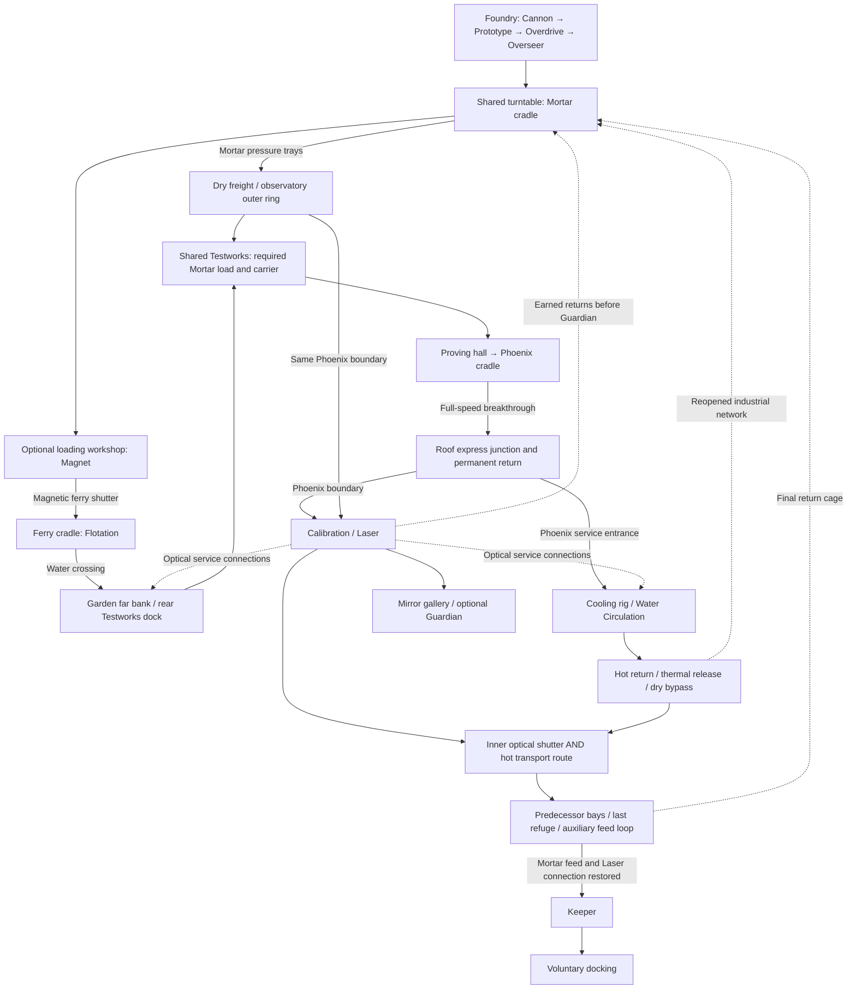

# Furnace Born — Game Specification

A lonely, wordless tank Metroidvania set in a cooling mechanical city. This document defines the current game: its story, rules, progression, places, presentation and intended player experience. Region IDs identify geography, not a required visit order. Numerical values are the current balance baseline; travel times and spatial dimensions explicitly described as targets remain authoring guidance.

## Contents

1. [Identity and scope](#1-identity-and-scope)
2. [Story and narrative structure](#2-story-and-narrative-structure)
3. [Controls, cameras and core systems](#3-controls-cameras-and-core-systems)
4. [The eight abilities](#4-the-eight-abilities)
5. [Exploration and acquisition](#5-exploration-and-acquisition)
6. [The folded mechanical city](#6-the-folded-mechanical-city)
7. [Machinery and environmental interactions](#7-machinery-and-environmental-interactions)
8. [Combat and enemies](#8-combat-and-enemies)
9. [Regional journeys](#9-regional-journeys)
10. [Final approach and ending](#10-final-approach-and-ending)
11. [Interface and information](#11-interface-and-information)
12. [Art, sound and music](#12-art-sound-and-music)
13. [Experience requirements and open scope](#13-experience-requirements-and-open-scope)

## 1. Identity and scope

The Tank escapes a factory that has marked it for recycling, explores a lost mechanical civilization, and eventually chooses to sustain the furnace on which that civilization depends. The emotional direction is loneliness, mystery and occasional tenderness. The world moves more often than it answers: empty carriers depart, observatories transmit into silence, and repair arms attend machines that no longer wake.

The game combines direct movement and independent aim, a shared Heat budget, abilities that change both exploration and combat, and a vertically connected world. The Tank remains grounded on floors, ramps, moving platforms and supported water. There is no jumping, flight or high-speed gap-leaping ability.

### Design pillars

- **Discovery belongs to the player.** An obstruction appears before its solution. Acquiring an ability changes familiar geography and creates a reason to revisit it. Local composition suggests a likely continuation without objective arrows, written quests or forced gameplay camera moves.
- **Places have purposes.** Freight, cooling, cultivation, testing and communication determine room shapes, machinery and routes. Ruins reveal interrupted habits and expectations, not just damage.
- **Abilities are physical actions.** Every acquisition supports exploration and combat. Gates communicate a material, force, surface or firing problem instead of an inventory check. Valid alternative solutions remain valid when the physical rules allow them.
- **Combat requires decisions.** Threat combinations change where the Tank moves, what it attacks first and when it spends Heat. Difficulty comes from readable pressure and spatial choices, not uniform HP inflation or hidden damage quotas.
- **Returns change the journey.** A nearby door, bridge, lift or express rail reveals a recognized place from another side and removes a real detour. The hub is a landmark, not a mandatory stop after each reward.
- **The world communicates without prose.** Shape, motion, sound, impact feedback, symbols and unlabelled instruments explain it. Menus and the completion screen may use text; gameplay, machinery, maps and the combat HUD do not use dialogue, instructions, names or numerical labels. Input glyphs are permitted.
- **The Tank remains expressive.** Exaggerated industrial forms, headlights, antenna motion and mechanical timing supply personality without dialogue or realistic military styling.

### Current scope

The connected journey contains seven regions, eight abilities including the starting Cannon, ten ordinary enemy archetypes, the Prototype and four Boss encounters, permanent regional shortcuts, optional restoration scenes, and one voluntary ending. The Empty Hoist is machinery distributed through these regions, not an eighth region. Main progress never depends on completing all optional repairs or collecting the optional Magnet and Flotation modules.

There is no ammunition economy, currency, experience, corpse retrieval, field healing, limited equipment loadout or mandatory restoration percentage. Acquired abilities remain available. Ordinary movement remains available during Overheat. Hazards do not bounce or teleport the Tank to safety.

## 2. Story and narrative structure

### The city before the journey

Factories, transport, gardens and observatories once shared a central furnace. Heat travelled outward through freight and service infrastructure; coolant and reclaimed material returned inward. The builders are gone. Their origin and disappearance remain partly unexplained.

The surviving machines inherited two duties: keep the furnace alive, and repair machines that can still work. As regulation and circulation failed, feeding the furnace more scrap prolonged operation without restoring efficiency. The city consumed unused equipment, then peripheral facilities, and eventually active machines. Each contraction preserved the centre while making fewer outer places habitable.

Repair Hives preserve the Tank while reclamation systems try to destroy it. Neither duty is secretly false; the failing city can no longer fulfil both together. The opening recycling attempt acquires a different meaning as the player understands the network.

Earlier mobile prototypes reached the furnace and served as replacement drive and regulator assemblies. They eventually wore out. Retired hulls, cradles and mounting sockets remain in successive chambers.

The player is a rejected experimental chassis that can accept modules from incompatible prototypes. Its apparent fault permits the combination of drive and circulation machinery needed for the final connection. This capacity is earned through exploration, not explained by prophecy or a secret identity. Docking supplies a working assembly and connection to existing fuel and stored heat; it does not create limitless energy. Future decline remains possible.

### The player's changing motivation

| Stage | Immediate purpose | What the world reveals |
| --- | --- | --- |
| Escape | Avoid reclamation and leave the Foundry | The factory rejects the Tank; Repair Hives preserve it |
| Find passage | Cross an empty transit network and its blocked approaches | The factory belonged to a much larger connected city |
| Restore local movement | Reach new banks, freight layers and service routes | Small repairs still let individual machines do useful work |
| Recognize earlier attempts | Recover the test engine and explore optical or circulation machinery | Failed vehicles share the Tank's sockets and intended destination |
| Inhabit the completed machine | Keep moving through Overheat and reopen old infrastructure | Heat can be carried, and the inner furnace approach is now possible |
| Choose | Defeat the keeper, inspect the socket and decide whether to dock | The familiar repair-shaped interface needs the Tank's drive to sustain the city |

Mandatory transit, Testworks and predecessor spaces carry the essential story. The optional Gardens and the independently ordered optical and circulation visits provide complementary evidence. No scene assumes that every optional region has already been visited.

### Recurring wordless motifs

| Motif | First reading | Later reading |
| --- | --- | --- |
| Repair arms and vehicle-shaped sockets | Safety and recovery | A machine can be connected to support something larger |
| Empty carriers and inward cargo | Abandonment | Distribution has been inverted toward reclamation |
| Detached hulls and module mounts | Scrap and useful upgrades | Previous attempts to carry the furnace's load |
| Outward optical pulses | A distant curiosity | Continued expectation without a reply |
| A maintenance machine repeating a failed task | Habit | An individual activity the player can restore |
| A red hull with a steady engine | Dangerous combat commitment | A body that can sustain the final connection |

Essential meaning must remain understandable if optional scenes are missed. Small acknowledgements use a light, head turn or resumed task; machines do not speak, lead the player, or point at objectives. The ending's detailed commitment and continuation rules are in [Final approach and ending](#10-final-approach-and-ending).

## 3. Controls, cameras and core systems

### Input and movement

| Default input | Action |
| --- | --- |
| W / A / S / D | Direct camera-relative movement; diagonal speed is normalized |
| Mouse | Independent aim; mouse look in third person |
| Left mouse button | Fire the selected weapon |
| Right mouse button | Magnetic Traction |
| Q | Cycle acquired Cannon, Mortar and Laser |
| Shift | Hold grounded acceleration; Phoenix upgrades the same action |
| F | Deploy or retract Flotation |
| E | Contextual use, including Repair Hives and deliberate final docking |
| C | Toggle third-person and overhead views |
| Tab | Open or close the map |
| Escape | Pause and system settings |
| Space | Skip the death sequence; the ending also exposes its system Skip action |

Bindings can be changed in settings. Movement is direct rather than tank steering: the hull turns to follow travel while the turret aims independently. Direction changes remain immediate during acceleration. A stationary Tank cannot build boost by holding Shift, and pushing against a wall cannot replace Phoenix's run-up. Actual wheel motion follows travel and slope support.

Weapon switching does not clear Heat, bypass firing recovery or retarget a launched Mortar. All owned capabilities remain available; there is no equipment-slot restriction that can strand the Tank.

### Two camera views

**Third person:** a perspective camera follows behind and above the Tank. Mouse look changes the view independently of hull heading; movement follows that view. One reticle stays centred on the screen. Mouse look remains smooth and available while firing or using Magnet, regardless of input order. Looking upward must not rotate the camera into the ground or hull.

**Overhead:** a fixed three-quarter view follows position and supporting height smoothly. Movement remains screen-relative, and the single reticle follows the mouse continuously. It does not snap to enemies, jump between platforms or move because an aim range is reached.

C switches immediately, preserving position, progress and equipment. Each view is a supported player choice. Ramps and lifts do not unexpectedly rotate the movement frame. Gameplay never pulls the camera toward a solution.

Settings provides a paused, unobscured scene preview. Third-person controls expose pitch, follow distance, height offset, shoulder offset and mouse sensitivity; overhead controls expose downward angle and visible area. Each view remembers its own settings and resets independently. Sensitivity ranges from 0.25× to 3×, defaulting to 1×. Adjusting presentation does not alter speed, weapon limits or progress.

Clicking the playfield captures the mouse; pausing or opening the map releases it. Where capture is unavailable, middle-button dragging turns the view and works alongside weapon inputs. Opening settings must respond to one pause action, without requiring a second Escape merely because capture was active.

### Aiming and obstruction

Cannon and Laser aim independently of the hull and can elevate or depress by **40 degrees**. Across a same-height open floor they remain level. At the angular boundary, the barrel and firing direction stop; the player's reticle does not snap to a different target. There is no angle-limit text or second projected-ground marker. A different supported firing position is the solution to a genuinely unreachable angle.

Mortar uses the same reticle, with a dashed ring and a light trajectory preview. It can target a landing behind low cover, but its arc still strikes a sufficiently high wall or ceiling. Aim intent stays continuous even beyond the weapon's reach; trajectory and impact show the actual outcome.

Visible surfaces and aiming agree. A translucent foreground must not cause aim to select an unrelated hidden floor, and transparency never removes collision. Floors, cover and roofs block actual projectiles and beams. Apparent targets must have usable firing terraces within the elevation limit; the limit is not an unexplained puzzle rejection.

### HP and damage feedback

| Rule | Current value |
| --- | ---: |
| Starting and maximum HP | 50 |
| Protection after a direct hit | 0.6 s |
| Player damage radius | 0.8 world units, inset from the hull |
| Enemy body and weak-point hit allowance | 15% larger radius than the underlying target |

Damage volumes and solid-body collision serve different purposes. Forgiving edge hits do not bypass armour; a surviving enemy remains a physical obstacle. Direct and repeated contact damage respect the protection interval. Furnace channels are a separate environmental hazard, described under combat.

HP is restored at Repair Hives or through reconstruction, not by field healing. Low HP changes lights, exhaust, motion accents and HUD colour without weakening control responsiveness.

### Shared Heat

| Rule | Current value |
| --- | ---: |
| Heat range | 0–100 |
| Overheat begins | 100 |
| Overheat releases | At or below 30 |
| Delay after all Heat generation ends | 0.75 s |
| Cooling rate | 50 Heat/s |
| Boost Heat, including acceleration and deceleration | 15 Heat/s |

Weapons and tools add their own costs, listed with each ability. Shooting and boost costs accumulate together. Cooling starts only after Heat-generating actions have stopped and the speed multiplier has returned to normal. A cold Tank can fire four consecutive Cannon shots safely; the fifth reaches Overheat.

During Overheat, weapons and the magnetic tool lock. Ordinary movement and Flotation remain available. Without Water Circulation, acceleration also locks. With it, grounded boost can continue or restart, keeps producing Heat and maintains the red-hot state. Displayed Heat stays capped at 100; continuing boost does not secretly start a self-damage timer or force a stop. Releasing boost permits ordinary deceleration, cooling and recovery.

The single reticle carries an unlabelled clockwise Heat ring, progressing from pale yellow through orange to flashing red. It stays red through the Overheated state. Steam, engine pitch and the Circulation hull glow reinforce the gauge; blue is reserved for magnetic affordances.

### Repair, death and persistence

A Repair Hive opens as the Tank approaches. Activation unfolds articulated tools, sweeps a visible maintenance light across the hull, restores HP and Heat, saves progress and establishes the respawn anchor. A world pulse communicates ordinary-enemy reset. Repeated repair may shorten its animation; reconstruction receives the full cycle.

An active Hive is a **safe refuge** on its own floor:

- Its surroundings reserve a 15-unit enemy-free radius. Patrols, pursuit, charges and drifting mines cannot enter.
- Entering the inner 5-unit maintenance area ends pursuit. Mobile attackers return toward their posts.
- A thin mint floor ring marks protection. Incoming and outgoing fire dissipate at the boundary with visible sparks and a short blocked sound; explosion and contact damage cannot reach the protected Tank.
- Holding a weapon does not remove protection. Magnet may operate machinery, but the refuge cannot be used to attack enemies outside it.
- Mortar's preview shows interception at the boundary. Leaving restores normal reach and vulnerability. Protection does not extend to a different floor.

At zero HP, tracks stop, the turret drops, headlights extinguish and smoke rises. Music stops immediately and discards the defeated encounter’s musical continuation; machinery remains audible. Reconstruction starts the current refuge region’s exploration music, rather than resuming the previous Boss cue. After a brief held view, a Hive-shaped mechanical iris closes, then opens around the reconstructed Tank. The sequence lasts about three seconds and can be skipped. Reconstruction restores HP, clears Heat and retracts Flotation.

| Persists through rest, death and reload | Resets with an encounter |
| --- | --- |
| Acquired abilities, activated Hives and discovered geography | Ordinary enemies and temporary damage states |
| Opened shortcuts, gates and completed machinery | Projectiles, mines and active fuses |
| Stable magnetic-object positions and completed restoration | Combat crates and pressure vessels |
| Defeated persistent Bosses and completed finite courts | Temporary shield exposure; removed enemy plates return with their bearer |
| Journey completion | Unfinished Boss arena locks and reserve deployment |

Incomplete moving-object puzzles retain a supported local retry, never a stranded platform or impossible saved state. Permanent route openings do not reconstruct on rest. Boss seals reset on death or reload; defeated Bosses remain defeated.

## 4. The eight abilities

| Ability | Acquired at | Exploration role | Combat role |
| --- | --- | --- | --- |
| Standard Cannon | Starting equipment | Break exposed supports, scrap and impact mechanisms | Reliable direct fire and exposed weak-point hits |
| Overdrive | R1 Prototype | Reverse familiar conveyors and operate momentum machinery | Reposition, evade and ram suitable ordinary enemies |
| Magnetic Traction | R2 loading workshop | Pull mounted panels, ballast, cover and suitable mirror carriages | Strip blue shields, pull light enemies, disarm mines and intercept shells |
| Flotation Chassis | R3 ferry cradle | Traverse the connected water network and reach new banks | Change firing angle and bypass suitable floor hazards |
| Mortar | Shared R2 turntable | Reach protected targets through a clear overhead arc | Delayed attacks over low cover against clusters or committed targets |
| Phoenix Engine | R5 test building | Break momentum shutters and open express routes | Destroy ordinary enemies at full speed while preserving travel momentum |
| Laser | R4 emitter, after Phoenix | Reach distant receivers and route through mirrors | Sustained precise fire and indirect weak-point attacks |
| Water Circulation | R6 cooling rig, after Phoenix | Continue hot travel and open thermal-contact routes | Double contact damage against every enemy category during Overheat |

Phoenix upgrades Overdrive's speed ceiling and shares its input; it still counts as an acquisition. Circulation is passive. There is no ninth ability or general-purpose heat-transfer, resonance, electrical-link or player-reflection tool.

### Standard Cannon

| Parameter | Value |
| --- | ---: |
| Heat per shot | 20 |
| Minimum interval | 0.5 s |
| Useful travel from the hull | Approximately 24 units |
| Direct damage | One Cannon-hit equivalent |

Shots travel straight without guidance, lock-on, gravity or aim correction. Ordinary cover and major structure stop them; designated scrap, exposed supports and impact paddles respond physically. A held fire input repeats at the weapon's cadence. There is no ammunition count, reload, charge shot or alternate ammunition.

Cannon remains useful after later weapons: moving targets can evade a delayed Mortar, while brief firing opportunities may not support sustained Laser exposure. Enemy weak points and machinery must remain aimable without artificially narrowing the shell's visible presence. Scorch marks and recoil communicate impact without making ordinary walls destructible.

### Overdrive

| Parameter | Value |
| --- | ---: |
| Normal speed | 7 units/s |
| Maximum multiplier | 1.6× |
| Acceleration from 1.0× to 1.6× | 0.5 s |
| Multiplier acceleration | 1.2/s |
| Release from 1.6× to 1.0× | Approximately 0.35 s |
| Offensive ordinary-ram threshold | 1.3× |

Boost requires movement input. Re-engaging during deceleration resumes from the current multiplier. Turning and turret aim remain responsive; there is no invulnerability, flight, wall passage or water-crossing permission.

An ordinary ram destroys a scout, gives a turret or an unshielded guard side a Cannon-equivalent hit, and loses speed against a surviving solid body. An intact guard front rejects the ram and damages the Tank. Ordinary engine contact does not damage major Elites or Bosses. Phoenix and Circulation modify these rules only as specified below.

The first visible gate is a conveyor that pushes normal movement backward. A short reverse conveyor immediately after acquisition demonstrates the new travel direction before the player revisits that original obstruction. Other momentum mechanisms must visibly respond to an impact, not merely to a held input.

### Magnetic Traction

Blue grip fittings, removable plates, mines and interceptable artillery shells share a recognizable magnetic material and shape. Holding the input always produces a scan, rings and sound, including with no target. A connected tether pulses toward the Tank, visibly strains the target and persists until release, obstruction, excess distance or a deliberate turn away. It never attracts the reticle.

| Parameter | Value |
| --- | ---: |
| Tether reach | 13 units |
| Empty-scan Heat | 3/s |
| Connected-pull Heat | 12/s |
| Driving speed during connected traction | 55% of normal |
| Rail counterweight travel | 3 units/s |
| Time to remove a blue shield | 0.7 s |

Solid walls and intervening cargo interrupt the tether. Mounted objects follow their rails toward the pulling position, stop short of the hull and cannot be pulled through other bodies. Partial travel persists after release. A counterweight may latch at its end detent and permanently operate a linked machine; ordinary magnetic cover carts remain repositionable in both directions. Heavy bolted machinery resists rather than moving inexplicably.

A blue shield tears free, throws aside and briefly staggers its bearer; the missing plate remains absent until that encounter resets. Movable cover may remove the enemy's screen and the player's shelter together. Mines can be pulled and disarmed or shot from outside their blast; blue shells can be intercepted. These are advantages, not prerequisites for every combat encounter: flanking, cover and leaving a warned impact area remain alternatives.

Traction occupies the weapon and stops on Overheat with a short red failure pulse. Pulling a clamp can interrupt its charge. Repositioning a mirror changes its location; rotation occurs only where the visible mounting converts the pull into rotation. The tool does not grapple the Tank upward or tow it through unsupported space.

### Flotation Chassis

Paired pontoons extend with a mechanical opening sound. F toggles them; a deployed-state glyph remains visible. Flotation consumes no Heat and remains usable during Overheat.

| Surface / rule | Value or behaviour |
| --- | --- |
| Water cruise | 1.15× normal driving speed |
| Deployed land travel | 0.75× normal driving speed |
| Boost while deployed | Unavailable, including on land |
| Deployment | Cancels the speed multiplier |
| Retraction | Requires support beneath the entire hull |

Ordinary tracks cannot cross unsupported water, even at high speed. Floats support connected water surfaces but do not cross walls, voids or unrelated height changes. Dry ramps and low shore edges identify entry and exit. Attempting to retract over deep water gives a short sound and warm ripple, leaving the pontoons deployed; no sinking timer, hidden HP cost or teleport is introduced.

The first crossing is calm, brief and ends at a visible landing. Later currents are readable in surface motion and remain escapable or traversable in reverse; the southern canal's 1.2-unit/s current is a handling variation, not a Circulation gate. Resting landings, bank defenders and firing angles make water an inhabited route rather than a long obstacle strip.

Weapons retain their normal Heat rules while afloat. Projectiles, beams, blasts and overhead shells remain dangerous. Only physically lower ground-contact hazards may be avoided. Wheels stop rolling on water; wakes and a gentler engine register distinguish travel. Red-state contact remains eligible on a valid enemy contact, even while afloat, but grounded engine boosting does not.

### Mortar

| Parameter | Value |
| --- | ---: |
| Maximum landing distance | 24 units |
| Flight duration | 1.15 s |
| Arc rise above the start/end-height path | 8 units |
| Heat per launch | 35 |
| Minimum interval | 1.05 s |
| Blast radius | 3 units against enemy damage volumes |
| Ordinary-enemy damage | 3 |

The landing point is fixed at launch. A visible arc clears low cover but strikes roofs and sufficiently high walls. Blasts respect intervening solid cover. An overhead hit bypasses an ordinary guard's frontal plate; it does not become a rear hit against a Boss with an armoured roof. Surviving ordinary machines are briefly staggered, providing a follow-up opening without suppressing Boss attacks.

The common turntable cradle makes this first extra weapon difficult to miss. Its safe first target is a yellow upper pressure tray above an open-topped screen. A descending shot or nearby blast presses it; a level or rising shot from underneath does not. The freight battery then uses the same low-cover geometry in combat, and the shared Testworks load requires another overhead application before Phoenix.

Mortar rewards predicting a committed enemy or cluster. Its delay, range and actual overhead clearance prevent it from replacing every direct or reflected shot. It does not home or pass through a roof simply because the cursor is beyond it.

### Phoenix Engine

Phoenix raises the same grounded engine to **3.2×** speed while retaining Overdrive's **1.2 multiplier/s acceleration**. From normal moving speed, maximum takes about **1.83 seconds** and a straight run-up of about **26.95 units**. Maximum world speed is **22.4 units/s**. Release deceleration retains the existing slope, approximately **1.71 multipliers/s**. Shared engine Heat is unchanged.

A distinct exhaust, hull state, speed gauge and engine register announce full-speed readiness. At maximum, eligible barricades break and ordinary enemies die immediately, including frontal guards and mirror inspectors. Breaking an ordinary body or obstacle preserves momentum. Intact major structures remain solid, and a blocked hull loses speed.

The finite high contact tier is 12 damage before Circulation's multiplier; ordinary full-speed destruction remains guaranteed rather than weakened by later ordinary-enemy HP. Cold Phoenix does not grant a required Boss attack or bypass special-enemy armour. Its combat purpose is overwhelming ordinary opposition during travel.

Express tracks have long visible run-ups, broad turns, physical guide rails and safe braking aprons. They connect actual neighboring places through player-controlled movement. Initial shutters stay broken and service returns stay open. Normal express routes fit the pre-Circulation Heat budget; they do not demand repeated mandatory cooling stops or a new jumping ability.

### Laser

| Parameter | Value |
| --- | ---: |
| Total beam path | 90 units |
| Maximum reflections | 5 |
| Heat | 24/s |
| Damage | 4.5/s |

Hold fire to sustain a beam through visible mirror faces. Opaque structure and nearer bodies stop it. Reflection follows the actual surface orientation, including tilted or enemy-mounted mirrors; framed reflective faces and outgoing segments remain readable from both sides. Authored early puzzles use one or two clear bounces rather than exhausting the maximum path.

Selecting Laser shows a thin, dashed preview of its actual reflected path and a small contact light at the final obstruction. The guide remains legible across foreground scenery, but stops wherever a physical object blocks the beam. Previewing costs no Heat, causes no damage and operates no machinery. It remains available during Overheat; firing remains locked. The guide neither moves the reticle nor chooses a target, and disappears on weapon switching, death or final docking. The solid damaging beam follows the same path when fired, with a faint guide retained for obscured segments.

Movement changes the incoming angle and therefore the useful firing line. Main-route puzzles keep the firing surface, mirrors and receivers at a common supported firing height. Broad mirror faces, receiver surfaces and openings admit a useful standing area and modest aim error. The challenge is discovering a route or changing a machine's orientation, not holding an exact pixel or finding one invisible position. Mirror faces must remain visible in both supported cameras rather than presenting an edge to the overhead view.

A receiver's visible collecting face is its actual target. One hit latches a passage permanently; the player never has to hold a beam from one position while driving through a self-closing gate elsewhere. Mandatory puzzle mirrors belong to scenery, so killing a reflective enemy cannot destroy the only solution. Magnetic mirror-carriage combinations remain optional.

For the tracking Guardian, conventional weapons can damage only the rear. Its front, sides and roof are armoured. It faces the Tank while acquiring an attack, then holds that orientation through its committed warning, attack and 2.2-second recovery. Two broad mirrors behind its flanks each support a single-bounce rear shot from the approach side. Dodging provides a stable opportunity to choose a useful mirror; the next attack reacquires the Tank. A reflected hit is judged by the **final arriving segment**, not the Tank's location. Red Circulation contact remains a close-range alternative against other surfaces. Laser is acquired before this encounter, and the Guardian does not gate the main inter-region shortcuts.

### Water Circulation

The module installs passively, adding no input, water-ammunition meter or refill chore. Coolant jackets, moving pipes and steam show the closed loop protecting the drive while heat spreads into the body. It does not instantly cool the Tank or restore ranged fire during Overheat.

The engine can continue or restart while Overheated. The hull remains red until the shared recovery threshold is reached, including during cooling. This visible state defines contact eligibility. Continued boosted movement can sustain it indefinitely under the normal Heat rules.

| Contact tier | Red-contact damage |
| --- | ---: |
| Low speed | 2 |
| At the offensive acceleration tier | 4 |
| Full Phoenix speed | 24 |
| Repeat interval against the same target | 0.5 s |

These are twice the positive base contact tiers, applied once. **Every enemy category is eligible**, including shielded enemies, the Prototype and Bosses. Ordinary ram immunity is not a zero base value that cancels the ability. The body remains solid, hostile damage still matters, and overlapping an enemy does not deal damage continuously per instant.

The first hot run starts from a cold, safe approach. Visible grilles add 28 Heat/s to engine use, bringing the Tank into Overheat before a readable thermal-contact barrier and ordinary defenders. Red contact releases load-bearing hot fasteners and pushes the barrier apart; a cold impact gives solid recoil. The route then opens an ordinary permanent bypass.

Later industrial returns and the inner route combine continued hot movement with thermal releases. They retain the ordinary opposing-belt speed. The inner optical shutter remains a separate Laser requirement visible before committing to the lane. Physically consistent alternate solutions to optional thermal machinery are allowed; required route boundaries must be established by observable hardware rather than an unexplained immunity.

Circulation must have an exploration interval through familiar reopened infrastructure before the final descent. Staying hot trades ranged fire for contact combat and travel; cooling restores the other choices. It changes neither engine maximum nor acceleration and adds no mandatory Phoenix Boss phase.

## 5. Exploration and acquisition

### The exploration rhythm

The Metroidvania structure follows a cycle: notice an unreachable place, follow a promising local route, learn a new physical possibility, return to recognized geography from another side, and choose which earlier obstruction to revisit. The world supports meaningful alternatives while keeping at least one comprehensible continuation. It does not maximize simultaneously open doors for their own sake.

Each major ability needs a visible acquisition, a forgiving first use, a later variation, and a lasting exploration or combat application. Acquisition rooms have a purpose and a former user for the equipment. New tools are not crowded into adjacent empty rooms.

Regions have layers: preview, initial access and deeper access. Seeing the observatory or reaching its outer freight ring does not grant Laser. Seeing water before Flotation establishes a remembered place and another bank, not merely an inaccessible strip.

### Required dependencies

**Cannon → Overdrive → Mortar → Phoenix → Laser and Water Circulation, in either order → inner route → final feed → Keeper → voluntary docking.**

**Magnetic Traction → Flotation** is an optional exploration branch. Its water approach and the dry freight approach reach the same Testworks; both encounter the required Mortar load before Phoenix. A player may explore the water branch before collecting Mortar, but cannot obtain Phoenix without returning for it.

Solid connections show first access; dotted connections are earned returns. The two Testworks entrances are **alternatives**, followed by one shared Mortar requirement. The two late abilities form an **AND** condition at the inner route, not a prescribed order. Optional Guardian and Sorter victories are not main-route dependencies.

| Acquisition or boundary | Required physical approach | Immediate result and guaranteed return |
| --- | --- | --- |
| Overdrive | Cannon; Foundry service route and Prototype | Short reverse belt returns to the familiar awakening bay, then the original belt reaches the Overseer |
| Mortar | Foundry exit; exposed cradle at the common bridge mouth | Safe pressure-tray shot, then the freight entrance; shared hub remains reachable |
| Magnet | Cannon and Overdrive through the optional loading workshop | Pull a return latch and use the tool against a blue shield; no water crossing required |
| Flotation | Magnet opens the dry ferry-service approach | Calm first crossing to a visible bank; water flanks and canal branches follow |
| Phoenix | Either Testworks entrance; Mortar at the common screened load, then carrier and proving hall | Full-speed shutter demonstration, roof return and independent optical/circulation branches |
| Laser | Phoenix opens calibration from either the outer ring or express junction | Safe reflection, indexed return and loading/garden/circulation exits before Guardian |
| Water Circulation | Phoenix opens the dry service yard; Cannon and ordinary movement reach the rig | Hot run and thermal release, permanent bypass, further exploration before R7 |
| Inner route | Laser opens the optical shutter on the safe approach; Circulation supplies hot traversal | Last refuge and final return cage; no Magnet or Flotation requirement |
| Final feed and docking | Short auxiliary feed loop, Keeper victory and deliberate socket use | Access depends on physical restoration, not an all-eight inventory check |

The dry route may complete the journey without Magnet or Flotation. The water branch remains valuable for different entry directions, bank combat, underwater infrastructure views and persistent returns. Blue shields and movable cover continue rewarding Magnet after the approaches converge.

### Ability locks and alternative solutions

- **Hard physical boundaries** include unsupported water, a visible momentum threshold, a protected overhead target, an optical path and a thermal-contact release. The whole surrounding space must preserve the claimed boundary: an upper balcony or a far-side lift must not accidentally open it early.
- **Alternative-solution obstacles** offer different ways to obtain a firing line or manipulate reachable hardware. Pulling cover, reaching another bank or lobbing a shell can all be valid where geometry permits. Do not add invisible immunity to force the expected tool.
- **Knowledge obstacles** ask the player to recognize an available action: pulling from the opposite side, changing a beam angle, holding a plate with the hull or timing an impact against an exposed mechanical part. No hidden input combinations or numerical recipes are required.

Main-path openings have evidence such as a seam, exposed support, machine using the passage or view of the room beyond. Randomly shooting every wall is never necessary. Critical mirrors and movable objects remain retrievable or have a local visible recovery. An optional enemy cannot be the only unrecoverable key.

A temporary commitment must be escapable or completable with every legal incoming loadout. No route demands its own reward, a newly introduced jump, accidental falling or simultaneous operation of distant controls. Do not alter steering or momentum rules merely to manufacture a lock.

### Returns, rewards and pacing

A successful acquisition loop exits toward familiar geography or a meaningful new junction. Its inside release cannot be reached early from the other side. Principal optical returns open before the optional Guardian; the roof return opens after the Phoenix demonstration; the final return opens before the Keeper.

A useful shortcut removes at least half of the initial detour between the same landmarks, including ordinary lift waiting and travel. Local returns target roughly 15–35 seconds and nearby cross-region travel roughly 45–75 seconds. These are pacing guides, not minimum durations or reasons to lengthen the initial trip. Shorten empty approaches and repeated waiting first.

Later travel should offer changed access, a new view or an efficient return. It must not repeatedly demand the same puzzle, full encounter gauntlet or series of cooling stops. The express junction provides several exits, but direct garden/optical/circulation connections prevent it becoming another mandatory hub.

Exploration rewards include useful routes, restored individual machinery, recognizable places and predecessor scenes. Empty locked pockets and routine currency filler do not satisfy that role. No permanent HP or Heat-capacity collectible is currently part of the required design.

## 6. The folded mechanical city

### Site and section

The city occupies neighboring structures around a great furnace shaft in a horseshoe-shaped industrial excavation. A broken transport bridge spans its middle. The Foundry sits below the southern transit deck, a water basin occupies the west, the Testworks rises through the rear/western cliff to the roof, and optical and circulation facilities share the eastern service structure. The central furnace lies below them all.

Routes derive from freight, drainage and maintenance. Scenic distance may imply a larger city without making every distant platform a destination. Playable scale comes from authored situations, not a requirement to triple floor area or repeat the same room loop in every region.

The R2 turntable is the reference height. Neighboring authoring bands begin about eight world units apart, with smaller offsets where useful. Bands are spatial guidance, not identical storeys or numbers shown to the player.

| Region | Height envelope | Physical relationship |
| --- | --- | --- |
| R1 Recycling Foundry | -2 to 0 | Under R2's south side; press foundation borders the garden canal; maintenance gallery faces loading works |
| R2 Empty Transit Hub | -1 to +1 | Turntable at 0; bridge underside frames water travel; its roof lies below the Testworks exit |
| R3 Sunken Gardens | -3 to -1 | Western basin; connected water near -2; upper pump terrace meets the eastern retaining wall |
| R5 Prototype Testworks | -1 to +3 | Water dock climbs to shared benches; independent dry receiving bay meets the outer freight ring; roof overlooks R2 |
| R4 Silent Observatory | +1 to +5 | Eastern stack; early outer ring below Phoenix-gated calibration; upper apparatus defines the skyline |
| R6 Circulation Works | -5 to -1 | Inside and below that stack; dry service descent, cooling rig, garden industrial terrace and inner approach |
| R7 Predecessors / Central Furnace | -7 to -5 | Deep beneath the bridge; last-rest return shaft rises to the known transit network |

The overlaps do not imply free travel between all surfaces at the same height. Actual floors, walls, water, bridge ends and supported landings define access. R1's recycling furnace and R7's central furnace are different machines, connected by material and heat infrastructure.

### Shared landmarks and recognition

Three local anchors organize the city; the distant furnace exhaust spine provides broad orientation.

- **Bent press:** one broken support and an intermittent empty stroke. Its working side appears in R1; its foundation and muffled rhythm return beneath the R3 canal grille.
- **Split flywheel:** a missing wedge and off-centre axle identify the same R2 structure from the arrival deck, below across water, and above from the Testworks roof.
- **Three coolant pipes:** one visibly broken branch links the underside of R4, the garden pump wall and R6. Restored flow changes an earlier view in a physically consistent direction.

Recognition happens during ordinary control, without an explanatory cut. Four major returns carry it:

1. The canal opens a supported maintenance ramp beside the familiar press.
2. Phoenix's roof exit reveals the flywheel below; a freight cage returns to its known refuge.
3. The emitter-side cage descends past the overhead enclosure previously seen from the loading apron.
4. Circulation's return reaches the back of the garden pump wall and restores the familiar broken pipe branch.

Use the actual structure across these views, not duplicate scenic substitutes. Major regions need an internal change of height and a visible relationship to another region; an entrance lift and an exit lift alone do not create an interwoven city.

### Permanent connector allocation

These IDs identify design connections. All released mechanisms remain open through repair, death and reload. Lifts become automatic on release, with no landing calls. Water required to reach a connector is stated separately from a dry connector itself.

| ID | Endpoints | First opening | Return and protected boundary |
| --- | --- | --- | --- |
| C01 | R3 cargo canal to R1 press maintenance floor | Flotation reaches the foundation; shoot the exposed inner maintenance latch | Dry ramp into completed Foundry; approaching through the canal still requires Flotation; no bypass into optical depth |
| C02 | Old loading apron to R1/R2 exit terrace | Mortar reaches the loading enclosure's return mechanism | Short dry return; does not grant the observatory's deeper access |
| C03 | Garden pump terrace to R2 ferry/garden shore | Hull plate and exposed retaining-pin shot restore the pump return from the garden side | Permanent dry connection with both ends released together; initial Flotation crossing cannot be bypassed |
| C04 | R5 rear dock to R3 far bank | Shoot the inner gangway release on the common Testworks approach | Dry return before Phoenix; a freight-first visitor reaches the bank, not the unearned ferry cradle across water |
| C05 | Testworks roof to turntable service landing | After Phoenix's breakthrough, release the upper freight coupling | Automatic roof cage and dry Foundry connection; separate from the early Magnet training lift |
| C06 | Roof express junction to R4 calibration | Full-speed Phoenix opens the service shutter | Open dry track on revisits; meets the outer approach behind the same Phoenix boundary |
| C07 | Express junction / old transit spur to R6 yard | Both approaches meet the same Phoenix barrier | Dry service descent with braking space; reaches the pre-Circulation yard, not the far end of a thermal trial |
| C08 | Emitter-side landing to old loading apron | Release the cage beside the emitter, before Guardian | Automatic lift lands on the safe apron; its drive housing and landing block early release from below |
| C09 | Mirror service gallery to upper garden pump works | Laser reaches the recessed garden-return receiver | Bridge and service lift; independent of Guardian and separate from the ferry acquisition approach |
| C10 | Mirror gallery to R6 service yard | Laser operates the neighboring optical release | Short passage and maintenance lift; C07 still permits Circulation before Laser |
| C11 | R6 hot-return landing to rig passage, garden industrial terrace and transit inner service | Cross with Circulation and release the far-side pressure assembly | Dry bypass removes repeated hot traversal; no unsupported water or bypass into R7 |
| C12 | Last-rest antechamber to transit inner service | Release the lower coupling before Keeper | Automatic final return cage; upper entry remains sealed until earned from below |

C05, C08 and C12 are distinct cages with distinct stops. Shared geography does not turn them into a freely selectable multi-destination elevator. C09 and C10 may share part of the eastern stack without sharing an accidental all-purpose release. Shafts and bridges must fit their footprints and avoid unrelated sealed rooms.

The early local training lift cannot become a third entrance to Phoenix. Its upper landing is physically separated from the later roof cage. Long-range shots, accessible Mortar arcs, magnetic object positions and riding platforms must obey those same boundaries.

### Architectural composition

Most workrooms and inhabited industrial spaces have substantial walls and ceilings. They need foundations, columns, door faces, service openings and coherent cargo or coolant routes. Missing panels expose a building that already makes sense. Plazas, water banks, inspection walks, outdoor bridges and the optical court remain open where their purpose calls for it.

Enclosure and release alternate: a compact interior frames the next shaft view or familiar landmark. Avoid an uninterrupted network of exposed platforms, but also avoid replacing it with repetitive narrow corridors. Doorways and turns accommodate the Tank and both cameras. Mortar rooms retain actual overhead clearance; tall Boss halls allow their visible indirect attacks.

Unrelated upper routes must not fill the centre of an encounter's view. Concentrate overlaps at recognizable bridges, underpasses, ramps and return junctions. Supporting piers stay out of usable paths. Rails, markings, pipes and fixtures belong visibly to their supporting structure; there are no detached floating remnants.

Occluding portions of walls, ceilings, posts, floors and attached details become smoothly translucent along the view to the Tank and its nearby fighting space. The camera never shortens its configured following distance to avoid an obstruction. Whole floor tiles must not vanish, and the Tank's current support must remain legible. Transparency is a local aid, not a substitute for composing rooms that can be understood without several ghosted floors.

Both views share readable world lighting. Interior paths, undersides and machine sides retain enough indirect light; ceilings cannot turn the third-person view black. Far structures fade beyond the local room network without removing nearby junctions, readable weapon targets or important landmarks.

## 7. Machinery and environmental interactions

### A shared physical language

| Affordance | Meaning and response |
| --- | --- |
| Recessed impact paddle or bullseye, spring and travel slot | Cannon-operable mechanism; recoil, sparks, sound and connected motion on impact |
| Yellow ready face / green operated lamp | Ordinary mechanism state; fixed jamb lights remain after a shutter retracts |
| Saturated blue fitting or plate | Magnetic grip; the physical grip stays blue even when a linked status lamp turns green |
| Framed mirror and lens-like receiver | Optical route; contact flare and outgoing beam show the reflection |
| Horizontal upper pressure tray behind a screen | A descending impact can press it; shots from below strike protected structure |
| Sprung striped plate | Hull weight maintains an action; leaving releases it |
| Flame-marked momentum shutter | Requires a supported full-speed Phoenix run-up |
| Heated load-bearing fasteners | Red contact releases a thermal barrier with steam and visible separation |
| Mint repair ring | Safe maintenance area and weapon boundary |

Mechanisms answer unsuccessful attempts with the appropriate impact, resistance or failed pulse. An inactive target must not feel like a broken input. A connecting cable or pipe leads from the control to its actual consequence. Activation travels along that connection progressively; it does not leave disconnected floating lamps. Distant encountered links remain identifiable on the discovered map.

Player shots operate machinery through their actual paths. Earlier walls and cover intercept them. Enemy attacks cannot silently solve progression mechanisms. Decorative panels do not copy usable target shapes. Difficulty comes from space, timing and pressure around simple actions, not written instructions or arbitrary input recipes.

### Conveyors and momentum

Conveyor motion is a physical world-direction force applied to the Tank, enemies, movable bodies and wrecks on the same support, including slopes.

| Conveyor purpose | Speed |
| --- | ---: |
| Ordinary opposing traversal | 7.15 units/s |
| Foundry and Keeper feed lanes | 3.2 units/s |

Ordinary walking loses ground against an opposing lane; Overdrive makes progress without a prolonged crawl. The first Foundry barrier is visible before the engine is acquired. Its short return belt demonstrates the new capability safely. Ordinary optional loading lanes have a supported cooling and combat bay between stretches.

Belts have dark beds, side frames, end rollers and moving transverse treads with regular warm marks. Movement follows the real direction and slope. Destroying a drive stops its belt for every body and leaves its tread surface in place. Thermal-contact lanes use the Circulation rules rather than faster conveyor tuning to exclude the earlier engine.

### Automatic lifts and freight carriers

Once released, a lifting deck continually travels between its stops, occupied or empty, dwelling **three seconds at each endpoint**. It also waits three seconds before its first departure. There are no landing call buttons, E prompts, boarding triggers or manual destination choices. Missing a departure means waiting safely for the next cycle.

A partly boarded hull pauses departure. A fully supported hull near the edge travels normally and does not arrest the platform between floors. An absent platform leaves an unwalkable recessed shaft; boarding never requires a precision jump. Automatic travel and unlocked routes remain after death or reload.

The local training gallery teaches the rule with two actions: shoot the ballast release to start the lift, then shoot an upper ratchet to open the gallery route. Neither action requires the reward beyond the gallery, and the same lift provides a return.

At the Testworks, Mortar releases the screened hanging load and starts the carrier. At its upper alignment, a physical sleeve exposes a large brake paddle for the endpoint dwell. Shooting it opens the onward route without stopping, reversing or restarting travel. A missed shot repeats the cycle; the side landing permits safe aiming. Closed-sleeve shots give metal rejection feedback.

Other suspended-load interactions obey visible support and a safe catch zone. A latch exposed from a side balcony can be shot there; a pallet or roof blocks a shot from below. Dropping a load may open both a walking route and an enemy sightline, making the timing a deliberate choice.

### Optional maintenance shunting yard — R2

The two-branch rail puzzle occupies a side warehouse within the already accessible freight layer. Shooting an impact paddle or crossing its hull treadle flips the visible track blades once. Remaining on the plate does not toggle repeatedly. Linkages and selected-branch lamps explain the result.

A Cannon hit releases the parked maintenance carrier's brake. It travels along the chosen track at four units/s. Correct routing delivers it to a pressure catch and opens both ends of a short local crossing immediately, with no extra reset action. Wrong routing returns it to its accessible start.

The signal recalls a moving carrier; nearby deliberate use remains an alternative. Recall does not launch a parked carrier, and shooting a moving carrier does not reverse or repeatedly restart it. Track changes lock during travel. The carrier pauses for a Tank or living enemy in its way.

An unfinished delivery can restart locally while track settings remain recognizable; a correctly docked carrier stays secured. This reward is a shortcut, not Magnet, a regional entrance or a main-route requirement.

### Pump return — R3

A yellow striped plate sits on the supported service walk beside the far bank. Its short pressure feed joins a piston and protective target sleeve. Driving onto it depresses the plate and builds pressure; the sleeve rises to expose the nearby firing pin. Holding position leaves time to aim. Leaving before the shot releases pressure and closes the sleeve.

Shooting the exposed pin permanently operates the linked pump and releases the return shutter directly behind it and the corresponding ferry-side shutter. The feed becomes green. Shots against the unpressurized sleeve give metal feedback. No E step is required.

The reward is a dry, bidirectional return to the familiar ferry entrance. Both ends stay closed before restoration, preserving the first Flotation crossing. The main canal, reservoir and dock crossing remain water. This is a shutter-and-pump sequence; it does not raise a separate cistern bridge in the same room.

### Optional gutter garden — R3

Two hinged gutters and low cranks lead from a leaking pipe toward an empty planter. Shooting the impact paddles or pushing the cranks with the hull advances a gutter to its next detent. A hull must withdraw before pushing again; there is no additional interaction-button step. Falling water follows the actual gutter orientation.

A rust plug restricts the pipe to a trickle. One Cannon hit breaks it, before or after alignment. A wrong alignment spills harmlessly. Two seconds of settled, connected full flow fills the planter, raises its metal stem, unfolds five leaves and lights a blossom. Interrupted flow drains an unfinished planter; completed restoration remains.

A low partition shelters the activity from the far-bank firing lane. The plant grants no collectible, HP or route key. It is a quiet act of care, separate from the maintenance delivery.

### Optional maintenance delivery — flooded foundations

Flotation reaches a stranded tender and a supported maintenance ramp. A Cannon shot releases its brake; it crosses the short floating service lane, climbs to the upper inspection berth and lights that bay. It waits for occupied track. Unfinished delivery restarts from the accessible lower dock; completion leaves the tender at its berth.

The reward is a local change in activity and a story about useful work. The ending does not move this tender elsewhere: its final awakening shot uses the different cargo machine established beside the opening bay.

### Optical machinery

A safe first mirror directs Laser through a broad screened opening to a large collecting face. The opened mechanism reveals the next useful line. Shooting a visible indexing release moves its mounted mirror between two clear horizontal detents and sends a second reflection into the garden-return receiver; a short physical linkage and operated lamp make the rotation legible. This route stays at the Tank's firing height rather than requiring simultaneous horizontal and vertical calibration.

Receivers are protected by actual geometry, while usable mirror faces and contact points remain visible. The Tank cannot simply drive into the receiver well. Later challenges vary orientation, distant firing position and indirect combat separately before combining them. A tilted-mirror inspection pocket may route a beam between elevations without adding a new mirror-angle control.

All required connections remain solvable without a uniquely surviving enemy or Magnet. Optional movable mirrors and reflective enemies extend the same physical reflection rule rather than replacing it.

## 8. Combat and enemies

### Encounter composition

An encounter combines a spatial pressure, a protected or mobile target, and at least two meaningful responses. A distant gun with a close flanker asks a different question from a shield carrier with a repairer. Cover, opposing belts, destructible machinery, water approaches and reflected fire change those decisions. More enemies or more HP alone do not create a new encounter.

Most ordinary groups use two or three complementary roles. Their arrival and sightlines must be readable before several attacks overlap. Heavy warnings within one squad take turns. Combat does not depend on whether a target happens to be on screen: directional sound and edge warnings communicate a relevant attacker beyond the camera, while unrelated floors remain visually subordinate. Enemy sight, physical cover and remembered sightings govern attacks; enemies do not know an unseen Tank's position through walls.

Mobile enemies pursue a last sighting for eight seconds and stay within 32 units of their home position. Guards and welders advance during recovery; skirmishers strafe during bursts; ranged specialists reposition between attacks; repairers follow damaged allies. Fixed turrets and heavy machinery stay fixed. Retreat to a Repair Hive ends ordinary pursuit. Ordinary encounters leave retreat available and do not all require extermination.

The Testworks proving court has one finite reserve pair, with four-second arrival spacing. It is the journey's ordinary endurance encounter, not a template repeated in the Hearth. Once cleared, its exit remains open. Boss reinforcements follow the separate arena rules below.

### Ten ordinary archetypes

| Archetype | Silhouette and behaviour | Decision it creates |
| --- | --- | --- |
| Clamp Scout | Low rust-orange jaws and a horizontal sensor; closes, locks direction, then commits its whole body to a charge | Evade sideways, bait solid cover and punish the stagger; avoid retreating along its line |
| Fixed Turret | Pale spindle or tripod with a coil hood; holds a lane and exposes a cooling interval | Cross between volleys, break cover, flank or counterfire during recovery |
| Shield Guard | Broad refractory plate and narrow slit; advances while protecting its front | Flank, lob over it, or strip a blue shield with Magnet |
| Skirmisher | Four wheels and paired guns; circles while firing a three-shot burst | Intercept its route or remove the partner that makes following it dangerous |
| Rail Sniper | Long raised rail; tracks with a red aim line for a 2.2-second warning, locking the final 0.8 seconds | Reach cover or leave the committed line before a 120-units/s shot with 86-unit reach |
| Artillery | Raised mortar cup; brackets a remembered target with three staggered ground circles and visible arcs | Keep moving, reach the launcher, remove its spotter or intercept a blue shell |
| Miner | Retreats while lobbing a limited supply of blue discs that arm after landing | Shoot or extract a mine, change approach, or advance before it establishes a field |
| Welder | Paired bottles and a short nozzle; warns a sector before a continuous sweep | Create distance or pass behind it; avoid getting pinned against cover |
| Repairer | Tender arms and a green repair beam; restores a living ally at a finite rate and needs a clear line | Interrupt the beam, separate the pair or prioritize the repairer; it never resurrects a destroyed unit |
| Mirror Inspector | Broad pale reflecting face and paired angled shots; reflection follows its real facing | Flank, lob above it, use red contact or redirect Laser toward another target |

The opening Foundry introduces scout, turret, guard, skirmisher and welder behaviour. Freight and water routes add long-range aim, artillery and mines. Optical and late industrial routes combine mirrors and repairs with previously learned threats. Elite machinery and Bosses do not count toward the ten archetypes.

The Guard's front reduces damage by **60%**. A pale plate flash, outward sparks and a hard ricochet distinguish armour contact from the orange response of a damaging hit. Blue shields use the same removable-material language as other magnetic objects. No enemy has a hidden maximum damage allowance per vulnerability window.

### Durability and cadence

Opening scouts have one HP, turrets two and guards three. Transit and reservoir light/heavy defenders retain their two/three-HP baseline. On the optical and coolant city routes, those light/heavy categories have four/five HP. Service-district health scales from its authored base by 1.25 in the Testworks, 1.5 in optics and coolant, and 1.75 in the deep Hearth, rounded upward. These are area-specific baselines, not a second multiplier on every route unit. Full-speed Phoenix still destroys ordinary enemies regardless of these increases.

| Ordinary enemy | Movement speed | Recovery after attack |
| --- | ---: | ---: |
| Scout | 5.6 | 1.5 s |
| Turret | Fixed | 1.5 s |
| Guard | 3.8 | 1.6 s |
| Skirmisher | 6.2 | 1.4 s |
| Sniper | 2.8 | 2.2 s |
| Artillery | 2.5 | 2.8 s |
| Miner | 4.6 | 2.1 s |
| Welder | 4.2 | 1.8 s |
| Repairer | 4.5 | 2.0 s |
| Mirror Inspector | 3.2 | 1.9 s |

Boss attack sequences override ordinary cadence. Readable commitment and exposed recovery remain essential even when an enemy moves aggressively.

### Damage to the Tank

| Attack | Damage per accepted hit |
| --- | ---: |
| Ordinary enemy projectile | 8 |
| Skirmisher projectile | 5 |
| Sniper shot | 14 |
| Boss fan projectile | 9 |
| Boss battery projectile | 12 |
| Boss homing missile | 16 |
| Boss aimed barrage, direct hit or blast | 18 |
| Enemy Mortar blast | 10 |
| Mine explosion | 9 |
| Welder flame contact | 6 |
| Keeper sweeping beam contact | 8 |
| Sorter arm contact | 9 |
| Ordinary enemy body contact | 5 |
| Failed accelerating ram into a guard | 6 |
| Prototype committed charge | 18 |

An ordinary enemy Mortar's direct impact uses its launcher's projectile damage; its blast deals 10. A Boss barrage uses its 18-point payload for both direct impact and blast. The Tank's consecutive-hit protection prevents direct impact and explosion from charging damage twice for the same impact. Continuous combat attacks respect that protection too; their values are not damage per frame.

Enemy projectiles stop at the first physical body and can hit other enemies for one Cannon-equivalent damage before armour. Enemy Mortar blasts deal three to other machines, excluding the launcher. Friendly fire does not operate switches.

### Cover and environmental pressure

Wood-braced crates have two HP and can be broken by fire, ramming or committed enemy charges. Steel cover stays solid; blue rail-mounted cover can be repositioned. Charge warnings must describe the whole swept body, including the path ends, rather than drawing a misleading thin line.

A pressure vessel ignites on the first hit or ram and explodes after a full 0.8-second fuse, within a 5.5-unit radius, for three damage to enemies and eight to the Tank. More shots do not shorten the fuse. Each chained vessel starts its own full warning. Cover that is intact when the explosion begins protects bodies behind it, even if that blast destroys the cover. Blasts do not unlock unrelated progression mechanisms. Destructible combat props reset with ordinary combat; permanent route changes do not.

Shallow furnace spill is traversable but deals five damage every 0.5 seconds, independently of ordinary consecutive-hit protection. Physical exit ramps remain available. Acceleration can shorten exposure; the hazard does not return the Tank to a platform automatically.

### Committed Boss arenas

Prototype, Recycling Foundry, Optical Guardian, Sorter and Final Keeper each occupy a bounded arena. When the Tank has entered completely, visible striped shutters close with a mechanical cue. A dormant Boss cannot be damaged from outside; hits produce protected-metal feedback.

The seal persists through venting, exposed phases and reinforcement deployment. Victory retracts the shutters and ends active arena hazards. Death or reload resets the encounter lock. Optional fights remain optional until entry. The roof express bridge passes outside the Sorter's inner court. Ordinary encounters do not inherit these seals, and a sealed fight cannot be escaped by reaching a nearby refuge.

Projectile warnings last at least 0.85 seconds, lock before release and show both battery origins when both will fire. Barrages retain visible landing areas throughout flight. Reinforcement hatches light for two seconds before a reserve can attack. Main projectile Bosses provide at least one second of recovery. Reserves are finite. An active Boss health bar remains visible throughout the fight, including when cover hides its body.

| Boss | Structure and pressure | Player response and reward |
| --- | --- | --- |
| Prototype | Nine HP; a pressing carriage with a broad ram and readable radiator lids. Below roughly half health, a faster committed charge becomes two charges, each with a fresh warning | Bait an impact into solid cover to cancel the follow-up and expose the drive. Defeat opens the visible Overdrive cradle and return route. No damage quota limits a successful punish |
| Recycling Foundry / Overseer | Four HP per side battery and six in the core, fourteen total. Alternating batteries release staggered fans and aimed ground barrages. One finite pair of light reserves enters below 60% health | Use cover and side routes, then exploit open drive windows. Destroying a battery cancels its unreleased volley and stops its associated machinery, creating a flank. Ordinary Overdrive is not a Boss ram solution |
| Optical Guardian | Forty-eight HP; armour protects front, sides and roof. Tracks between attacks, then holds its facing through warning, attack and recovery. Five-lane fast fans alternate with paired seeking shells whose turning is limited and ends before impact | Dodge the committed attack and use the stable recovery to find a reflected rear shot through broad mirrors and a clearly exposed rear aperture. Red contact is an alternative. No per-window quota. Victory restores the optional outward array |
| Sorter | An optional roof machine that moves rail cover and alternates a committed arm sweep with ground barrages. Hiding behind cargo invites a barrage | Read the pale-to-red-to-dark sweep warning and use its cover interaction to interrupt the arm and expose the drive. Magnet adds control of rail cover, but ordinary movement and Cannon remain viable. No ability reward or express-route requirement |
| Final Keeper | Two nine-HP feed assemblies and a thirty-HP core, forty-eight total. Alternates batteries, seeking pairs, barrages and an exposed-core sweep. Below 40% health, tighter fans overlap a delayed ground strike | Destroy feeds to stop their local belts and open flanks. Both destroyed feeds leave the core continuously vulnerable, including during its attacks. Reserve pairs become eligible at 65% and 32%; no more than two reserves may be alive or deploying |

The Keeper counters repeated fire from behind cover with a warned indirect attack acquired from sight or incoming fire, never from unknown movement through walls. Mortar remains useful, but staying behind one crate and holding fire must not solve the whole fight. Reflected fire, relocating under pressure and red ramming offer distinct approaches.

A full-speed red impact's damage can pass from a destroyed feed assembly into the core; it is not discarded at a component boundary. Two such clean impacts can defeat the Keeper. Cold Phoenix contact remains ineffective against Boss armour. The strength of an earned ability must not be erased by a hidden phase cap.

## 9. Regional journeys

Each region combines a former civic or industrial purpose, a distinct arrangement of spaces, an ability lesson and a change in the player's understanding. Room counts and floor area do not determine quality. The routes below use the connections in [the city table](#permanent-connector-allocation); machinery rules are defined once in [environmental interactions](#7-machinery-and-environmental-interactions).

### R1 — Recycling Foundry

**Purpose and character.** Receiving pits, sorting presses, low service trenches, engine tests and a local recycling furnace form a working reclamation plant. Dirty refractory blocks, worn teal machinery and warm furnace apertures contrast with cooler readable fill light. Heavy knocks and conveyor clatter establish a city still performing the wrong task.

**Journey.** The rejected Tank awakens beside hulls moving toward a press. A visible upper exit and northbound opposing belt establish an obstruction before the engine upgrade. A scout is visible before it attacks. The west service descent leads to a workshop shot that opens its adjacent shutter, then a sheltered Repair Hive. Beyond it, the wider sorting bay pairs a guard with a welder around low cover. Its second impact paddle opens the Prototype approach.

Cargo crossings supply periodic cover and pause when occupied. Long firing lanes combine with close pressure; enemies share the belts' physical movement. Each operated switch has a traceable local connection, so finding the next room does not require an unexplained relay hunt.

The Prototype court gives its charge substantial solid obstacles and clear flanks. Its engine cradle is visible before victory. Acquiring Overdrive leads immediately to a short belt climb back toward the awakening bay, then the original reverse belt and the Recycling Foundry fight. The return is recognition plus a new action, not a separate tutorial corridor.

**Aftermath.** Overdrive also releases a permanent maintenance return. A post-Boss Hive and a brief local machinery pulse lead continuously into transit, without an end-of-level modal. There is no extra refill stop immediately before the local Overseer. The contrast between preservation and reclamation is established physically, without explaining the furnace's full story.

### R2 — Empty Transit Hub

**Purpose and character.** One large freight system organizes turntables, loading galleries, warehouses and maintenance sidings. Its quieter south wall exposes the split flywheel through roof structure; the central Repair Hive is protected. Empty carriers and inward-pointing clamps suggest a distribution network now serving reclamation. This hub is a recognizable place, not a row of identical reward rooms or shops.

**Journey.** The Foundry arrival passes beside a locked roof cage. A common bridge cradle makes Mortar visible on the shared route. Its safe first shot reaches a horizontal target tray over a screen; a following freight battle pairs a protected lobber with a mobile flanker. Mortar supports the dry onward route whether or not the optional water branch is taken.

The western training lift and workshop form the Magnet approach. Its ballast and upper ratchet are operated with existing movement and fire. Dispatch cargo periodically cuts a sniper line; a blue-shield advance and a side skirmisher make the far installation matter as combat space. Counterweights and inspection flanks remain usable before Magnet is acquired. Recovering the module enables a pull through the disabled-loader arrangement and gives an immediate shield-removal opportunity.

**Branches and returns.** Water below advertises the Gardens; dry freight leads toward the Testworks. The old loading spur is an optional conveyor cooling bay and turret apron, with future canal and optical connections. It does not hide the required Mortar. The optional shunting delivery opens a local crossing; repairing a maintenance arm and its rail restores visible freight activity. Neither is a main-route checklist.

The later roof return reaches the same flywheel and lift structure from above. Familiar machinery changes apparent scale without replacing the hub with a second copy.

### R3 — Sunken Gardens

**Purpose and character.** Retaining walls, greenhouse ribs, filter works and mineral-stained cultivation beds occupy a cooling basin beneath the transit bridges. Muted green surfaces, reflected water light, drips and muffled freight noise distinguish the region. The canal must already be visible before Flotation is found.

**Journey.** The Magnet approach reaches dry filter works. An inlet rotor and its linked filter actuator operate the sluice, leading to the ferry installation and Flotation. This is a piece of water machinery, not another pressure-plate-and-shot recipe. The first water use has a visible, safe landing. Subsequent bank turrets and blue shields let water create a flanking choice; sheltered pockets provide recovery from crossfire.

The main channel passes under a real bridge and alongside press foundations. It opens an optional old-loading return, then a dock where artillery and a flanker contest the approach to the Testworks gangway. The gangway reconnects to the common onward route without requiring Phoenix.

**Returns and quiet activity.** The pump sequence opens both ends of a dry return to the ferry. It does not drain all meaningful water. Later optical access reaches the upper pump walk, while circulation routes reveal the old garden wall and returning pipes from another level.

The sheltered gutter garden and stranded maintenance tender offer small acts of restoration. Their result is a living machine or completed task, not an extra ability, health pickup or mandatory ending flag. There is no regional Boss.

### R5 — Prototype Testworks

**Purpose and character.** An engine proving plant sits between freight and the exposed roof routes. Pale enamel panels, rubber stops, bare steel and scorched test mounts surround enclosed runways. The roof's openness arrives as a deliberate reveal after these compressed spaces.

**Journey.** The lower water dock and dry freight observation approach converge on the same Mortar-operated load apparatus. It releases an automatic carrier; an upper brake shot opens onward access without turning the carrier back into a manual lift. The inspection gallery exposes failed mounts, cooling jackets and stranded rail chassis before the Phoenix installation.

The proving hall pairs a central artillery position with a mobile flank, followed by its finite reserve pair. The entry remains available for retreat, and clearing the court permanently releases its exit. A safe alcove separates this pressure peak from the ability installation. The player does not receive successive abilities in an empty run of cradles.

A conventional shot releases the Phoenix installation clamp. The immediate runway teaches sustained acceleration through a heavy shutter and ordinary defenders. The sightline opens onto the split flywheel from the roof, exposing the hub return and two onward branches.

**Branches and meaning.** The optical route and dry circulation route are now independent choices. The optional Sorter occupies a lateral bay; the express connection stays outside its arena. Phoenix creates fast, useful travel without making Boss ramming a requirement. Failed test chassis establish the purpose of the Tank's modular construction before the final predecessor chambers explain its cost.

### R4 — Silent Observatory

**Purpose and character.** Eastern calibration halls rise around a void, with dark glass, pale cladding, brass fittings and narrow warm light. Galleries look back toward the garden retaining wall and the old loading cage. Receivers and mounted mirrors belong to real machinery; decorative reflections must not obscure usable faces.

**Journey.** An early Mortar-accessible outer ring provides a dry Testworks approach below the Phoenix route. Both entrances to the emitter installation itself require Phoenix. A west gallery, distant sighting station, emitter workshop and return bridge form distinct sides of the calibration space. The player sees inaccessible receivers and reflection surfaces before obtaining Laser.

The installation leads to one safe reflected shot that opens a local return. Later rooms separately develop mirror indexing, firing across distance and indirect combat before combining them. A mirror inspector with a partner differs from a sniper lane contested by a moving flanker. Required optical connections use fixed or mechanically indexed scenery; a magnetic mirror carriage is an optional extension.

**Returns and optional climax.** Connections to the loading cage, upper Gardens and circulation yard open before the optional Guardian. The Tank can leave the installation by ordinary movement before solving any return puzzle that needs its new Laser, so acquisition cannot trap the player.

The Guardian court presents its useful mirrors, rear-hit route and safe movement space within a coherent view, without unrelated floors obscuring the fight. After victory, the array transmits outward and waits. No reply or explanatory cutscene resolves the mystery, and array restoration does not gate the main journey.

### R6 — Circulation Works

**Purpose and character.** Descending separator halls and boiler workshops follow the three returning coolant pipes. Copper, dark ceramics and mineral stains sit under neutral task lighting; local heat sources supply red accents without tinting the entire level. Uneven pump rhythms settle into a more regular pulse as machinery is restored.

**Journey.** Phoenix reaches a dry maintenance yard independently of Laser. An optical bridge provides another entrance, not a prerequisite. Boilers divide sightlines into real maintenance choices. A close welder and indirect fire behind cover pressure different positions. A shot-operated counterweight visibly opens its connected transfer route; it is distinct from the Gardens' pump plate.

A safe refuge separates the inlet gun-and-flanker encounter from a descent squad. Compatible cooling jackets and dismantled assemblies prepare the Circulation installation. Recovery of the module begins a substantial final exploration act rather than placing it directly beside the ending.

**New use and convergence.** Heated grilles, ordinary defenders and a red-contact thermal release develop the new ability. The pressure bypass reconnects to the rig, Gardens and transit. Optional foundation maintenance remains available before the inner descent. The broken pipes and garden wall connect this industrial failure to the earlier basin.

The inner optical shutter is visible before the red run. A Circulation-first visitor can leave safely to find Laser; a Laser-first visitor recognizes the thermal obstruction. Both abilities are required for the inner route, without demanding every optional repair or module.

### R7 — Predecessors and Central Furnace

**Purpose and character.** Low service entries widen into massive refractory chambers, charcoal surfaces and weak furnace light. Distant city sounds become muffled. The final section reveals what the transport system feeds and what previous mobile regulators became.

**Journey.** Successive service bays show worn mounts, a cooling body still attached to a pipe, two abandoned hulls and an empty docking outline. Clear rails and supported ramps keep the approach traversable; emotional quiet is not an excuse for long empty travel.

The last Repair Hive and the hub return open before the Keeper. A short auxiliary-feed loop near this refuge combines a protected distant gun with a close defender. Mortar reaches the screened feed; Laser restores the final descent connection. Completing it returns nearby rather than sending the player through a second endurance court.

**Climax.** The Keeper is part of the operating feed system. Defeating it stops reclamation machinery but does not finish the journey automatically. Its remaining weak fire, the quiet approach and a familiar vehicle-shaped socket lead to the voluntary ending below. There is no ninth ability or last-minute inventory checklist.

## 10. Final approach and ending

### Before commitment

After the Keeper, feeding tracks stop and the sound recedes. A short, quiet approach gives the player roughly half a minute to see the damaged furnace and inspect its socket, without enforcing a wait. The docking rails, clamps and contact marks recall Repair Hives and the predecessor bays. The Tank remains controllable and can leave.

Holding contextual use for two seconds aligns the Tank with the socket. A circular progress signal and visible clamp preparation communicate the action. Releasing the control or moving away before coupling cancels it. There is no written sacrifice prompt, spoken revelation or compulsory ending trigger on Boss death.

### The 26-second ending sequence

| Time | Image and action | Meaning |
| --- | --- | --- |
| 0–9 s | Clamps couple; wheels settle; the engine joins the furnace rhythm. Circulation connects, red heat becomes a steadier light, and power travels outward. One small turret or antenna motion remains | The Tank participates in the machine; its precise consciousness or fate remains unstated |
| 9–15 s | Transit returns to view. Useful cargo movement resumes if the player repaired its rail | A previous act of repair now has a larger consequence |
| 15–20 s | The Gardens receive power. Restored pumping and water activity reflect the saved pump state | Recovery belongs to the places the player affected |
| 20–26 s | At the opening bay, the previously dormant cargo machine's eyes light; it rolls a short distance and stops | Something else can begin |

The cargo machine in the last shot is present from the beginning and is distinct from the optional foundation tender. Unrepaired facilities remain visibly unfinished even when shared power returns. The observatory continues according to its restored state; the ending does not invent actions the player skipped.

This is the only ending. It restores operation without promising permanent salvation or explaining the absent builders. The Tank's final motion permits ambiguity rather than explicitly declaring death or immortality.

### Presentation and continuation

The HUD withdraws after commitment. The coupled engine and returning network lead the sound before the ending music expands. Camera direction is permitted during this committed sequence. Pause remains available; losing focus pauses the sequence. Skip becomes available after the brief coupling beat and reaches the same completed state as watching.

The completion card reads exactly **Mission Accomplished**. Its main choices are Continue Exploration and Return to Journey Menu; the menu retains a completion mark. The full ending piece can continue beneath this card.

Continue Exploration returns to the final Repair Hive with the Keeper defeated, acquired abilities retained and opened routes intact. This is an exploration continuation from before final docking, not a literal reversal of the cinematic's events. Reloading a completed journey resumes exploration rather than automatically replaying the film. Returning to the socket allows the ending to be viewed again.

## 11. Interface and information

### Menus and settings

The interface should feel like part of a finished industrial adventure: a strong title composition, restrained architectural imagery, oxidized brass panels, clear focus, consistent spacing and deliberate animation. Avoid a development-dashboard appearance.

The journey menu prioritizes Continue and Start. A new journey begins at the Foundry awakening with Cannon only; replacing existing progress requires confirmation. Independent location previews are clearly separated from the main journey, show their equipment scope and keep separate progress. They must not become the normal way to find the first region or travel between regions. Any archival previews belong in a secondary, collapsed area.

Pause provides a prominent Resume action and coherent display, camera, audio and input groups. Camera distance, angle and height can be previewed against the paused scene; sensitivity and full control rebinding are accessible here. Settings persist. Keyboard focus, reduced-motion treatment and compact layouts receive the same care as mouse interaction. Escape should reach pause directly rather than requiring a confusing second press after pointer release.

### Gameplay HUD and acquisition

- **Hull:** lower-left segments show health without a number. The acceleration gauge can sit beside it; Heat cannot.
- **Heat and aim:** the single reticle carries the Heat ring and Overheat state defined in the core systems. There is no extra map-point cursor, automatic enemy snapping or written angle-limit warning.
- **Equipment:** a stable tray shows distinct pictograms for weapons, tools and engine upgrades. Selection and actual bound inputs remain legible. Cannon, Mortar and Laser use the weapon-cycle relation; tools retain their own actions; Phoenix upgrades the existing acceleration slot.
- **State:** Flotation deployment, active acceleration, full Phoenix speed and red Circulation have visible equipment and body feedback. A newly acquired ability updates the tray immediately and remains represented after reload.
- **Boss:** the top-centre health display appears for the active sealed encounter and remains visible behind cover. Ordinary enemies do not fill the world with names and bars.

Module contact acquires it; deliberate nearby use may also do so. An acquisition pulse and approximately eight seconds of pictorial action feedback demonstrate the new control using the player's actual binding. A new weapon can show its cycle-and-fire relationship. Control remains with the player; no paragraph, compulsory pause or generic reward popup replaces the ability's safe first-use space.

First-use control glyphs disappear once learned. A small camera-toggle affordance remains available. The non-pointer-locked look gesture can be hinted until used. Low-priority help yields during combat. The native pointer is hidden over active aiming so only the game's reticle remains.

### Map and orientation

The compact upper-right map shows nearby discovered geometry, relevant visible threats, heading and aim, without a quest arrow. Its orientation follows the camera-relative movement frame. In overhead play it becomes visually subordinate when the aiming cursor crosses it; it must not intercept a shot intended for the world.

The full map pauses play. Nearby exits can be revealed without revealing an entire unexplored route; unknown areas remain incomplete. Floors are real separate layers. The current-position arrow is shown at full presence only on the Tank's actual floor, while the floor selector identifies where the Tank is when another layer is inspected.

Discovered lift connections allow inspecting the other known landing, without revealing unknown floors. Gates distinguish closed and opened states. Receivers, circuits, uncollected modules and Repair Hives use recognizable pictograms and a graphical legend. Maps share the HUD's restrained material language and do not add prose room names or numeric floor labels to explain poor world composition.

## 12. Art, sound and music

### Visual language

Oversized rounded barrels, pistons, vents, thick wheels and bold silhouettes make machines expressive. The style is an exaggerated industrial world, with substantial architecture and readable materials rather than realistic military hardware or a toy diorama. Soft contact shadows and restrained outlines support form without blackening interiors.

The warm Tank silhouette stays distinct against each region's materials. Blue denotes magnetic interaction; yellow and green distinguish available and operated mechanisms; red communicates heat and danger; the Repair Hive has its own calm mint light. Shape, motion and sound reinforce these colours. Ordinary decorative lights must not imitate a usable switch or magnetic target.

Recoil moves the whole machine. Acceleration has lean, engine strain and correct wheel rotation. The hull follows supported slopes without burying half its wheels or cutting holes in the ramp to hide contact problems. Headlights and antenna motion supply attention and personality. Critical states alter expression and sound without secretly degrading steering.

Impact rings, broad projectiles, sparks, smoke and debris give weight while preserving target silhouettes and warning areas. Effects have a clear lifetime and origin; stray suspended blocks must not masquerade as architecture. Muzzle and projectile proportions remain intentionally substantial. Enclosed rooms retain enough ambient and task light to read the Tank, floor and exits in both camera views.

Regional materials, enclosure, landmarks and machinery are specified with each [regional journey](#9-regional-journeys), rather than being colour swaps over a repeated layout.

### Mechanical sound and ambience

Movement produces a continuous engine and running-gear voice. Acceleration becomes louder and higher in pitch, with an audible distinction at sustained Phoenix speed. Stopping and cooling settle naturally. Overheat, renewed availability and red Circulation each have a clear state cue.

Armour ricochets, successful damage, empty magnetic scanning, attached traction, switch operation, travelling power, lift arrival and Repair Hive reconstruction sound different. Sniper locks, incoming artillery and off-screen relevant threats carry positional warnings. Critical warnings remain intelligible above music and machinery.

Ambient rhythm reflects purpose: Foundry clatter, hollow transit movement, water and distant freight, engine tests, optical resonance, uneven circulation, then the Hearth's low pressure. There are no vocals, spoken announcements or intelligible broadcasts. After the Keeper falls, the score leaves silence for the final approach. Quiet stretches make restoration and final coupling audible; constant drone and combat noise must not erase them.

### Musical direction

The soundtrack contains eleven distinct pieces. Each lasts at least 90 seconds and no more than three minutes. Exploration and battle pieces have an authored introduction and a seamless musical loop whose repeatable section is itself at least 90 seconds. The loop may return to a point after the introduction; it must not restart the opening or use a fade to conceal a broken phrase. The ending is a complete finite piece and may continue under the completion card.

Only **Clockwork Crypt** uses organ as a defining colour and develops the historical chant-like material of the approved theme. The rest require independent melodies, rhythms, harmonic motion and instrumentation. Reorchestrating the same theme eleven times does not meet the direction. Battle music must create scale, urgency or fear.

| Place or encounter | Piece | Musical identity |
| --- | --- | --- |
| R1 Foundry | Clockwork Crypt | Gothic plucked strings, reeds and the soundtrack's organ colour; a contrasting gallery development, with fuller melodic movement after Overdrive |
| R2 Transit | Platform Zero | A-flat Rhodes-led swing, brushed rhythm and plucked bass; spacious and abandoned rather than another Gothic march |
| R3 Gardens | Water Remembers | 6/8 marimba, kalimba and flute; flowing, restrained and fragile |
| R5 Testworks | Flight Test | Fast motorik analogue synth and driving bass; breaks and rebuilding phrases support the engine reveal |
| R4 Observatory | Unanswered Light | Asymmetric 5/4, FM glass and spectral textures; no organ or conventional exploration drum kit |
| R6 Circulation | Second Heart | Half-time industrial trip-hop, low bass, brass and valve-like percussion |
| R7 Hearth | Those Before Us | B-minor low-string elegy; bowed pulse rather than exploration drums or organ |
| Prototype, Foundry and Sorter | Iron Vigil | Industrial metal, breakbeats and power-chord weight; forceful attack and contrast |
| Optical Guardian | Mirror Hunt | 7/8 horror, semitone tension and bowed metal; withdrawals followed by sudden impact |
| Final Keeper | The Last Keeper | Symphonic siege with brass, strings, timpani and large drums; tragic contrast and a returning climax |
| Ending | Morning Without Us | D-major piano and chamber writing; a complete, finite resolution |

Ordinary encounters intensify the region's rhythmic or textural layer without restarting its piece; the Hearth uses bowed motion rather than an unrelated drum overlay. Pressure settles gradually after a fight. Region transitions overlap at a suitable musical point instead of switching on every boundary fluctuation. Pause preserves musical position. Important warnings briefly take priority. Music and effects have independent volume and mute controls.

## 13. Experience requirements and open scope

The design is successful when the player can infer actions from the world, make materially different choices in combat, and recognize why a return route matters. These requirements apply throughout the journey:

- A new obstruction is seen before its solution. Each ability then has a safe first use, a meaningful combat use and a useful change to earlier geography.
- The dry route remains complete. The optional Magnet–Flotation branch reconnects naturally, and both Laser-first and Circulation-first orders remain recoverable. Convergence asks for its actual physical abilities, not an all-items or all-restorations checklist.
- Every switch visibly connects to its result. A failed interaction produces informative physical feedback. Puzzles vary the action and spatial problem rather than repeating a hidden input recipe.
- Camera views preserve the Tank, supported floor, relevant firing paths and the next usable exit. Occlusion treatment does not fragment the floor or remove the architectural meaning of a room.
- Combat introduces threats before combining them. Sealed Boss fights retain readable warnings and viable responses; ordinary encounters allow retreat. Neither hidden damage caps nor endless reserves substitute for encounter design.
- Repair Hives remain safe. Death, reload and unfinished machinery do not strand the Tank, close permanent rewards or remove a necessary object. Lifts remain automatic after unlocking.
- Regions differ in room shape, movement, tactical pressure, quiet activity and return structure. Expansion adds purposeful play and story, not repeated six-room loops or longer empty travel. The player is not sent on a full-world sweep after every acquisition.
- The last ability has time to transform exploration before the climax. The Keeper's defeat leaves a voluntary final action. Optional restoration changes the ending honestly, and continuing exploration preserves progress.

Exact campaign duration and final room counts remain open. Travel-time and spatial targets in this document guide composition rather than demanding uniform rooms or a particular amount of floor area. Additional abilities, currencies, mandatory collectibles, alternate endings and new control schemes are outside the current agreed scope.
